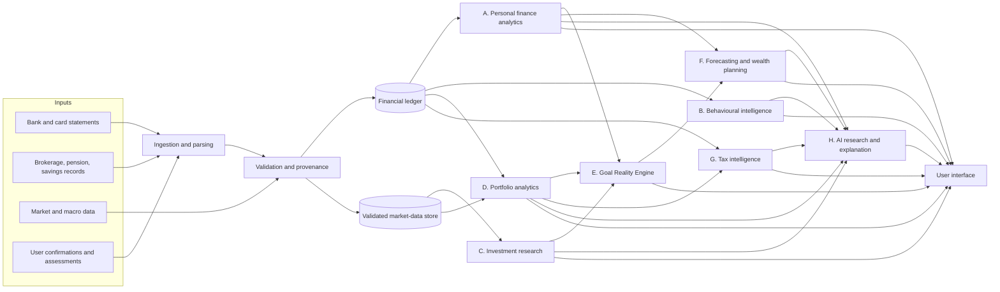

# Document 1 — Company Vision and Product Charter

```
Document: 1 — Company Vision and Product Charter
Department: Executive Leadership (CEO / Chief Product Officer), prepared by the programme coordinator
Version: 0.1 draft  ·  Date: 2026-11-02  ·  Status: for founder review and approval
Reviewers required: Founder (approval authority); all departments (consistency check); Investment Committee (Stage 3)
```

## 1. Executive summary

Portfolio OS is a financial-intelligence operating system that unifies personal finance, behavioural finance, investment
research, quantitative portfolio management, financial planning and taxation for an individual whose financial life spans
Nigeria, the UAE and international markets. Its first user is the founder. Its long-term ambition is a Nigerian
financial-technology company, if and only if the evidence gathered during personal use and commercial validation justifies it.

This charter reconstructs the complete vision from the founder's master prompt of 2026-11-02 and from the evidence in the
repository. It fixes the product's purpose, users, nine capability systems, operating principles, boundaries and success
criteria so that every department researches against the same target. It also records, honestly, what this programme does
not know: the earlier conversations the founder refers to are not accessible in this session, so prior decisions are listed
as items for the founder to confirm rather than assumed.

The biggest open question is not technical. It is whether the system can be made trustworthy enough, figure by figure, that
the founder would act on it. The charter therefore places financial accuracy and provenance above every other property.

## 2. Provenance and known gaps

| Item | Status |
|------|--------|
| Founder's master prompt (2026-11-02) | Primary source for this charter |
| Earlier Claude conversations (requirements, Nigerian equity tracker, Deal Radar, AML venture) | **Not accessible in this session.** No transcript, export or document was available |
| Repository `alhameenoki1-prog/Terminal-` | Contains NEXUS, a Bloomberg-style day-trading dashboard (React, Vite, Zustand). No Portfolio OS code. Useful as evidence of past patterns and mistakes |
| Founder's claude.ai artifacts | Ten artifacts listed; none relate to Portfolio OS |
| Founder's Google Drive | Searched for project terms; no Portfolio OS material found. Private corporate documents exist and are excluded from scope |
| Prior Nigerian equity research tracker | Not found. The founder reports it produced outdated or inaccurate market figures; that failure is treated as a design constraint |

**How gaps are handled.** Where a prior decision would change the design, this charter states an explicit assumption and
lists it in §10 for the founder to confirm or correct. No department may invent a prior decision.

## 3. Mission, vision and ambition

**Mission.** Give one person, and eventually millions of Nigerians, a financial system that knows their real position,
understands their behaviour with scientific honesty, researches investments from validated data, and explains every
conclusion in plain language without ever inventing a number.

**Vision.** A financial intelligence platform with the analytical standards of an investment institution, the evidential
standards of a research university, the reliability of financial infrastructure, the usability of the best consumer
software, and the execution discipline of a venture-backed startup.

**Ambition, staged.** Personal system for the founder → trusted by a small circle → a Nigerian fintech → other markets.
Each step is gated by evidence (see Document 2, stage gates, and Document 9, kill criteria). The full vision is preserved
throughout; only the build order is staged.

## 4. The problems we are solving

### 4.1 The founder's own problems (first user)

1. **Fragmented position.** Money sits in NGN, AED and USD accounts, savings products, brokerages and possibly pensions, with
   no single reconciled view of cash flow, net worth and exposure.
2. **Untrustworthy numbers.** Prior tooling showed stale or wrong market figures. A tool that is sometimes wrong about numbers
   is worse than no tool, because it erodes the user's own vigilance.
3. **Behaviour without evidence.** Financial habits, risk perception and investment decisions are judged by intuition or by
   superficial "personality" labels, not by measurement with stated uncertainty.
4. **Investment research without integration.** Securities on NGX, DFM/ADX and US markets are evaluated in isolation from
   the person's liabilities, currencies, taxes, liquidity and goals.
5. **Goals without reality testing.** Targets such as "grow $100,000 at a given return" are set without an honest analysis of
   feasible ranges, required risk and alternative structures.
6. **Tax exposure across two jurisdictions.** Nigerian and UAE obligations, residency rules and investment-income treatment
   are hard to track, recently reformed in Nigeria, and cannot be reconstructed from bank statements alone.
7. **Explanations that hide assumptions.** Existing tools either overwhelm with jargon or hide the assumptions that drive a
   conclusion.

### 4.2 The market's problems (future users; to be validated in Document 9)

Multi-account, multi-currency individuals in Nigeria and the diaspora; UAE residents with Nigerian financial ties;
mass-affluent savers who invest across local and foreign markets; small-business owners whose personal and business money
mixes. Whether these segments feel the problem strongly enough to pay is an open research question, not an assumption.

## 5. Intended users by phase

| Phase | User | What must be true to enter |
|-------|------|----------------------------|
| P1 Personal | The founder | Research package approved; architecture reviewed; privacy controls designed |
| P2 Friendly circle | Up to ~20 trusted users | Personal MVP reliable for 3+ months; security review passed; consent and data-protection basics in place |
| P3 Commercial pilot (Nigeria) | Early adopters in defined segments | Regulatory perimeter assessed; pricing and economics tested; licensed professionals engaged for tax/advice boundaries |
| P4 Scale | Nigerian market, then others | Evidence of retention and willingness to pay; funding; compliance programme |

## 6. The nine interconnected systems

The founder's vision is nine systems that behave as one product. The ledger is the spine; everything else reads from it or
from the validated market-data store, and the AI layer explains rather than invents.



### 6.1 Capability charter per system

| ID | System | Must do | Must not do | Governing research document |
|----|--------|---------|-------------|-----------------------------|
| A | Financial data and personal finance | Ingest statements and records; reconcile to statement balances; classify transactions with confidence states; detect income; match inter-account transfers and investment contributions; detect duplicates; multi-currency net worth, cash flow, budgets, liabilities, planning | Silently interpolate missing periods; treat transfers as spending; present unreconciled totals as final | Doc 4, Doc 6 |
| B | Behavioural finance intelligence | Measure observable behaviour from ledger, investment history, structured assessments and decision journals; report patterns with evidence level, alternative explanations and uncertainty; offer evidence-informed, testable interventions | Produce personality labels or scores without defensible basis; infer psychology from single observations; shame or manipulate | Doc 3 |
| C | Investment research | Research NGX, UAE and US securities from validated data; financial-statement analysis, valuation ranges, dividends, macro context, risks; every figure traceable to source and as-of date | Quote unverified or stale figures; generate recommendations; promise returns | Doc 5 (5a, 5c) |
| D | Portfolio management and quantitative analytics | Concentration, diversification, currency exposure, volatility, drawdowns, correlations, risk-adjusted and cash-flow-aware performance, scenario and stress analysis, optimisation alternatives with stated instability | Present optimiser output as a forecast; hide estimation error | Doc 5 (5b) |
| E | Goal Reality Engine | Test objectives against feasible ranges, required risk, available instruments, economic assumptions and alternative structures; show probability of shortfall with its own uncertainty | Promise returns; confuse optimisation with forecasting certainty | Doc 5b, Doc 4 |
| F | Forecasting and wealth planning | Link income, spending, savings, contributions, taxes, inflation, FX and goals; scenarios; explain trade-offs | Single-path projections presented as plans | Doc 4, Doc 5b, Doc 6 |
| G | Tax intelligence | Versioned, sourced Nigerian and UAE rules with effective dates; compute amounts with audit trail; prepare filing information; list what statements cannot reveal; flag items for licensed review | Assume residency or income type; file without authorisation; present itself as a licensed adviser | Doc 6 |
| H | AI research and explanation | Answer questions by retrieving validated data, running deterministic calculations as tools, and explaining in plain language with assumptions visible | Fabricate figures; restate numbers from prose; state assumptions as facts | Doc 7, Doc 8 |
| I | Future commercialisation | Architecture and data model that can scale; market, segment, regulatory, pricing and economics research | Compromise the personal product's integrity to chase scale prematurely | Doc 9, Doc 7 |

## 7. Product principles

1. **Accuracy and provenance before features.** Every figure carries source, as-of date, unit, currency and validation status.
   A figure that cannot be sourced is not shown as a fact.
2. **Evidence-graded insight.** Behavioural and investment conclusions state their evidence level and their alternative
   explanations. The system says less when the evidence is weaker.
3. **Explain, do not advise.** The product researches, calculates and explains. It does not issue personal investment advice
   or promise returns. Where regulation defines advice, the product stays on the research-and-education side until licensed.
4. **Infer before you interrogate.** Facts that can be read from uploaded records are proposed for confirmation, not asked for.
   Questions are reserved for what records cannot reveal.
5. **Sophisticated inside, simple outside.** Advanced models are available on demand; defaults are plain-language summaries.
6. **Research governs architecture.** Financial, behavioural, accounting and tax methodology is settled before engineering
   decisions constrain it.
7. **Privacy and security by design.** Highly sensitive data: minimisation, encryption, auditability, user control; designed
   in from the first line of code, not retrofitted.
8. **Personal first, commercial-ready.** Build for one user without hacks that would have to be undone for many.
9. **Preserve the whole vision; stage the build.** Nothing requested is quietly dropped. Infeasible or unsupported items are
   explained and given a sound alternative.
10. **Reproducibility.** Any calculation can be re-run from stored inputs and produce the same output.

## 8. Boundaries and non-goals

- **Separate products.** Portfolio OS is not merged with the founder's private-equity Deal Radar or the AML/financial-
  operations venture. Reusable components may be shared later by explicit decision.
- **Not a trading terminal.** The NEXUS dashboard in this repository is a different product with different purposes
  (macro and intraday trading intelligence). Portfolio OS may reuse ideas or UI components only after evaluation (Doc 7).
- **Not a broker, bank or payment service.** The product does not hold, move or custody money.
- **Not automated tax filing (initially).** It prepares and explains; filing support is added only where legal and
  technically permitted (Doc 6).
- **Not a licensed adviser.** Simulated specialists are not licensed accountants, tax agents, lawyers or regulated advisers.
- **Not a real-time market-data platform.** End-of-day and validated fundamentals first; real-time only if justified later.

## 9. Success criteria for the personal product (exit of Stage 7)

| Area | Criterion |
|------|-----------|
| Ledger integrity | 100% of uploaded statements reconcile to closing balances, or the gap is explicitly shown |
| Provenance | Zero figures displayed without source and as-of date; stale data visibly flagged |
| Transfer and duplicate handling | On a labelled synthetic-plus-real set: transfer-match precision ≥ 98%, recall ≥ 95%; duplicates ≥ 99% caught |
| Categorisation | ≥ 90% accuracy on a held-out month after three months of corrections |
| Behavioural insights | Every insight shows evidence level and at least one tested alternative explanation; no personality labels |
| Investment research | Every number in a research note links to a filing, exchange release or validated feed with a date |
| Goal engine | Outputs are ranges with stated assumptions; calibration test documented on synthetic data |
| Tax | Computations trace to versioned rules with effective dates; "cannot know from statements" list produced; reviewed by a licensed practitioner before any filing |
| Usability | Monthly review completed by the founder in under 20 minutes; diary study shows no unexplained figures |
| Security | Independent security checklist passed; no secrets in client storage; encrypted backups restored in a test |
| Reproducibility | Any displayed calculation can be regenerated from stored inputs |

## 10. Assumptions the founder must confirm or correct

| # | Assumption made for research | Why it matters |
|---|------------------------------|----------------|
| A1 | The founder has accounts in NGN, AED and USD, including at least one Nigerian bank, one UAE bank and one brokerage | Drives ledger, FX and ingestion priorities |
| A2 | Tax residency, employment vs business income, and citizenship are unknown and will be captured as inputs | Tax rules and filing obligations differ completely |
| A3 | The personal product will be self-hosted or run on infrastructure the founder controls | Security and privacy architecture |
| A4 | Base reporting currency is to be chosen by the founder (USD or NGN); the system will support switching | Net-worth and performance presentation |
| A5 | Primary device for personal use is desktop/laptop; mobile is secondary for the personal MVP | UX scope |
| A6 | A modest paid budget for market data and AI usage is acceptable for personal use | Data-source selection |
| A7 | Statements will be uploaded manually (PDF/CSV) until open-banking access is reliable | Ingestion architecture |
| A8 | The founder will keep a short decision journal for investment decisions | Behavioural measurement quality |
| A9 | Portfolio OS will be developed as a separate codebase or directory from NEXUS | Repository strategy |
| A10 | Earlier requirements not reproduced here are either captured by the master prompt or will be supplied by the founder | Completeness |

## 11. Glossary

- **Ledger:** append-only record of financial postings reconstructed from statements and records.
- **Provenance:** the source, retrieval time, as-of date, unit, currency, licence and validation status of a figure.
- **Evidence level (E1–E6):** grading scale defined in the context brief.
- **Goal Reality Engine:** the module that tests financial objectives against feasible ranges under explicit assumptions.
- **NGX / DFM / ADX:** Nigerian Exchange; Dubai Financial Market; Abu Dhabi Securities Exchange.
- **Personal MVP:** the first coherent version built for the founder's own use.

## 12. Relationship to the existing repository

The repository currently documents a generic terminal application in its README while containing the NEXUS trading
dashboard; neither describes Portfolio OS. The research package lives under `docs/portfolio-os/`. A decision on whether
Portfolio OS is built in this repository (as a new directory) or in a new repository is deferred to Stage 4 and recorded in
the decision log (D-009).
