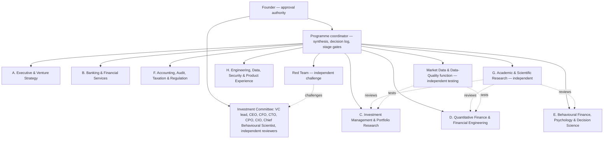

# Document 2 — Organization and Agent Deployment Plan

```
Document: 2 — Organization and Agent Deployment Plan (team-and-tooling plan)
Department: Executive Leadership / Programme coordination
Version: 0.1 draft  ·  Date: 2026-11-02  ·  Status: operational; for founder review
Reviewers required: Founder (authorisations in §11); Red team (process integrity)
```

## 1. Executive summary

This plan describes how the virtual company is actually run inside this Claude Code environment: which specialist
departments exist, how each is implemented as a separate agent with its own context, which tools, skills, plugins and
connectors are genuinely available, which require the founder's authorisation, and how cross-department review, decision
records and stage gates work.

Three facts shape everything. First, real parallel subagents are available here, so departments are separate agents briefed
from a shared context file, not one assistant role-playing. Second, every department is still a language model; "independent
review" means a separate agent with a separate context and an adversarial brief, which is valuable but is not the same as
independent human expertise. Third, no plugin or connector provides Nigerian or UAE market data, Nigerian open-banking access
or Nigerian/UAE tax engines; those will have to be built or licensed, and the plan says so rather than pretending otherwise.

## 2. Operating model

| Element | How it is implemented |
|---------|----------------------|
| Departments | Separate background agents (general-purpose type, full tool access) launched in parallel, each with a written assignment and an output file |
| Shared context | `docs/portfolio-os/00_CONTEXT_BRIEF.md` — vision, standards, evidence grading, deliverable format. Each agent reads it first |
| Deliverables | One Markdown document per department under `docs/portfolio-os/`, in a mandatory ten-section format so reviewers can cite sections |
| Cross-review | Separate reviewer agents with adversarial briefs read the drafts and write memos under `docs/portfolio-os/reviews/` |
| Synthesis | The coordinator (this session) reads summaries and documents, resolves or records disagreements, and drafts the Investment Committee memo and the executive recommendation |
| Decisions | `docs/portfolio-os/decisions/DECISION_LOG.md` using the founder's required fields |
| Tracking | In-session task list (stage gates) plus the package index `docs/portfolio-os/README.md`; everything committed to the branch `claude/upbeat-mayer-55n8yk` |
| Approval | The founder approves the charter, MVP scope, data budgets, plugin or connector authorisations, any external data connection, and anything touching real financial data. The Investment Committee recommends; departments own methodology; the coordinator synthesises |

### 2.1 Honest limits of the model

- Agents are simulated specialists. They are not licensed accountants, tax agents, lawyers, regulated advisers or
  credentialed academics. Documents mark where a licensed human must review.
- Agreement among agents is not validation. Validation comes from verified sources, reproducible calculations, tests on data,
  and, for tax and legal matters, licensed professionals.
- Agents can only read what is reachable: the public web, this repository and documents the founder places in it. The
  founder's earlier conversations are not reachable.
- Research freshness is bounded by what the web search tools return on the day. Every time-sensitive fact carries a
  "checked on" date so that it can be re-verified.

## 3. Organisation chart



## 4. Department roster, deliverables and review obligations

| Department | Roles simulated | Deliverable | Must be reviewed by |
|------------|-----------------|-------------|---------------------|
| Executive & Venture Strategy | CEO/strategy lead, CPO, CTO, CFO, VC partner/IC lead, YC-style operator | Doc 1 (charter), Doc 2 (this plan), Doc 9 (investment memo), Doc 12 (executive recommendation) | Red team; Investment Committee |
| Banking & Financial Services | Commercial banker, retail banking, private banker/wealth manager, financial planner, adviser, credit specialist, open-banking/infrastructure, payments operations | Doc 4 (ledger and personal-finance spec) | Accounting (controls); Engineering (feasibility); UX (journeys); Behavioural (what the ledger must capture) |
| Investment Management & Portfolio Research | CIO, institutional PM, equity analyst, fixed-income analyst, strategist, asset allocation, risk manager, financial-statement analyst, economist, macro analyst, EM specialist | Doc 5a (research methodology) | Quant (calculations); Data-quality (inputs); Academic (evidence); Tax (after-tax view) |
| Quantitative Finance & Financial Engineering | Quant researcher, financial mathematician, statistician, econometrician, quant risk analyst, optimisation specialist, financial data scientist, financial engineer | Doc 5b (model selection) | Academic (assumptions); Investment research (usefulness); Engineering (implementability); UX (explainability) |
| Market Data & Data Quality | Financial data engineer, licensing specialist, research operations, independent data-quality tester | Doc 5c (sourcing and validation) | Investment research; Quant; Engineering; Accounting/audit |
| Behavioural Finance, Psychology & Decision Science | Chief behavioural scientist, behavioural-finance researcher, academic/cognitive psychologist, decision scientist, behavioural economist, consumer financial psychology, measurement psychologist, experimental designer | Doc 3 (scientific behavioural framework) | Academic (construct validity, evidence); Quant/statistics (inference limits); Financial planning (usefulness); UX (presentation); Privacy/compliance (sensitive data); Executive (value vs complexity) |
| Accounting, Audit, Taxation & Regulation | Chartered/financial/management/forensic accountant, internal and external audit, tax accountant, Nigerian tax, UAE tax, international tax, tax-administration perspective, regulatory compliance, data-privacy legal research | Doc 6 (accounting, audit and tax framework) | Banking (ledger fit); Engineering (rule engine); Venture (regulatory perimeter); licensed professionals before reliance |
| Academic & Scientific Research (independent) | Finance, economics, behavioural economics, psychology, statistics/econometrics reviewers; research methodology; fintech researcher; evidence-review specialist | Evidence-review memos on Docs 3, 5a, 5b (inputs to Doc 11) | Red team (process) |
| Engineering, Data, Security & Product Experience | Principal architect, backend, frontend, data engineer, ML engineer, AI systems engineer, DB architect, cybersecurity, privacy engineer, QA, UX researcher, UI designer, accessibility, product analytics | Doc 7 (technology and open source), Doc 8 (UX blueprint), Doc 10 (roadmap, with coordinator) | All methodology owners (architecture must fit methodology); Red team (security) |
| Red Team (independent) | Scientific sceptic, security reviewer, financial-model reviewer, regulatory reviewer, UX critic, engineering-complexity critic | Doc 11 | Investment Committee |

## 5. Tooling inventory — inspected on 2026-11-02

### 5.1 Available in this environment and used

| Tool or capability | Purpose in this programme | Notes |
|--------------------|---------------------------|-------|
| Agent subagents (general-purpose, Explore, Plan, web-fetch) | Separate specialist departments and reviewers with their own context | Nine research agents launched in parallel for Stage 1; reviewers in Stage 1b/3 |
| Workflow tool (deterministic multi-agent pipelines) | Candidate for repeatable review pipelines (research → verify) | Available; not used for Stage 1 because reviewer briefs are tailored to each draft. Default guidance keeps a workflow under ten agents |
| WebSearch / WebFetch | Current sources: regulators, exchanges, vendors, papers, repositories | US-based search; agents record URL and access date |
| Reference-lookup tools (Research Desk plugin; OpenAlex and arXiv) | Verify every academic citation; find papers; citation neighbours | Verification status is recorded as [verified]/[unverified]. Tested 2026-11-02: the hosted server variant verified a known paper by DOI in seconds; the local variant timed out at 60 s twice. OpenAlex and arXiv APIs are also directly reachable as a fallback |
| Research Desk skills: citation-check, paper-critique, llm-council, decision-matrix, paper-compare | Academic review, red-team critique, structured decisions | Used in Stage 1b and Stage 3 |
| Product-management skills: write-spec, competitive-brief, brainstorm, roadmap-update, synthesize-research | Specs, competitive analysis, roadmap | Stage 2–4 |
| Design skills: user-research, design-critique, accessibility-review, design-handoff, ux-copy | UX blueprint review and later handoff | Stage 2–3 |
| Engineering skills: architecture (ADR), system-design, testing-strategy, security-review, code-review, tech-debt | Architecture decisions and reviews; code review once implementation begins | Stage 2–6 |
| Finance skills: reconciliation, financial-statements, variance-analysis, audit-support, journal-entry | Accounting-control design and later testing of the ledger | Stage 1–6 |
| dataviz, artifact-design, docs, xlsx, pptx, pdf | Visualisations, board-package presentation, spreadsheets, document export | As needed |
| claude-api skill | Current model IDs, tool use, structured outputs, pricing for the AI layer | Stage 2 and 5 |
| Python 3.13 (numpy, pandas), Node 22, Playwright/Chromium | Worked examples, synthetic data, calculations, later prototypes | scipy/statsmodels not installed; installable when needed |
| Task tracking (in-session) and Git (branch `claude/upbeat-mayer-55n8yk`) | Stage-gate tracking; versioned deliverables | GitHub operations scoped to this repository |

### 5.2 Connected connectors

| Connector | Status | Use in this programme |
|-----------|--------|-----------------------|
| GitHub (scoped to `alhameenoki1-prog/Terminal-`) | Connected | Versioning the package; issues/PRs if the founder wants durable tracking there |
| Google Drive | Connected | One-time search for project files; none found. Private corporate documents present are excluded from research scope |
| Gmail | Connected | Not used; out of scope unless the founder points to specific project material |
| Google Calendar, Amplitude | Not connected | Not needed in the research phase |

### 5.3 Available but requiring the founder's authorisation (not enabled; nothing was installed)

| Plugin or connector | What it offers | Relevance | Recommendation |
|---------------------|----------------|-----------|----------------|
| Distilla Investment Research (Anthropic Directory, community tier) | Public-company statements, consensus estimates, earnings calendars, transcripts, prices, multiples; screening | US and major-market equity research in Stage 5+; NGX/DFM/ADX coverage not established | Consider enabling later for US research; verify coverage and terms first |
| Financial Datasets (MCP connector) | Balance sheets, cash-flow statements, filings, earnings, ownership for US companies | US fundamentals as a second source for validation | Consider later; US only |
| Spreadsheet (DWS Build) | Local Excel/CSV read and edit | Statement and export analysis | Optional; built-in xlsx skill already covers most needs |
| GDPRGard Compliance Skills | DPIA, records of processing, privacy-policy review | Privacy engineering templates (GDPR-centric; adaptable to NDPA and UAE PDPL analysis) | Optional in Stage 2–3 |
| Ansvar Compliance Skills | EU security and compliance threat modelling | EU-centric; partial relevance to threat modelling | Not needed now |
| Plaid Developer Tools | Debugging an existing Plaid integration | Not relevant: Plaid does not serve Nigeria or the UAE | Do not enable |
| Intuit TurboTax, TaxAct, Aiwyn Tax | US tax estimation | Not relevant to Nigerian or UAE tax | Do not enable |
| Notion, Linear, Asana, Jira, Slack, Figma, Monday, ClickUp | Project management and design tooling (need OAuth) | Optional durable tracking and design files | Only if the founder prefers them over the repository |

### 5.4 Not available anywhere in the ecosystem inspected

- Nigerian or UAE market-data connectors (NGX, DFM, ADX, FMDQ): must be licensed or built (Doc 5c).
- Nigerian open-banking or aggregator connectors (Mono, Stitch, OnePipe): custom integration later (Doc 4).
- Nigerian or UAE tax-rule engines: must be built as versioned rules with professional review (Doc 6).
- Access to the founder's earlier conversations.

## 6. Cross-functional review workflow

Every important capability follows the founder's chain. Example for a behavioural feature derived from transaction history:

1. Behavioural department proposes construct, metric, method and permitted statements (Doc 3).
2. Academic reviewer tests construct validity, evidence strength and alternative explanations.
3. Quant/statistics reviewer tests whether the measurement supports inference for one person over time.
4. Financial-planning reviewer tests whether the insight would change a real decision for the better.
5. UX reviewer tests whether it can be communicated without misleading or overwhelming.
6. Privacy and compliance reviewer tests sensitive-data handling and consumer-protection implications.
7. Venture/executive reviewer tests value against complexity.
8. CTO and CPO decide how it enters the architecture and roadmap, and the decision is logged.

Reviews are written by agents other than the author, with explicit instructions to find weaknesses, and are filed under
`docs/portfolio-os/reviews/`. Disagreements are preserved in the decision log, not averaged away.

## 7. Decision record standard

Every decision uses the founder's required fields: proposal; supporting research; departments consulted; major objections;
alternatives considered; final recommendation; outstanding uncertainties; required validation before implementation. Status
values: Proposed, Recommended, Approved by founder, Rejected, Superseded. The log is `docs/portfolio-os/decisions/DECISION_LOG.md`.

## 8. Stage gates

| Stage | Entry condition | Exit criteria | Review |
|-------|-----------------|---------------|--------|
| 0 Context and team formation | Master prompt received | Context brief, charter, org plan written; agents launched; task list live | Founder reads Docs 1–2 |
| 1 Scientific, financial and market research | Stage 0 exit | Docs 3, 4, 5a–c, 6, 7, 8, 9 drafted in the mandatory format with sources | Coordinator checks format, sourcing and verification tags |
| 1b Academic evidence review | Drafts of 3, 5a, 5b | Evidence-review memos filed; claims re-graded where needed | Independent academic agent |
| 2 Product and architecture design | Stage 1 exit | Consolidated Doc 5; architecture and data-model decisions as ADRs; journeys and screens specified | Methodology owners confirm architecture fits |
| 3 Independent review and Investment Committee | Stage 2 exit | Red-team Doc 11; IC memo with bear case; decision log updated; disagreements recorded | Red team and IC |
| 4 MVP definition | Stage 3 exit | Doc 10 roadmap; personal MVP scope approved by the founder; founder-approval list resolved | Founder |
| 5 Engineering implementation | Founder approval of Stage 4 | Modules built to acceptance criteria with tests; security review scheduled | Code review; QA |
| 6 Testing and validation | Stage 5 modules | Accuracy, model, behavioural-inference, UX, security and completeness tests passed | Independent QA and security review |
| 7 Personal deployment and iteration | Stage 6 exit | Founder uses the system; Doc 1 §9 success criteria measured | Founder diary and metrics |
| 8 Commercial validation | Stage 7 success | Segment, pricing, regulatory and economics evidence; go/no-go | Investment Committee |

## 9. Integrity rules

1. No claim of agent activity, tool access, document review or research unless it happened; this plan records only what was
   inspected.
2. Every important factual claim in a deliverable carries an evidence grade and a source with access date; academic sources
   carry a verification tag.
3. Time-sensitive facts carry effective dates and "checked on" dates.
4. Simulated specialists are labelled as such; items needing licensed review are listed explicitly.
5. Disagreements are preserved; uncertainty is not hidden to make a document look decisive.
6. No plugin is installed, account connected or permission expanded without the founder's explicit authorisation.
7. Private Drive and email content is excluded from research inputs.

## 10. Resources and what the founder must supply

- **This session:** compute and token budget sufficient for the Stage 1 research fan-out, Stage 1b/3 reviews and synthesis.
- **From the founder, when convenient:** any exports of earlier conversations or documents (requirements, the previous
  Nigerian equity tracker, lessons learned); confirmation of the assumptions in Doc 1 §10; preferences on repository strategy,
  base currency, hosting, data budget; and, before Stage 5, a decision on the plugins in §5.3.
- **Before reliance on tax or legal outputs:** a licensed Nigerian tax practitioner, a UAE tax agent, and, before any
  commercial offering, a Nigerian securities lawyer and a data-protection adviser.

## 11. Authorisations and decisions requested from the founder

| # | Request | Why |
|---|---------|-----|
| R1 | Confirm or correct the assumptions in Doc 1 §10 | They shape every department's recommendations |
| R2 | Confirm that the research package lives in this repository under `docs/portfolio-os/` on the designated branch | Versioning and visibility |
| R3 | Decide whether Portfolio OS code (Stage 5) lives in a new directory of this repository or a new repository | Clean separation from NEXUS |
| R4 | Approve a modest paid data and AI budget range for the personal MVP, to be sized in Doc 5c and Doc 10 | Data-source selection |
| R5 | Decide whether to enable Distilla and/or Financial Datasets for US research later (no action now) | Second-source validation for US securities |
| R6 | Provide any prior-conversation exports or documents you want incorporated | Closes the provenance gap |
| R7 | Confirm that Drive and Gmail remain out of research scope unless you point to specific files | Privacy |
