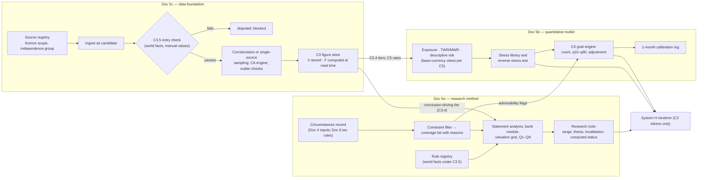

```
Document: 5 — Institutional Investment Research and Quantitative Finance Blueprint
Department: Investment Management, Quantitative Finance and Data Quality  ·  Lead role(s): Chief Investment Officer; head of quantitative research; head of data quality (all simulated; none licensed)
Version: 0.2  ·  Date: 2026-11-04  ·  Status: consolidated from 05a/05b/05c v0.2
Reviewers required: Investment Committee (the founder); Legal & Compliance; Tax (Doc 6); Personal-Finance Ledger (Doc 4); Behavioural Finance (Doc 3); Technology / AI (Doc 7); Product & UX (Doc 8); Finance (Doc 9); Programme coordinator
```

> **How to read this document.** It integrates three revised reports and adds no new research and no new figures. Every number is quoted from them or from their scripts. "5a §4.9" points into `research/05a_…`, `05b_…` or `05c_…` (all v0.2, 2026-11-04). "5c-S3" means source S3 in Doc 5c's list, because the three lists number independently. Where a report and `CANONICAL_CONTRACTS.md` differ, the contract governs. All examples are synthetic.

## 1. Executive summary

**Biggest uncertainty.** Can Portfolio OS license Nigerian Exchange (NGX) data for *processing*, at a known cost, as one natural person? NGX prices any use beyond display as "Non-Display Usage", and the founder's unconfirmed residency sets the fee basis. The NGX core feed therefore costs between USD 26 and about USD 1,417 a month (5c §4.6). Only NGX, in writing, can settle it. NGX-based conclusions also need about 23 minutes a week of the founder's review; without it they are refused (5c §4.3.10).

**Conclusions.**
1. **One pipeline order.** A figure enters only after an entry-time primary-source check (C3.5), has its status computed when read (C3), and reaches prose only as a token (C2). This blocks errors like the repository's 27.50% policy rate, which was wrong when committed (5c §4.4).
2. **Research is disciplined, not broad.** Valuations are mechanical ranges and theses carry invalidation conditions. The system issues no ratings, targets or return forecasts (5a §4.10).
3. **For one person, the quantitative problem is measurement under bad data.** Exposure, performance, risk and stress come first. No optimiser is in Phase 1 (5b §4.10).
4. **Goals use the C6 engine**: a count such as "about 40 of 100". It cannot be calibrated at the goal horizon for one user within the MVP (5b F26).
5. **Circumstances decide what is researched.** In 5a's synthetic household the goal is infeasible on current income, so no security research is triggered.

**Inconsistencies (§9, I1–I12).** The most material: 5a's freshness code uses 5c's withdrawn v0.1 thresholds, and 5a labels NGX prices "two independent", which 5c shows is impossible. Neither changes a published conclusion. Both were fixed in the 2026-11-04 consistency pass, with I3–I11; I12 stays open (status in §9.2).

**Top recommendations (§10):** the status-and-rendering layer; the circumstances filter with C6; the measurement-first quant layer; the written NGX licence request.

## 2. How the three reports fit together

The three reports form one pipeline. Doc 5c owns what may enter and how its status is computed. Doc 5a owns how a validated figure becomes a research view and which instruments a person's circumstances admit. Doc 5b owns risk measurement, performance and the goal engine. Contracts C2, C3, C5 and C6 are the interfaces between them.



| Stage | What happens | Owning report | Interface contract |
|---|---|---|---|
| 1. Source and licence | Each source is registered with licence scope, `terms_version` and an independence group | 5c §4.1, §4.3.1 | C3 R axis |
| 2. Entry | World facts and manual values stay `candidate` until they match a primary snapshot | 5c §4.3.6; C3.5 | C3.5 |
| 3. Validation and freshness | Corroboration or the single-source protocol; corporate-action engine; freshness computed at read time | 5c §4.3.2–4.3.5 | C3.2–C3.4 |
| 4. Circumstances filter | Goals, currencies, liabilities, tax and liquidity give a coverage list, not an allocation | 5a §4.9 | Doc 6 C7 rules; ternary admissibility (I7, §9) |
| 5. Research view | Statement analysis, bank module, valuation range, invalidation conditions, Q1–Q9 | 5a §4.1–4.4, §4.10 | C3.4 conclusion tier |
| 6. Risk view | Exposure, TWR/MWR, descriptive risk with intervals, stress and reverse stress | 5b §4.3–4.5 | C5.3; C3.4 |
| 7. Goal range | C6 engine and the deterministic `required_return` | 5b §4.7; 5a §4.9 Step 2 | C6 |
| 8. Rendering | The language model writes connecting text; values reach the screen only as tokens | 5c §4.3.12; 5a §4.10 | C2 |

## 3. The investment research method in brief (5a)

**What the system does.** It encodes institutional research as gated stages: circumstances filter → idea → data validation → statement analysis → valuation → thesis and invalidation → review → publication → monitoring (5a §4.1). A security cannot advance until its gate passes and is logged. All three markets report under the International Financial Reporting Standards (IFRS), so one statement model serves NGX, DFM/ADX and US filers (5a F1; E2). Derived values are stored with their formula and inputs.

**What it adds that generic tools lack.**
- *A market- and prudential-rule registry.* NGX changed hours and settlement in 2026 (5a F2–F4; E2/E3), and the CBN Appendix 2 payout matrix caps bank distributions (5a F12; E2, 5a-S52). Rows are C3 world facts; tax rows point to Doc 6 rule records.
- *A bank module.* Stage 3 (IFRS 9) and the prudential NPL ratio are stored separately and never compared. Capital floors include buffers. The dividend cap is shown for every value of the unpublished Composite Risk Rating (5a §4.3).
- *Two cost-of-equity routes on two country-risk bases.* The basis moves k by 3.3–3.4 points on the USD route; the grid is derived mechanically (5a §4.4; 5a-S27).
- *Quant-check tests Q1–Q9* (period alignment, share counts, tax-effected normalisation, sustainable growth and payout, grid equals routes, currency and inflation, units, computed status). Each blocks publication on failure.

**What it refuses to do (5a §4.10; 5a R11).**
- Buy/sell/hold ratings, target prices or expected-return point estimates.
- Macro-timing tilts. Macro may set constraints and stress scenarios only (5a F21–F22; E1 on weak predictability).
- Tax positions, leverage, orders, or any conclusion from inputs that are not conclusion-eligible.
- Any digit written by a language model.

Quality screens (accruals, F-score, M-score, Altman Z'') enter only as descriptive flags. Their US evidence is historical and weaker after publication. No credible return test exists on NGX, DFM or ADX (5a F19–F20; E1 historical, E2/E3 persistence, E4 locally).

**Permitted language (5a §4.10).**

| Permitted | Not permitted |
|---|---|
| "research view", "range", "scenario", "the price implies … under assumptions …", "we could not establish", "as of ‹date› per ‹source›" | "will", "guaranteed", "expected return of X%"; "buy", "sell", "hold"; "on track" without the assumption in the same sentence; any figure without an as-of date; any phrasing that ranks price against value as a call ("overvalued", "undervalued", "cheap", "expensive", "attractive", "upside/downside to fair value") |

Every note, view and constraint result carries `advice_sensitive: true`. Personal research for the founder's own use falls outside the SEC Nigeria and UAE Capital Market Authority (CMA) perimeters per Doc 6. Offered to another person, the same output would be regulated advice. Legal must approve the wording before any such use (5a §4.10; E4, not legal advice).

## 4. The data foundation (5c)

### 4.1 What can be obtained, by market

| Market | System of record (MVP) | Comparators | Gaps and caveats | Grade |
|---|---|---|---|---|
| **NGX** | NGX Market Data API v3: end-of-day (EOD) prices and Interday history (≤ 10 years); dividends, corporate actions and indices priced separately (5c N1) | CSCS, Kobo, Mansa, EODHD: copies of NGX or undisclosed, so `same_upstream` at best (5c F27) | Natural-person eligibility unconfirmed; no adjusted prices; documentation errors; `two_independent` unreachable | E2 |
| **DFM** | **None licensed.** Holdings valued from custodian or broker statements, badge "valued from statement of ‹date›" (5c U9) | — | Website 15-minute delayed, display-only; developer portal "Filenotfound". Explicit MVP gap | E2 for what was seen |
| **ADX** | ADX MCP server: Starter free (100 calls a month, current or last-day history) or AED 9.99–49.99 a month; deterministic client only, never the answering model (5c U4) | Statement prices (`same_upstream`) | Terms unread (403); about three calls a day; no history | E3 (press) |
| **US** | Tiingo (free, or USD 30/month); SEC EDGAR XBRL APIs, free, ≤ 10 requests a second (5c I1, I8) | EODHD (USD 19.99/month), `same_upstream` | "Personal use only" clauses; keep restatement vintages | E2 |
| **FX** | CBN Nigerian Foreign Exchange Market (NFEM) rate, Excel export kept as primary snapshot (C5.1) | FMDQ closing (≤ 0.5%) and Frankfurter, both `same_upstream` | Parallel rate: indicative only, confidence D, never valuation or tax. AED/USD peg 3.6725 is a world fact, `candidate` until a CBUAE snapshot | E2 / E4 (peg) |
| **Macro** | CBN decisions page (policy rate 23.00% from 2026-09-22, 5c-S107); NBS CPI (2024 = 100); FRED/ALFRED; World Bank; IMF | Press relays only | NBS revisions; January 2026 methodology change unverified; Damodaran country risk is single-source, semi-annual | E2 |

### 4.2 Costs, on local and international bases

NGX charges naira to end users within Nigeria and USD outside (licence cl. 10.7, 5c-S6); residency is unconfirmed, so both bases are shown. USD a month, from `doc05c_revision_checks.py` part B at an illustrative 1,345.01 NGN/USD, ex-VAT (7.5%) unless stated.

| NGX core (EOD + Interday, one securities set) | Without non-display | With non-display ("Delayed Data for Financial modelling") |
|---|---|---|
| Local basis | **26.33** (28.31 incl. VAT) | **103.78** (111.56 incl. VAT) |
| International basis | **166.67** (179.17 if VAT applies) | **791.67** (851.04 if VAT applies) |

**The non-display fee is the swing factor.** Valuation, risk and AI tools process data, and NGX's licence prices any processing beyond display separately (5c F3; E2).

| Sensitivity, with non-display | Local | International |
|---|---|---|
| General "Non-Trading Related activities" non-display line instead of the modelling line | 181.23 | 1,416.67 |
| Plus the API bandwidth Entry band, if NGX applies it | 116.17 | 875.00 |
| Interday priced per security, five sets | 178.13 | 1,125.00 |

**MVP totals (5c §4.6):** floor 26.33 (local, no non-display, free secondaries); 103.78 if personal analytics is non-display; 1,146.93 international with non-display, optional NGX feeds and paid US/ADX; ceiling 1,989.64.

**Other costs.** FMDQ bond closes by API (Later): NGN 860,000 a year including VAT, about USD 639.40. Commercial display (Later): a licence floor of NGN 6.4–8.5 million a year, about USD 4,780–6,327, before legal review (script part C; E5). Bloomberg or LSEG: about USD 22k–32k per user per year (aggregator estimates, unverified).

### 4.3 The entry-time primary-source check

No world fact (policy rate, tax parameter, peg, threshold, calendar date) and no manually entered value may leave `candidate` until all four conditions of C3.5 hold:
1. an evidence snapshot exists from an official source;
2. the entered value equals the snapshot;
3. `as_of` is not earlier than the latest decision in the primary record;
4. `expiry_at` is derived from a separately sourced calendar record, never typed.

Every seeded value is re-verified this way before go-live.

**Why this check comes first.** The repository's `cbRate: 27.50` was committed on 2026-03-02, when 26.50% was in force: 100 basis points wrong at entry, and last true 160 days earlier. Its typed "next meeting" was not a scheduled date. An expiry-only control would have certified it fresh until 2026-04-01. The entry check blocks it, and the calendar derives `expiry_at` = 2026-05-27. The same-day Fed rate (4.25% against 3.50%) is blocked the same way (`doc05c_revision_checks.py` part A; E2). 5a and 5c now agree that the value was **wrong when committed**, not merely stale later.

### 4.4 Status vocabulary (C3)

| Axis | Stored or computed | Values |
|---|---|---|
| V validation | Stored; append-only log | `candidate`, `auto_validated`, `validated`, `disputed`, `rejected` |
| F freshness | **Computed at read time** from 5c §4.3.2 thresholds | `fresh`, `ageing`, `stale`, `expired` (`republished` counts at least as `ageing`) |
| L lifecycle | Stored | `current`, `restated`, `superseded`, `withdrawn` |
| R rights | Computed from the licence registry | `licence_active`, `licence_expired`, `licence_revoked` |
| I identity | Stored | `resolved`, `vendor_renamed`, `unresolved` |
| C corroboration | Attribute | `two_independent`, `same_upstream`, `single_source` |
| M method | Attribute | `observed`, `derived`, `estimated`, `manual_override` |

**Calculation tiers (C3.4).** A *descriptive* calculation (a net-worth total) may use non-expired `validated` or `auto_validated` figures and inherits the worst badge. A *conclusion-driving* calculation (valuation, risk limits, goal engine, tax, AI conclusions) also needs freshness `fresh` or `ageing`, a licence scope that permits processing, and either `validated` or `auto_validated` with `two_independent` corroboration or a passing single-source sampling rule. A derived figure takes the minimum V and worst F of its inputs. A `disputed` figure shows both values, never a range. A screen that cannot show the badge cannot show the number.

**Single-source protocol (C3.3).** NGX prices, CPI, the policy rate, FMDQ fixings, filed share counts and all DFM/ADX data have one effective source. They feed conclusions only while internal-consistency checks and plausibility bands pass and a 1-in-20 human sample (plus every band break) finds no error.

## 5. The quantitative toolkit (5b)

### 5.1 Phase lists

5b applies its phase rule mechanically (5b §4.10; scores E4; totals recomputed by `doc05b_revision_checks.py` [1]):
- a module that outputs a sizing, leverage, order or "edge" instruction is never built, whatever its score;
- Phase 1 needs a score S5 ≥ 3.25, no portfolio-weight output and no *estimated* expected return;
- Phase 2 needs S5 ≥ 2.50 and a data-requirements score ≥ 2, and any weight output sits behind a stability gate.

| Class | Module (S5) | One-line reason |
|---|---|---|
| **Phase 1** | Exposure decomposition by asset, issuer, sector, country and currency (5.00) | Pure measurement; no estimation risk |
| Phase 1 | TWR and MWR ledger with currency decomposition (4.59) | Replaces the prototype's wrong "Sharpe" and drawdown; 12 golden cases |
| Phase 1 | Descriptive risk with intervals (4.35) | USD and NGN views; break days kept in tail figures |
| Phase 1 | Historical, hypothetical and reverse stress (4.24) | Regime events dominate naira risk; reverse stress labelled as optimisation |
| Phase 1 | 1-month calibration logging (3.94) | The only calibration feasible for one user |
| Phase 1 (internal) | Ledoit–Wolf covariance, EWMA cross-check, break rule (3.76) | A risk input, not a licence to optimise |
| Phase 1 | Goal engine per C6 (3.53) | No weights; no estimated return |
| Phase 1 | Sharpe/Sortino/Calmar rules with Lo standard error (3.41) | Says "not distinguishable from zero" honestly |
| **Later** | Risk-budgeting weights (3.82); constrained minimum-variance (2.71); Black–Litterman (2.65) | Gated: half-history weights within 10 points and bootstrap weight SD below 10 points. The synthetic data fail (SD 25–30 points) |
| Later | Estimated Student-t GARCH (2.65); Brinson at asset-class × currency level; Karnosky–Singer split | Need ≥ 1,000 clean days, licensed benchmarks or C3-eligible short rates |
| Later (5a) | Quality screens after local backtests; valuation engine; fixed income; funds | Not yet validated locally, or data not yet licensed |
| **Not yet** | CVaR optimisation (2.65, data score 1); HRP (2.47); regime switching (2.12); resampled or robust mean–variance (1.88); unconstrained mean–variance (1.53); DCC-GARCH (1.35) | Expected returns and tails cannot be estimated from short, broken histories (5b F1, F4, F7, F9; E1/E2) |
| **Never** | Kelly sizing (1.71); edge scores; sizing advice; auto-rebalancing; orders; leverage or margin; a single "probability of success" gauge; ratings, target prices, point return forecasts, model-written figures (5a) | Wrong objective. Banned because of what they are, not because of their score |

The NEXUS prototypes (`MonteCarloPanel.tsx`, `PerformancePanel.tsx`) have 27 numbered defects, many rated H (a wrong number shown to a user). They are retired and rebuilt from tests upward (5b §4.8, Rec 9; E5 plus replication by `prototype_checks.py`).

### 5.2 The goal engine per C6

**Method (C6; 5b §4.7 G-1 to G-12).**
- A stationary bootstrap resamples joint date-vectors (all assets and FX from one date). Columns are **demeaned**: history supplies shape (volatility, tails, dependence), never drift.
- Drift comes from a named assumption set: a registered, C3-eligible, licence-permitted capital-market-assumption (CMA) record; the neutral "zero real return" case; or a user value. Drift uncertainty is integrated.
- Break days are removed and overlaid as compensated jumps at an editable rate: they add tail, not mean.
- At least 10,000 paths, with seed and versions recorded.

**Outputs.** `required_return`, `success_count` with Monte Carlo SE, quantiles q05–q95 (nominal and real), `adjustment` (lump sum, monthly contribution or delay needed for the q10 future to reach the goal), `drift_sensitivity` at −2/0/+2 points, `width_reason`, `assumption_set`, `history_base_rate` over non-overlapping windows, `calibration_status` and `refusal`.

**Refusal.** The engine refuses when an input is not conclusion-eligible, when an asset with more than 10% weight has less than 36 months of history, or when H/T > 4 without a CMA overlay.

**Display.**
- *Allowed:* the count rounded to the nearest 5, always with the q10–q90 range and the adjustment; a 20-dot plot; the drift sensitivity.
- *Forbidden:* a bare probability; the median alone; a difference between options smaller than 2 SE plus 5 points; a second-order band as the headline.

5a's deterministic required-saving table is the C6 `required_return` field. It is arithmetic, not a forecast (5a §4.8, §4.9).

### 5.3 What calibration can and cannot show for one user

- **Can:** test whether the engine's **1-month-ahead** predictive bands are grossly miscalibrated. Outcomes at that horizon do not overlap, so PIT histograms, the Berkowitz test and exact Clopper–Pearson coverage intervals apply (5b §4.7; E1 for the methods).
- **Power is low.** With 24 monthly outcomes, a nominal 90% band that truly covers 80% is detected 19% (equal-tailed test) to 34% (minimum-likelihood test) of the time. 80% power needs 83 outcomes (6.9 years) for one series, or 21 months if four *independent* series could be pooled. Pooled series share the FX factor, so real pooling gains less (`doc05b_revision_checks.py` [2]). Status stays `uncalibrated` until at least 60 non-overlapping pooled outcomes exist (E5).
- **Cannot:** establish calibration at the goal horizon (five years) for one user within the MVP. It also cannot validate the CMA drift, which is a labelled judgement (5b F19, F26). The product says this through `calibration_status`.

## 6. Individual circumstances as inputs

Circumstances are captured **before** research begins, as a typed record with source, confirmation and expiry for each field. An unconfirmed or expired field is `candidate` and cannot drive a conclusion (5a §4.9). The filter's output is a research-coverage list with a reason for each exclusion or flag. It is not an allocation. Every rule evaluates a parameter the user sets; **no house defaults are shipped**, because unsourced thresholds applied to another person would be allocation advice (5a R4; E5).

| Circumstance | Effect on the admissible universe | Source of the rule |
|---|---|---|
| **Goals** (currency, amount, date, priority) | Define buckets (safety, rent reserve, goal, aspirational). A user-set minimum horizon per asset class can exclude equities from short buckets (rule 4). An unfunded aspirational bucket triggers no security research | 5a §4.9 rules 1 and 4; Example 3 |
| **Currencies and liabilities** | *Inside* the user's near-liability window, only same-currency assets count. NGN assets do not count towards AED or USD liabilities, because NFEM convertibility is a risk (rule 1a: **exclusion**). *Beyond* the window, a mismatch is a named risk with its FX sensitivity (rule 1b: **flag**) | 5a §4.9; C5.1 rates |
| **Tax (Doc 6)** | Tax rows are Doc 6 rule records with C7 status, for example `NG-DIV-WHT-FINAL-2026`, `NG-INT-SHORTTERM-FINAL-2026`, `NG-BOND-EXEMPT-2026` and `NG-CGT-SHARES-NGCO-2026`. US-domiciled ETFs bear 30% US withholding on dividends, and US-situs holdings above USD 60,000 fire the estate-tax monitor. While residency is unknown, the filter runs in **provisional mode** under each residency scenario, with the weakest C7 watermark. Provisional outputs never feed a conclusion-driving calculation | 5a §4.5, §4.9; Doc 6 F12–F13, F30–F31 (as cited by 5a) |
| **Liquidity** | The position must be within the user-set share of 60-day average daily value traded, and the issuer must meet the exchange free-float rule. NGX names unchanged for 20 sessions are flagged "price stale by rule". 5b adds zero-return-day fraction, the Amihud ratio and days-to-liquidate | 5a §4.9 rule 2; 5b §4.3 |
| **Concentration and human capital** | User-set caps per issuer, sector and country. Employer-sector exposure counts only through a sector link the user has confirmed; it is never inferred from transactions | 5a §4.9 rule 3; Doc 3 |
| **Data quality** | An instrument is inadmissible for valuation unless every mandatory input is conclusion-eligible (C3.4). With the MVP data stack (§4.1), DFM equities and, in practice, ADX equities have no licensed price history, so 5b's floors and C6's 36-month rule suppress or refuse their risk and goal figures (I6, §9) | 5a §4.9 rule 5; 5c §4.6; C6 |
| **Access and Shari'a preference** | Instruments the user cannot legally buy are excluded. A stated Shari'a preference is a hard filter using the DFM list | 5a §4.9 rules 6–7 |
| **Loss tolerance per goal** | Stored as a user-stated constraint, not as a psychometric score. Whether a validated per-goal instrument is needed is Doc 3's decision | 5a §4.9 |

The goal engine **displays** admissibility flags and never applies them silently. An inadmissible asset in a goal portfolio is shown with its flag, not refused (5b §4.7 G-11).

## 7. Validation and testing

### 7.1 Golden datasets and fixtures

| Asset | Content | Owner | Where it runs |
|---|---|---|---|
| Market-data golden set | About 20 securities × 5 years (NGX, ADX, US) plus official FX and CPI, every event confirmed against primary documents. Traps include a late-credited bonus, a rights issue with supplementary allotment, a scrip dividend, a par-value change, a kobo dividend, a holding-company succession, the June 2023 unification, settlement-cycle changes, a NAFEM republication and **a world fact wrong at entry** (5c §4.3.7) | Data quality (audit function) | Private licensed storage (only pass/fail and hashes leave it); public CI uses synthetic fixtures |
| Performance golden ledger | 12 cases (G1–G12): time-weighted and money-weighted returns, Modified Dietz, IRR root handling, annualisation, fees, dividends inside and outside scope, currency decomposition (5b §4.5) | Quant | Public CI |
| Frozen synthetic generator | 5b §4.9 data-generating process; output SHA-256 `8c0725b9…3b6ba4` with numpy 2.5.3 and pandas 3.0.5 | Quant | Public CI, hash compared |
| Research regression cases | Q1–Q9 run on 5a's v0.1 and v0.2 Example 1 inputs; v0.1 must fail Q1, Q3, Q4(b), Q4(c) and Q6 (5a §9 item 13) | Research | Public CI |
| Figure-integrity suite | C2 adversarial tests T2-01 to T2-12, run on every prompt, tool or model change; reported as an upper bound (0 failures in 200 cases ≈ 1.5% at 95%) | AI (Doc 7) | Public CI |

### 7.2 Tolerances

| Comparison | Tolerance | Grade |
|---|---|---|
| Deterministic quant outputs (TWR, Ledoit–Wolf, minimum variance, block length), Python reference against production | 1e−9; MWR 1e−10; multicurrency identity 1e−12; Ledoit–Wolf against scikit-learn 1e−8 | E5 |
| Random outputs (quantiles, counts) across Python and TypeScript generators | Within 3 Monte Carlo SE (distribution-level, not bit-exact) | E5 |
| NGX close against comparators | Exact after unit normalisation for the same price type; any difference is a copy or timing error | E5, to be reset from the two-week NGX trial |
| NGX volume; CBN against FMDQ USD/NGN; EPS recomputed against filed EPS | ≤ 2%; ≤ 0.5%; ≤ 2% | E5 |
| Bank ratios recomputed against published values (CET1, CAR, leverage, Stage 3, NIM) | < 1 percentage point | E5 (5a R5 metric) |
| AED/USD observed against the registered peg | > 0.01% marks the peg `disputed` | E5 |

### 7.3 Sign-off roles

| Role | Signs off | Personal MVP | Before commercial use |
|---|---|---|---|
| Data-quality validator (never the ingesting process) | `validated` transitions; single-source samples; overrides | The founder, about 23 minutes a week (to be confirmed) | Data-quality analyst with no product-delivery KPI |
| Quant check | Q1–Q9; recomputation of every derived figure | Automated plus a mandatory confirmation screen | Independent quant reviewer |
| CIPM- or GIPS-literate reviewer | The 5b §4.5 performance contract; **no coding of the performance engine before this** | To be appointed by the founder | Same |
| Statistician | The calibration protocol | Simulated role; external review recommended | Required |
| Regulated financial adviser and counsel | Permitted language; 5b §4.11 statements; `advice_sensitive` outputs | Required before anything leaves personal use | Required |
| Licensed tax practitioner | Doc 6 rule records (C7 `practitioner_confirmed`) | Watermark until then | Required |

### 7.4 Which scripts reproduce which numbers

All run with `python3 -I` from `research/scripts/`. We re-ran the five scripts cited in §8 on 2026-11-04; outputs match the figures quoted and the 5b hash matched. After the consistency pass, `doc05a_worked_examples.py` was re-run under `python3 -I`. Only its line on the v0.1 inputs changed: both are now `stale` under 5c v0.2. Example 1 is still `fresh`, and every figure quoted in §8 is unchanged.

| Script | Reproduces |
|---|---|
| `doc05a_worked_examples.py` (standard library) | 5a §4.4 cost-of-equity routes and grid; Example 1 (Bank X metrics, CBN effective floors, Appendix 2 payout caps, justified P/B and DDM grid, sustainable-growth tests, computed freshness, v0.1 gate failures); Example 2 DCF grid; Example 3 required-saving arithmetic |
| `doc05c_revision_checks.py` (standard library) | 5c parts A–H: entry check on the repository's rates; NGX cost 2×2 and sensitivities; commercial floor; validation workload; bonus-issue sequencing; price-group stale-close check; read-time freshness; kobo/naira dividend normalisation |
| `worked_example_5b.py` (numpy, pandas) | 5b §4.9: correlation with and without the break day, Ledoit–Wolf intensities, exact minimum-variance weights, drawdowns, the C6 goal engine, risk diagnostics, reverse stress, calibration demonstration, SHA-256 of the output |
| `doc05b_revision_checks.py` | Decision-matrix totals and phase rule; calibration power; June 2023 unification loss; the H/T band |
| `doc05b_performance_golden.py` | Golden cases G1–G12 |
| `prototype_checks.py`; `thin_trading_demo.py` | Numerical evidence for prototype defects D1–D27; thin-trading beta bias and the Dimson correction |
| `contracts_checks.py` | C2, C3, C5 and C6 worked examples in `CANONICAL_CONTRACTS.md` |

## 8. A single integrated worked example (synthetic)

**Case file SYN-05.** One pass through the pipeline of §2, quoting script outputs only. **Caveat:** the reports built their examples on *different* synthetic entities and FX bases (5a: Bank X and a household at 1,330 NGN/USD; 5c: 1,345.01; 5b: a generated path). The stages are read in sequence but **never combined arithmetically** (shared fixture: §8.1; §10 Rec 9).

**Stage 1 — A world fact enters (5c; `doc05c_revision_checks.py` part A).** The repository's policy rate of 27.50, entered on 2026-03-02, fails C3.5 against the primary value of 26.50 and is blocked as `disputed`. Its `expiry_at` comes from the calendar (2026-05-27), not from the typed date. The current record is 23.00 from 2026-09-22.

**Stage 2 — A price series is adjusted and its freshness computed (5c parts D, E, G).**
- A synthetic 1-for-4 bonus is marked down on 2026-10-30 under T+1. The factor of 0.8 turns an unadjusted "crash" of −19.5% into an adjusted ex-date return of +0.62%. The new shares are credited 25 business days later; until then the shares figure is `ageing`.
- Recomputed EPS is 10.00 against a vendor's 12.50; the 25% variance makes the vendor value `disputed`.
- At read time a close two trading days old is `ageing`, four `stale`, seven `expired`.
- Validation labour: 392 checks a year, 19.6 hours, about 23 minutes a week.

**Stage 3 — The circumstances filter (5a Example 3; `doc05a_worked_examples.py`).**
- Net income is USD 45,112.78 after provisional Nigerian personal income tax; rent is USD 32,675.29, or 72.4% of income.
- Required saving for USD 100,000 in five years: USD 17,000 a year at 0% net return and USD 14,179 at 6% if only the USD 15,000 balance counts; USD 11,062 and USD 7,131 if all liquid assets count. Moving the return assumption from 0% to 6% changes it by only 16.6%; balance and income are the larger levers.
- The rent reserve is short by AED 80,000, and the US estate-tax monitor fires.
- The aspirational bucket is unfunded, so **no security-level research is triggered for this household**.

**Stage 4 — A research note, shown as information (5a Example 1; `doc05a_worked_examples.py`).**
- *Inputs.* The Damodaran internal-consistency check passes on both country-risk bases. The mechanical cost-of-equity grid is 23.99 / 27.31 / 30.65 / 34.05% (low, CDS base, rating base, high).
- *What the price implies.* At the synthetic price, Bank X's price-implied ROE is 25.1–35.5% across the grid. Reported ROE is 27.10%. Normalised ROE is 20.32%, or 17.42% if FX gains were untaxed.
- *Distribution capacity.* The Appendix 2 cap on distributable profit is 0, 63, 189 or 252 billion NGN depending on the unpublished risk rating. The declared dividend of 4.00 per share is within the cap only at Moderate or Low.
- *Status.* Computed freshness is `fresh` (worst input). The note issues no rating and no target.

**Stage 5 — A risk view (5b; `worked_example_5b.py`).**
- *Drawdown depends on the base currency.* A separate synthetic USD 100,000 equal-weight portfolio of NGN equity, USD equity and an FGN bond shows NGN-equity maximum drawdown of −17.5% in naira and −47.4% in dollars (section 3).
- *Break-day sensitivity.* Portfolio volatility is 0.145 with the devaluation day and 0.099 without it (section 5). Naira risk is 86% of the total on all days and 65% on ordinary days (5b §4.11, from section 5).
- *One day is not a regime.* The NGN-equity/FGN-bond correlation reads 0.783 after the break only because of that day. Without it the correlation is 0.281, and the day's leave-one-out influence is −0.502 (section 1b).
- *Reverse stress.* A 25% one-month loss needs naira per dollar +60.0% with everything else flat (distance 9.23). The least extreme joint scenario is −15.8% / −14.0% / −1.2% with +31.6% FX (distance 7.07), labelled as an optimisation output (section 5b).
- *Performance.* Golden case G2 shows why both return measures are displayed: TWR +1.20% against Modified Dietz −4.49% for the same ledger (`doc05b_performance_golden.py`).

**Stage 6 — A goal range (5b, C6; `worked_example_5b.py` section 4).**
- For USD 100,000 → USD 150,000 in five years under assumption set ASM-SYN-01, `success_count` is 41 of 100 (Monte Carlo SE 0.49), displayed "about 40 of 100".
- q10–q90 is USD 84,853–216,448 nominal.
- The adjustment is USD 76,776 more today, or USD 1,200 a month; delay alone does not reach the goal within 60 months.
- Drift sensitivity: 31 / 41 / 52 of 100. The neutral "zero real return" case gives 23 ("about 25").
- `width_reason`: H/T = 1.00. `calibration_status`: `uncalibrated`.
- For contrast, v0.1's withdrawn method gave an analytic band of 14.1%–93.2%, fixed by H/T rather than by the data.

**Stage 7 — Rendering (C2).** Every value above reaches the screen as a `fig`, `calc`, `count` or `range` token, allowed only if a tool returned its ID that turn and its semantic field matches. The model writes connecting words only, under the permitted-language linter (§3).

**What the example shows.** The decision-relevant information sits upstream: entry check and status, circumstances arithmetic, and currency-dependent risk. For this household the security note matters least.

### 8.1 Appendix: shared synthetic test household SYN-HH-01 (consistency pass, I10)

One fixture for 5a, 5b and 5c, so that a later version of this example can combine stages arithmetically. It **extends the existing contract household C5.4** (`contracts_checks.py` `c5()`, also used by `doc08_journey_figures.py`) instead of creating a new one. Every value is synthetic. This is an input specification, not a result: nothing in §8 has been recomputed on it yet.

| Item | Fixture value | Taken from | What it tests |
|---|---|---|---|
| Dates and FX path | 30 Sep → 30 Oct 2026. Synthetic CBN NFEM ₦1,530.00/$ → ₦1,480.00/$ (16 Oct fixing 1,500.00). AED/USD 3.6725 peg, `candidate` until a CBUAE snapshot | C5.4 | C5.2 fixing dates; C5.3 sign check |
| Cash | NGN 12,000,000; USD 35,000; AED 85,000 | C5.4 | Three-currency net worth in the USD and NGN views |
| US-domiciled ETF | 12 units, USD 250.00 → 257.50 | C5.4 | Market term; 30% US dividend withholding; estate-tax monitor (below USD 60,000, so it does not fire) |
| NGX bank equity | Bank X (BNKX), 50,000 shares at NGN 60.00, 5a Example 1's price re-dated to 30 Oct | 5a Ex. 1 price; holding new | `same_upstream` close under the single-source protocol; rule 1b and rule 3 flags |
| FGN bond | NGN 5,000,000 face, priced at par, five years to maturity | New | `NG-BOND-EXEMPT-2026`; NGN-bond risk in 5b |
| UAE equity | 2,000 shares of synthetic DFM stock "UAE-EQ1" at AED 10.00, from a broker statement of 30 Sep 2026 | New | Exposure-only path: "valued from statement of ‹date›"; no risk or goal figures (I6) |
| October flows | AED −5,500 (15 Oct); NGN 1,000,000 → USD 660 (Sun 18 Oct); salary NGN +2,350,000 (26 Oct); NGN −480,000 (28 Oct) | C5.4 | C1.5 conversion cost; C5.3 flows |
| Liability | Rent AED 120,000 a year, paid quarterly | 5a Ex. 3 | Rule 1a |
| Goals | G1: USD 100,000 by 31 Oct 2031, essential, USD 800 a month. G2: rent reserve, the next 12 months of rent, in AED. G3: safety, 6 months of expenses in AED and NGN | Doc 8 J6; 5a Ex. 3 | C6 engine; 5a buckets |
| Circumstances | Residency unknown (provisional mode). Employer sector banking, confirmed. User parameters as in 5a Ex. 3: 24-month window, 5% issuer cap, 25% sector cap, equities only for goals of five years or more | 5a Ex. 3 | Provisional mode; no house defaults |
| Expected admissibility (test oracle) | Bank X: `flag` for G1 (rule 1b), `exclude` for G2 and G3 (rules 1a, 4). ETF: `pass` for G1, `exclude` for G2 and G3. FGN bond: `flag` for G1 (rule 1b), `exclude` for G2 (rule 1a). UAE-EQ1: `exclude` from valuation (rule 5), exposure only | 5a §4.9 | 5b §4.1 ternary mapping |
| Status traps | Bank X close `same_upstream`; Fri 30 Oct fixing read on Tue 3 Nov is `ageing` (Doc 8 script §1); policy rate 23.00% `auto_validated`, `single_source`; UAE-EQ1 statement price dated 30 Sep | 5c §4.3.1–4.3.3 | Read-time freshness and badges |

**Scripts to adopt it next** (no script was rewritten in this pass):
1. `doc05a_worked_examples.py`, Example 3: replace its household (NGN 25m, AED 40,000, USD 15,000 at 1,330) with SYN-HH-01 and the C5.4 FX path, and print the admissibility oracle.
2. `worked_example_5b.py`: keep the generated return process, but take SYN-HH-01's weights, FX path and G1, and print UAE-EQ1's "not simulated" line. Its output hash will change and must be re-pinned.
3. `doc05c_revision_checks.py` part G: compute the read-time status of SYN-HH-01's figures.

`contracts_checks.py` and `doc08_journey_figures.py` already use the C5.4 cash and G1. The first script to adopt the fixture should write it once, as a file under `research/scripts/` loaded by path, so that the others read the same values.

## 9. Cross-report disagreements and open questions

### 9.1 Disagreements preserved from the source reports

| # | Topic | Position A | Position B | Resolution path | Owner |
|---|---|---|---|---|---|
| D1 | Any optimiser in the MVP? (5b) | Optimisation specialist: a labelled alternative view helps the user see trade-offs | Statistician: weights with 25–30-point SDs are noise dressed as advice | No optimiser in Phase 1. Phase 2 only behind the stability gate. If the gate fails on the founder's data, the feature is deferred indefinitely, with the reason shown | Founder, after Phase 1 data |
| D2 | Country-risk basis (5a) | Equity analyst: rating basis (stable) | Risk manager: CDS basis (market-based, about 3 pp lower) | No house default; both are scenario axes; revisited with each semi-annual edition | Investment Committee (the founder) |
| D3 | NGN cost-of-equity route (5a) | USD route plus inflation conversion | NGN local-currency route | Both computed; the gap is shown as the implied inflation expectation | Investment Committee |
| D4 | Macro overlay (5a) | Strategist: small rules-based tilts | Risk manager: evidence does not justify tilts for one household | Macro sets constraints and stress scenarios only, until 5b shows out-of-sample benefit | 5b, then IC |
| D5 | Free sources first (5c) | Engineering: ship on free sources, license later | Audit: nothing enters the system of record without a licence record | Free sources enter as badged comparators. NGX-dependent conclusions wait for the licensed feed and the founder's sampling | Founder with Legal |
| D6 | Which NGX non-display line applies (5c against R05c) | Modelling line (NGN 1.25m / USD 7,500) | General "Non-Trading" line (NGN 2.5m / USD 15,000) | Both shown; NGX's written answer decides | Founder with Legal |
| D7 | Goal headline (5b against C6) | Statistician: a two-level display | R05b and Doc 8: the count is actionable | C6 decides: the count is the headline; `width_reason` stays one tap away | Closed (dissent narrowed) |
| D8 | Showing value numbers to an individual (5a) | CIO: ranges with drivers | Behavioural lead: any number anchors | Ranges for the founder; retail display to be tested | Doc 3 |
| D9 | FX rate of record (5b against C5.1) | Risk analyst (minority): measure risk at the rate the user could actually convert | C5.1: CBN NFEM central rate | Parallel-rate sensitivity line shown when the gap exceeds 5% | Closed by C5.1 |
| D10 | Normalisation tax rate (5a against R05a) | Reviewer: fixed 30% | Department: the tax note's attribution; untaxed variant shown | Q3 requires the tax-note attribution; both variants shown when the note is silent | Doc 6 (windfall levy) |

### 9.2 Inconsistencies found in consolidation

| # | Inconsistency | Evidence | Effect | Resolution | Owner |
|---|---|---|---|---|---|
| I1 | 5a's freshness code implements **5c v0.1** thresholds (EOD ageing ≤ 3, stale ≤ 20 trading days; annual fresh ≤ 300 days; quarterly ≤ 135). 5c v0.2 has EOD ageing 2, stale 3–5; interim fallback stale > 120; annual fallback stale > 270 | `doc05a_worked_examples.py` `fresh_5c()`; 5c §4.3.2 | 5a's claim that the v0.1 inputs (308 and 127 days old) "would be ageing / fresh under 5c" is wrong: both are `stale` under 5c's fallback rules. R05a's B1 stands in full; 5a's B1-grading dissent and contract observation 1 rest on a withdrawn table. Example 1's `current` status is **unaffected** (35-day interim, 1-day price) | Update `fresh_5c()`; withdraw the dissent | Doc 5a |
| I2 | 5a Example 1 labels the NGX price and the dividend `two_independent` | 5a §4.11; 5c §4.3.3, F27 (CSCS and the NGX dividend endpoint are `same_upstream`) | Price still eligible (V = `validated`); dividend only via the sampling rule | Relabel `same_upstream` | Doc 5a |
| I3 | Policy rate `validated` in 5a, `auto_validated` / `single_source` in 5c's record | 5a Ex. 1; 5c §4.3.1 | Cosmetic unless a review was logged | One registry record | Doc 5c |
| I4 | NGX ±10% limit: a daily limit in 5b; pre-open only and `candidate` in 5a; conflict-flagged in 5c | 5b §4.6; 5a §4.5; 5c §4.3.5 | 5b limit-day flags may be wrong | `candidate` everywhere until the Rulebook is read | Doc 5c with 5a |
| I5 | 5c cites the T+2 date as E2 "via 5a", which regraded it E3; 5b calls T+1 and the new hours "unverified", which 5a grades E2 | 5c §4.3.4; 5a §4.5; 5b §6 | Grade drift | Cite the registry's grades | Docs 5b, 5c |
| I6 | 5a's Example 3 universe has about 130 DFM/ADX equities; 5c's MVP stack has no licensed DFM data and ADX Starter has no history | 5a §4.11; 5c §4.6 | UAE equities cannot meet 5b's data floors or C6's 36-month rule; no report says so | MVP label: "valued from statement; no risk or goal analytics" | Docs 5a, 5b; route 5c |
| I7 | 5b expects binary admissibility; 5a produces pass, exclude (rule 1a) or flag (rule 1b) | 5b §6; 5a §4.9 | Binary would turn flags into exclusions (the R05a M6e error) | Ternary interface | Docs 5a, 5b |
| I8 | 5a ships no constraint defaults; 5b ships a drift band (5 pp / 25%) and days-to-liquidate at 20% of volume | 5a §4.9; 5b §4.2–4.3 | Inconsistent stance on house parameters | User-editable display defaults, logged, E5; Legal to confirm | Doc 5b, Legal |
| I9 | 5a's country-risk freshness row (fresh ≤ 7 months) is used in its script but absent from 5c's table | 5a §4.10; 5c §4.3.2 | Unregistered parameter | Add the row; human-check each edition | Doc 5c |
| I10 | No shared synthetic fixture (FX 1,330 / 1,345.01 / generated) | §8 | Examples cannot be reconciled end to end | Rec 9 | Quant, Data |
| I11 | 5b needs a registered break list from 5c; 5c lists regime breaks (P10) but no deliverable | 5b §6; 5c §6 | Goal-engine step G-2 has no input owner | 5c owns it | Doc 5c |
| I12 | C5.1 names the CBN field `central`; CBN calls the official rate the NFEM volume-weighted average | 5a §11; 5c §4.1.4 | Field mapping open | Confirm from the CBN export | Doc 5c; Doc 6 |

**Status after the consistency pass (2026-11-04; V-031, V-032, V-033).**
- **I1 fixed.** `fresh_5c()` uses 5c v0.2 thresholds. The v0.1 inputs print `stale` and `stale`, and Example 1 stays `fresh`. 5a's B1-grading dissent and contract observation 1 are withdrawn (5a §4.11, §11).
- **I2 fixed.** The NGX price and dividend are `same_upstream`. They are eligible only through V = `validated` or the C3.3 single-source protocol (5a §4.10, Ex. 1).
- **I3 fixed.** 5a points to 5c's single MPR record (`auto_validated`, `single_source`).
- **I4 fixed.** The limit is `candidate` in 5a, 5b and 5c. A move at either level is a review item.
- **I5 fixed.** 5b and 5c cite the registry grades: T+1 and the hours E2, the T+2 date E3.
- **I6 fixed.** UAE equities are exposure-only, stated in 5a Ex. 3, 5b §4.1, 5c §1 and §4.6, and Doc 8 §4.5.7, with the UI labels.
- **I7 fixed.** The ternary mapping is in 5b §4.1, and the output values in 5a §4.9.
- **I8 fixed in part.** 5b labels the drift band and participation rate as user-editable display defaults (E5). Legal's confirmation is still open.
- **I9 fixed.** The country-risk row is in 5c §4.3.2.
- **I10 addressed** by the §8.1 fixture specification. Adoption by the scripts is pending.
- **I11 fixed.** 5c §6 lists the break list as its deliverable.
- **I12 open.** The field mapping depends on the C5.1 revision now under way in `CANONICAL_CONTRACTS.md`, which this pass did not edit.

### 9.3 Open questions carried forward

- **Founder:** residency (NGX fee basis and tax scenarios); the validator role; statement-based DFM valuation; the CMA source and licence; the neutral goal default and NGN depreciation assumption; base currency and cash-rate benchmark; the prior tracker's sources (unknown — founder to confirm).
- **NGX, via Legal:** natural-person eligibility, the non-display line, bandwidth fees, Interday pricing.
- **Legal:** the research/advice boundary in Nigeria and the UAE; purging derived figures at licence end (C3.8 Q1).
- **Doc 6:** practitioner confirmation of every tax rule used; the 2024 bank windfall levy; VAT on NGX fees for a non-resident.
- **Doc 3:** a per-goal loss-tolerance instrument; display rules for ranges and stale markers.
- **Contract owners:** C3 has no "pending corporate action" state (5c); C3.3 barely samples semi-annual series (5a); whether C6 drift includes devaluation jumps (5b assumes yes and compensates).
- **Data:** NGX Rulebook items (daily limit, filing deadlines, bonus timelines); licensed 2007–09 S&P 500 and NGX series; CBUAE peg documentation.

## 10. Recommendations, ranked

| Rank | Recommendation | Source recs | Class |
|---|---|---|---|
| 1 | **Status-and-rendering layer.** C3 axes and tiers; the C3.5 entry check with pre-go-live re-verification; read-time freshness from 5c's merged table; "no silent constants" by type, lint, grep, CODEOWNERS and monitor; C2 tokens for every figure in AI and UI output | 5c R1, R3, R4, R5; 5a R1 | Personal-MVP must-have |
| 2 | **Circumstances filter and goal arithmetic.** User-set parameters with logged reasons; provisional residency mode; ternary admissibility; the C6 goal engine with 1-month calibration logging | 5a R4; 5b Rec 6–7 | Personal-MVP must-have |
| 3 | **Measurement-first quant layer.** Exposure decomposition; TWR/MWR ledger with currency decomposition (after GIPS-literate sign-off); descriptive risk with intervals in USD and NGN views; scenario library and reverse stress; Ledoit–Wolf as an internal input; Sharpe display rules; rebuild the engine from tests and retire the prototypes | 5b Rec 1–5, 8, 9 | Personal-MVP must-have |
| 4 | **Written NGX licence request** (eligibility, fee basis, non-display line, bandwidth, Interday) with legal review, recorded as a dated decision; then the two-week trial | 5c R2 | Personal-MVP must-have (action) |
| 5 | Corroboration with independence groups and the single-source protocol, with the founder as validator; official FX per C5.1 | 5c R7, R8 | Personal-MVP must-have |
| 6 | Market- and prudential-rule registry with C3.5 rows; research-note template with computed status, Q1–Q9 and the permitted-language linter | 5a R2, R3 | Personal-MVP must-have |
| 7 | Corporate-action engine for the NGX subset, with issuer-document gating and the golden traps | 5c R6 | Personal-MVP must-have |
| 8 | NGX bank module, gated on CBN registry rows at C3 eligibility; DFM statement valuation as an explicit gap; macro context panel without forecasts | 5a R5, R6; 5c R9 | Personal-MVP must-have (gated / fallback) |
| 9 | One shared synthetic golden household and FX path across 5a, 5b and 5c; fix inconsistencies I1–I12 | New (this document) | Personal-MVP must-have (test infrastructure) |
| 10 | Quality screens after local backtests; valuation engine; fixed income with FMDQ data; funds; ADX MCP under its actual terms; Phase 2 alternative views behind the stability gate; GARCH and regime research engines; Brinson and Karnosky–Singer; commercial licences | 5a R7–R10; 5b Rec 10–13; 5c R10–R12 | Later |
| 11 | CVaR optimisation, DCC-GARCH, HRP, resampled or robust mean–variance, point return forecasts; Bloomberg/LSEG terminal | 5b Rec 14; 5c R13 | Do-not-build (yet) |
| 12 | Kelly sizing, edge scores, sizing advice, auto-rebalancing, orders, leverage, a single probability gauge; ratings, target prices, macro-timing tilts, model-written figures; scraping exchange or publisher sites | 5b Rec 15; 5a R11; 5c R14 | Do-not-build |

**Five-question test for the top three.**

*Rec 1 — status-and-rendering layer.*
1. **Problem:** the repository showed values wrong at entry and labelled current (27.50% policy rate, 4.25% Fed rate), and its AI path let a model restate injected numbers.
2. **Who:** the founder, and every later user who must trust a figure.
3. **Evidence:** CBN and Fed records against the commit dates (E2; 5c-S107); vendor data-error studies (5c; E2, verified); FinanceBench on model-restated figures (5c F24; E2, scope caveats).
4. **Build and validate:** C3 store, entry checks, the golden wrong-at-entry trap, and C2 tests T2-01 to T2-12.
5. **Metric:** 100% of world facts with a matching primary snapshot; 100% of conclusion-driving figures C3.4-eligible; 95% upper bound on unreferenced numbers ≤ 1.5% at 200 cases.

*Rec 2 — circumstances filter and goal arithmetic.*
1. **Problem:** a multi-currency household can research securities that cannot meet its liabilities, and judges goals by intuition or false-precision calculators.
2. **Who:** the founder, with NGN, AED and USD obligations.
3. **Evidence:** liability-matching and human-capital literature (5a F24–F26; E1/E2); weak return predictability (5b F19; E1); bootstrap and calibration methods (E1). Thresholds and the assumption overlay are E4/E5 until set.
4. **Build and validate:** synthetic household tests (5a Example 3); demeaning and compensation tests (mean log wealth 0.313 simulated against 0.314 analytic, 5b §4.9); coverage tests with known truth; then live 1-month logging.
5. **Metric:** zero unflagged currency mismatches against near liabilities; a reason on every exclusion; zero house defaults; 1-month coverage consistent with nominal (Clopper–Pearson) once ≥ 60 pooled outcomes exist.

*Rec 3 — measurement-first quant layer.*
1. **Problem:** the founder cannot see, in one currency, what they own, what it earned after cash flows, or where the risk sits; the prototypes show wrong numbers (27 defects).
2. **Who:** the founder now; multi-currency retail users later.
3. **Evidence:** GIPS 2020 (5b-S96; E3, adaptation E5); concentration and decomposition literature (E1); devaluation and oil series (E2).
4. **Build and validate:** analytic unit tests, the 12-case golden ledger, the frozen generator hash, Ledoit–Wolf against scikit-learn.
5. **Metric:** ledger-to-priced-positions reconciliation error below 0.1%; every displayed statistic covered by an analytic or golden test; every result reproducible from (inputs, seed, version).

## 11. Sources

Full, verification-graded lists are in 5a §10, 5b §10 and 5c §10. Only the items below are cited directly. Internal documents were read on 2026-11-04. External sources carry the access date their source report gives and were not re-fetched.

**Internal (Portfolio OS repository, `docs/portfolio-os/`)**
1. `00_CONTEXT_BRIEF.md`, v0.2, 2026-11-04 (programme coordinator).
2. `research/05a_investment_research_methodology.md`, v0.2, 2026-11-04 (Investment Management and Portfolio Research).
3. `research/05b_quantitative_model_selection.md`, v0.2, 2026-11-04 (Quantitative Finance and Financial Engineering).
4. `research/05c_market_data_sourcing_and_validation.md`, v0.2, 2026-11-04 (Market Data & Data Quality).
5. `CANONICAL_CONTRACTS.md` (C2, C3, C5, C6), v0.1, 2026-11-04 (Architecture and Accounting).
6. `research/scripts/`: `doc05a_worked_examples.py`, `doc05b_revision_checks.py`, `doc05b_performance_golden.py`, `worked_example_5b.py`, `doc05c_revision_checks.py`, `prototype_checks.py`, `thin_trading_demo.py`, `contracts_checks.py`, `requirements.txt`. Re-run on 2026-11-04.

**External, cited directly (through the source report's entry)**
7. Nigerian Exchange Limited, *Market Data Pricelist*, Schedule 3 (PDF created 12 Aug 2026), https://ngxgroup.com/ngx-download/market-data-pricelist-2/?wpdmdl=41216. Accessed 2026-11-02, re-extracted 2026-11-04 (5c-S3). Official exchange publication.
8. Nigerian Exchange Limited, *Global Data Licence Agreement for End Users* (2021), https://ngxgroup.com/ngx-download/end-user-agreement/?wpdmdl=27014. Accessed 2026-11-02, re-extracted 2026-11-04 (5c-S6). Official.
9. Central Bank of Nigeria, *Monetary Policy Committee decisions*, https://www.cbn.gov.ng/MonetaryPolicy/decisions.html. Accessed 2026-11-04 (5c-S107; 5a-S10). Official.
10. Central Bank of Nigeria, *Guidelines on Regulatory Capital* (September 2021), https://www.cbn.gov.ng/Out/2021/BSD/1.%20GUIDELINES%20ON%20REGULATORY%20CAPITAL.pdf. Accessed 2026-11-04 (5a-S52). Official.
11. Damodaran, A., *ctrypremJuly26.xlsx* (1 July 2026 update), NYU Stern, https://pages.stern.nyu.edu/~adamodar/pc/datasets/ctrypremJuly26.xlsx. Accessed 2026-11-04 (5a-S27). Practitioner dataset (E3).
12. CFA Institute, *2020 Global Investment Performance Standards (GIPS) for Firms* (2019; effective 1 January 2020), https://www.gipsstandards.org/wp-content/uploads/2021/03/2020_gips_standards_firms.pdf. Accessed 2026-11-04 (5b-S96). Standards body (E3).
13. Frankfurter v2 exchange-rate API, https://frankfurter.dev/. Accessed 2026-11-02 (5c-S82). Aggregator of official rates; used only for the illustrative conversion rate.

**Revision history**

| Version | Date | Change |
|---|---|---|
| 0.2 | 2026-11-04 | Consolidated from 05a, 05b and 05c v0.2 |
| 0.2 | 2026-11-04 | Consistency pass, 2026-11-04 (V-031, V-032, V-033). Added the status of I1–I12 to §9.2 and the shared synthetic household SYN-HH-01 as §8.1. Updated the notes in §1 and §7.4. No quoted figure changed; `doc05a_worked_examples.py` re-run under `python3 -I` |

---
*Prepared by the simulated Investment Management, Quantitative Finance and Data Quality functions. Simulated specialists are not licensed professionals. A regulated financial adviser, a chartered accountant, a licensed tax practitioner and counsel must review this document before anything in it is relied upon or offered to third parties. All examples are synthetic. Nothing here is a forecast or a promise of returns.*
