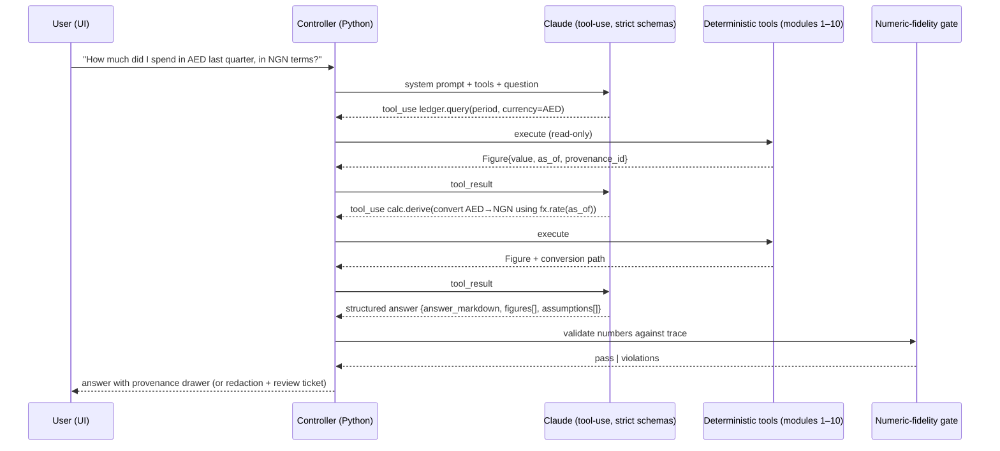

```
Document: 07 — Technology and Open-Source Research Report
Department: Engineering, Data, Security and AI Systems  ·  Lead role(s): principal software architect, senior backend engineer, frontend engineer, financial data engineer, machine-learning engineer, AI-systems engineer, database architect, cybersecurity specialist, privacy engineer, QA engineer
Version: 0.1 draft  ·  Date: 2026-11-02  ·  Status: for cross-department review
Reviewers required: Financial methodology / ledger team (System A); Behavioural finance team (System B); Investment research team (System C); Portfolio & quant team (System D); Goal Reality & forecasting team (Systems E–F); Tax, legal, regulatory & privacy team (System G, referred to here as "Doc 6" per the assignment); Commercialisation team (System I); Programme coordinator
```

# Document 7 — Technology and Open-Source Research Report

## 1. Executive summary

**Conclusions.** (1) No existing open-source product can be adopted as the core of Portfolio OS. The closest systems split into three families: budgeting tools with excellent transaction workflows but weak or absent multi-currency and portfolio analytics (Actual Budget, Firefly III); portfolio trackers with good performance analytics but thin ledger semantics and float arithmetic (Ghostfolio, Wealthfolio, Portfolio Performance); and plain-text double-entry engines with the most rigorous ledger model but no product surface (Beancount, hledger). Most of the product-grade systems are AGPL-3.0, which rules out embedding their code in a future commercial product but not borrowing their designs. (2) The right shape is a **modular monolith**: one Python 3.12+ service (FastAPI, SQLAlchemy 2, Alembic) over one PostgreSQL database, a background worker, and a React + TypeScript frontend, deployed with Docker Compose for personal use. Thirteen modules are specified with interfaces, data ownership and testing requirements (§4.3). (3) The ledger must be **append-only double-entry postings in decimal arithmetic**, with every market, FX and tax figure carrying a provenance record (source, as-of, retrieved-at, licence, validation status). This is the direct remedy for the stale-constant and unverified-endpoint anti-patterns found in the existing repository. (4) The AI layer must be built as **deterministic calculators behind tool-use**, with strict schemas and a post-generation **numeric-fidelity gate** so that no number reaches the user unless it came from a tool result. Anthropic's current API supports strict tools and constrained JSON outputs; Claude Sonnet 5.5 / Opus 5.5 are the recommended defaults, with an Apache-2.0 local-model path (Qwen3, gpt-oss) for privacy-sensitive extraction. (5) The existing NEXUS repository is not a foundation: salvage the theme and layout components; treat the Monte Carlo code as a reference with known defects (unscaled Student-t innovations, unseeded randomness, uncalibrated parameters).

**Biggest uncertainty.** Data access for the founder's actual institutions and markets. NGX, DFM and ADX market data are licensed products with redistribution restrictions; Nigerian open banking is live only under CBN's registry and tiering model and UAE Open Finance requires a CBUAE licence, so bank connectivity for a personal system will initially be statement upload, not APIs. Whether the founder's banks issue machine-readable statements (CSV/CAMT) or only PDFs is **unknown — founder to confirm**; this single fact drives the size of the ingestion module.

**Second uncertainty.** Local-first privacy versus hosted convenience is a genuine, unresolved disagreement inside the department (§7). The recommended design keeps both open: a single-binary Compose deployment on the founder's own hardware now, with the data model and key management designed so a hosted tier can be added without rewriting the ledger.

## 2. Scope and method

**Questions addressed.** (A) Which existing open-source finance systems are worth reusing, borrowing from, or avoiding, and under what licences? (B) What library landscape exists for portfolio/risk analytics, data access, statement parsing, categorisation, storage, scheduling and charting, with licences and maintenance health? (C) How should an AI research-and-explanation layer be built so it cannot fabricate figures? (D) What security and privacy architecture does highly sensitive, multi-jurisdiction financial data require? (E) What architecture, data model, stack and testing strategy should Portfolio OS adopt? (F) What should be built, reused, bought, or deferred? (G) What is salvageable from the existing repository?

**What was inspected.** The repository `alhameenoki1-prog/Terminal-` (package.json, vite.config.ts, src/App.tsx, src/store/useStore.ts, src/services/chatService.ts, src/services/yahooService.ts, src/components/ChatPanel.tsx, src/components/MonteCarloPanel.tsx, src/data/countryProfiles.ts, src/types/index.ts, git log; no tests, no CI, no backend found). Project READMEs, licence files, release pages, schema and source files for Ghostfolio, Actual Budget, Firefly III (+ Data Importer), Maybe Finance and its fork Sure, Beancount (+ Fava, beangulp, beanquery), hledger, OpenBB, Wealthfolio, Portfolio Performance, rotki and Paisa. Official documentation for Anthropic models, pricing, tool use, structured outputs, citations and data retention; PyPI and npm registry metadata for 95 packages (version, release date, declared licence); TimescaleDB, PostgreSQL, Python `decimal`, SEC EDGAR, CBN, NGX, Mono, Lean, OWASP, NIST, Microsoft STRIDE, Meta/Google/Qwen/OpenAI model licences; DLA Piper country pages and the UAE government portal for NDPA 2023 and the UAE PDPL; the CBN Operational Guidelines for Open Banking (PDF, text extracted locally).

**Tools.** WebFetch for all pages (each source lists URL and access date 2026-11-02); `curl` against the PyPI and npm registry JSON APIs; the hosted reference-lookup tool for academic works where it responded, otherwise direct OpenAlex and arXiv API queries as the coordinator authorised (each academic source states which); Python 3 for the worked examples and the validator smoke test; the `claude-api` reference skill (cached 2026-10-06) cross-checked against the live docs.

**What could not be accessed (stated, not guessed).** The GitHub REST API is blocked for repositories outside this session (health signals therefore come from rendered release pages and PyPI/npm dates, which show day and month; years were inferred from page context and are flagged where uncertain). The WebSearch budget was exhausted by other agents mid-task, so regulatory sources were reached by direct URL only. `ndpc.gov.ng`, `docs.firefly-iii.org` and the CBUAE rulebook returned HTTP 403; `altareq.ae` is outside the session's allowed network; DFM data-services pages returned 404; `nrs.gov.ng` renders only client-side. OpenAlex's shared free quota was exhausted after the reference verifications, so two literature searches on transaction categorisation returned nothing; the categorisation approach is therefore graded E5 rather than E2. No Google Drive or Gmail content was read.

## 3. Findings

Evidence grades follow the brief (E1–E6). Source numbers refer to §10. "Observed" means the fact was read directly from the cited page or file on 2026-11-02; licence names are quoted as published.

### 3.1 Existing systems (Part A)

**Table 3.1 — Comparative evaluation of open-source personal-finance and portfolio systems**

| System | Purpose / stack | Data model (accounts, transfers, multi-currency, duplicates, rules) | Bank connectivity | Portfolio analytics | Licence (as published) | Health (observed) | Our stance |
|---|---|---|---|---|---|---|---|
| **Ghostfolio** [S1–S4] | Wealth tracker; NestJS + Prisma + PostgreSQL + Redis, Angular; Nx monorepo | Activity model `Order` {BUY, SELL, DIVIDEND, FEE, INTEREST, LIABILITY}; `quantity`, `unitPrice`, `fee`, `marketPrice` are Prisma **Float**; currency is a plain string; no FX table — rates fetched via an abstracted data-provider service, gaps filled by carrying the last rate forward, no source/timestamp kept | None; JSON/CSV import; data sources enum ALPHA_VANTAGE, COINGECKO, EOD_HISTORICAL_DATA, FINANCIAL_MODELING_PREP, GHOSTFOLIO, GOOGLE_SHEETS, MANUAL, RAPID_API, YAHOO | Allocation, performance, benchmark; premium data via Ghostfolio cloud | "Licensed under the AGPLv3 License" | Releases 3.94–3.96 dated 28–31 Oct (page shows no year; context 2026) | **Borrow** the activity taxonomy and `MarketData(dataSource, symbol, date)` uniqueness idea; **avoid** float money and provenance-free FX; do not embed (AGPL) |
| **Actual Budget** [S5–S13] | Local-first envelope budgeting; Node/TypeScript, React, SQLite-per-device with a CRDT sync package (`@actual-app/crdt`, protobuf messages) | Single budget currency (multi-currency is a long-running request, #1132/#3351, auto-closed under "needs votes"); transfers are **paired transactions** linked so edits propagate, payee = other account, excluded from reports; **rules engine** with `pre/default/post` stages, conditions (is/contains/matches regex/one of) over imported-payee vs payee, amount, date, notes; auto-learned payee→category rules; imports reconcile to existing transfers | Via `actual-server` with user-supplied credentials: Akahu (NZ), Enable Banking (EU), GoCardless (EU, "not accepting new accounts"), SimpleFIN (N. America), Pluggy.ai (Brazil). Bank tokens are **outside** end-to-end encryption | None (budgeting only) | "MIT license" | Monthly releases: v26.11.0 (2 Nov), v26.10.0, v26.9.0 | **Reuse design** of the rules engine, transfer pairing, and E2E-encrypted sync model; MIT permits code reuse but the budgeting domain model does not fit |
| **Firefly III** + Data Importer [S14–S19] | Self-hosted personal finance; PHP (Laravel-style), REST API, Docker | True **double-entry**: transaction journals with source/destination accounts; `TransactionTypeEnum` {Withdrawal, Deposit, Transfer, Reconciliation, Opening balance, Liability credit, Invalid}; `AccountTypeEnum` includes Asset, Expense, Revenue, Loan, Debt, Mortgage, Cash, Credit card, Reconciliation, Initial balance; each `Transaction` row carries `amount`, `foreign_amount`, `foreign_currency_id`, `native_amount` cast as **strings** (decimal-safe); rule engine; arbitrary currencies | Separate Data Importer: CSV, CAMT.052, CAMT.053; topic tags gocardless/nordigen/salt-edge/spectre; it "does not connect to banks directly" | None beyond balances | "GNU Affero General Public License v3" (both repos) | v6.7.9 (11 Oct) + daily `develop` pre-releases (1–2 Nov 2026) | **Borrow** the dual-amount (`amount` + `foreign_amount`) posting pattern and the account-type taxonomy; AGPL — no code embedding |
| **Maybe Finance** → **Sure** [S20–S21] | Rails + PostgreSQL + Hotwire personal finance with AI assistant | Not visible in README; AI builds ("No AI", "Simple AI" with OpenAI settings, "External AI"); forks may not use the "Maybe" name | Not stated on pages read | Net worth and accounts | "Maybe is distributed under an AGPLv3 license"; "Maybe and Sure are both distributed under an AGPLv3 license" | Maybe **archived 27 Jul 2025** (final v0.6.0); Sure active (~4k commits, 10.8k stars, no release visible) | **Avoid** as a base (archived upstream, AGPL, Rails); note as a cautionary case for venture-backed open-core |
| **Beancount 3** (+Fava, beangulp, beanquery) [S22–S25] | Plain-text double-entry language; Python with C++ core | Directives (open, close, commodity, transaction, balance, pad, price, note, document, event, query, custom); postings with units, `{cost}` lots and `@`/`@@` prices; **weights must sum to zero per currency**; booking methods STRICT (default), FIFO, LIFO, NONE (AVERAGE planned); balance assertions with tolerance; importers framework (beangulp) | File-based imports only | Via plugins/queries; Fava UI | Beancount "GNU GPLv2 only" (PyPI `GPL-2.0-only`); beangulp/beanquery GPLv2; Fava "MIT" | beancount 3.2.3 (PyPI 2026-05-05); fava 1.30.16 (2026-08-18); v3 stable since June 2024 | **Borrow the semantics** (weights, lots, balance assertions, pad) as the reference model for our ledger; **do not link** GPL-2.0 code into the service; offer Beancount export as an interoperability format |
| **hledger** [S26] | Plain-text accounting; Haskell; CLI/TUI/web + JSON API | Multi-commodity engine, costs and market values "in any currency", balance assertions, periodic/forecast transactions, CSV import rules; "accurate to 255 decimal places"; lot tracking is a 2.x goal | CSV import | Valuation reports | "GNU General Public License v3.0 or later" | 1.99.6 (2.0 preview 6) on 2026-11-01; monthly cadence | **Borrow** CSV rules-file design and valuation semantics; GPL — no embedding |
| **OpenBB Platform** ("Open Data Platform") [S27–S29] | Python data-integration layer with FastAPI REST (`openbb-api`), provider extensions; commercial Workspace separate | Standardised provider/fetcher interface; data "not necessarily accurate" disclaimer | n/a (market data) | Research data, not portfolio accounting | Core repo LICENSE: "Apache License, Version 2.0" (© 2021–2026 OpenBB Inc.); but extensions differ: `openbb-yfinance` 2.1.0 **AGPL-3.0-only**, `openbb-fmp` and `openbb-polygon` AGPL-3.0, `openbb-sec`/`openbb-fred`/`openbb-core` Apache-2.0 | openbb 5.0.0 (PyPI 2026-09-29); openbb-yfinance 2.1.0 (2026-11-01) | **Borrow** the provider/fetcher abstraction and standard field models; reuse Apache-2.0 providers (SEC, FRED) with per-package licence check; treat AGPL providers as separate-process or avoid |
| **Wealthfolio** [S30] | Local-first investment tracker; Tauri + Rust, React, SQLite (Diesel), optional Axum web server | Holdings, TWR and money-weighted returns, cost-basis methods FIFO/avg/LIFO/HIFO, rebalancing; multi-currency with exchange-rate management, per-currency formats, FX gains on cash (v3.11.0); optional SQLCipher encryption, OS credential store; AI agent (MCP) tools for import/categorisation | Optional paid "Connect" (read-only brokerage sync, 30+ institutions) | Good (TWR, MWR, benchmarks, allocation) | "licensed under the AGPL-3.0 license"; trademarks reserved by Teymz Inc. | v3.12.0 (1 Nov 2026), v3.11.0 (23 Oct), v3.10.0 (14 Oct) | **Borrow** local-first packaging ideas and the idempotent re-import rule ("re-importing trades by symbol or ID no longer creates duplicates"); AGPL — no embedding |
| **Portfolio Performance** [S31] | Desktop Java/Eclipse portfolio analysis | Securities, transactions, performance; hundreds of institution-specific **PDF importers** (0.90.0 adds/improves ~20 banks) | PDF/CSV import only | Strong (TTWROR, IRR, volatility widgets) | "EPL-1.0 license" | 0.90.0 (1 Nov 2026), 0.89.0, 0.88.0 | **Borrow** the concept of per-institution PDF importer modules with regression fixtures; Java/EPL code not reusable in our stack |
| **rotki** [S32] | Privacy-focused crypto portfolio/accounting; Python + TS frontend, local encrypted data | PnL with configurable accounting settings | Exchange/blockchain APIs | Crypto-focused | "AGPLv3 License" with commercial licensing offered | ~22.6k commits, active | **Note** its dual-licensing model as a commercial precedent; out of scope otherwise |
| **Paisa** [S33] | Go + Svelte UI over ledger/hledger/beancount journals | Delegates ledger semantics to the journal engine | Templates | Goals, retirement | "AGPL 3 or later" | 659 commits; author-maintained | **Borrow** the pattern "UI over a rigorous ledger engine" |

**F1. No candidate base system.** Across eleven systems, none combines a rigorous multi-currency double-entry ledger, portfolio analytics, statement ingestion and an explanation layer. The ledger rigour lives in GPL plain-text tools; the analytics in AGPL trackers that use floats (Ghostfolio) or desktop stacks (Portfolio Performance). **E3** (observed design review) [S1–S33].

**F2. Licence boundary is decisive for System I (commercialisation).** AGPL-3.0 governs Ghostfolio, Firefly III, Maybe/Sure, Wealthfolio, rotki, Paisa and OpenBB's yfinance/FMP/Polygon extensions; GPL-2.0-only governs Beancount; GPL-3.0-or-later governs hledger. Incorporating or linking this code into a proprietary hosted product would trigger source-disclosure obligations; using their *designs* does not. Permissive licences (MIT: Actual, Fava; Apache-2.0: OpenBB core/SEC/FRED, Docling; BSD: Riskfolio, skfolio, QuantLib) allow reuse with attribution/NOTICE obligations. **E3**; the legal boundary between "idea" and "expression" and the linking analysis for GPL-2.0 must be confirmed by counsel (Doc 6). [S1–S33]

**F3. The best transaction-workflow design is Actual's.** Staged rules (pre/default/post), conditions on the *imported* payee (immutable original text) versus the editable payee, auto-learned rules, paired transfers, and reconciliation of imports against existing transfers are directly transferable to Portfolio OS's categorisation module. **E3** [S7, S9].

**F4. The best ledger semantics are Beancount's.** Weights that must sum to zero per currency, explicit lots with cost basis and booking methods (STRICT/FIFO/LIFO/NONE), balance assertions with tolerance, `pad` for opening balances, and `price` directives for FX form a complete, well-specified model that already handles multi-currency conversions and capital gains. **E3** [S23]. Firefly's dual-amount posting (`amount` + `foreign_amount`, stored as strings) is the relational analogue. **E3** [S19].

**F5. Float money is common and wrong.** Ghostfolio stores quantities, prices and fees as Prisma `Float`; the repository's own Monte Carlo and position types use JavaScript numbers. Python's `decimal` is explicitly designed for "accounting applications which have strict equality invariants" (0.1 + 0.1 + 0.1 − 0.3 is exactly zero) and follows the General Decimal Arithmetic Specification. **E3** [S2, S42, S101].

**F6. FX provenance is absent everywhere we looked.** Ghostfolio's exchange-rate service keeps rates as date-keyed numbers with no source or retrieval timestamp and silently carries the last rate forward over gaps; the repository hardcodes a CBN policy rate of 27.50 with a March-2026 "next meeting". The CBN publishes an official daily NFEM volume-weighted USD/NGN rate with "Export to Excel" [S44]; this is the kind of source a provenance record must name. **E3** [S4, S44, S101].

**F7. Bank connectivity in the founder's jurisdictions is licensed, not open.** CBN's Operational Guidelines for Open Banking (approved March 2023) define API Providers and API Consumers, a CBN-maintained Open Banking Registry keyed by CAC registration number, consent requirements, and sponsored participant tiers 0–3 (Tier 2 "Personal Information and Financial Transaction" and Tier 3 "Profile, Analytics and Scoring"); individuals are not a participant class. Mono (Flutterwave company) offers account linking for "100+ banks and fintechs" across Nigeria, Ghana and South Africa with ISO/IEC 27001 badges. In the UAE, Lean states it holds an **In-Principle Approval** from CBUAE for Open Finance Services and is ADGM-regulated, with SOC 2 Type II and ISO 27001:2022. Actual's European providers show that even mature aggregators churn (GoCardless "not accepting new accounts"). **E2** for the CBN guideline (official publication) [S48]; **E3** for vendor claims [S46, S47, S6]. The reported August 2025 Nigerian go-live and the CBUAE Open Finance Regulation text could not be verified in this session (403/unreachable) — **unverified**.

**F8. Market data for NGX/DFM/ADX is a licensed product.** NGX sells "real-time, end-of-day, reference and historical data products" directly and through authorised vendors, via "a robust API platform" and X-DataPortal, and all use "must be used and distributed in accordance with the NGX Market Data Agreement" [S45]. DFM/ADX pages could not be reached (404). yfinance states it "is not affiliated, endorsed, or vetted by Yahoo", is "intended for research and educational purposes", and that "the Yahoo! finance API is intended for personal use only" [S38]. Conclusion: yfinance is acceptable for the founder's personal prototype only; any multi-user product needs licensed feeds. **E3** [S38, S45]. SEC EDGAR APIs are free, key-less, real-time within ~1 minute, but automated access must comply with SEC's fair-access policy [S43] **E2**.

### 3.2 Library landscape (Part B)

**Table 3.2 — Libraries, licences (as declared on PyPI/npm) and latest release observed on 2026-11-02** [S34, S35]

| Area | Library | Version · release date | Declared licence | Note |
|---|---|---|---|---|
| Portfolio optimisation | PyPortfolioOpt | 1.6.0 · 2026-02-26 | MIT License | Mature API; classical MVO, HRP, Black-Litterman |
| | Riskfolio-Lib | 7.4.0 · 2026-10-04 | BSD (3-clause) | Broadest risk-measure set; depends on cvxpy |
| | skfolio | 1.12.5 · 2026-10-29 | BSD License | scikit-learn style pipelines, cross-validation of portfolios — best fit for a testable module |
| | cvxpy | 1.9.3 · 2026-09-19 | Apache-2.0 | Convex solver layer (open solvers CLARABEL/SCS/OSQP) |
| Pricing / rates | QuantLib (Python) | 1.44 · 2026-10-13 | BSD-3-Clause | Bond maths, day counts, curves (FGN bonds, T-bills) |
| Volatility / econometrics | arch | 8.0.0 · 2025-10-21 | NCSA | GARCH family estimation — replaces hardcoded GARCH parameters |
| | statsmodels | 0.15.0 · 2026-08-27 | BSD-3-Clause | Regression, time-series tests |
| Performance stats | empyrical / pyfolio (Quantopian) | 0.5.5 · 2020-10-13 / 0.9.2 · 2019-04-15 | Apache | **Unmaintained**; use the "-reloaded" forks |
| | empyrical-reloaded / pyfolio-reloaded | 0.7.1 · 2026-10-26 / 0.10.1 · 2026-10-25 | Apache-2.0 | Maintained forks; cross-check oracle for our own metrics |
| | quantstats | 0.0.86 · 2026-09-27 | Apache-2.0 | Tear sheets; second oracle |
| | ffn / bt | 1.4.1 · 2026-10-10 (both) | MIT | Simple performance utilities and backtests |
| Data access | yfinance | 1.7.0 · 2026-08-26 | Apache Software License | Personal/research use only per README [S38] |
| | openbb / openbb-core | 5.0.0 · 2026-09-29 / 2.0.1 · 2026-09-28 | Apache-2.0 | Provider extensions have mixed licences (AGPL for yfinance/FMP/Polygon) |
| | edgartools | 5.62.1 · 2026-10-23 | MIT | XBRL financial statements from EDGAR |
| | sec-edgar-downloader | 5.1.0 · 2026-02-02 | MIT License | Filing downloads |
| | fredapi | 0.5.2 · 2024-05-05 | (none declared) | Thin wrapper; FRED API key required |
| Statement parsing | pdfplumber | 0.11.10 · 2026-06-15 | MIT License | Text-layer PDFs, word positions, tables |
| | camelot-py | 2.0.0 · 2026-06-04 | MIT | Lattice/stream table extraction |
| | PyMuPDF | 2.0 · 2026-10-19 | "Dual Licensed - GNU AFFERO GPL 3.0 or Artifex Commercial License" | Fast, but AGPL unless commercial licence [S36] |
| | Docling | 2.145.0 · 2026-10-29 | MIT (codebase; models carry their own licences) | Layout, table-structure, OCR, local/air-gapped execution; LF AI & Data project [S37, S74] |
| | Unstructured | 0.27.36 · 2026-10-30 | Apache-2.0 | General document partitioning |
| | marker-pdf / surya-ocr | 2.1.0 / 0.23.0 · 2026-10-29 | Apache-2.0 | PDF→Markdown and OCR models |
| | pytesseract / paddleocr / easyocr | 0.3.13 · 2024-08-16 / 3.7.0 · 2026-06-11 / 1.7.2 · 2024-09-24 | Apache | OCR engines for scanned statements |
| Categorisation | scikit-learn | 1.9.1 · 2026-09-10 | BSD-3-Clause | Linear classifiers over rule features |
| | sentence-transformers | 6.2.0 · 2026-10-21 | Apache-2.0 | Embeddings for merchant-string similarity (later) |
| | modAL-python | 0.4.2.1 · 2023-06-01 | MIT | Active-learning loop; low activity — simple query strategies can be hand-written |
| Storage / data | PostgreSQL | — | PostgreSQL License ("liberal… similar to the BSD or MIT licenses") [S41] | System of record |
| | TimescaleDB | — | Apache 2 Edition vs Community Edition under "Tiger Data License (TSL)": "You cannot sell TimescaleDB Community Edition as a service" [S40] | Not needed at personal scale; TSL matters for SaaS |
| | DuckDB / pyarrow / polars | 2.0.0 · 2026-10-21 / 26.0.0 / 2.1.0 | MIT / Apache-2.0 / MIT | Analytical scans over Parquet snapshots |
| | psycopg 3 | 3.3.6 · 2026-09-18 | LGPL-3.0-only | Driver (dynamic use is fine) |
| | SQLAlchemy / Alembic | 2.1.6 / 1.20.1 · 2026-10 | MIT | ORM + migrations |
| Validation | pydantic / pandera / great-expectations | 2.14.2 / 0.35.0 / 1.24.1 · 2026-10 | MIT / MIT / Apache | Schema and dataframe contracts |
| Jobs | Procrastinate | 3.10.0 · 2026-09-23 | MIT License | PostgreSQL-backed queue — no Redis |
| | APScheduler | 3.11.3 · 2026-06-28 | MIT License | In-process cron |
| | Celery / dramatiq / arq / Prefect / temporalio | 5.6.3 / 2.2.1 / 0.28.0 / 3.9.1 / 1.35.0 | BSD-3 / LGPLv3+ / MIT / Apache / MIT | Heavier options for later scale |
| Money types | py-moneyed | 3.0 · 2022-11-27 | BSD License | Low activity; prefer `Decimal` + ISO code columns |
| Testing | Hypothesis / pytest | 6.170.14 · 2026-10-30 / 9.2.0 · 2026-10-27 | MPL-2.0 / MIT | Property-based tests [S75, S76] |
| Auth / crypto | webauthn (py_webauthn) / Authlib / PyJWT / cryptography | 3.0.1 / 1.9.2 / 2.15.1 / 50.0.2 · 2026-09/11 | BSD-3-Clause / BSD / MIT / Apache-2.0 OR BSD-3-Clause | Passkeys, OIDC, tokens, AES-GCM |
| AI | anthropic (Python) / @anthropic-ai/sdk | 2.3.0 · 2026-10-23 / 1.3.0 · 2026-10-23 | Apache | Official SDKs |
| | promptfoo / inspect-ai / deepeval / ragas | 0.125.1 / 0.3.287 / 4.3.2 / 0.4.3 | MIT / MIT / Apache / Apache | Evaluation harnesses |
| | langfuse / structlog / opentelemetry-api | 5.1.0 / 26.1.0 / 1.45.2 | MIT / MIT OR Apache-2.0 / Apache-2.0 | Tracing and logging |
| Frontend | react / vite / zustand | 19.3.1 / 8.3.5 / 5.0.16 · 2026-10 | MIT | Current majors (repo is on React 18 / Vite 5) |
| | lightweight-charts | 5.2.1 · 2026-08-12 | Apache-2.0 **plus** attribution notice and link to tradingview.com required [S39] | Price/candlestick charts |
| | echarts / recharts / plotly.js / @visx/visx / uplot | 6.1.0 / 3.10.1 / 4.2.0 / 4.0.0 / 1.6.32 | Apache-2.0 / MIT / MIT / MIT / MIT | Analytics charts |
| | @tanstack/react-table / ag-grid-community | 9.3.1 / 36.2.0 | MIT | Ledger grids |
| | decimal.js / big.js / dinero.js | 10.6.0 / 7.0.1 / 2.0.2 | MIT | Display-side decimal handling only |

**F9. The Python ecosystem holds the financial-methodology libraries; TypeScript holds the UI.** Every portfolio-optimisation, econometric, document-parsing and property-testing library in Table 3.2 is Python; the TypeScript side offers charts, grids and money formatting. This asymmetry, not taste, drives ADR-2. **E3** [S34, S35].

**F10. The Quantopian lineage is dead but forked.** `empyrical`/`pyfolio` last released 2020/2019; `empyrical-reloaded`/`pyfolio-reloaded` released in October 2026 under Apache-2.0. Use them as *oracles* in golden tests, not as the production implementation, because our metrics must be reproducible from stored inputs under our own numerical conventions. **E3** [S34].

**F11. Two document-parsing licences require care.** PyMuPDF is AGPL-3.0 or commercial; Docling's code is MIT but "individual models follow their own original licenses". Deterministic text-layer parsing (pdfplumber, Camelot) is permissively licensed and sufficient for digitally generated statements; OCR/layout models are needed only for scanned statements. **E3** [S36, S37].

**F12. Portfolio-optimisation theory warns against point-estimate optimisation.** Mean-variance optimisation is highly sensitive to estimation error ("error maximisation", Michaud 1989); DeMiguel, Garlappi and Uppal (2009) found 1/N hard to beat out of sample across 14 models; Ledoit–Wolf shrinkage and López de Prado's Hierarchical Risk Parity are standard mitigations, and all three are implemented in skfolio/PyPortfolioOpt/Riskfolio. The optimisation module must therefore present alternatives with uncertainty rather than a single "optimal" weight vector (consistent with System E's "optimisation is not forecasting"). **E2** (peer-reviewed) [S79–S83].

### 3.3 AI system (Part C)

**F13. Financial LLM question-answering fails at high rates without engineering controls.** FinanceBench reports that "GPT-4-Turbo used with a retrieval system incorrectly answered or refused to answer 81% of questions" on a 150-case sample of its 10,231 questions. FinQA and TAT-QA document the difficulty of numerical reasoning over financial tables. Hallucination is a general property of generative models (Ji et al. 2023). **E2** [S68–S71]. Implication: the model must not be the calculator.

**F14. The Anthropic API now provides the primitives for a no-fabrication design.** Strict tool use (`strict: true`) and JSON outputs (`output_config.format`, `type: "json_schema"`) "guarantee schema-compliant responses through constrained decoding" on all current models; `additionalProperties` must be `false`; numerical constraints (`minimum`, `maximum`) and string-length constraints are **not** supported in schemas and must be validated application-side; outputs may still violate the schema on `refusal` or `max_tokens` stop reasons. Citations (document blocks with `char_location`/`page_location`) are **incompatible** with structured outputs (400 error), so provenance citation must be implemented by our own figure-reference scheme when JSON outputs are used. Tool use adds 286 system-prompt tokens on Opus 5.5/Sonnet 5.5/Haiku 5.5; parallel tool calls are supported; forced `tool_choice` (`any`/`tool`) is rejected on the newest models, so steering is by prompt plus strict schemas. **E2** (vendor documentation) [S52–S54, S56].

**F15. Current model IDs and list prices (checked 2026-11-02).** `claude-fable-5-1` $10/$50 per MTok (cache hits $0.25); `claude-opus-5-5` $4/$20 (cache hits $0.20, default effort `medium`); `claude-sonnet-5-5` $2/$10 (cache hits $0.10); `claude-haiku-5-5` $0.10/$0.50 up to 100k-token prompts ($0.50/$2.50 above). Batch API is 50% off; 1M-token context and 128K output on all four; thinking is adaptive and always on for Fable 5.1 and Opus 5.5. **E2** [S50, S51].

**F16. Data handling on the Claude API.** "Conversation content (your prompts and Claude's outputs) is not retained by default"; "Retained data is never used for model training without your express permission"; zero data retention (ZDR) is available for Commercial organisations — **except** Claude Fable 5.1 / Fable 5 / Mythos, which "require 30-day data retention and are not available under ZDR unless expressly authorized by Anthropic". Schemas compiled for structured outputs are cached separately and should not contain personal data. **E2** [S55]. This is a privacy-engineering reason to prefer Opus 5.5/Sonnet 5.5 over Fable 5.1 for a system processing bank statements.

**F17. Prompt injection via documents is a demonstrated, not theoretical, threat.** Greshake et al. (2023) showed indirect prompt injection against deployed LLM-integrated applications; OWASP ranks Prompt Injection LLM01:2025, with Sensitive Information Disclosure (LLM02), Improper Output Handling (LLM05), Excessive Agency (LLM06) and Misinformation (LLM09) also directly relevant. Two design responses exist: Willison's Dual-LLM pattern (privileged model never sees untrusted text; quarantined model has no tools; a deterministic controller passes variables) and CaMeL (Debenedetti et al. 2025), which enforces capabilities on data flows "by design". **E2** for the attack and CaMeL [S65, S66]; **E3** for OWASP and the Dual-LLM pattern [S63, S64].

**F18. Local open-weight models are viable for quarantined extraction but their licences differ.** Ollama and llama.cpp are MIT; llama.cpp serves an OpenAI-compatible API with GBNF grammar constraints; Qwen3-32B is Apache-2.0 with tool calling and a thinking mode; gpt-oss-20b is Apache-2.0 (21B total / 3.6B active) with structured outputs and reasoning-effort levels; Llama 4 is under the "Llama 4 Community License Agreement" (effective 5 April 2025; 700M-MAU clause; "Built with Llama" attribution); Gemma is under custom "Gemma Terms of Use" (Gemma 4 under a separate licence). Neither Llama nor Gemma terms are OSI-approved licences. Quality on financial extraction was **not** measured here — it must be, before any local model is trusted. **E3** [S57–S62].

**F19. Validator design detail discovered by test.** A smoke test of the numeric-fidelity gate (§4.12) flagged "10" and "31" inside the ISO date `2026-10-31` as unsupported numbers. Dates, identifiers and years must be masked before number matching, and tolerance/unit normalisation must be explicit. **E5** (engineering finding, reproduced in §4.12).

### 3.4 Security, privacy and regulation (Part D)

**F20. Standards baseline.** OWASP ASVS 5.0.0 ("Published 30 May 2025") is the application-security verification checklist; NIST SP 800-63B-4 (Final, July 2025) requires at least one phishing-resistant option at AAL2, permits syncable authenticators (passkeys) up to AAL2 but not AAL3, forbids composition rules and periodic password rotation, requires 15-character minimum single-factor passwords, and restricts PSTN/SMS out-of-band. STRIDE (Microsoft SDL) remains the standard threat taxonomy. **E2/E3** [S86, S88, S89].

**F21. Secrets and encryption tooling.** HashiCorp Vault is "Business Source License 1.1" (licensor IBM; change licence MPL 2.0 after four years; no competing hosted offering); OpenBao (MPL-2.0) is the open-governance alternative; SOPS (MPL-2.0, CNCF sandbox) with age (BSD-3-Clause) covers encrypted configuration for a Compose deployment; SQLCipher (BSD-3-Clause, Zetetic) covers encrypted SQLite for a desktop variant; Keycloak (Apache-2.0), Authelia (Apache-2.0, passkeys, OpenID Certified) and authentik (MIT + separate "authentik EE License") cover identity. **E3** [S90–S97].

**F22. Nigeria: NDPA 2023 and GAID 2025.** The NDPA received Presidential assent on 13 June 2023; the NDPC issued the General Application and Implementation Directive on 20 March 2025, after which the 2019 Regulation and 2020 Framework "ceased to apply". Breach notification to the NDPC within 72 hours; data subjects "immediately" where high risk; registration tiers for controllers of major importance by data-subject counts over six months (over 200 / 1,000 / 5,000); fines up to the greater of 2% of annual gross revenue or ₦10 million for major-importance controllers; cross-border transfers need adequacy or listed safeguards/conditions. The GAID effective date and NDPA commencement date are **not stated** in the secondary source and the primary site was unreachable — **Doc 6 to confirm**. **E3** (secondary practitioner source, last modified 17 March 2026) [S98].

**F23. UAE: PDPL (Federal Decree-Law No. 45 of 2021).** In force 2 January 2022 per the UAE government portal (page updated 4 December 2025); the DLA Piper summary (27 January 2025) states the Executive Regulations "have not yet been published" and compliance runs six months from their issuance; the PDPL does not apply to DIFC/ADGM (own regimes) or to banking and credit data governed by other laws; breach reporting is to the UAE Data Office "immediately upon becoming aware"; penalties are to be set by Cabinet decision. Whether the Executive Regulations have since been issued is **unverified** — **Doc 6 to confirm**. **E2** for the portal statements; **E3** for the summary [S99, S100].

**F24. Cross-border processing is unavoidable with a hosted model API.** Sending statement-derived data to the Claude API is a transfer out of Nigeria/UAE under both regimes; for a single individual processing his own data this is largely a personal-use question, but for any multi-user product it requires a lawful transfer mechanism, a data-processing agreement, and minimisation of what leaves the system (aggregates, not raw statements). **E4** (privacy engineer's judgment pending Doc 6) [S55, S98, S99].

### 3.5 The existing repository (Part G)

**F25. Secrets in localStorage.** `useStore.ts` persists `settings` — including `groqApiKey`, `telegramBotToken`, `youtubeApiKey`, `fredApiKey` and EmailJS keys — through Zustand `persist` under key `nexus-terminal-v6`; any XSS or shared browser exposes them. **E3** (observed) [S101].

**F26. Prompt stuffing instead of tools.** `ChatPanel.buildContext()` interpolates live tickers, a regime score and ten headlines into the system prompt of a Groq-hosted `llama-3.3-70b-versatile` call (`chatService.ts`); the model is instructed to "cite specific levels and spreads" with nothing preventing restatement or invention. **E3** [S101].

**F27. Unofficial, provenance-free data.** `yahooService.ts` calls Yahoo's v7 quote endpoint through a Vite dev proxy; Stooq, rss2json and CBOE CDN are proxied the same way; `countryProfiles.ts` hardcodes 22 central-bank rates with fixed "next meeting" dates (CBN 27.50, 2026-03-25). No value carries source, as-of or licence. **E3** [S101].

**F28. The Monte Carlo prototype has substantive defects.** (i) Student-t innovations with df = 5 are used unscaled, so variance is inflated by df/(df−2) ≈ 1.67 (volatility overstated by ≈29%); (ii) `Math.random()` is unseeded — results are not reproducible; (iii) drift is hardcoded (`mu = 0.05`), GARCH parameters are fixed (α = 0.08, β = 0.85) rather than estimated (Bollerslev 1986 defines the model; `arch` estimates it); (iv) jump parameters are fixed constants; (v) "max drawdown" is approximated from the terminal cross-section, which the code comment itself concedes; (vi) regime multipliers 0.85/1.0/1.2/1.5 have no source; (vii) Sharpe is computed from terminal returns scaled by √(252/h); (viii) no tests. The models themselves (GBM, GARCH(1,1), Ornstein–Uhlenbeck, Merton jump-diffusion, Cholesky) are standard and the structure is readable — hence "reference only". **E3** [S84, S85, S101].

**F29. No engineering safety net.** No test files, no CI workflow, no backend, no lockfile-based audit; React 18.3 / Vite 5 against current React 19.3 / Vite 8. **E3** [S101, S35].

## 4. Proposed framework / specification for Portfolio OS

### 4.1 Architecture principles and the five-question test

The founder's rule — methodology first, architecture second — is honoured by making the **ledger and provenance model** the fixed point and letting every other module consume it. Five principles follow: (P1) every figure is a `Figure{value: Decimal, unit, currency, as_of, provenance_id, validation_status}`; (P2) the system of record is append-only and reproducible; (P3) calculations are deterministic Python functions with golden tests, never model prose; (P4) untrusted inputs (documents, web data) are data, never instructions; (P5) one deployable unit until evidence demands otherwise.

**Table 4.1 — Five-question test applied to the big choices**

| Choice | 1. Real problem | 2. Who needs it | 3. Evidence | 4. Build & validate | 5. Measurable improvement |
|---|---|---|---|---|---|
| Modular monolith | Boundary uncertainty across 13 interdependent modules; one operator | Founder (single deployment), later a small team | Fowler's "Monolith First": boundaries stabilise before splitting [S87] **E3** | One repo, enforced import rules (import-linter), per-module schemas; validate by module-dependency tests | Lead time per feature; zero cross-module data access outside interfaces |
| Python backend over TypeScript-only | Quant, econometric, document-parsing and property-testing libraries are Python (Table 3.2) | Quant, data and QA roles | F9 **E3** | FastAPI + OpenAPI-generated TS client; validate with contract tests | Fraction of methodology implemented with maintained libraries vs hand-written; defect rate in calculations |
| Append-only decimal ledger with provenance | Stale/incorrect figures were the founder's prior failure (brief §1) | Founder; auditors/accountants later | Beancount/hledger semantics [S23, S26]; `decimal` docs [S42] **E3** | Hypothesis invariants, reconciliation tests (§4.9) | 100% of displayed figures traceable to a source and as-of date; reconciliation breaks per statement |
| Tool-use AI with numeric-fidelity gate | LLMs fabricate or misreport numbers [S68–S71] | Every user of System H | F13–F14 **E2** | Golden Q&A, fidelity and refusal suites (§4.6) | Fabricated-number rate = 0 on the eval set; numeric exact-match ≥ 95% |
| Compose on founder-controlled hardware now, hosted later | Highly sensitive data, two privacy regimes | Founder now; customers later | Local-first literature [S78]; NDPA/PDPL transfer rules [S98–S100] **E3** | Threat model (§4.7) for both deployments; restore drills | Security review findings closed; recovery time objective met in drills |

### 4.2 Core data model principles

1. **Postings, not transactions with a sign.** A `journal_entry` has ≥2 `posting` rows; each posting has `account_id`, `amount: NUMERIC(28,8)`, `currency CHAR(3)`, optional `foreign_amount/foreign_currency` (Firefly pattern [S19]) and optional `lot_id` with cost basis (Beancount pattern [S23]). Invariant: per currency, Σ weights = 0 where weight = amount, or units × cost, or units × price. Transfers between the founder's own accounts are a single entry with two asset postings — never two unlinked transactions (Actual's pairing problem solved at the model level [S9]).
2. **Append-only with reversals.** Postings are never updated or deleted; corrections append a reversing entry referencing the original (`reverses_entry_id`). Soft state (categories, tags, notes) lives in separate mutable tables keyed by entry id, so recategorisation does not touch money.
3. **Decimal arithmetic end to end.** `Decimal` in Python, `NUMERIC` in PostgreSQL, strings over the API, and display-only formatting in the browser. A lint rule bans `float` in modules that touch money. Rounding is explicit (`quantize`, `ROUND_HALF_EVEN` default) and residuals are booked to an `Equity:FX-Rounding` account rather than silently dropped (worked example §4.12).
4. **Bitemporal as-of dating.** Every fact row has `effective_date` (when it is true in the financial world) and `recorded_at` (when the system learned it); market data additionally has `as_of` (the market's timestamp) and `retrieved_at`. Queries take an `as_of_recorded` parameter so any past report can be regenerated exactly.
5. **Provenance on every market, FX and reference figure.** `provenance{id, source_name, source_url_or_endpoint, licence_terms, retrieved_at, as_of, method (official|vendor|derived|manual), validation_status (unvalidated|validated|disputed|stale), validator_id}`. A figure without provenance cannot be served by the API (database constraint + API contract). Stale thresholds per source (e.g. CBN NFEM rate older than 2 business days → `stale`).
6. **Currency and FX provenance.** FX conversions store the rate used, its provenance and the conversion path (AED→USD→NGN). Official sources are preferred and named: CBN NFEM for USD/NGN [S44], CBUAE for AED (peg; source to be confirmed by Doc 6/Doc for System C), ECB/Fed reference rates for USD crosses; vendor rates are allowed only as `vendor` with licence recorded.
7. **Documents are immutable evidence.** Uploaded statements are stored once with SHA-256, MIME type, page count, encryption key id; extracted rows link back to `(document_id, page, bbox)`; duplicates are detected by content hash first, then by `(account, date, amount, normalised description)` within a window.
8. **Identity of instruments.** `instrument{id, isin, ticker, exchange(MIC), currency, asset_class}`; prices keyed by `(instrument_id, source, as_of)` with uniqueness (Ghostfolio's `(dataSource, symbol, date)` idea [S2]).

### 4.3 Modular monolith — the thirteen modules

Layout: one Python package `portfolio_os/` with one sub-package per module, each exposing a typed service interface and owning its tables (a PostgreSQL schema per module). Cross-module access only through interfaces; raw SQL joins across schemas are forbidden except in the read-only `analytics` role. One FastAPI app mounts each module's router under `/api/v1/<module>`. One worker process runs Procrastinate jobs. "Governing document" names the methodology document that owns the formulas (numbering to be confirmed by the coordinator; "Doc 6" is the tax/legal/privacy document named in the assignment).

| # | Module | Purpose | Inputs → Outputs | Interface (API shape) | Depends on | Owns (data) | Testing requirements | Governing document |
|---|---|---|---|---|---|---|---|---|
| 1 | **Financial ledger** | Append-only double-entry postings, accounts, lots, FX conversions, balances | Validated entries, FX rates → balances, positions, lots, cash flows | `POST /ledger/entries` (idempotency key), `GET /ledger/balances?as_of&as_of_recorded`, `GET /ledger/positions`, `GET /ledger/entries/{id}/lineage` | Validation (inputs), Security (authz) | `ledger.*` schemas: account, journal_entry, posting, lot, fx_rate, provenance | Hypothesis invariants (zero-sum per currency, append-only, idempotent import, lot conservation); golden Beancount-equivalent fixtures; reconciliation against statement closing balances | System A (personal finance & ledger methodology) |
| 2 | **Data ingestion** | Parse statements (PDF/CSV/CAMT), market and FX data, manual entries into *candidate* records | Files, feeds → `candidate_transaction`, `candidate_price` with provenance and page/bbox | `POST /ingest/documents` (multipart), `GET /ingest/jobs/{id}`, `POST /ingest/feeds/{source}/run` | Security (encryption), Validation | `ingest.*`: document, extraction_run, candidate_* | Per-institution fixture suites (Portfolio Performance pattern [S31]); OCR accuracy on synthetic scans; feed contract tests; replay from stored raw payloads | System A (statements), System C (market data) |
| 3 | **Data validation** | Promote candidates to facts only when checks pass | Candidates → validated records or exceptions queue | `POST /validate/runs`, `GET /validate/exceptions`, `POST /validate/exceptions/{id}/resolve` | Ingestion, Ledger (read) | `validation.*`: rule, run, exception | Rule unit tests; property: closing = opening + credits − debits per statement; duplicate-detection precision/recall on labelled synthetic set | System A; this document (engineering rules) |
| 4 | **Financial analytics** | Cash-flow, spending, income detection, net worth, budgets, liabilities | Ledger → time series and aggregates with provenance | `GET /analytics/cashflow?period&currency`, `GET /analytics/networth`, `GET /analytics/categories` | Ledger, Categorisation rules (within module 5 or 4 — see note) | `analytics.*` materialised views only (no new facts) | Golden datasets with hand-computed answers; view-refresh determinism | System A |
| 5 | **Behavioural intelligence** | Measured patterns with evidence grades; interventions only if approved by System B | Ledger, analytics → metrics, flags, experiment logs | `GET /behaviour/metrics`, `GET /behaviour/evidence/{metric}` | Analytics | `behaviour.*`: metric_definition (with E-grade), observation, intervention_log | Statistical tests reproducible with fixed seeds; pre-registered metric definitions; no AI-generated conclusions | System B (behavioural document; eight-question test) |
| 6 | **Investment research** | Fundamentals, filings, macro, dividends for NGX/DFM/ADX/US instruments from validated data | Provider payloads → instrument facts with provenance | `GET /research/instruments/{id}/fundamentals?as_of`, `GET /research/filings` | Ingestion (feeds), Validation | `research.*`: instrument, fundamental, filing, macro_series | Provider contract tests; staleness alerts; cross-source agreement checks | System C |
| 7 | **Portfolio optimisation** | Alternatives (equal-weight, min-variance, HRP, shrinkage MVO, constraints) with uncertainty | Positions, returns → candidate allocations + diagnostics | `POST /optimise/runs {universe, constraints, methods[]}` → run id; `GET /optimise/runs/{id}` | Risk (covariances), Research | `optimise.*`: run, result (immutable) | Reproduce textbook cases; compare against skfolio/PyPortfolioOpt oracles; resampling stability tests; never emit a single "optimal" without alternatives | System D / System E |
| 8 | **Risk management** | Volatility, drawdown, correlations, concentration, currency exposure, VaR/CVaR, scenario simulation (rebuilt Monte Carlo) | Ledger positions, prices → risk metrics with as-of | `GET /risk/metrics?as_of`, `POST /risk/scenarios/runs {model, seed, params}` | Ledger, Research | `risk.*`: metric, scenario_run (seeded, reproducible) | Analytic moment checks for GBM; GARCH unconditional variance; seeded reproducibility; cross-check with empyrical-reloaded/quantstats | System D |
| 9 | **Financial planning** | Goals, scenarios, trade-offs (income, spending, contributions, tax, inflation, FX) | Ledger, assumptions → projections as ranges | `POST /plan/scenarios`, `GET /plan/scenarios/{id}/paths` | Analytics, Risk, Tax | `plan.*`: goal, assumption_set (versioned), scenario_run | Deterministic given seeds; assumption provenance mandatory; no point forecasts in outputs | Systems E–F |
| 10 | **Tax calculations** | Nigerian and UAE positions from ledger facts; filing information packs; **no filing automation** | Ledger, residency inputs → computed positions, worksheets | `POST /tax/computations {jurisdiction, year, assumptions}`, `GET /tax/computations/{id}` | Ledger, Analytics | `tax.*`: rule_set (versioned with effective dates and source), computation | Rule tests per effective date; golden cases reviewed by a licensed practitioner; rule-set version pinned in every output | System G (Doc 6) |
| 11 | **AI reasoning & explanations** | Answer questions by calling tools over modules 1–10; explain with citations; never compute | Question, context → structured answer with figure references | `POST /ai/conversations/{id}/messages` (SSE stream), `GET /ai/traces/{id}` | All read interfaces; Security (tool allow-list) | `ai.*`: conversation, trace (full tool log), eval_case, review_queue | Golden Q&A, numeric-fidelity gate, refusal tests, injection suite; prompt/model version pinning | System H and this document |
| 12 | **User interface** | React + TypeScript app: ledger, dashboards, document review, exceptions, AI chat with provenance drawer | API responses (decimal strings) → rendered views | Consumes OpenAPI client; no business arithmetic | All API modules | None (stateless; per-user preferences via API) | Component tests; Playwright end-to-end on synthetic data; accessibility checks; visual regression for charts | This document; design guidance |
| 13 | **Security & access control** | Authn (passkeys/OIDC), authz (scopes, roles), encryption and key management, audit log, secrets | Identities, policies → tokens, decisions, audit events | `POST /auth/webauthn/*`, `GET /audit/events`, internal `KeyService.wrap/unwrap` | None (foundation) | `security.*`: principal, credential, session, audit_event (hash-chained), key_metadata | Authz matrix tests; audit-chain verification; key-rotation drills; dependency and image scanning in CI | This document; Doc 6 for legal obligations |

Note on categorisation: the rules engine (Actual-style stages) and the optional classifier belong to **module 4** as a sub-component `analytics.categorisation`, writing to a mutable `entry_category` table, never to postings.

### 4.4 Component diagram

```mermaid
flowchart TB
  subgraph Client["Frontend (React + TypeScript, Vite)"]
    UI[12 User interface]
  end
  subgraph App["Modular monolith — Python 3.12 / FastAPI (one process) + worker (Procrastinate)"]
    SEC[13 Security & access control]
    ING[2 Data ingestion]
    VAL[3 Data validation]
    LED[1 Financial ledger]
    ANA[4 Financial analytics + categorisation]
    BEH[5 Behavioural intelligence]
    RES[6 Investment research]
    OPT[7 Portfolio optimisation]
    RSK[8 Risk management]
    PLN[9 Financial planning]
    TAX[10 Tax calculations]
    AI[11 AI reasoning & explanations]
  end
  subgraph Data["PostgreSQL 16 (schema per module) · encrypted object store · Parquet snapshots (DuckDB)"]
    PG[(PostgreSQL)]
    OBJ[(Statements, raw payloads)]
    PQ[(Parquet / DuckDB)]
  end
  subgraph Ext["External (all through provenance-recording adapters)"]
    MKT[Market & FX feeds: CBN, SEC EDGAR, FRED, licensed NGX/DFM/ADX, yfinance (personal only)]
    LLM[Claude API or local model via Ollama/llama.cpp]
  end
  UI --> SEC
  SEC --> ING & VAL & LED & ANA & BEH & RES & OPT & RSK & PLN & TAX & AI
  ING --> VAL --> LED
  LED --> ANA --> BEH
  LED --> RSK --> OPT
  RES --> OPT & RSK
  ANA & RSK & TAX --> PLN
  LED --> TAX
  AI -. read-only tools .-> LED & ANA & BEH & RES & OPT & RSK & PLN & TAX
  AI --> LLM
  ING --> MKT
  App --> PG
  ING --> OBJ
  ANA & RSK --> PQ
```

### 4.5 Data-flow diagram (statement to explanation)

```mermaid
flowchart LR
  A[Upload PDF/CSV statement] --> B[Store immutable document\nSHA-256, encrypt with per-document key]
  B --> C{Text layer?}
  C -- yes --> D[pdfplumber / Camelot deterministic parse]
  C -- no --> E[Docling layout + OCR]
  D & E --> F[Candidate rows with page/bbox]
  F --> G[Quarantined LLM extraction proposer\nstrict JSON schema, no tools, optional]
  G --> H[Validation: running balance, closing = opening + credits - debits,\nduplicate hash, currency, date order]
  H -- pass --> I[Ledger entries: append-only postings + provenance]
  H -- fail --> J[Exceptions queue: human review in UI]
  J --> I
  I --> K[Analytics views, risk metrics, tax computations\ndeterministic, seeded, as-of]
  K --> L[AI tool calls return Figures with provenance ids]
  L --> M[Numeric-fidelity gate: every number in answer\nmatches a tool-result figure]
  M -- pass --> N[Answer with citations to provenance]
  M -- fail --> O[Redact figure or regenerate; log for review]
```



### 4.6 AI research-and-explanation layer (System H)

**Architecture (deterministic controller + tool-using model).** A Python controller owns the loop (manual loop or the SDK tool runner [S56]). The model receives a frozen system prompt (cacheable prefix), a tool registry, and the user's question. Tools are **read-only, typed, strict** (`strict: true`, `additionalProperties: false`) and return `Figure` objects (§4.2 P1) with `provenance_id`. Categories of tools: `ledger.query` (balances, positions, cash flows by period/currency/as-of), `analytics.metric`, `risk.metric`, `risk.scenario_run` (seeded), `optimise.run`, `plan.scenario`, `tax.compute`, `research.fact`, `documents.search` (retrieval over the founder's own statements and notes, returning chunks with `document_id/page/bbox`), and `calc.derive` (an arithmetic tool: the only way to produce a number not already in a tool result — e.g. a ratio of two figures — which records its operands' provenance). Write actions (e.g. "categorise these 40 rows") are proposals queued for human confirmation in the UI (OWASP LLM06 Excessive Agency [S64]).

**Structured final answer.** `output_config.format` with schema `{answer_markdown, figures:[{ref, value, unit, currency, as_of, provenance_id, tool_call_id}], assumptions:[{text, source}], limitations:[string], confidence: enum, refused: bool, refusal_reason}`. Because Anthropic Citations cannot be combined with structured outputs [S54], provenance is cited through `figures[].ref` tokens embedded in the prose (e.g. `[f1]`), rendered by the UI as a provenance drawer. Where document-grounded prose matters more than structure (long research explanations), a second, text-only pass with Citations enabled on the retrieved documents is permitted, followed by the same numeric gate.

**"No number without a tool result" enforcement (defence in depth).** (1) Prompt: the system prompt forbids arithmetic in prose and instructs the model to call `calc.derive`. (2) Schema: every figure must reference a `tool_call_id`. (3) **Gate**: after generation, a validator masks dates, identifiers, years and reference tokens, extracts every remaining numeral (with %, thousands separators, units and currency normalised), and checks each against the set of values returned by tool calls in the trace (tolerance 0.5% relative or the display rounding, whichever is larger). Any unmatched number causes either a regeneration with the violations listed, or redaction as "[figure withheld — not computable from stored data]" and a review-queue entry. The smoke test in §4.12 shows why date masking is mandatory (F19). (4) Forward-looking numbers are allowed only when produced by `plan.scenario`/`risk.scenario_run`, which return ranges with assumption sets — operationalising "never promise returns".

**Retrieval over the user's own documents.** Chunks come from the validated extraction store (not raw OCR), are embedded locally (sentence-transformers, Apache-2.0) into pgvector, and are presented to the model wrapped as data with explicit boundaries. Retrieval is for *explanation* ("which statement line is this fee from?"), never for *computation*. This is standard RAG [S67] with the crucial difference that numbers are recomputed by tools, not copied from chunks.

**Prompt-injection defences for uploaded documents.** Statements may contain adversarial text (merchant names, memo fields, PDFs crafted by a third party). Controls, following Greshake et al., the Dual-LLM pattern and CaMeL [S63, S65, S66]: deterministic parsers first; any LLM-assisted extraction runs in a **quarantined call** with no tools, a strict schema, and outputs that must reconcile arithmetically before promotion (§4.5); retrieved chunks never carry executable instructions (content wrapped, tool allow-list fixed per conversation, no tool can change permissions or settings); the privileged answering model never sees raw document text, only validated rows and bounded chunks; outputs are rendered as sanitised Markdown (LLM05); an injection test suite (instructions hidden in memo fields, in PDF metadata, in white text) runs in CI.

**Evaluation harness (promptfoo or Inspect AI, MIT [S34, S35]).** (a) *Golden Q&A*: ≥200 questions over a synthetic multi-currency ledger with known answers (balances, TWRR, drawdown, FX-converted spending, tax estimates). (b) *Numeric fidelity*: fabricated-number rate (must be 0), exact-match rate on golden numerics (target ≥ 95%), unit/currency correctness. (c) *Refusal tests*: forecasting requests ("what will USD/NGN be in June?"), advice framing ("should I buy X?"), questions outside stored data — expected: refusal or ranges with assumptions. (d) *Injection suite* as above. (e) *Regression*: run on every prompt, tool-schema or model change; prompt and model IDs are versioned and logged with every answer. FinanceBench-style external benchmarks [S68] are used to compare models, not to certify the product.

**Model choice and cost (list prices F15, verified).** Default interactive model `claude-sonnet-5-5`; escalate to `claude-opus-5-5` for multi-step research synthesis (adaptive thinking always on; set `effort` explicitly); `claude-haiku-5-5` via the Batch API for bulk extraction/classification proposals. `claude-fable-5-1` is **not** recommended: 5× the price of Opus 5.5 and it requires 30-day data retention with no ZDR [S55, S51]. Illustrative monthly cost for 300 questions × ~20k input / 2k output tokens: Sonnet 5.5 ≈ $18 (≈ $10 with 70% cache hits); Opus 5.5 ≈ $36 (≈ $20 cached); Haiku 5.5 ≈ $0.90; Fable 5.1 ≈ $90. Statement extraction with Haiku 5.5 in batch ≈ $0.003 per 20-page statement (computed in §4.12). Use `inference_geo`/data-residency options and a ZDR-eligible organisation when the privacy team requires it; keep personal data out of JSON schemas [S55].

**Local-model option (privacy).** Ollama or llama.cpp (both MIT) serving Qwen3 (Apache-2.0) or gpt-oss (Apache-2.0) with grammar-constrained JSON for the *quarantined extraction* role, where data never leaves the machine [S57–S62]. Trade-offs: unmeasured accuracy on bank statements (must be evaluated with the same harness), hardware cost, weaker tool-use reliability, and no vendor constrained-decoding guarantee beyond GBNF grammars. Llama 4 and Gemma are usable but under non-OSI terms (attribution, MAU thresholds, prohibited-use policies) — record the terms in the licence register if adopted.

**Logging and human review.** Every conversation stores the full trace (prompts, tool calls and results, model/prompt versions, token usage, gate verdicts) in `ai.trace`, encrypted at rest; a review queue surfaces gate failures, refusals and low-confidence answers; reviewer labels feed the eval set. Traces are retained per the retention schedule (§4.7) and are excluded from any vendor training by default [S55].



### 4.7 Security and privacy architecture

**Threat model (STRIDE [S86]).** Assets: statements and extracted rows (highly sensitive personal financial data, account identifiers), ledger, AI traces, credentials, API keys, backups.

| STRIDE category | Single-user self-hosted (now) | Future multi-tenant SaaS | Primary controls |
|---|---|---|---|
| Spoofing | Stolen session on a shared device; phishing of a password | Credential stuffing; token theft; OIDC misconfiguration | Passkeys (WebAuthn) as primary factor; AAL2 phishing-resistant option per NIST 800-63B-4 [S89]; short-lived sessions; no SMS OTP |
| Tampering | Edited ledger rows; altered statement before upload; malicious PDF | Cross-tenant writes; supply-chain compromise | Append-only postings with reversal lineage; document hash at upload; hash-chained audit log; row-level security by tenant; signed images, SBOM |
| Repudiation | "I never approved that categorisation" | Disputes over advice shown | Audit events for every write and every AI answer with trace id |
| Information disclosure | Laptop theft; backup leak; LLM vendor exposure; logs with PII | Tenant isolation failure; insider access; vector-store leakage (LLM08) | Volume encryption + field-level envelope encryption for documents/PII; age-encrypted backups; data minimisation to the model; PII-scrubbed logs; per-tenant keys |
| Denial of service | Runaway parsing job; lost keys | Abuse of AI endpoints (LLM10) | Job quotas/timeouts; key escrow procedure; rate limits and per-tenant budgets |
| Elevation of privilege | Container escape; AI tool misuse to write data | Admin takeover; prompt injection reaching write tools | Non-root containers, read-only FS; AI tools read-only with human-confirmed writes; least-privilege DB roles; separate admin plane |

**Authentication.** Single user: passkeys via `py_webauthn` (BSD-3) with printed recovery codes; optionally Authelia (Apache-2.0) in front of the app for a second gate. Multi-tenant: an OIDC provider (Keycloak, Apache-2.0) with passkeys, MFA policy and session management; never roll our own password store. Passwords, if ever used, follow 800-63B-4 (≥15 characters, blocklist, no composition rules, no periodic rotation) [S89].

**Encryption and key management.** In transit: TLS 1.3 via a reverse proxy with automatic certificates; internal Compose network isolated. At rest: encrypted volumes for PostgreSQL; **envelope encryption** for statements, raw payloads and sensitive fields: per-document data keys (AES-256-GCM via `cryptography`), wrapped by a key-encryption key held outside the database — an age identity (BSD-3) on the founder's machine today, a KMS/OpenBao (MPL-2.0) later [S91, S93]. Key ids live in `security.key_metadata`; rotation re-wraps data keys without re-encrypting documents. Account numbers are stored masked (last four) plus an HMAC for matching. Crypto-shredding (deleting a data key) implements erasure.

**Secrets handling (contrast with the repository).** No secret ever reaches the browser or localStorage (F25). Provider API keys live in the server's environment, supplied from SOPS+age-encrypted files (MPL-2.0/BSD-3) or Docker secrets; the UI stores only a session. Keys are scoped (read-only data keys), rotated on a schedule, and never logged.

**Least privilege.** One PostgreSQL role per module with grants only on its schema; a separate read-only `analytics` role; the AI tool executor uses the read-only role; migrations run under a dedicated role; containers run as non-root with read-only root filesystems and dropped capabilities.

**Audit logging.** `security.audit_event{ts, principal, action, object, before_hash, after_hash, prev_event_hash}` — append-only, hash-chained, verified nightly; AI traces reference audit ids. Logs are structured (structlog) and PII-scrubbed; exported to OpenTelemetry only in the hosted tier.

**Backup and recovery.** Nightly `pg_dump` plus continuous WAL archiving; backups encrypted with age to an off-device location (second disk and a cloud bucket in a jurisdiction approved by Doc 6); object store synced the same way; quarterly restore drills with a documented recovery time objective (target < 4 hours) and recovery point objective (< 24 hours); key-escrow procedure for the age identity (sealed paper copy).

**Data minimisation and retention.** Store only fields needed for the ledger and validation; discard raw OCR text after validation unless flagged; retention schedule: documents 7 years (typical tax-record horizon — Doc 6 to set per jurisdiction), AI traces 12 months, logs 90 days; export in open formats (CSV, Beancount text) to avoid lock-in.

**Privacy by design mapping (coordinate with Doc 6).** Lawful basis and roles: for personal use the founder is both controller and data subject; third-party data in statements (counterparties) must still be minimised. For the SaaS stage: NDPA — registration tiers by data-subject counts, DPO, 72-hour breach notification, transfer safeguards for US-hosted model inference (F22); UAE PDPL — DPO where profiling of sensitive data at scale, "immediate" breach reporting to the Data Office, awaited Executive Regulations (F23); banking-data rules of CBN/CBUAE may apply independently of the privacy statutes. Engineering commitments: data inventory per module, DPIA template for the AI module, consent and purpose records, subject-access export endpoint, erasure via crypto-shredding, and a vendor register (Anthropic data-processing terms, ZDR status).

**Dependency and supply-chain hygiene.** Lockfiles (`uv.lock`/`poetry.lock`, `package-lock.json`) committed; Dependabot/Renovate; `pip-audit`/`npm audit` and Trivy image scans in CI; SBOM (CycloneDX) per release; pinned base images by digest; no install scripts fetched over the network at build time; licence scanning (e.g. `pip-licenses`) against an allow-list (MIT, BSD, Apache-2.0, MPL-2.0 for tooling, PostgreSQL) with AGPL/GPL/BUSL/TSL flagged for review.

**Security review before personal deployment must cover:** threat model sign-off; authentication flow test (passkey registration, loss and recovery); encryption verification (keys not in DB, backups unreadable without identity); secrets scan of the repository history; dependency and image scan clean; AI tool allow-list and gate tests passing; injection suite passing; audit-chain verification; restore drill completed; network exposure review (no public ports except the proxy; firewall; no dev proxies like the repository's Vite config in production); logging contains no PII; documented incident runbook.

### 4.8 Stack decisions as ADRs

| ADR | Decision | Alternatives considered | Consequences |
|---|---|---|---|
| **ADR-1** Modular monolith | One Python service + worker + Postgres; module boundaries enforced by import rules and schemas | Microservices (rejected: operational premium, unstable boundaries [S87]); serverless (cold starts, state); plugin desktop app (kept as a local-first variant, see §7) | Simple ops for one user; later extraction of modules (AI, ingestion) possible along schema lines |
| **ADR-2** Python 3.12+ backend (FastAPI 0.16x, SQLAlchemy 2.1, Alembic 1.20, Pydantic 2.14) | Methodology libraries are Python (F9); numpy/scipy now require ≥3.12 [S34] | TypeScript-only (NestJS, as Ghostfolio): one language, but re-implementing skfolio/arch/Docling-class functionality; Rust/Tauri (Wealthfolio): strong local-first, small hiring pool | Two languages; mitigated by an OpenAPI-generated client and contract tests |
| **ADR-3** PostgreSQL 16+ as system of record, NUMERIC money, append-only postings, bitemporal columns, provenance FK on every figure | SQLite+SQLCipher (good for pure desktop; weaker concurrency, no RLS for SaaS); TimescaleDB (unnecessary at personal scale; TSL blocks "as a service" use [S40]); MongoDB (no) | Portable to managed Postgres later; analytical scans offloaded to Parquet/DuckDB (MIT) snapshots when needed |
| **ADR-4** Background jobs with Procrastinate (Postgres-backed, MIT) + APScheduler for cron | Celery/Redis (extra service); Temporal (powerful, heavy); Prefect (orchestration-grade, heavy) | No Redis in the personal deployment; migrate to Celery/Temporal if multi-tenant throughput demands |
| **ADR-5** React 19 + TypeScript + Vite frontend; lightweight-charts for price series (attribution notice required [S39]); ECharts or Recharts for analytics; TanStack Table; decimal strings rendered with `Intl.NumberFormat`/dinero.js | Angular (Ghostfolio); Svelte (Fava, Paisa) | Reuse of the repository's Tailwind theme and layout; **no financial arithmetic in the browser** |
| **ADR-6** Docker Compose for personal deployment: `api`, `worker`, `postgres`, `proxy` (TLS), optional `ollama`; backups via sidecar | Bare-metal install; Kubernetes (premature) | One-command deployment on the founder's machine or a VPS he controls; same images reused for a hosted tier |
| **ADR-7** Claude API via tool use + strict schemas + structured outputs; Sonnet 5.5 default, Opus 5.5 escalation, Haiku 5.5 batch; local Apache-2.0 models for quarantined extraction | Groq-hosted Llama (repository): prompt stuffing, no tool discipline; OpenAI/Gemini (not evaluated here); local-only (quality unmeasured) | Vendor dependency bounded by a provider adapter and the eval harness; privacy posture documented (F16) |
| **ADR-8** Document ingestion: deterministic parsers first (pdfplumber, Camelot), Docling for layout/OCR, LLM extraction only as a quarantined proposer validated by reconciliation; PyMuPDF excluded unless commercially licensed | Commercial parsing APIs (data leaves device; cost); OCR-only pipelines | Permissive licences throughout; every extracted row traceable to page/bbox |
| **ADR-9** Validation-first promotion of data (Pydantic schemas, pandera dataframe checks; Great Expectations later if needed) | Trust-then-correct | Exceptions queue is a first-class UI surface, not an afterthought |
