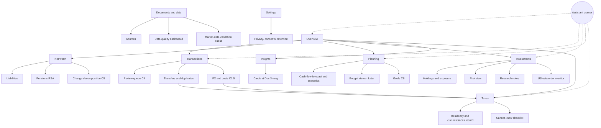
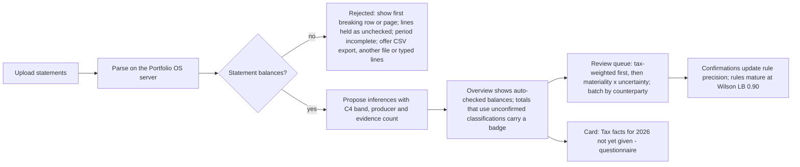

```
Document: 08 — User Experience and Product Design Blueprint
Department: Product and User-Experience  ·  Lead role(s): Chief Product Officer; UX researcher; UI designer; accessibility specialist; product-analytics specialist; human–computer-interaction (HCI) researcher
Version: 0.2 · Date: 2026-11-04 · Status: revised after independent review
Reviewers required: Behavioural Finance (Doc 3); Ledger and Data (Doc 4); Investment and Quant Methods (Docs 5a–5c); Tax (Doc 6); Architecture and Data Engineering (Doc 7); owners of CANONICAL_CONTRACTS C2–C7; Programme coordinator; licensed reviewers flagged in §4.4 Journey 7, §4.5.13 and §7
```

# Document 8 — User Experience and Product Design Blueprint

## 1. Executive summary

**Conclusions.** "Remarkably easy to use" is achievable without hiding sophistication if five commitments hold. Version 0.2 binds each one to the package contracts rather than to Doc 8's own vocabulary.

1. **Infer first, ask what only the user can attest.** First run is an upload. The system proposes facts with Doc 4's four confidence bands, and the review rules in contract C4 decide what reaches a person. The legally attested facts (residency, circumstances, nationality) are asked once a year as Doc 6's dated questionnaire, after the first Overview, and no tax figure appears without it.
2. **Every number wears an evidence strip.** The strip renders the C3 status axes and the C2 figure tokens. The assistant writes connecting text only.
3. **Two disclosure levels by default**, with cross-links for depth (an E3 heuristic, not a law).
4. **Uncertainty as counted futures.** The C6 headline is "about 60 of 100", always shown with its range, the adjustment that would reach the goal and the effect of a ±2-point change in assumed return.
5. **Currency honesty.** C5 splits each change into flows, conversion cost, market and exchange-rate effects, and a sign check runs when the figure is drawn. Recomputed this way, v0.1's "+0.8M FX" Overview becomes **−NGN 3,033,009.39**.

Behavioural cards render Doc 3's ladder and templates verbatim, show the checks already run, and offer no within-person experiments in the MVP.

**Biggest uncertainty.** Review workload. Under C4 every rule starts provisional, so the first six-month batch of about 1,272 lines needs about 231 decisions, roughly 2.2 hours (E5 model). A steady month needs 20 or 74 decisions, depending on how C4 counts a rule's track record (§4.3.5). Second: whether frequency framing and the adjustment line help a Nigerian–UAE user (E4, untested).

## 2. Scope and method

**Questions addressed.** (A) Which research should govern how a sophisticated financial system is made easy to use and honest about uncertainty? (B) What is the context of use? (C) Which information architecture, onboarding, journeys, screens, components, accessibility, performance and localisation rules follow? (D) How would we know the product is easy to use and its explanations are understood without over-trust?

**Method (v0.1, 2 Nov 2026).** Web search and fetch for HCI research, standards (WCAG 2.2, CLDR/ICU), style guidance (NN/g, GOV.UK, Monzo), regulators (FCA, FTC, NDPA, UAE PDPL) and Nigerian and UAE context. Academic references were verified by DOI against Crossref or OpenAlex. §10 marks each source [verified], [verified — page fetched], [secondary] or [unverified].

**Revision method (v0.2, 4 Nov 2026).**
- Read the context brief v0.2 and `CANONICAL_CONTRACTS.md` (C1–C7) in full, then reviews R08 and R03b (the Doc 8 points) and the relevant parts of R03.
- Read the parts of Docs 3, 4, 5c, 6 and 7 that Doc 8 renders.
- Recomputed every journey and worked-example figure in `research/scripts/doc08_journey_figures.py` [S149]. It runs under `python3 -I` with numpy and pandas and stops if either is missing. Its FX section reproduces contract C5.4 to the kobo and asserts equality.
- Re-fetched the FCA research note PDF (text extracted), Russell's 2026 budgets page and the W3C WCAG 2.2 Recommendation; pulled the OpenAlex abstracts for [S22] and [S69]; re-ran the local ICU minus-sign check. All on 2026-11-04.

**Correction.** v0.1 said that sibling Documents 3–7 "did not exist". That was true when v0.1 was drafted on 2 November. The file was edited again on 4 November without being reconciled to them (R08 §5). v0.2 references their current versions. Docs 3, 4, 5c, 6 and 7 are being revised in parallel, so dependencies on those revisions are listed in §11.

**Not done.** No usability or assistive-technology testing. No reading of the founder's Drive or email. Nothing written under `src/`. Synthetic data throughout. Not re-fetched, and still resting on v0.1 or on reviewers: TechCabal (HTTP 403), the KPMG/Orange study (404), the UAE PDPL primary text, and NGX trading hours (Doc 5c §9.3 lists these as still to be fetched).

## 3. Findings

Evidence grades follow the Context Brief (E1–E6). Source numbers refer to §10. Grades changed after review are marked "(v0.2 regrade)".

**F1 — Cognitive load is the binding constraint. Two-level progressive disclosure is a well-supported default, not an inviolable rule. (E2 load theory; E3 disclosure heuristic, v0.2 regrade of its binding force.)**
- Working memory holds about four chunks of novel material [S2], and extraneous load degrades problem solving [S1].
- NN/g's 2006 article reports that progressive disclosure improves learnability, efficiency and error rate, and that more than two levels "typically have low usability" [S3]. The article cites unnamed research.
- Shneiderman's "overview first, zoom and filter, details on demand" is the same rule for data-rich screens [S4].
- *Implication:* two layers per domain is the default. Phase 1 tests decide any exception (§4.9).

**F2 — Nielsen's heuristics translate cleanly into finance-specific obligations. (E3 heuristics [S5–S7]; E4 mapping by the HCI researcher and CPO.)**

| Heuristic | Portfolio OS obligation |
|---|---|
| Visibility of system status | Every figure shows as-of time and its C3 status; long jobs (parsing, simulations) show progress and partial results |
| Match to the real world | Use the user's own account names, bank descriptors and currencies; say "money you moved between your own accounts", not "intra-entity transfer" |
| User control and freedom | Every inference is reversible through a new classification version; ledger errors are corrected by a void and a replacement (C1.7), never by silent edits |
| Consistency and standards | One evidence strip, one number format per currency, one colour meaning everywhere |
| Error prevention | Duplicate and transfer detection before posting; confirmation only for destructive actions |
| Recognition rather than recall | Show the evidence (the transactions behind a pattern) rather than asking the user to remember it |
| Flexibility and efficiency | Keyboard-first ledger (shortcuts that can be turned off, §4.8), batch review by counterparty, saved views |
| Aesthetic and minimalist design | Five to seven figures per summary layer; no decorative gauges |
| Recognise, diagnose, recover from errors | Parsing failures name the file, page and reason, and offer a manual path |
| Help and documentation | "How was this calculated?" on every derived figure, in the same place on every screen (WCAG 3.2.6) |

**F3 — Trust should be calibrated, not maximised. Explanations and confidence displays can increase over-reliance unless they are designed as checks. (E3 for the framework, E2 for the experiments; v0.2 regrade from E1.)**
- Lee and See [S8] (a conceptual review) and Hoff and Bashir [S9] (a systematic review, not a meta-analysis) define appropriate reliance as trust matched to capability.
- The design implications rest on single, mostly crowd-sourced experiments:
  - showing confidence scores improved calibration but not accuracy [S10];
  - explanations raised acceptance of AI advice even when it was wrong [S11];
  - cognitive forcing functions reduced over-reliance but were liked less [S12];
  - explanations reduced over-reliance only when they made verification cheap [S13];
  - transparency had an inverted-U effect on trust [S14];
  - people abandon algorithms after seeing them err, but keep using them if allowed to adjust the output [S15, S16].
- *Implication:* show the data and calculation in a form that is cheap to verify (the Working panel), label unchecked inputs loudly, and never present a lone confidence number as reassurance.

**F4 — Counted, discrete futures beat single probabilities and error bars in the domains tested. (E2 for transit and weather decisions; E4 for the transfer to long-horizon personal finance; v0.2 regrade from E1–E2.)**
- *Dotplots and outcome plots.* Quantile dotplots and CDFs improved transit decisions in repeated experiments by one research group [S25, S26]. Hypothetical outcome plots beat error bars for judging ordering and trends [S27, S28]. Discrete displays improved recall of uncertainty [S38].
- *Misreading.* Error bars and confidence intervals are misread even by researchers [S31, S32]. Hurricane cones are read as the storm growing [S33, S34].
- *Trust.* Across five experiments (n = 5,780), communicating uncertainty produced "only a small decrease in trust … and mostly for verbal uncertainty communication". v0.1's "verbal hedges damage trust" overstated this (abstract re-read 2026-11-04 [S22, S151]).
- *Reviews.* Spiegelhalter's reviews recommend multiple formats and natural frequencies, avoiding false precision, and separating sampling uncertainty from uncertainty about the model's parameters [S23, S24, S36].
- *Adjustment framing.* The "probability of adjustment" framing [S40] is one practitioner's opinion, backed by a survey of advisers, not clients. **E4.** Contract C6 nonetheless requires the adjustment field, so Doc 8 displays it and tests its comprehension in Phase 1 (§4.9).
- The Bank of England fan chart is the institutional precedent [S39].

**F5 — Numeracy varies widely. Frequencies and consistent icon arrays help; "1 in X" formats confuse; fees in currency beat fees in percent. (E1 numeracy effects [S41, S42]; E2 formats.)**
- Natural frequencies improve probabilistic reasoning [S44, S45], and people with lower numeracy are more swayed by format [S41–S43].
- "1 in X" performed worst among the formats tested [S46], and ratio bias makes "10 in 100" feel larger than "1 in 10" [S47].
- Consistent icon arrays reduce errors [S48–S50].
- Fees shown in pesos made Mexican investors more fee-sensitive [S51]. Investors fail to minimise fees even among identical funds [S52, S53]. Credit-card repayment maths is widely misunderstood [S54].
- *Implication:* use a fixed denominator of 100, and show costs, fees and conversion costs in currency first.

**F6 — Feedback frequency and currency framing change decisions. (E1 framing [S55–S57]; E2 myopic loss aversion [S58–S61], ostrich effect [S62], money illusion and numerosity [S63–S65].)**
- Investors who see returns more often take less risk [S59–S61].
- People check portfolios less after falls [S62].
- Nominal framing and high-numerosity currencies distort judgement [S63–S65].
- *Implication:* long-horizon defaults; base-currency values next to native amounts; FX effects separated (C5).

**F7 — Seeing spending changes behaviour modestly and inconsistently. Goal-setting and reminders have the best field evidence; social comparison can backfire. (E2.)**
- *Seeing spending.* Account aggregation reduced spending in one field study [S67], and app adoption changed fee behaviour in another [S66]. Consumption responds to liquidity [S68].
- *Goals and reminders.* In a randomised beta-tester design, goal setting raised the savings rate without reducing saving outside the app, and helped those least likely to save [S69]. The abstract was re-read on 2026-11-04 [S151]. v0.1's "the effect persisted" is not in the abstract and has been removed. SMS reminders raised saving modestly [S70]. A credit-card reminder had side effects elsewhere [S71].
- *Peer information.* It helped in one app [S72] but discouraged low savers in a retirement experiment [S73]. Energy-use comparisons had small effects [S74].
- *Education.* Financial education has small effects that decay [S75–S77].
- *Defaults.* Defaults and commitment devices move behaviour more than information does [S78–S82]. Doc 3 v0.1 notes the bias-corrected finance-domain nudge effect is near zero (R03 B2).
- *Implication:* neutral, user-paced feedback; no peer comparison; no interventions without Doc 3's evaluation design.

**F8 — Dark patterns are prevalent and effective. Gamified engagement raised trading in a regulator's experiment, but did not produce riskier end portfolios. (E2.)**
- *Prevalence.* Dark patterns are common [S84] and effective: mild ones doubled acceptance of a dubious service [S86]. The FTC groups them by mechanism [S87].
- *The FCA experiment* [S88], PDF re-read on 2026-11-04. It was an online simulation with more than 9,000 participants and an endowment equivalent to £0.50.
  - **Trades.** Push notifications and points-plus-prize-draws raised the number of trades by 11% and 12%.
  - **Risky trades.** They raised the share of trades in the riskiest investments by 3.5 percentage points (10%) and 2 points (6%). The summary page says 8% and 6%.
  - **End portfolios.** "None of the features led to a statistically riskier investment portfolio at the end of trading."
  - **Subgroups** attach to different features and outcomes:
    - low literacy: more trading under flashing prices and the leaderboard, which had no main effect;
    - women: more trading under push notifications and points;
    - ages 18–34: higher end-portfolio riskiness under every engagement feature except flashing prices.
- *Implication:* §4.1 prohibited patterns; nothing celebrates a trade, a login or a streak.

**F9 — Ethical presentation of behavioural insights means boosting competence, protecting autonomy, avoiding shame and disclosing the nudge. (E2.)**
- Boosts preserve agency [S89], and autonomy support sustains motivation [S90].
- Financial shame drives avoidance [S91].
- Disclosing a nudge does not remove its effect [S92, S93].
- Sunstein's criteria are the test [S94]. Scarcity consumes bandwidth [S95].
- Mental accounting explains separate pots [S96, S97].
- *Implication:* no labels, no scores, and alternatives shown by default. But the alternatives must be the ones Doc 3's checks leave **open**, never ones the checks were supposed to have removed (R03b B1).

**F10 — Context of use. Nigeria is Android-dominant and data-cost sensitive; the UAE is majority-Android on the web. Neither open-banking regime gives an individual a licence-free data path. (E2 statistics; E3 for status.)**
- *Platforms.* Statcounter, October 2026, re-confirmed by R08: Nigeria Android 86.6%, iOS 13.3% [S98]; UAE 80.7% and 19.3% [S99]. These are web-traffic shares.
- *Data cost.* The NCC's 50% tariff rise in January 2025 took the 1 GB floor from ₦287.50 to ₦431.25. Use was 9.86 GB per subscriber per month in May 2025 [S100]. A reported 2025 average of about ₦575/GB [S101] is **unverified** (HTTP 403).
- *Inclusion.* Formal financial inclusion was 64% (EFInA 2023, secondary [S104]).
- *Open banking*, per Doc 4 F1 and F8, checked 2026-11-02 [S142]:
  - Nigeria: the August 2025 go-live did not happen, and no nationwide go-live was confirmed by October 2026.
  - UAE: CBUAE Open Finance (Circular 3/2025) is live at some banks but requires a CBUAE licence.
- v0.1's "broadband crossed 50%" claim (not fetched) is withdrawn.
- *Implication:* uploads are the ingestion path, and a Nigerian product must be data-light.

**F11 — Multi-currency views need declared presentation currencies and a strict separation of exchange-rate effects from real changes. (E3 standard [S108]; E2 behavioural basis [S63–S65]; E4 design.)**
- IAS 21 translates transactions at transaction-date rates and reports exchange differences separately [S108].
- v0.1 translated every flow at the closing rate. On real data its screen would not have matched the ledger (R08 B2).
- v0.2 adopts **C5**: flows at their own dates' rates, conversion cost against the CBN reference, market moves at the closing rate, FX translation including intra-period flows, an exact identity, and a sign check. Two default views, NGN and USD (C5.3; Doc 4 §4.4.7).

**F12 — CLDR formats are mostly right; the minus sign and the dirham sign need handling. (E3; locally verified 2026-11-04.)**
- *Formats.* ICU 78.3 (Unicode 17.0) formats `en-NG` as `₦1,234,567.89`, `en-AE` as `AED 1,234,567.89`, and `ar-AE` with RLM/LRM marks [S107, S152].
- *Minus sign.* ICU emits a **hyphen-minus** for negatives (`-₦1,234,567.89`, reproduced), and parentheses are not announced as negative by screen readers (§4.8).
- *Naira sign.* U+20A6 is in every mainstream font and is used in Docs 3 and 4.
- *Dirham sign.* The new sign, U+20C3, was encoded in Unicode 18.0 (September 2026) [S106; confirmed by R08 in UnicodeData.txt, S153]. It is not in current ICU builds.
- *GOV.UK rules* are the plain-language baseline [S109]: numerals, commas, "million" in words, dates as "3 November 2026". §4.7 lists the exceptions.

**F13 — Usability can be measured credibly at n = 1 and in small samples, if the right instruments are used and the founder's dual role is controlled. (E2 instruments; E3 practice.)**
- *Instruments:* SUS [S120, S121], UMUX-Lite [S122], SEQ [S123], NASA-TLX and Paas [S124, S125], HEART [S126]. Pitfalls are documented by Hornbæk [S127].
- *Sample size.* Five users find most problems in a homogeneous group [S128, S129], but not in heterogeneous groups [S130].
- *Methods.* Diary methods for lived use [S131]. N-of-1 logic for features [S132], but only where effects reverse; learning effects do not.
- *Dual role.* The founder is sponsor, designer-of-record and sole subject, so demand effects are expected (R08 M8).

**F14 — Perception research and standards set hard constraints. (E1 graphical perception [S114–S116]; E3 standards [S111–S113, S117–S119].)**
- Position along a common scale beats angle and area [S114–S116].
- About 8% of men have a colour-vision deficiency, and Okabe–Ito is the safe set [S112, S113]. But **several Okabe–Ito hues fail 4.5:1 as text on white** (§4.8, script §9).
- *WCAG 2.2* (Recommendation, 5 October 2023) adds nine criteria [S111]. It also requires:
  - character-key shortcuts that can be turned off or remapped (2.1.4, Level A);
  - a timeout warning with at least 20 seconds to extend (2.2.1, A);
  - focus not entirely hidden (2.4.11, AA);
  - consistent help (3.2.6, A);
  - reflow at 320 CSS px (1.4.10, AA) [S154].
- *Core Web Vitals* "good" thresholds: LCP ≤ 2.5 s, INP ≤ 200 ms, CLS ≤ 0.1 at p75 [S118].
- *Russell's 2026 3-second budgets*, re-fetched 2026-11-04, for a Galaxy A24-class device on 9/3 Mbps with 100 ms RTT, two TLS connections [S119]:
  - JS-light page: 2.0 MiB total, 0.3 MiB JavaScript;
  - **JS-heavy page: 1.2 MiB total, 0.62 MiB JavaScript**.

  A table- and chart-heavy app is the JS-heavy case.

**F15 — Data-protection law grants rights the interface must honour, and behavioural inferences are profiling in substance. (E2 Act text as read by R03b; E3 practitioner summaries; licensed review required.)**
- *Nigeria (NDPA 2023, as read page by page by R03b [S155]):*
  - s.3(1) exempts processing "solely for personal or household purposes", which covers the founder acting alone;
  - s.24 limits purpose and retention, s.25–26 govern lawful basis and consent, and s.27(1)(g) requires notice of automated decision-making including profiling;
  - s.30 requires specific consent for sensitive data, which s.65 defines to include religion, health and political affiliation;
  - s.34–35 give rights of erasure and of withdrawal as easy as consent; s.37 covers solely automated decisions.
- *UAE.* Decree-Law 45/2021 excludes banking and credit data and free zones [S135]. Its sensitive-data definition reportedly covers data revealing a person's family (DLA Piper via R03b; primary text 403; E3).
- *Implication:* a separate behavioural consent, a sensitive-inference register, and retention rules that differ by store (§4.5.13, V-028).

**F16 — The assistant's value depends on explanation forms people ask for. (E2.)**
- Users ask "why", "why not", "what if" and "how confident" [S18, S21].
- Complete but not overwhelming explanations build accurate mental models [S17].
- Human–AI interaction guidelines stress capability disclosure and efficient correction [S19], and contrastive explanation [S20].

**F17 — The review queue is the real onboarding cost, and contract C4 makes it larger at first. (E5 model; `doc08_journey_figures.py` §8.)**
- *Assumptions:* about 212 lines a month across accounts, in a stated composition; counterparties drawn from Zipf-like pools; 20 s per batch decision plus 2 s per line shown, 30 s per transfer pair, 45 s per first tax-weighted credit.
- *Why the first batch is large.* Under C4 every rule starts provisional. Also, an all-correct rule needs **35** confirmations, not 30, to reach a Wilson lower bound of 0.90, because 30 of 30 gives 0.886.
- *First batch (six months).* 1,272 lines need **231 decisions**: 102 merchant batches, 48 transfer pairs, 34 payee batches, 31 credit decisions, 8 bill batches, 6 levy-rule batches and 2 savings batches. That is about **131 minutes**, or 6.5 twenty-minute sessions. Counterparty batching is what keeps it from being about 1,272 single decisions.
- *Month 7.* About 20 decisions (9 minutes) if counterparty memory is scored as one pooled producer; about 74 decisions (30 minutes) if each counterparty must earn its own 35 confirmations. C4 does not say which. §11 raises it with the contract owners.

## 4. Proposed framework / specification for Portfolio OS

### 4.1 Design principles and the two universal components

**Ten principles** (each traceable to §3; changes from v0.1 in bold where material):

| # | Principle | Evidence | Testable consequence |
|---|---|---|---|
| P1 | Infer before asking; **attested legal facts (Doc 6 questionnaire) are asked together, once a year, after the first Overview** | F1, F16; Doc 6 §4.4 | First run contains zero free-text questions before the first upload is parsed; no tax figure renders without a current questionnaire (Doc 6 R3) |
| P2 | Every figure carries an evidence strip rendered from C2 tokens and C3 status | Brief §5.1, F3 | No numeral renders outside a renderer-emitted span (C2.2 item 10) |
| P3 | Two disclosure levels per domain **by default** | F1 (E3) | Any datum is ≤ 2 taps from its domain summary or reached by a cross-link |
| P4 | Uncertainty as counted futures **per C6**: count rounded to 5, q10–q90 range, adjustment, drift sensitivity | F4, F5 | No count appears without range and adjustment in the same view, Overview included |
| P5 | Currency honesty **per C5**: native amount, two base views, decomposition with sign check | F6, F11 | Every period change shows flows / conversion cost / market / FX; a sign-check failure withholds the figure |
| P6 | Horizon-appropriate feedback | F6 | Portfolio summary defaults to 1-year and since-inception; daily change is a detail-layer element |
| P7 | Observation, not judgement; **behavioural text only from Doc 3 templates** | F7–F9 | Copy lint (§4.7) and template-ID check on every card |
| P8 | Reversible by design **without rewriting history**: classification changes are new versions; ledger errors are void + replacement (C1.7) | F2 | "Undo" restores the prior classification version at any time; no posting row changes (C1-I12) |
| P9 | Explanations verifiable and contrastive, with inputs shown | F3, F16 | Working panel on 100% of assistant answers containing figures |
| P10 | Accessible and light by default | F14 | WCAG 2.2 AA audit passes; bundle budget per §4.8 |

**Component A — the evidence strip.** It is rendered beside or beneath any figure. Fields come from the C3 axes and the C1/C2 data contract: `source` (with licence class), `as_of`, `unit_currency`, `validation` (C3 V axis), freshness (C3 F, **computed when read**), lifecycle, rights, identity and corroboration overlays, `method` (C3 M axis), `confidence` (C4, inferences only), `rate_set` (for converted figures) and a link to the calculation record. The table below maps each state to its look and its accessible name. Contrast values come from script §9.

| C3 / C4 / Doc 4 state | Visual | Accessible name fragment (spoken after the value) | May feed |
|---|---|---|---|
| V `validated`, F `fresh` | plain numerals | "as of {date}" | descriptive and conclusion-driving calculations |
| V `auto_validated` | "auto-checked" chip, or "single source" when `single_source` | "auto-checked" / "single source" | descriptive; conclusions only via C3.4 corroboration or the sampling rule |
| V `candidate` | "unchecked" chip | "unchecked, not in totals" | nothing |
| V `disputed` | **both values side by side** with sources and the tolerance that failed; chip fill #CC79A7 with black text (6.86:1); **never a range** | "disputed: {value A} from {source A}, {value B} from {source B}" | nothing, and no derived figure |
| V `rejected` | hidden (audit view only) | — | nothing |
| F `ageing` | amber chip: fill #E69F00 with black text (9.32:1); numerals unchanged | "ageing, {n} business days old" | descriptive with badge; conclusions allowed |
| F `stale` | grey numerals (#767676 light 4.54:1; #7D7D7D dark 4.55:1) and a "stale" chip | "stale, as of {date}" | descriptive with inherited badge; not conclusions |
| F `expired` | no value: "expired since {date}" | same | nothing |
| L `restated` / `superseded` / `withdrawn` | "restated" chip with link to the prior vintage / history only | "restated" | per C3.4 |
| R `licence_expired` / `licence_revoked` | licence chip / "removed (licence)" | same | per C3.4 |
| I `vendor_renamed` | "symbol changed: confirm" chip | same | nothing until confirmed |
| M `estimated` | italic numerals **plus visible "est."** | "estimated" | per V and F |
| Aggregate `incomplete` (Doc 4 §4.3.7) / "rate missing" (Doc 4 §4.5(6), C5.2) | "incomplete: {reason}" chip; unconverted item shown native | "incomplete" / "rate missing, not converted" | descriptive with badge only |
| "No trade since {date}" (Doc 5c P1) | chip beside the price | same | per F |
| Inference confidence (C4) | band word (very high / high / medium / low) plus evidence count and producer ("rule", "your earlier choice", "model suggestion"); **number only in the detail drawer** | "{band}, seen {k} of {n}" | auto-applies only under the C4 rule |

The worst badge among a derived figure's inputs is inherited ("includes 1 stale price"). Statement lines that reconciled are `auto_validated` under C3.2. In dense ledger tables Doc 8 shows that state **once, at table level** ("All 212 lines reconciled to statements"), not as a chip in every cell. This interpretation needs the C3 owner's agreement (§11).

Text wireframe (desktop). Statement amounts keep their minor units, which is a stated exception to GOV.UK (§4.7).
```
NGN 12,870,000.00  ·  auto-checked  ·  NG Bank statement p.3  ·  as of 30 Oct 2026  ·  How was this calculated? ›
```

**Component B — the Working panel.** It is attached to every assistant answer and every derived figure, and contains:
1. the inputs, as a table with their own strips;
2. the deterministic operation, as a C2 `calc` registry entry with name, version and parameters;
3. the assumptions, each flagged "default — change?";
4. what was not known;
5. a Recompute action.

**The model writes connecting text only. Values, dates, counts and directions are tokens that the renderer resolves from the validated store against the turn's allow-list (C2.2).** Quoted statement text appears only as a `quote` ("as printed on …, p.n") and never as a figure. Numbers the user types are labelled "you entered" (C2.2 item 8). v0.1's "the model may paraphrase" is withdrawn.

**Prohibited patterns (design-review checklist, from F8).**
- Pressure and nagging: confirmshaming; countdowns or scarcity cues; nagging after a declined intervention (one decline silences it for 90 days).
- Rewards and comparison: celebratory animation after any financial action; leaderboards or peer rankings; streaks and badges.
- Hidden costs: fees or conversion costs disclosed piecemeal ("drip pricing"); conversion costs hidden inside a rate.
- Defaults against the user: pre-ticked consents; opt-out defaults for data sharing or behavioural analysis.
- Obstruction: interstitials that delay reaching one's own data.
- Encoding: colour as the only signal of gain or loss.

**Worked example (synthetic; contract C5.4, reproduced by script §2).** The figures are October 2026 at CBN central synthetic rates: ₦1,530.00/$ on 30 Sep, ₦1,500.00 on 16 Oct and ₦1,480.00 on 30 Oct, so the naira strengthens. 31 Oct is a Saturday and takes the 30 Oct fixing.
- Holdings: NGN 12,000,000; USD 35,000; AED 85,000; 12 ETF units moving from $250.00 to $257.50.
- Flows: AED −5,500 spent on 15 Oct; NGN 1,000,000 converted to USD 660 on Sunday 18 Oct (using the 16 Oct fixing); salary NGN +2,350,000 on 26 Oct; NGN −480,000 spent on 28 Oct.

| View | Opening | Closing | Change | Flows | Conversion cost | Market | FX on NGN | FX on USD | FX on AED | Display rounding |
|---|---|---|---|---|---|---|---|---|---|---|
| NGN | 105,551,844.79 | 102,258,121.17 | −3,293,723.62 | −383,914.23 | −10,000.00 | +133,200.00 | 0.00 | −1,913,200.00 | −1,119,809.39 | 0.00 |
| USD | 68,988.13 | 69,093.33 | +105.20 | −243.67 | −6.67 | +90.00 | +265.53 | 0.00 | 0.00 | +0.01 |

Sign check: in the NGN view the USD rate fell while the user was long USD, so FX on USD must be negative, and it is. The same holds for AED. In the USD view, FX on NGN is positive (OK). v0.1's Overview showed "+0.8M FX". Under C5 it is **−NGN 3,033,009.39**, the sign R08 B2 predicted. Shown as:

```
NG Bank · NGN current            Oct 2026                        view: NGN | USD
Balance   NGN 12,870,000.00  (USD 8,695.95 at CBN central 1,480.00, fixing Fri 30 Oct)
Net worth change (all accounts)  −NGN 3,293,723.62
   your income and spending   −NGN 383,914.23
   conversion cost vs CBN     −NGN 10,000.00
   market (ETF)               +NGN 133,200.00
   exchange rates             −NGN 3,033,009.39   (naira strengthened: your USD and AED are worth fewer naira)
   Why these parts? ›
```

USD 8,695.95 = 12,870,000 ÷ 1,480, rounded half-even once. In the USD view the same month reads +USD 105.20, of which +USD 265.53 is the naira's rise. A line valuing NGN liquidity at the parallel rate is available as a sensitivity only, at confidence D, and never as a headline (C5.1; Doc 4 §4.4.7).

### 4.2 Information architecture

**4.2.1 Domains** (two layers each; v0.2 adds homes R08 M3 found missing):

| Area | Summary layer | Detail layer and homes |
|---|---|---|
| Overview | ≤ 7 figures (§4.5.1) | links only |
| Transactions | ledger, "Needs you" count | Ledger; **Review queue** (C4); Transfers and duplicates; **FX and costs** (conversion cost vs reference per C1.5, dealer markup, fees and levies, "unexplained difference" items; §4.5.14) |
| Net worth | NGN and USD views, decomposition | Accounts by currency; **Liabilities** (cards, loans, payables; debt-service ratio, liabilities ÷ liquid assets, Doc 4 §4.4.5); **Pensions** (RSA by PFA and fund, statement value with as-of; carried-forward values labelled, Doc 5c §4.3.11); currency exposure |
| Planning | reserve months, committed next 30 days | **Cash-flow forecast** with Doc 4's recurring projection and scenario overlays (§4.4.6); **Budgets** in Doc 4's three views (envelope, zero-based, percentage guides; *Later* per Doc 4 R9); Goals (Goal Reality Engine) |
| Investments | value, allocation, exposure | Holdings; Risk; Research notes; **US estate-tax monitor** link (Doc 6 R6) |
| Insights | observations at their Doc 3 rung | Cards (§4.5.6); hidden kinds; consent status |
| Taxes | questionnaire status; mode (indicative / audited) | Nigeria and UAE columns; "cannot know from statements" checklist; **US-situs value vs USD 60,000** (Doc 6 F31, R6); rule status and watermark (C7) |
| Documents and data | uploads, parsing status | Documents; Sources; **Data-quality dashboard** (Doc 5c §4.3.8); **Market-data validation queue** (Doc 5c §4.3.10; C3 sampling at 1 in 20) |
| Settings | — | Facts about you (residency and circumstances record; risk willingness, §4.3.4); currencies and views; privacy and consents (§4.5.13); keyboard; notifications |

The assistant is a drawer available on every screen, pre-filled with the context of the current object. Its entry button sits in the same relative position everywhere (WCAG 3.2.6).

**4.2.2 Navigation.**
- *Desktop:* left rail with the nine areas; content pane with the summary on top and collapsible detail below; inspector on the right.
- *Mobile* (a web layout only; no native app, Doc 7 §4.10): bottom bar with Overview, Transactions, Net worth, Goals, More. The assistant opens from the header, not a floating button, to keep focus visible (§4.8).
- *Global:* command palette (`Ctrl/Cmd+K`; `/` only while it is enabled) and search.

**4.2.3 Cross-linking, with tax chips on transaction kind.** Every object exposes its relations, rendered as a breadcrumb trail of chips. Behavioural constructs appear under descriptive names (R03b m1), never under internal construct names. **Tax relevance attaches to transaction kind**, not to category:
- kinds that carry a chip: conversion, dividend, interest, disposal, salary or other income credit, foreign-tax withheld, rent paid, pension contribution;
- until the Doc 6 questionnaire is current, the chip reads **"Tax: not yet determined"**;
- the system never shows "Tax: not relevant" before residency is known, because that is itself a tax conclusion;
- kinds with no Doc 6 relevance carry no chip;
- the transfer card (§4.5.3) carries one, because a conversion disposes of a chargeable asset under NTA s.34(1)(b) (Doc 6; C1.6 ⚠).

Example: "Transaction › Kind: card purchase › Category: Utilities › Budget: Housing (Lagos) › Pattern: spending after salary arrives". A conversion's trail ends "› Tax: not yet determined ⚠".



**4.2.4 "Explain" entry points.** Four fixed verbs:
- **Why?** — what this number is made of;
- **Why not?** — why a transaction was not matched, or why a goal falls short;
- **What if?** — opens the scenario control, pre-filled;
- **How sure?** — opens the strip and the confidence rationale.

The answer format is fixed: one sentence; two to four **components** (v0.1's "drivers" read as causal); the Working panel; a "What I could not know" line. Every figure, date, count and direction is a C2 token.

Example, rendered output, using Journey 2's synthetic series (script §4):

> **Why is October's spending higher than the previous six months?** October spending was NGN 1,420,000, which is NGN 145,000 above the April–September average of NGN 1,275,000. Components: school fees NGN 180,000 (an annual item, last seen October 2025); fuel and generator NGN 62,000 above their average; all other categories NGN 97,000 below theirs. Excluding school fees, October was NGN 35,000 below the average. *Working:* NG Bank statements April–October 2026 (auto-checked); categories as confirmed by you on 3 Nov. *Not known:* whether the fees cover one term or the year.

The model's raw output for the first sentence looks like `{{fig:sp_oct|as=spend.total|fmt=money}} … {{dir:sp_delta}} … {{calc:avg6.output|as=spend.avg_6m|fmt=money}}`. The renderer produces the digits.

### 4.3 Onboarding by inference, with attested facts asked once

**4.3.1 First-run flow.**



**4.3.2 What is inferred, how it is shown and how it is routed.**

| Proposed fact | Producer (Doc 4 §4.3.6) | Card copy (synthetic) | Routing under C4 |
|---|---|---|---|
| Accounts and currencies | statement structure | "We found 3 accounts: NG Bank NGN current, UAE Bank AED current, US Broker USD. Correct?" | A masked identifier only creates a candidate; the user confirms on first sight (C1.8) |
| Salary or regular income | deterministic rule | "A credit of about NGN 1,850,000 arrives around the 25th each month, seen 6 of 6 months. Treat as salary?" | First classification of a credit as income is tax-weighted, so it always goes to review (C4 item 4) |
| Recurring bills | rule or counterparty memory | "12 recurring payments found (rent, DEWA, data, school fees…). Review list ›" | Batch per payee; auto-apply only after the rule matures |
| Own-account transfers | matching rule | "NGN 1,000,000 out on Sun 18 Oct and USD 660 in at US Broker on Mon 19 Oct look like the same money" (§4.5.3) | Cross-currency with no shared reference: review (C4 item 5); until confirmed, both legs sit in transit and no conversion cost appears in totals (C1.5) |
| Investment contributions | matching rule or rule | "USD 800 to US Broker on the 5th each month" | Transfer, not spending (Doc 4 §4.3.3) |
| Duplicates | line key (C1.8) | "Two files cover 1–15 Oct; 41 lines already held were skipped. Show ›" | Re-imports create no postings (C1-I10); fuzzy candidates are reviewed |
| Unknown credits | — | "NGN 250,000 from a new sender. What was it?" | **Never defaulted to a transfer**; counts toward a visible "unexplained inflows" total (C4) |
| Presentation views | — | "Totals are shown in NGN and USD. Change the order any time." | Two default views (C5.3); NGN is the tax currency (Doc 6) |

**4.3.3 Corrections.** Each user decision is a typed event: `fact_id`, old, new, scope (this item / this counterparty / all similar), actor, time.
- **A classification change** is a new bitemporal `classification` version, so "undo" restores the previous version at any time (C1.3, C1-I12).
- **A wrong posting** (a parser defect) is a void and a replacement, with a reason (C1.7).
- **Statement lines** are never edited.

The user sees the consequence at once: "Applied to 11 lines from this payee — undo". Corrections feed rule precision (C4 calibration) and Doc 4's evaluation.

**4.3.4 The questions that cannot be inferred.**

| Question set | Why statements cannot answer it | When asked | Default while unanswered |
|---|---|---|---|
| **Residency and circumstances record** (Doc 6 §4.4, yearly, attested, about 20 items) | Legal status and facts not in cash flows | Offered as one card right after the first Overview; required before any tax figure; re-attested yearly and when a trigger fires (for example days present cross 183, or a new foreign income stream) | Taxes area in *indicative* mode: no tax figures; tax chips "not yet determined" |
| Goals (amount, currency, date, purpose, flexibility) | Preferences | When opening Goals or "What happens if I spend…?" | No goal counts displayed |
| Risk-capacity facts (dependants, insurance, debts not on statements) | Must be confirmed | First goal simulation; inferred values pre-filled for confirmation | Simulation labelled "capacity facts unconfirmed" |
| Risk willingness (one item, asked when the first portfolio benchmark appears; R03b M3) | Stated preference | Just in time | Not shown; Doc 3/Doc 4 to settle the instrument (SOEP item vs Grable–Lytton 13, and its licence; V-026) |
| Consents (§4.5.13) | Legal requirement (F15) | At first upload, as separate unticked choices; behavioural analysis asked only when Insights is first opened | Off |

**Residency and circumstances record.**
- *Contents.* Items follow Doc 6 §4.4: days in Nigeria, the UAE and elsewhere; domicile claim; homes; family location; employment type and employer country; benefits; pension and NHF contributions; rent and landlord; other assets; business activity; Tax ID and prior filings; foreign tax withheld; W-8BEN; treaty positions; joint ownership; gifts and loans; US-situs holdings. **Nationality and citizenship are also asked**, which reverses v0.1's "not asked". The UAE 90-day test needs them (Doc 6 F25), and so does US estate-tax status (Doc 6 F31).
- *Pre-filling.* Where the ledger can suggest an answer (an employer country from a `WPS` salary narration, a rent payee), the item is pre-filled, but every pre-filled item must be confirmed, because it carries tax weight (C4 item 4).
- *Attestation.* The record is attested with a date ("I confirm these answers are correct as of 3 November 2026"), stored with timestamps, and shown under Settings › Facts about you with its own strip.
- *Form behaviour.* It can be saved and resumed. It never asks again for what the user has already given (WCAG 3.3.7).

**Indicative and audited modes** (Doc 6 disagreement 9, adopted):
- *Indicative mode:* analytics with an "unaudited" watermark and **no tax figures**.
- *Audited mode:* tax schedules unlock only after Doc 6 gates 1–3 and a current questionnaire.
- *Watermark:* every tax figure also carries the C7 watermark for the weakest rule status used.

**4.3.5 Fallbacks when inference is imprecise** (replaces v0.1's "define fallbacks if below 90%"). The ladder runs in order, per fact type:

1. **Measure.** Precision and recall per fact type and producer on a founder-labelled sample. At least 200 own transfers and 50 reversals (Doc 4 §9 item 6), plus a stratified sample of 100 categorised lines per batch. Doc 4's gates apply: salary precision ≥ 0.95 before use in forecasts (§4.3.1); rules demoted below 0.90 trailing-100 precision (§4.3.6); C4's Wilson lower bound for auto-apply.
2. **Batch.** Resolve by counterparty or rule. One decision shows every line in scope and confirms only non-tax items. Medium and low items are listed individually inside the batch with tick boxes.
3. **Defer low-materiality items** below a founder-set NGN-equivalent threshold (open, C4 Q1) to **"Unclassified"**:
   - their amounts **stay in account balances and in total spending** as an explicit "unclassified" line, with "includes NGN X unclassified (n lines)";
   - they are excluded from category, budget and behavioural statistics.

   This deliberately differs from R08's "excluded from totals" (§7).
4. **Time budget.** Each queue session is offered as about 20 minutes, in the C4 order: tax-weighted first, then materiality × (1 − p). Minutes per session are logged (§4.9).
5. **Manual mapping.** Column mapping for files the parser cannot read. This fixes parsing, not inference.
6. **Stop condition.** If precision for a fact type stays below its gate after three batches, that fact type stops being proposed. It becomes a plain list the user classifies, and the "no questionnaire" promise is stated as not met for that type.

**Sizing** (script §8; E5): the first batch is 1,272 lines, 231 decisions and about 131 minutes. Month 7 needs 20 decisions (9 minutes) or 74 (30 minutes), depending on the C4 reading. v0.1's "14 items" first queue is withdrawn.

### 4.4 End-to-end journeys

All journeys use synthetic data. The user is "the founder", and devices are unknown, so desktop is assumed unless stated. Each figure is reproduced by the named section of `doc08_journey_figures.py`.

**Journey 1 — First upload and reconciliation (desktop, Tuesday 3 November 2026; about 25 minutes to first Overview; review continues in later sessions).**
- *Upload.* The founder drops five files: NG Bank NGN statements May–October 2026 (two password-protected PDFs), a UAE Bank AED statement ending 15 October, a US Broker activity CSV and a savings-app PDF.
- *Parsing failure.* Page 7 of one NG Bank PDF is scanned, so that statement fails its balance check and is **rejected** (Doc 4 §4.3.7). Its other 13 pages are held as `candidate` lines, never in totals, and May–June are marked *incomplete*. The error names the page, the first row where the running balance breaks and three paths:
  - export a CSV from the bank app;
  - upload another copy;
  - type the missing lines, which are labelled "you entered".

  The statement is accepted only when it balances to its printed closing figure.
- *Proposals* (§4.3.2): 3 accounts, a salary stream (6 of 6 months), recurring bills, transfer pairs, skipped duplicates.
- *Correction.* A USD credit at US Broker that looked like a transfer leg is a client payment. Its first classification as income is tax-weighted, so it was in the queue anyway. The founder sets the scope to "this payer", and future credits from that payer are proposed as income but still reviewed until the rule matures.
- *Overview* appears with:
  - balances from reconciled statements (auto-checked);
  - an *incomplete* chip on the AED account ("16–31 Oct not uploaded"), not v0.1's "Estimated";
  - an **ageing** chip on converted totals: the latest fixing is Fri 30 Oct, two business days before Tue 3 Nov, which is `ageing` under Doc 5c §4.3.2 and C5.2, not "stale" (script §1);
  - "Needs you: 231 decisions, about 2 hours 10 minutes; start a 20-minute session".
- *Success criteria:*
  - time to first Overview ≤ 30 minutes;
  - zero free-text questions before the first proposal;
  - precision and recall per fact type measured on the labelled sample, with calibration per band (C4);
  - review minutes per session logged;
  - the founder can state, unprompted, which figures are unchecked, incomplete or ageing (comprehension probe, §4.9).

**Journey 2 — Monthly review (mobile, then desktop; about 15 minutes).**
- *Notification.* On Tue 3 November a monthly notification (opted in) says: "October is ready to review: 20 decisions, about 9 minutes." That is the pooled C4 reading. The per-counterparty reading gives 74 decisions and 30 minutes (script §8).
- *Mobile:* Overview (§4.5.1), then the review queue in list form (§4.5.2 phone layout; no gamified clearing).
- *Desktop* (Journey 2's own synthetic NG Bank series, script §4, separate from the C5.4 household): the budget and cash-flow view shows October spending of NGN 1,420,000 against the April–September average of NGN 1,275,000, with the annual school-fees item split out. The "Why?" answer is the §4.2.4 example.
- *What if?* The founder asks "What if school fees are for the whole year?" The scenario spreads NGN 180,000 over 12 months. The May–October monthly surplus changes from a mean of NGN 540,000 (sample SD NGN 61,595, n = 6) to NGN 555,000 (sample SD NGN 35,693). v0.1's "NGN 551,667 ± 75,093" could not be reproduced and is withdrawn.
- *Success criteria:*
  - review completed in one session, with session minutes logged;
  - SEQ recorded (descriptive; §4.9);
  - no figure without a strip;
  - the founder correctly restates the four-part decomposition of the net-worth change.

**Journey 3 — "What happens if I spend…?" (mobile, about 5 minutes; v0.1's "Can I afford…?" is renamed).** In Dubai, the founder considers an AED 14,000 purchase and enters amount, currency and date. Data shown, as of 30 Oct, from the C5.4 household (script §5):
- AED balance AED 79,500.00, minus AED 23,400 committed in the next 30 days (rent instalment, DEWA, school), leaves AED 56,100.00 free, or **AED 42,100.00 after the purchase**;
- AED reserve: **7.23 months → 5.95 months** of essential AED spending (6-month median AED 11,000; Doc 4 §4.4.2 uses essential spend, not v0.1's "baseline spending");
- NGN and AED combined (NGN view): 8.91 → 7.79 months;
- if the founder chose to pay from NGN instead, the conversion cost against the CBN reference would be shown in AED first and percent second (C1.5).

The goal effect is "Goal USD 100,000 by 31 Oct 2031: **unchanged** at about 60 of 100 futures (lowest tenth USD 83,000; highest tenth USD 132,000), because the goal draws only on USD broker assets and USD contributions." This fixes v0.1's internal contradiction, where the count moved even though the money came from AED cash.

*Success criteria:* answer in ≤ 3 taps; the founder can say which currency the money comes from and what changes; the system gives no yes/no verdict.

**Journey 4 — A behavioural observation is surfaced (desktop, about 4 minutes).**
- *Sources.* The card renders Doc 3's construct specification and templates (window days 0–6 against days 7 and later, ratio with 95% interval, cycles held, checks). The figures come from Doc 3's committed synthetic ledger (1 Jan–30 Jun 2026), recomputed in script §7; the interval and chance test are Doc 3 `payday_sim.py` outputs.
- *Headline* at rung **L1 "Measured pattern"**: over 5 complete pay cycles, spending in the categories the founder marked as flexible averaged ₦32,612 a day in the 7 days after salary against ₦20,389 on other days. That is **1.6 times** (likely range 1.4–1.8), against 1.0 if spending were even. It held in 5 of 5 cycles.
- *Checks already run, with their size:*
  - rent, school fees, utilities, ajo, the family transfer, currency conversions and the investment contribution were removed or shown separately; together they were **93% of the raw post-salary rise** (the naive all-outflows ratio was 8.03);
  - weekday mix: 29.3% weekend days in the window against 28.6% outside;
  - chance: circular-shift test p = 0.006.
- *Still open* (L3; from R03 M2; shown as "not tested"): bulk buying at payday; card-posting lags; cash withdrawn and spent; a second income stream; spending from another person's account.
- *What it touches:* investment contribution made in 6 of 6 cycles; the records contain no fee or overdraft lines in the last 7 days of any cycle. So **no cost linked to this pattern was found** (R03b M1).
- *Context.* A collapsed "Research context (not about you)" line uses Doc 3's analogy template ("several large US and Icelandic bank-data studies report a similar after-income pattern").
- *The card asks nothing.* The collapsed "If you want to try something" section offers **no within-person experiment in the MVP**. Doc 3's own power figures are 0.23 at 6 months for a 15% effect. Under the within-pair randomisation it specifies, 6 months gives power 0 (R03 B1; V-024). Automated transfers are Do-not-build (Doc 4 R13). The section says instead: "If you set up a standing order at your bank on salary day, Portfolio OS will show your savings rate and lowest balance before the next salary as plain records. It will not claim the order caused any change."
- *Success criteria:*
  - the founder can restate the ratio, its range and which explanations were checked and which remain open (rubric, §4.9);
  - no banned word (§4.7);
  - every sentence carries a Doc 3 template ID;
  - "Useful" rating recorded (descriptive).

**Journey 5 — Investment research on an NGX or US stock (desktop, about 20 minutes).**
- *Searches:* "NGX: BANKX" (synthetic) and a US name.
- *Price:* the evidence strip shows "close, Fri 30 Oct 2026", the source and licence scope (NGX display and non-display terms, V-012), and "no trade since" when relevant. v0.1's "16:30 WAT" is withdrawn because NGX hours are unsourced (Doc 5c §9.3).
- *Fundamentals* carry per-field as-of dates ("Q3 not yet filed").
- *Valuation ratios* are computed only from conclusion-eligible inputs (C3.4).
- *Macro context:* the policy rate with its decision date. It cannot leave `candidate` until it matches a primary-source snapshot taken at entry (C3.5).
- *Analyst consensus* shows **"unchecked · single source"** and feeds nothing.
- *Shares outstanding disputed:* both values are shown side by side with sources and the tolerance that failed. **Market capitalisation and every ratio that uses it are withheld** ("not computed: shares outstanding disputed"). v0.1's market-cap range is removed (C3.4, T2-09).
- *The US name* shows a price marked "delayed 15 min" and 10-Q fundamentals with the filing date.
- *The assistant* may cite `auto_validated` figures with their badge, but states conclusions only on conclusion-eligible ones (Doc 5c §4.3.10). It ends with "What I could not verify" and never with a buy or sell verdict.
- *Success criteria:* every figure has its strip; seeded ageing, stale and disputed states are noticed (§4.9 protocol); no sentence states a return expectation as fact.

**Journey 6 — Goal Reality Engine: "USD 100,000 targeting X percent" (desktop, about 15 minutes; script §6).**
- *Inputs* (confirmed): USD assets USD 38,750 at 30 Oct (the C5.4 household's USD cash plus ETF); contributions USD 800 a month; 60 months to 31 Oct 2031; three candidate structures.
- *Engine.* Contract C6 requires a demeaned joint bootstrap with a labelled capital-market-assumption overlay. No validated return history is in scope for Doc 8, so the script uses a **parametric stand-in**: Gaussian monthly log returns, with drift uncertainty integrated per path, 20,000 paths, seed 20261104. The drift, drift-uncertainty and volatility values are **synthetic placeholders**, not any provider's figures. Doc 8 specifies the output and its display, not the engine.
- *Required return.* To reach USD 100,000 exactly with these contributions takes **3.98% a year nominal**. It is shown as a plain number with "this is not a forecast".

| Structure (placeholder assumptions: drift ± drift sd, volatility) | Count (MC SE) | Display | q10–q90, USD | q25–q75, USD | Lowest tenth reaches the goal with | Drift −2 / 0 / +2 points (display) |
|---|---|---|---|---|---|---|
| 60/40 global (5.0% ± 1.5%, 10%) | 60 (0.35) | about 60 of 100 | 83,000–132,000 | 93,000–118,000 | +USD 290/month, or USD 17,600 today, or 19 more months | 45 / 60 / 75 |
| All-equity (6.5% ± 2.5%, 16%) | 64 (0.34) | about 65 of 100 | 77,000–162,000 | 91,000–135,000 | +USD 420/month, or USD 26,800 today, or 28 more months | 55 / 65 / 75 |
| USD money-market (3.5% ± 1.0%, 0.5%) | 35 (0.34) | about 35 of 100 | 94,000–103,000 | 96,000–101,000 | +USD 100/month, or USD 5,500 today, or 7 more months | 0 / 35 / 95 |

- **Structure comparison.** The 60/40 and all-equity counts differ by 4.2 points, below the C6 display bar of 2 SE + 5 = 5.7 points. The screen therefore shows "**no displayable difference in the count**; the all-equity range is wider". It does not show "63 vs 60".
- **Money-market.** Its spread is almost entirely assumption uncertainty: a 2-point change in assumed return moves the count from 0 to 95. The drift row makes this visible.
- **Contribution scenarios.** "Changing contributions to USD 1,000 a month changes the count to about 85 of 100; USD 1,200, about 95 of 100." This is neutral copy; v0.1's "Biggest lever … Try it" was directive.
- **The X percent** the user named is placed on Doc 5b's `history_base_rate` ("n of m non-overlapping five-year windows: history, not a forecast"). It is never in the futures frame, and the value is pending Doc 5b.
- The result carries **calibration status `uncalibrated`**.
- *Success criteria:* the founder restates the count as a frequency, the range and the adjustment (rubric); no screen shows a count without range and adjustment; the assumptions registry is opened at least once.

**Journey 7 — Tax-season preparation (desktop, about 30 minutes; licensed review required).**
- *Gate.* Taxes opens on the questionnaire status. If the 2026 record is not current, the area stays in indicative mode with no tax figures (Doc 6 R3).
- *Layout.* With the record current, two columns, Nigeria and UAE, each with "What we can compute from your records" and "What we cannot know from statements". Every figure carries its strip and the **C7 watermark** of the weakest rule status used: "DRAFT COMPUTATION – rule text sourced, not reviewed", "INDICATIVE – not confirmed by a licensed tax practitioner", or "Rules practitioner-confirmed (not advice)".
- *Refusals.* A computation needing a `draft` rule is refused with its reason. Example: the YOA 2026 transitional rule for 2025 disposals (C7) shows "Not computed: rule in draft. Route to a practitioner."
- *Alternative treatments* (deposit interest A/B) are computed and shown side by side.
- *Basis period.* Gains appear in the year of assessment after disposal (NTA s.26(3); C7).
- *Estate-tax monitor.* It shows US-situs value against USD 60,000 (Doc 6 F31) and prompts the user to seek advice, never to restructure.
- *Export.* A preparation pack with every figure's strip and watermark. Filing-ready schedules only when every rule is `practitioner_confirmed` (C7). A permanent banner: "Prepared from your records; a licensed tax practitioner must review before filing." Nothing is filed by the product.
- *Success criteria:* the founder distinguishes computed, refused and unknown items; the export has zero figures without provenance or watermark.

### 4.5 Screen and component specifications

**Common states.**
- *Loading:* a skeleton with the as-of of the last good data.
- *Empty:* what to upload, plus one action.
- *Error:* the named cause, where it happened, what was kept or discarded, and the manual path.
- *Status states* per Component A (C3).
- *Offline:* see §4.8. Read-only; the last view is shown with freshness **recomputed at read time**, and writes are disabled.

The table below lists the states each screen must handle beyond these.

| Screen | Screen-specific states |
|---|---|
| Overview | rates ageing/stale/missing; any account incomplete; questionnaire not current; sign-check failure (figure withheld) |
| Ledger and queue | statement rejected; gap; unchecked lines; unexplained inflows; unclassified line; in-transit legs at period end |
| Transfer card | residual outside band (unexplained difference, not spread); dealer rate printed or not; legs in different periods |
| Net worth | pension value carried forward from the last statement; liability statement missing; parallel-rate sensitivity open |
| Insight card | below Doc 3 minimum sample ("Not enough history yet: N of M pay cycles"); possible pattern (interval overlaps the ROPE, the band within which a ratio counts as "no meaningful difference"); behavioural consent off |
| Goal view | C6 refusal (reason shown); capacity facts unconfirmed; assumption set changed since the last run |
| Research note | disputed field; licence expired or revoked; symbol changed; no trade since |
| Taxes | indicative mode; rule refused; alternative treatments; watermark level |

**4.5.1 Overview dashboard** (C5.4 household; script §2, §6).
```
┌ Overview ───────────────────── view: NGN | USD ─── as of Tue 3 Nov 2026, 09:10 WAT ┐
│ Net worth  NGN 102.3 million   [ageing: CBN central, fixing Fri 30 Oct]              │
│ October change  −NGN 3.3 million                                                     │
│   income and spending −NGN 0.38 million · conversion cost −NGN 10,000 ·              │
│   market +NGN 0.13 million · exchange rates −NGN 3.03 million        Why? ›          │
│ Income NGN 2,350,000 · Spending NGN 480,000 and AED 5,500                            │
│ Goal USD 100,000 by 31 Oct 2031: about 60 of 100 futures; lowest tenth USD 83,000,   │
│   highest tenth USD 132,000; lowest tenth reaches it with +USD 290 a month  ›        │
│ Needs you: 20 decisions (about 9 min) ›   Insights: 1 ›   Taxes: tax facts not given │
├ Detail (collapsed) ──────────────────────────────────────────────────────────────────┤
│ ▸ Accounts by currency  ▸ Liabilities  ▸ Pensions  ▸ Cash-flow  ▸ Upcoming bills     │
└──────────────────────────────────────────────────────────────────────────────────────┘
```
Rules:
- at most seven figures in the summary;
- "million" in words with one or two decimals (GOV.UK) in summary tiles only; full numerals in tables, with the full value as the accessible name;
- the goal line obeys U10;
- the decomposition line is withheld with an error chip if the sign check fails.

**4.5.2 Transaction ledger and review queue.**
- *Desktop table columns:* date, description as printed (a `quote`), counterparty, amount native, amount in the active view, category, kind, account, status, tax chip.
- *Queue order:* C4 (tax-weighted first, then materiality × (1 − p)).
- *Queue grouping:* by counterparty or rule, so a batch is one decision listing every line.
- *Bulk accept* only for very-high items that share one reason and carry no tax weight (C4). **v0.1's "accept all High" is removed.**
- *Keyboard* (active only while the grid has focus, and can be turned off or remapped, §4.8): `j/k` move, `a` accept, `c` categorise, `t` transfer, `u` undo.
- *Empty state:* "Nothing needs you", with no celebration.

Phone width (320–360 CSS px; WCAG 1.4.10 reflow):
```
┌ Needs you · 20 · about 9 min ────┐
│ ① Tax: credit from new sender     │
│   +NGN 250,000 · Mon 26 Oct        │
│   NG Bank · "TRF FROM A. OKON"     │
│   What was it?                    │
│   [Income] [Gift] [Loan] [Mine]   │
├───────────────────────────────────┤
│ ② Shoprite Lekki · 6 lines        │
│   NGN 84,300 total · groceries?   │
│   high · seen 6 of 6 · rule       │
│   [Confirm all 6]  [Review lines] │
├───────────────────────────────────┤
│ ③ Transfer? NGN→USD  ›            │
└───────────────────────────────────┘
```
Ledger row as a card (phone):
```
┌───────────────────────────────────┐
│ Fri 30 Oct · NG Bank              │
│ POS PURCHASE TOTAL ENERGIES       │
│ −NGN 27,300.00   Fuel · spend     │
│ reconciled · rule (very high)     │
└───────────────────────────────────┘
```

**4.5.3 Transfer and duplicate resolution** (C1.5; script §3).
```
┌ Possible transfer between your accounts ────────────────────────────────────────┐
│ OUT  Sun 18 Oct  NG Bank     −NGN 1,000,000.00  "TRF TO US BROKER"               │
│ IN   Mon 19 Oct  US Broker   +USD 660.00        "WIRE IN"                        │
│ Implied rate 1,515.15 NGN/USD · CBN central 1,500.00 (fixing Fri 16 Oct;         │
│   18 Oct is a Sunday)                                                            │
│ Cost of converting vs CBN central rate: NGN 10,000.00 (1.00% of NGN given)       │
│   within the expected range for NGN→USD (−1.0% to +4.0%) · provider rate not     │
│   printed, so the provider's markup cannot be separated                          │
│ Confidence: medium · matching rule · amounts, 1-day lag, descriptor              │
│ Tax: not yet determined ⚠ (a currency conversion can be a disposal; Doc 6)      │
│ [ Same money — confirm ]  [ Different — keep both ]  [ Not sure — leave in transit ]│
└──────────────────────────────────────────────────────────────────────────────────┘
```
- Until it is confirmed, both legs sit in transit or suspense, and no conversion cost appears in any total (C1.5 rule 3).
- If the cost falls outside the band, the card says "**unexplained difference** NGN X: not shown as conversion cost" and the credit stays in `Suspense:FXUnexplained`.
- Duplicates show both source documents side by side, with the overlap highlighted.

**4.5.4 Cash-flow and budget view.**
- Horizontal bars by category against the six-month baseline (or a user budget when one exists). Annual items are split out. Over-baseline shows an outline, never a red fill.
- "Committed next 30 days" list; waterfall from income to surplus.
- Forecast tab: Doc 4's recurring-pattern projection with its ± band, plus the scenario overlays (income stops, NGN depreciates x%, rent rises y%).
- Doc 4's three budget views (Later) share one layout.

**4.5.5 Net worth across currencies.**
- *Views and charts:* NGN and USD views; stacked bars by currency in the active view; a toggle to three native small multiples.
- *Decomposition table* (C5.3): flows, conversion cost, market, FX per currency, and display rounding as its own line.
- *Rate set:* id and as-of for each pair.
- *Liabilities* are subtracted and listed by account, with debt-service ratio and liabilities ÷ liquid assets (Doc 4 §4.4.5).
- *Pensions* show the RSA value from the latest statement with its as-of date. Values carried past a quarter-end are labelled "statement value of 30 Sep, carried forward" (Doc 5c §4.3.11).
- *Sensitivity:* the parallel-rate line is collapsed and labelled confidence D.

**4.5.6 Behavioural insight card** (Journey 4 figures; Doc 3 templates).
```
┌ Spending after salary arrives ──────────── Measured pattern (L1) · ladder L0 L1 L2 L3 L4 ┐
│ Over 5 complete pay cycles (Jan–Jun 2026), spending in categories you marked as flexible │
│ was 1.6 times higher per day in the 7 days after salary than on other days               │
│ (likely range 1.4 to 1.8). Even spending would give 1.0. This held in 5 of 5 cycles.     │
│ Checks already run                                                                       │
│  ✓ Rent, school fees, utilities, ajo, family transfer, currency conversions and the      │
│    investment contribution: removed or shown separately (93% of the raw rise)            │
│  ✓ Weekday mix: 29% weekend days in the window, 29% outside                              │
│  ✓ Chance: a ratio this large was rare when the window was shifted at random             │
│ Not tested yet: bulk buying at payday · card posting lags · cash spent · second income   │
│ What it touches: contribution made in 6 of 6 cycles; no fees or overdrafts found         │
│ ▸ Research context (not about you)   ▸ See the transactions   ▸ If you want to try …     │
│ [ Useful ] [ Not useful ] [ Hide this kind of observation ]                              │
└──────────────────────────────────────────────────────────────────────────────────────────┘
```
**Evidence indicator.**
- The rung is shown in **words**, with its position on Doc 3's ladder, one-to-one with Doc 3's rung IDs (R03b B1(f)). The literature's evidence grade (E1–E6) is never displayed as the user's rung.
- If Doc 3 adopts R03 M1's split, the indicator renders the new IDs from Doc 3's machine-readable specification without a Doc 8 change. That split is L0a/L0b, L2 as "literature context (analogy)", and a within-person causal rung.

| Doc 3 rung (v0.1 IDs) | Where it may appear |
|---|---|
| L0 Observed | statements of fact: amounts, counts, dates |
| L1 Measured pattern | a card headline, with statistic, interval, cycles held, baseline and checks |
| L2 (analogy, per R03 M1) | only in the collapsed "Research context (not about you)" |
| L3 Hypothesis | only in "Not tested yet" and "If you want to try …" |
| L4 Not establishable | silence, or "the system does not measure this" |

**Card rules.**
- A card below Doc 3's minimum sample shows only "Not enough history yet: N of M pay cycles".
- A card whose interval overlaps the ROPE reads "A possible pattern; too early to tell".
- Cards are computed only with behavioural consent on (§4.5.13).
- Categories in the sensitive-inference register never feed a card.

**4.5.7 Portfolio exposure and risk view.**
- *Summary:* value in the active view, allocation by asset class, currency exposure (look-through) against the currency of liabilities (R03b M4), top-five concentration, and 1-year volatility and maximum drawdown with as-of dates.
- *Detail:* ordered correlation matrix with numbers printed; drawdown chart; risk-adjusted measures with window and benchmark named.
- Daily change comes third (P6).

**4.5.8 Research note view.**
- *Header:* security, exchange, currency, price, and the badge row per Component A.
- *Sections:* Business; Financial statements (per-field as-of); Valuation (computed from eligible inputs, or withheld with the reason); Dividends; Risks; Macro context; "What could not be verified"; Sources.
- A disputed field is shown as two values, never as a range.
- No rating, target-price or recommendation component exists.

**4.5.9 Goal simulation view** (script §6).

Desktop:
```
┌ USD 100,000 by 31 Oct 2031 ──────────── assumptions: placeholder set A ▾ · uncalibrated ┐
│ About 60 of 100 simulated futures reach the goal.                                      │
│  ●●●●●●●● | ●●●●●●●●●●●●  (20 dots, each 5 futures; dots right of | reach USD 100,000) │
│ Lowest tenth below USD 83,000 · middle half USD 93,000–118,000 · highest tenth above   │
│   USD 132,000                                                                          │
│ For the lowest-tenth future to reach the goal: +USD 290 a month, or USD 17,600 today,  │
│   or 19 more months                                                                    │
│ If the assumed return were 2 points lower: about 45 of 100 · 2 points higher: about 75 │
│ Changing contributions to USD 1,000 a month changes the count to about 85 of 100  ▸    │
│ [ Show 20 possible paths (animated) ] [ Compare structures ] [ Table ] [ Why this? ]   │
└────────────────────────────────────────────────────────────────────────────────────────┘
```
Phone:
```
┌ USD 100,000 by 31 Oct 2031 ───────┐
│ About 60 of 100 futures reach it  │
│ ●●●●●●●●|●●●●●●●●●●●●            │
│ Lowest tenth  USD 83,000          │
│ Highest tenth USD 132,000         │
│ Lowest tenth reaches it with      │
│  +USD 290 a month or 19 months    │
│ Return 2 pts lower: about 45      │
│ ▸ Assumptions  ▸ Table  ▸ Paths   │
└───────────────────────────────────┘
```
- The dots use the same resolution as the count: 20 dots of 5 futures each, and the count is rounded to 5 (C6). The dots are a quantile dotplot, so 8 dots fall left of the line and 12 right, matching "about 60".
- **Text alternative:** "Of 100 simulated futures, about 60 reach USD 100,000. One in ten ends below USD 83,000; one in ten ends above USD 132,000." The Table toggle lists q05–q95.
- The required return is shown as a plain number with "this is not a forecast".
- The historical base rate sits in a separate panel headed "History, not a forecast".

**4.5.10 Tax workspace.**
- *Header:* mode banner (indicative or audited), then questionnaire status with its attestation date.
- *Layout:* two jurisdiction columns. Per item: figure, strip, C7 watermark, status (Confirmed / Unknown / Practitioner to review / Refused: rule in draft).
- *Pinned:* the "cannot know from statements" checklist.
- *Rules:* each item shows its rule ID, version, status and effective dates (from Doc 6).
- *Also:* export pack; permanent practitioner banner; US estate-tax monitor.

**4.5.11 Data provenance, freshness and data quality.**
- *Documents › Sources:* each feed and file, its licence class and terms version, last successful fetch, feed health (`ok` / `fetch_failed` per series, C3.2), and dependent figures.
- *Header:* a global freshness indicator shows the oldest input on screen.
- *Data-quality dashboard* (Doc 5c §4.3.8): counts per V state, open reconciliation breaks, coverage of holdings with eligible prices, figures rendered with badges, AI answers blocked.
- *Validation queue* (Doc 5c §4.3.10; C3.3 single-source sampling at 1 in 20; about 250 samples a year, C3.8 Q2). Each item shows the source snapshot and reconciliation result side by side. The validator must differ from the ingester.

**4.5.12 Empty, error and stale states.** Empty: one sentence and one button. Error: cause, where (file, page, row), what was kept, manual path. Stale: grey numerals, chip, "last good value as of …", and recompute if possible. Expired: no value.

**4.5.13 Settings, privacy and retention** (V-028; F15; R03b M5). Licensed data-protection review in Nigeria and the UAE is required before any second user.

*Consents.* Four separate, unticked choices, each withdrawable as easily as it was given (NDPA s.35):
1. cloud document parsing (a quarantined extraction call; Doc 7 ADR-8);
2. assistant cloud-model calls, per data class;
3. analytics events (local, aggregate, event list shown);
4. **behavioural analysis.** This one is new and off by default. It is offered when Insights is first opened, with the purpose stated ("computing patterns in your spending for you to read; no decisions are made automatically"). Without it no construct is computed.

*Sensitive-inference register.* These categories are excluded from every behavioural computation unless the user consents to each one separately (NDPA s.30, s.65; PDPL family limb):
- religious giving (tithes, zakat);
- health (pharmacy, hospital);
- political dues;
- community and ethnic associations (town-union levies);
- transfers tagged to named family members.

Seasonality is modelled only from calendar events the user declares (for example Ramadan, if the user adds it).

*Retention, shown per store:*

| Store | Contents | Retention | "Delete everything" |
|---|---|---|---|
| Tax and ledger records vault | statements, documents, journal, questionnaire | ≥ 6 years after the year of assessment (NTAA s.31(5); Doc 6 §4.1), WORM-style | Offers a full export first, and states that Nigerian law requires the taxpayer to keep these records six years. For the founder as sole user (NDPA s.3(1)) the choice is theirs. For a multi-user service, policy is set by counsel and a DPIA |
| Behavioural derivations | construct results, card history | Outside the tax vault; deleted when behavioural consent is withdrawn, otherwise after 24 months (E5; R03b) | Deleted |
| Analytics events | local event log | Deleted on opt-out | Deleted |

Behavioural templates are filled by the local renderer from tokens (C2). Counterparty names are never sent to a cloud model for behavioural text. "Delete everything" is two-step, with no retention dark pattern.

*Other settings:*
- Data: export everything as CSV and JSON (portability).
- Access: passkey or OS biometrics (WCAG 3.3.8). Session timeout per Doc 7, with a warning (§4.8).
- Keyboard: shortcuts on or off, and remapping.
- Notifications: all off by default except parsing results; weekly or monthly cadence; no daily spending alerts.

**4.5.14 FX and costs view (new).**
- Per month and per pair: confirmed exchanges with implied rate, CBN reference and fixing date, and conversion cost against the reference in currency first and percent second (C1.5).
- Dealer markup where a provider rate is printed.
- Unexplained differences, which are not counted as costs.
- Fees, levies and stamp duty by type.
- A separate, ⚠-flagged "realised currency gain (tax view, NGN)" from the C1.6 pool. It is labelled "the only FX figure the tax engine receives; practitioner confirmation pending" (C1 D9) and is never added to the conversion cost.

**4.5.15 Assistant drawer and Working panel.**
```
┌ Ask about this screen ───────────────────────────── [×] ┐
│ [Why?] [Why not?] [What if?] [How sure?]                │
│ Why is October's spending higher?                       │
│ October spending was NGN 1,420,000, NGN 145,000 above   │
│ the April–September average.                            │
│ Components                                              │
│  · school fees +NGN 180,000 (annual)                    │
│  · fuel and generator +NGN 62,000                       │
│  · all other categories −NGN 97,000                     │
│ ▾ Working                                               │
│   Inputs: 7 monthly totals (auto-checked) · categories  │
│   confirmed 3 Nov                                       │
│   Operation: calc.avg_monthly v1.2 (window Apr–Sep)     │
│   Assumptions: school fees are annual — change?         │
│   Not known: one term or the whole year                 │
│   [Recompute]                                           │
└─────────────────────────────────────────────────────────┘
```
Focus moves into the drawer on open and returns to the invoking control on close. The drawer never covers the focused element (WCAG 2.4.11).

### 4.6 Uncertainty display standard (aligned to C6)

| Rule | Specification | Basis |
|---|---|---|
| U1 Frequency first | "About N of 100 futures", N rounded to the nearest 5 (C6); Monte Carlo SE in the drawer; percent only in secondary text | F5; C6 |
| U2 Distribution visible | 20-dot quantile plot, each dot 5 futures, so dots and count share one resolution; CDF and table available | F4; C6 |
| U3 Range before point | q10 and q90 (and q25–q75) stated before any median; never the median alone | F4; C6 |
| U4 Adjustment | C6 `adjustment`: extra monthly amount, lump sum or delay for the q10 future to reach the goal, in currency and months. **Evidence E4** [S40]; comprehension tested in Phase 1 | C6; F4 |
| U5 Animated paths on demand | HOPs behind a button, with pause and stop and a static fallback | F4; WCAG 2.2.2 |
| U6 No fan-chart-only displays | Fan chart only beside the dotplot, captioned "widening means less certainty, not growth" | F4 |
| U7 Assumptions and their uncertainty | Assumption set (id, source, as-of, every parameter) and **drift sensitivity at −2/0/+2 points always shown**, which makes parameter uncertainty visible, not only sampling spread | C6; [S23, S24] |
| U8 Honest zero | "0 of 100" with the arithmetic reason, never "unlikely" | F4 |
| U9 Inference confidence | C4 four bands plus evidence count and producer; the numeric probability only in the detail drawer | C4; F3 |
| U10 Never alone | No count, score or gauge without U2–U4 in the same view, Overview included | F4, F8; C6 |
| U11 No false differences | A difference between options smaller than 2 SE + 5 points is shown as "no displayable difference" | C6 |
| U12 History is not the future | `history_base_rate` as "n of m non-overlapping windows: history, not a forecast", in its own panel | C6 |
| U13 Calibration and refusal | "uncalibrated" label until C6 calibration exists; refusals shown with their reason | C6 |

### 4.7 Copy principles and tone

**Principles.**
- Plain English: expand terms on first use, use active voice, lead with the effect on the reader.
- Numbers follow GOV.UK [S109], with **stated exceptions**:
  - ledger and statement amounts keep minor units ("NGN 12,870,000.00") because they reconcile to the kobo;
  - "million" in words with one or two decimals appears only in summary tiles, with the full value in the accessible name;
  - tables, strips and exports use ISO codes (NGN, AED, USD), and prose may use ₦ (U+20A6).
- Never patronise or joke about money; own mistakes once and plainly [S110].
- Every assumption is stated in the sentence that uses it ("using the CBN central rate of 1,480.00, fixing Fri 30 Oct"), and every time-sensitive figure carries "as of".
- Behavioural sentences come only from Doc 3 templates.

**Banned vocabulary (lint rule; v0.1 list merged with Doc 3 §4.4 and §4.7, R08 M6 and R03b m1–m3).**

| Group | Terms |
|---|---|
| Labels, traits and causes | over-spender, under-saver, spender, avoider, impulsive, irrational, overconfident, present-biased, trait, habit, bad habit, "you tend to", "because" (in any L1 output), "because you are", always, leakage, "payday effect", "in most people", money-type labels |
| Judgement and pressure | guilty, splurge, treat yourself, on fire, streak, badge, level up, congratulations (for financial actions), score |
| Advice and verdicts | you should, should consider, need to, recommend, best, safe, afford, beat, risk-free |
| Promises and causal claims | guaranteed, will grow to, expected return (without "assumed"), on track (without the frequency), drivers |
| Internal names in user copy | discretionary (use "categories you marked as flexible"), severity, inertia, ostrich |

**Preferred patterns.**
- "We noticed…" (L0)
- "Over N pay cycles … (likely range …)" (L1, Doc 3 template)
- "Not tested yet: …" (L3)
- "Changing X to Y changes the count to Z" (scenario)
- "We could not tell from your statements whether…" (unknowns)
- "This is an assumption you can change" (defaults)

**Sample strings.**
- *Error:* "We could not read page 7 of NG-Bank-Oct-2026.pdf (it looks scanned), so this statement does not balance and is not used yet. Its other pages are kept as unchecked lines. You can export a CSV from the bank app, upload another copy, or type the missing lines; we will use the statement once it balances to its closing figure."
- *Ageing:* "Rate as of Fri 30 Oct (CBN central). Two business days old; values that depend on it are marked."
- *Stale price:* "Close of Fri 30 Oct. More than three trading days old; values that depend on it are marked stale."
- *Parsing consent:* "Send document text to a cloud model to help read difficult statements? Off by default. If off, reading happens on your Portfolio OS server (your own hardware) and may be slower." v0.1's "on this device" was wrong under Doc 7.

### 4.8 Accessibility, performance, localisation and design system

**Accessibility (WCAG 2.2 AA as the floor [S111, S154]).**

1. *Contrast.* All text and numerals reach ≥ 4.5:1; chart marks and UI boundaries reach ≥ 3:1. Measured values are in the token table below (script §9). Grey stale numerals are content, so 1.4.3 applies.
2. *Targets.* ≥ 24×24 CSS px everywhere. A ≥ 44 px convention for primary mobile actions (E4; the Apple page was not retrievable).
3. *Character-key shortcuts* (2.1.4). `j/k/a/c/t/u` work only while the ledger grid has focus. Settings › Keyboard turns them off or remaps them to modifier combinations. The palette uses `Ctrl/Cmd+K`, and `/` is optional.
4. *Timeout* (2.2.1). Doc 7 sets the session length. The UI warns at least 60 s before expiry, extends with one action (allowed at least ten times), and keeps unsaved review decisions as server-side drafts.
5. *Accessible names for figures.* The name is the value in words-friendly form plus any non-plain status: "minus NGN 27,300.00, reconciled". The full strip sits in an `aria-describedby` popover. In dense tables:
   - the column header carries unit and currency;
   - a cell announces status only when it is not plain;
   - the caption summarises ("212 lines, all reconciled; 3 unchecked").

   A five-field strip is therefore not read on every cell. "Estimated" is spoken, not only italic.
6. *Minus sign* (F12). The renderer replaces ICU's hyphen-minus with U+2212 for display. The accessible name says "minus". If the user opts for parentheses, the accessible name still says "minus".
7. *Charts.* Every chart has a table toggle and a text alternative. For the dotplot, see §4.5.9.
8. *Colour.* Colour is never the only channel: sign, glyph and label accompany it.
9. *Focus* (2.4.11). Never entirely hidden. Sticky headers set `scroll-padding-top`. The mobile assistant entry is in the header, not floating. The drawer restores focus on close.
10. *Consistent help* (3.2.6). "How was this calculated?" and the assistant entry appear in the same relative order on every page.
11. *Forms.* No redundant entry (3.3.7). Authentication by passkey or biometrics with no cognitive test (3.3.8).
12. *Motion.* Animations respect reduced-motion settings, and HOPs have pause controls.
13. *Announcements.* Review-queue actions and undo are announced to screen readers.
14. *Reflow at 320 CSS px* (1.4.10). The ledger turns into row cards (§4.5.2).

**Colour tokens** (script §9; light surface #FFFFFF, dark surface #121212):

| Role | Mark or fill | Text on light | Text on dark | Note |
|---|---|---|---|---|
| positive | #0072B2 | #0072B2 (5.19:1) | #2184BC (4.54:1) | plus sign "+" and up-glyph |
| negative | #D55E00 (marks) | **#C25600** (4.54:1) | #D55E00 (4.84:1) | v0.1 used #D55E00 for text at 3.87:1 |
| ageing | #E69F00 chip fill, black text 9.32:1 | #9C6C00 (4.61:1) if used as text | #E69F00 (8.32:1) | Doc 5c's amber; ageing only |
| disputed | #CC79A7 chip fill, black text 6.86:1 | #A36186 (4.55:1) | #CC79A7 (6.12:1) | **differs from ageing** (C3.7); v0.1's conflict orange removed |
| stale | grey | #767676 (4.54:1) | #7D7D7D (4.55:1) | plus "stale" chip |
| estimated | none | body colour, italic, plus "est." | same | not colour-coded |
| categorical series | six Okabe–Ito hues plus patterns | n/a (marks only, ≥ 3:1 against surface or outlined) | — | sky blue #56B4E9 (2.31:1 on white) and orange need an outline on light surfaces |

**Performance.**
- *Personal MVP* (desktop web served by the founder's Compose server, Doc 7 ADR-1): LCP ≤ 2.5 s, INP ≤ 200 ms, CLS ≤ 0.1 at p75 on the founder's hardware [S118]. A 15-page statement parses in ≤ 20 s, with progress shown. A bundle analysis is run in Phase 0.
- *Future Nigerian web product.* The budget is re-based to Russell's **JS-heavy** 3-second column: ≤ 1.2 MiB total critical-path transfer and ≤ 0.62 MiB JavaScript with two TLS connections (935 KiB total with four) [S119]. v0.1's "≤ 300 KiB JS / 1.0 MiB" mixed the JS-light column with a chart-heavy app. Tested on a Galaxy A24-class device at 9/3 Mbps and 100 ms RTT.
- *Data cost.* The upload size is shown before sending, with its data cost **as a range from ₦431.25/GB (NCC floor, [S100]) to about ₦575/GB (reported 2025 average, unverified [S101])** until the user enters a tariff.

**Offline (conditioned on Doc 7).** Doc 7 specifies a server-backed modular monolith, lists "a mobile app" as do-not-attempt-yet, and leaves local-first unresolved (§7, item 1). No sync or conflict model exists, and reconciled statements are immutable. v0.1's "offline-first, local database, writes queued" is therefore **withdrawn**. Until Doc 7 decides:
- offline means **read-only** display of the last loaded view;
- freshness is recomputed when read, and badges age accordingly;
- carried-forward values are labelled per Doc 5c §4.3.11;
- writes are disabled with "Reconnect to make changes";
- there is no queue.

**Localisation.**
- Default locale `en-NG`, `en-AE` or `en-US`; CLDR via ICU [S107], with the minus-sign substitution above.
- ISO codes in tables; ₦ in prose; the dirham sign U+20C3 is used only after font coverage is measured [S106, S153].
- Dates and times are stored in UTC with the statement's time zone (WAT UTC+1, GST UTC+4) and displayed in the user's zone. The travel time-zone rule is open (C5 Q2).
- Right-to-left readiness for a later Arabic release.
- Nigerian languages: founder and Doc 9 to decide. C2's number-word lists would then need translation (C2.6).

**Design system.**
- *Tokens:* the colour table above.
- *Typography:* tabular lining figures for numeric columns, right-aligned with aligned decimals; at least 14 px in desktop tables and 16 px body on mobile.
- *Components:* evidence strip, Working panel, confidence chip, status chips, dotplot, dense table and row card, review batch, insight card, jurisdiction column, transfer card, decomposition table.
- *Charts:* FT Visual Vocabulary categories [S117]; position encodings; no pies or gauges [S114–S116].

### 4.9 Validation plan

**Phase 0 — heuristic and accessibility review (week 1 of any build).** Two reviewers apply F2, the prohibited-pattern checklist, an automated WCAG 2.2 scan, a manual screen-reader pass (NVDA and VoiceOver) on the ledger, queue and goal view, and a bundle analysis. Defects are logged by severity.

**Phase 1 — n = 1 protocol with the founder (first 8 weeks).**
- **Materials.** **Synthetic statement packs**, plus the founder's own files only after Doc 7's privacy controls are approved (Brief §5.7). Real-file sessions then run on the founder's server with the redaction tools Doc 7 provides.
- **Facilitation and scoring.** An **independent facilitator** who is not the designer-of-record runs the sessions. A second person scores the rubric blind to condition where possible. This limits the demand effects of the founder being sponsor, designer and subject.
- **Measures per task:** success (binary, assists counted); time; SEQ; Paas effort; review minutes per queue session.
- **SUS and UMUX-Lite** are administered at the start and at week 8 only, and reported descriptively. v0.1's monthly SUS ≥ 80 target had no n = 1 norm and adds practice effects.
- **Comprehension rubric (pre-registered before the first session).**

  | Item | Score 0 | Score 1 | Score 2 |
  |---|---|---|---|
  | Frequency | wrong | restates it partly | restates the count as a frequency |
  | Range | wrong | one end right | both ends right |
  | Adjustment | wrong | partly | states it in currency or months |
  | Status (per explanation) | misses the status | partly | names which inputs are unchecked, ageing or disputed |
  | Behavioural card | — | — | states the ratio and range, one check run and one open alternative |

  Pass = 5 of 6 on the goal items. Targets (indicative): ≥ 80% of probes passed by week 4. v0.1's undefined Likert target is dropped. "Useful" ratings are reported descriptively.
- **Seeded-error protocol.** The founder consents in advance that "some sessions in weeks 3–8 will contain planted errors at unannounced times". Errors are planted in ordinary sessions, not in a labelled sandbox: an ageing rate shown as fresh, a transposed amount, an unchecked field, a disputed value. The protocol measures detection with and without the strip's signal [S11–S13] and debriefs after each session. Detection in a labelled sandbox would be optimistic (R08 M8(c)).
- **Calibration probe.** After answers in test sessions: "How confident are you this is right?", compared with actual correctness.
- **Dotplot versus HOPs.** Not alternated within the founder: comprehension carries over and breaks the reversibility n-of-1 designs assume [S132]. This comparison moves to Phase 2 as a between-subject test. Within-founder comparisons are kept only for reversible preferences (for example the monthly versus weekly review prompt), in crossover with a one-week washout.
- **Diary.** An opt-in **research diary** (two questions, eight weeks), labelled as research and separate from product notifications, so it does not break the "no daily alerts" rule.
- **Thresholds (indicative, not population claims):** unassisted task success ≥ 90% by week 4; precision per fact type at Doc 4's gates; correction rate on proposals falling batch over batch; median minutes per monthly review ≤ 15.

**Phase 2 — external users (before any multi-user release; DPIA first, V-028).** Three segments (Nigeria-resident, diaspora, UAE-resident), with **5 users per segment = 15** [S129, S130]. A 6-user pilot (2 per segment) is allowed only for problem discovery, with no segment claims. Mixed numeracy is screened with [S43]. Synthetic packs; the seeded-error block; dotplot versus HOPs between subjects.

**Instrumentation (privacy-preserving, opt-in, aggregate).**
- *What events carry.* No amounts, counterparties, descriptors or document text. Only event type, screen, duration, outcome and coarse counts. The store is local with a user-visible log, and only aggregates are exported. Differential-privacy noise [S133] would apply if a multi-user service ever exists.
- *Events:*
  - `upload_started/parsed/rejected`;
  - `proposal_shown/confirmed/corrected/skipped` (fact type, band, producer);
  - `queue_session` (decisions, minutes);
  - `queue_item_resolved` (reason, action, time);
  - `explain_opened`; `working_panel_opened`; `assumption_changed`;
  - `status_seen` (state);
  - `insight_shown/rated/hidden`;
  - `goal_sim_run` (assumption-set id);
  - `export_run`; `settings_privacy_changed`; `consent_changed`.
- *Not collected:* app-open events linked to portfolio returns. The ostrich construct is removed or deferred (R03 M2, R03b §2a), and such linkage conflicts with the aggregate-only promise.

**UX metrics (HEART framing [S126]).**
- *Happiness:* SUS and UMUX-Lite (start and end); "useful" rate.
- *Engagement:* monthly review completed within 7 days of statement availability; minutes per review.
- *Adoption:* share of accounts ingested; share of fact types meeting their precision gate.
- *Retention:* consecutive monthly reviews.
- *Task success:*
  - unassisted success per journey; time to first Overview;
  - **precision and recall per fact type** on the labelled sample;
  - **calibration per band** (observed accuracy against the band floor, C4);
  - correction rate per 100 confirmed items;
  - comprehension rubric pass rate.
- v0.1's "proposals accepted without edit" is withdrawn. Acceptance rises with over-trust, which is the F3 risk.

**Limitations.** Doc 3 owns every behavioural claim, rung and minimum window. Synthetic numbers in §4 are illustrations. Thresholds are E5 until calibrated. The founder's devices and connectivity are unknown.

## 5. Alternatives considered and rejected

| Alternative | Why rejected (for now) |
|---|---|
| Questionnaire-first onboarding (profile, goals, risk quiz before data) | Adds load before value (F1). The only questionnaire kept is Doc 6's attested residency record, asked after the first Overview and required before tax figures, because statements cannot establish residency |
| Drip-asking tax facts one at a time "when they change a number" (v0.1) | The first currency conversion or UAE salary credit is tax-relevant at once (NTA s.34(1)(b), s.12), so the drip becomes immediate and unattested; Doc 6 needs one dated, attested record |
| Chat-only interface | Numbers in prose cannot carry strips; C2 requires tokens. Kept as a drawer with fixed verbs |
| A single "financial health score" | Hides assumptions; invites labelling (F9); prohibited by Doc 3 §4.7 |
| Gamification | Raised trading in the FCA experiment (F8); conflicts with P7 |
| "Probability of success" gauge | Misread (F4); replaced by §4.6 |
| Native apps first; offline-first PWA | Doc 7 lists a mobile app as do-not-attempt-yet and has no sync model; responsive web with read-only offline until Doc 7 decides |
| Red/green P&L | Fails for about 8% of men (F14) |
| Silent auto-categorisation | Removes the correction signal; replaced by C4 routing |
| "Accept all High" bulk action | Would bulk-accept items C4 sends to review; removed |
| Per-line review of the first batch | About 1,272 single decisions; replaced by counterparty batches (§4.3.5) |
| Peer comparison | Backfires (F7); excluded |
| Daily spending notifications | F6, F7; weekly or monthly, user-set |
| Showing disputed values as a range or feeding valuations | C3.4 forbids it; side-by-side only |
| Two-month before/after self-experiment on the insight card (v0.1) | Unreadable by Doc 3's own power analysis; replaced by L0 tracking of a user's own bank standing order |
| Bank API connections | Neither regime offers a licence-free path (F10) |

## 6. Cross-department dependencies

| From | What we need | Status / contract |
|---|---|---|
| Doc 3 Behavioural | Machine-readable construct specification: window, statistic, interval, gates, template IDs, rung IDs (including any R03 M1 split); forbidden-word list; minimum windows; decision link per construct (R03b M1); the policy on records kept after consent withdrawal | Doc 3 revising in parallel (§11) |
| Doc 4 Ledger | `is_essential` flag; income-stream objects; liabilities and RSA accounts; three budget views; forecast scenarios; labelled transfer sample; precision gates | C1, C4 govern |
| Doc 5b/5c Quant and data | C6 engine outputs incl. `history_base_rate`; freshness thresholds; validation queue; licence scopes; NGX hours | C3, C6 govern |
| Doc 6 Tax | Questionnaire item list (with nationality); indicative/audited modes; rule IDs, statuses and watermarks; tax-relevant transaction kinds for chips; estate monitor | C7 governs |
| Doc 7 Architecture | Local-first decision and sync model; session timeout length; renderer span map and token resolver; redaction tools for Phase 1 real files; bundle tooling; font coverage | C2 governs the renderer |
| Coordinator/founder | Devices and connectivity; materiality threshold (C4 Q1); preferred view order; consent to analytics and to seeded-error sessions; an independent facilitator for Phase 1 | Open |

**What they need from us:** the Component A state map (§4.1); the rendering of C2 tokens and C3 states; accessible-name patterns (§4.8); the uncertainty standard (§4.6); the banned-word lint (§4.7); the review-queue time model (script §8); and the validation protocols (§4.9).

## 7. Risks, open uncertainties and disagreements

**Risks.**
- **R1 Review workload** (F17). The first batch is about 2.2 hours, and steady state is 9–30 minutes a month depending on C4's reading. Mitigation: batching, deferral to "Unclassified", 20-minute sessions, and the §4.3.5 stop condition.
- **R2 Over-trust despite strips.** Mitigation: the seeded-error protocol and calibration probes.
- **R3 Disputed or ageing market data undermines research credibility.** Mitigation: C3 states are first-class and derived figures are withheld.
- **R4 Screen density creeps back.** Mitigation: the seven-figure rule and heuristic review each release.
- **R5 Privacy obligations at the first second user** (V-028). Mitigation: §4.5.13, a DPIA, licensed review.
- **R6 Sign or decomposition errors in FX displays.** Mitigation: the C5 exact identity and the render-time sign check, which withholds the figure on failure.

**Open uncertainties.**
- the founder's devices;
- whether frequency framing and the adjustment line work for this user (E4);
- whether HOPs help;
- the C4 precision stratum (§11);
- the Doc 7 local-first decision;
- language needs.

**Disagreements preserved.**

| Topic | Position A | Position B | Proposed resolution |
|---|---|---|---|
| Default density | UI designer: calm summary, five figures | Product analytics: a richer default yields more signal | Two-level default stands; density setting; decide on Phase 1 task time |
| When to ask tax residency | CPO (v0.1): defer until a number changes | Tax (Doc 6 §4.4, R3, actual, no longer "anticipated"): yearly attested record before any tax figure | **Adopted Doc 6's position**, with the questionnaire offered after the first Overview, not before upload (§4.3.4) |
| HOPs animation | HCI: strongest evidence for ordering judgements | Accessibility: motion and data cost | Static dotplot default; HOPs on demand; Phase 2 between-subject test |
| Single headline probability | Product: users want one number | HCI: single numbers are misread | C6: rounded count plus range plus adjustment |
| Telemetry depth | Product analytics: screen funnels | Privacy: minimal, local | Opt-in aggregate events; no returns-linked app-open data |
| Unclassified low-materiality items (with R08 M1) | R08: "unresolved, excluded from totals" | Doc 8 v0.2: excluding real outflows from totals hides money; keep them in totals as an explicit "unclassified" line and exclude them only from category and behavioural statistics | Doc 8 position adopted; coordinator to confirm |
| Adjustment line (with C6) | C6 requires the `adjustment` field (from Doc 8 v0.1 U4) | R08: its basis is practitioner opinion (E4) | Display per contract; grade E4; Phase 1 comprehension test; propose a contract change if the founder misreads it |

v0.1's "Behavioural (anticipated): more frequent nudges" row is deleted. Doc 3 argues the opposite (R03b §5 #6).

## 8. Recommendations, ranked

| Rank | Recommendation | Class |
|---|---|---|
| 1 | Evidence strip (C3 map) and Working panel (C2 tokens) across all systems | Personal-MVP must-have |
| 2 | Inference-first onboarding with C4 routing, counterparty batching and the §4.3.5 fallback ladder | Personal-MVP must-have |
| 3 | Uncertainty standard (§4.6, C6) | Personal-MVP must-have |
| 4 | C5 decomposition with sign check, in NGN and USD views | Personal-MVP must-have |
| 5 | Doc 6 residency and circumstances record, indicative/audited modes, C7 watermarks, tax chips on kind | Personal-MVP must-have |
| 6 | Two-level IA with homes for liabilities, pensions, FX and costs, data quality and validation | Personal-MVP must-have |
| 7 | Privacy controls: separate behavioural consent, sensitive-inference register, per-store retention | Personal-MVP must-have (Blocking at first external user) |
| 8 | WCAG 2.2 AA with the §4.8 tokens, shortcut controls, timeout warning, accessible names | Personal-MVP must-have |
| 9 | Behavioural insight card rendering Doc 3 templates at L1, with no MVP experiments | Personal-MVP must-have, after Doc 3 sign-off |
| 10 | Android-first data-light build with the JS-heavy budget; offline beyond read-only | Later (needs Doc 7 decisions) |
| 11 | Bank API ingestion | Later |
| 12 | Localisation beyond English; Arabic | Later |
| 13 | Peer comparison, gamification, composite scores, daily alerts, within-person intervention experiments | Do-not-build (yet) |

**Five-question test on the top three.**
- *Evidence strip and Working panel.*
  1. Problem: unsourced, stale and model-restated numbers (Brief §1).
  2. Who: the founder, then every user.
  3. Evidence: F3 (E2/E3); C2 and C3 design.
  4. Build and validate: the C2 renderer span map and the C3 state map; the seeded-error protocol.
  5. Improvement: ≥ 80% detection of seeded ageing, stale, unchecked and disputed figures with signals; zero unsourced figures in audits.
- *Inference-first onboarding.*
  1. Problem: questionnaires overload, and unreviewed inferences mislead.
  2. Who: multi-account, multi-currency users.
  3. Evidence: F1; Doc 4 rules; C4.
  4. Build and validate: a labelled sample and per-band calibration.
  5. Improvement: every fact type at its Doc 4 precision gate within three batches; median monthly review ≤ 15 minutes; first Overview ≤ 30 minutes.
- *Uncertainty standard.*
  1. Problem: single probabilities are misread.
  2. Who: goal decisions.
  3. Evidence: F4 (E2; E4 for transfer to finance).
  4. Build and validate: C6 outputs and the rubric.
  5. Improvement: ≥ 80% rubric pass on frequency, range and adjustment.

## 9. Required validation before implementation

1. Measure precision and recall per fact type on a founder-labelled sample (§4.3.5) and time the first review batch. Confirm or revise F17's model.
2. Agree the C3 table-level "reconciled" treatment and the C4 precision stratum with the contract owners (§11).
3. Doc 3 to publish its machine-readable construct specification and rung IDs, then sign off §4.5.6. Doc 5b to confirm the C6 outputs, including `history_base_rate`.
4. Doc 6 and a licensed Nigerian tax practitioner to review the questionnaire items (including nationality), the modes and the tax-chip kinds. Nigerian and UAE data-protection counsel to review §4.5.13 and a DPIA before any second user.
5. Run Phase 0 on these wireframes, including the phone widths; then Phase 1 sessions on Journeys 1, 2 and 6 first.
6. Font and glyph test for ₦ and U+20C3; CLDR tests for `en-NG`, `en-AE` and `ar-AE`, including the minus substitution.
7. Doc 7 to decide local-first versus hosted and the session timeout; confirm the founder's devices.
8. Pilot the rubric and seeded-error protocol on two colleagues with synthetic data.
9. Re-run `doc08_journey_figures.py` after Docs 3, 5b and 6 revise their outputs; update the journeys if their figures change.

## 10. Sources

All web sources accessed 2026-11-02 unless stated. v0.2 re-checks made on 2026-11-04 are noted on the entry. Academic statuses rest on the 2026-11-02 Crossref/OpenAlex checks, and R08 independently re-verified 21 of them on 2026-11-04 (R08 §4). **[verified]** = DOI resolved in Crossref (or OpenAlex via the hosted tool) with matching title, first author and year; **[verified — page fetched]** = primary page read; **[secondary]** = reported via search snippet only; **[unverified]** = could not be confirmed.

1. Sweller, J. (1988). Cognitive load during problem solving. *Cognitive Science* 12(2). https://doi.org/10.1207/s15516709cog1202_4 [verified]
2. Cowan, N. (2001). The magical number 4 in short-term memory. *Behavioral and Brain Sciences* 24(1). https://doi.org/10.1017/S0140525X01003922 [verified]
3. Nielsen, J. (2006). Progressive Disclosure. Nielsen Norman Group. https://www.nngroup.com/articles/progressive-disclosure/ [verified — page fetched]
4. Shneiderman, B. (1996). The eyes have it: a task by data type taxonomy. *IEEE Symposium on Visual Languages*. https://doi.org/10.1109/VL.1996.545307 [verified; Crossref records digitised year 2002]
5. Nielsen, J., Molich, R. (1990). Heuristic evaluation of user interfaces. *CHI '90*. https://doi.org/10.1145/97243.97281 [verified]
6. Nielsen, J. (1994). Enhancing the explanatory power of usability heuristics. *CHI '94*. https://doi.org/10.1145/191666.191729 [verified]
7. Nielsen, J. (1994, reviewed 2024). 10 Usability Heuristics for User Interface Design. NN/g. https://www.nngroup.com/articles/ten-usability-heuristics/ [verified — page fetched]
8. Lee, J. D., See, K. A. (2004). Trust in automation: designing for appropriate reliance. *Human Factors* 46(1). https://doi.org/10.1518/hfes.46.1.50_30392 [verified]
9. Hoff, K. A., Bashir, M. (2015). Trust in automation: integrating empirical evidence. *Human Factors* 57(3). https://doi.org/10.1177/0018720814547570 [verified]
10. Zhang, Y., Liao, Q. V., Bellamy, R. K. E. (2020). Effect of confidence and explanation on accuracy and trust calibration. *FAT\* '20*. https://doi.org/10.1145/3351095.3372852 [verified]
11. Bansal, G. et al. (2021). Does the whole exceed its parts? *CHI '21*. https://doi.org/10.1145/3411764.3445717 [verified]
12. Buçinca, Z., Malaya, M. B., Gajos, K. Z. (2021). To trust or to think. *PACM HCI* 5(CSCW1). https://doi.org/10.1145/3449287 [verified]
13. Vasconcelos, H. et al. (2023). Explanations can reduce overreliance on AI systems. *PACM HCI* 7(CSCW1). https://doi.org/10.1145/3579605 [verified]
14. Kizilcec, R. F. (2016). How much information? Effects of transparency on trust in an algorithmic interface. *CHI '16*. https://doi.org/10.1145/2858036.2858402 [verified]
15. Dietvorst, B. J., Simmons, J. P., Massey, C. (2015). Algorithm aversion. *JEP: General* 144(1). https://doi.org/10.1037/xge0000033 [verified]
16. Dietvorst, B. J., Simmons, J. P., Massey, C. (2018). Overcoming algorithm aversion. *Management Science* 64(3). https://doi.org/10.1287/mnsc.2016.2643 [verified]
17. Kulesza, T. et al. (2013). Too much, too little, or just right? *IEEE VL/HCC*. https://doi.org/10.1109/VLHCC.2013.6645235 [verified]
18. Liao, Q. V., Gruen, D., Miller, S. (2020). Questioning the AI. *CHI '20*. https://doi.org/10.1145/3313831.3376590 [verified]
19. Amershi, S. et al. (2019). Guidelines for human-AI interaction. *CHI '19*. https://doi.org/10.1145/3290605.3300233 [verified]
20. Miller, T. (2019). Explanation in artificial intelligence: insights from the social sciences. *Artificial Intelligence* 267. https://doi.org/10.1016/j.artint.2018.07.007 [verified]
21. Lim, B. Y., Dey, A. K., Avrahami, D. (2009). Why and why not explanations improve intelligibility. *CHI '09*. https://doi.org/10.1145/1518701.1519023 [verified]
22. van der Bles, A. M., van der Linden, S., Freeman, A. L. J., Spiegelhalter, D. J. (2020). The effects of communicating uncertainty on public trust. *PNAS* 117(14). https://doi.org/10.1073/pnas.1913678117 [verified; abstract re-read via OpenAlex 2026-11-04, S151]
23. Spiegelhalter, D., Pearson, M., Short, I. (2011). Visualizing uncertainty about the future. *Science* 333. https://doi.org/10.1126/science.1191181 [verified]
24. Spiegelhalter, D. (2017). Risk and uncertainty communication. *Annual Review of Statistics and Its Application* 4. https://doi.org/10.1146/annurev-statistics-010814-020148 [verified]
25. Kay, M., Kola, T., Hullman, J. R., Munson, S. A. (2016). When (ish) is my bus? *CHI '16*. https://doi.org/10.1145/2858036.2858558 [verified]
26. Fernandes, M., Walls, L., Munson, S., Hullman, J., Kay, M. (2018). Uncertainty displays using quantile dotplots or CDFs improve transit decision-making. *CHI '18*. https://doi.org/10.1145/3173574.3173718 [verified — OpenAlex and Crossref]
27. Hullman, J., Resnick, P., Adar, E. (2015). Hypothetical outcome plots outperform error bars and violin plots. *PLOS ONE* 10(11). https://doi.org/10.1371/journal.pone.0142444 [verified — OpenAlex and Crossref]
28. Kale, A., Nguyen, F., Kay, M., Hullman, J. (2019). Hypothetical outcome plots help untrained observers judge trends. *IEEE TVCG* 25(1). https://doi.org/10.1109/TVCG.2018.2864909 [verified]
29. Hullman, J., Qiao, X., Correll, M., Kale, A., Kay, M. (2019). In pursuit of error: a survey of uncertainty visualization evaluation. *IEEE TVCG* 25(1). https://doi.org/10.1109/TVCG.2018.2864889 [verified]
30. Hullman, J. (2020). Why authors don't visualize uncertainty. *IEEE TVCG* 26(1). https://doi.org/10.1109/TVCG.2019.2934287 [verified]
31. Correll, M., Gleicher, M. (2014). Error bars considered harmful. *IEEE TVCG* 20(12). https://doi.org/10.1109/TVCG.2014.2346298 [verified]
32. Belia, S. et al. (2005). Researchers misunderstand confidence intervals and standard error bars. *Psychological Methods* 10(4). https://doi.org/10.1037/1082-989X.10.4.389 [verified]
33. Ruginski, I. T. et al. (2016). Non-expert interpretations of hurricane forecast uncertainty visualizations. *Spatial Cognition & Computation* 16(2). https://doi.org/10.1080/13875868.2015.1137577 [verified]
34. Padilla, L. M. et al. (2017). Effects of ensemble and summary displays on interpretations of geospatial uncertainty data. *Cognitive Research: Principles and Implications* 2. https://doi.org/10.1186/s41235-017-0076-1 [verified]
35. Padilla, L. M., Creem-Regehr, S. H., Hegarty, M., Stefanucci, J. K. (2018). Decision making with visualizations: a cognitive framework across disciplines. *Cognitive Research* 3. https://doi.org/10.1186/s41235-018-0120-9 [verified — OpenAlex]
36. Padilla, L., Kay, M., Hullman, J. (2021). Uncertainty visualization. *Wiley StatsRef*. https://doi.org/10.1002/9781118445112.stat08296 [verified]
37. Goldstein, D. G., Johnson, E. J., Sharpe, W. F. (2008). Choosing outcomes versus choosing products. *Journal of Consumer Research* 35(3). https://doi.org/10.1086/589562 [verified]
38. Hullman, J., Kay, M., Kim, Y.-S., Shrestha, S. (2018). Imagining replications: graphical prediction and discrete visualizations improve recall and estimation of effect uncertainty. *IEEE TVCG* 24(1). https://doi.org/10.1109/TVCG.2017.2743898 [verified]
39. Britton, E., Fisher, P., Whitley, J. (1998). The Inflation Report projections: understanding the fan chart. *Bank of England Quarterly Bulletin* 1998 Q1. https://www.bankofengland.co.uk/quarterly-bulletin/1998/q1/the-inflation-report-projections-understanding-the-fan-chart [verified — page fetched]
40. Tharp, D. (2021). Why 50% probability of success is actually a viable Monte Carlo retirement projection. Kitces.com, 6 Jan 2021. https://www.kitces.com/blog/monte-carlo-retirement-projection-probability-success-adjustment-minimum-odds/ [verified — page fetched; practitioner source, E3]
41. Peters, E. et al. (2006). Numeracy and decision making. *Psychological Science* 17(5). https://doi.org/10.1111/j.1467-9280.2006.01720.x [verified]
42. Reyna, V. F., Nelson, W. L., Han, P. K., Dieckmann, N. F. (2009). How numeracy influences risk comprehension and medical decision making. *Psychological Bulletin* 135(6). https://doi.org/10.1037/a0017327 [verified]
43. Lusardi, A. (2012). Numeracy, financial literacy, and financial decision-making. NBER WP 17821. https://doi.org/10.3386/w17821 [verified]
44. Gigerenzer, G., Hoffrage, U. (1995). How to improve Bayesian reasoning without instruction: frequency formats. *Psychological Review* 102(4). https://doi.org/10.1037/0033-295X.102.4.684 [verified]
45. Hoffrage, U., Lindsey, S., Hertwig, R., Gigerenzer, G. (2000). Communicating statistical information. *Science* 290. https://doi.org/10.1126/science.290.5500.2261 [verified]
46. Cuite, C. L. et al. (2008). A test of numeric formats for communicating risk probabilities. *Medical Decision Making* 28(3). https://doi.org/10.1177/0272989X08315246 [verified]
47. Denes-Raj, V., Epstein, S. (1994). Conflict between intuitive and rational processing. *JPSP* 66(5). https://doi.org/10.1037/0022-3514.66.5.819 [verified]
48. Garcia-Retamero, R., Cokely, E. T. (2013). Communicating health risks with visual aids. *Current Directions in Psychological Science* 22(5). https://doi.org/10.1177/0963721413491570 [verified]
49. Fagerlin, A., Zikmund-Fisher, B. J., Ubel, P. A. (2011). Helping patients decide: ten steps to better risk communication. *JNCI* 103(19). https://doi.org/10.1093/jnci/djr318 [verified]
50. Ancker, J. S. et al. (2006). Design features of graphs in health risk communication: a systematic review. *JAMIA* 13(6). https://doi.org/10.1197/jamia.M2115 [verified]
51. Hastings, J. S., Tejeda-Ashton, L. (2008). Financial literacy, information, and demand elasticity: evidence from Mexico. NBER WP 14538. https://doi.org/10.3386/w14538 [verified]
52. Choi, J. J., Laibson, D., Madrian, B. C. (2010). Why does the law of one price fail? An experiment on index mutual funds. *RFS* 23(4). https://doi.org/10.1093/rfs/hhp097 [verified]
53. Beshears, J., Choi, J. J., Laibson, D., Madrian, B. C. (2009). How does simplified disclosure affect individuals' mutual fund choices? NBER WP 14859. https://doi.org/10.3386/w14859 [verified]
54. Soll, J. B., Keeney, R. L., Larrick, R. P. (2013). Consumer misunderstanding of credit card use, payments, and debt. *Journal of Public Policy & Marketing* 32(1). https://doi.org/10.1509/jppm.11.061 [verified]
55. Tversky, A., Kahneman, D. (1981). The framing of decisions and the psychology of choice. *Science* 211. https://doi.org/10.1126/science.7455683 [verified]
56. Kahneman, D., Tversky, A. (1984). Choices, values, and frames. *American Psychologist* 39(4). https://doi.org/10.1037/0003-066X.39.4.341 [verified]
57. Kahneman, D., Tversky, A. (1979). Prospect theory. *Econometrica* 47(2). https://doi.org/10.2307/1914185 [verified]
58. Benartzi, S., Thaler, R. H. (1995). Myopic loss aversion and the equity premium puzzle. *QJE* 110(1). https://doi.org/10.2307/2118511 [verified]
59. Thaler, R. H., Tversky, A., Kahneman, D., Schwartz, A. (1997). The effect of myopia and loss aversion on risk taking. *QJE* 112(2). https://doi.org/10.1162/003355397555226 [verified]
60. Gneezy, U., Potters, J. (1997). An experiment on risk taking and evaluation periods. *QJE* 112(2). https://doi.org/10.1162/003355397555217 [verified]
61. Larson, F., List, J. A., Metcalfe, R. D. (2016). Can myopic loss aversion explain the equity premium puzzle? NBER WP 22605. https://doi.org/10.3386/w22605 [verified]
62. Sicherman, N., Loewenstein, G., Seppi, D. J., Utkus, S. P. (2016). Financial attention. *RFS* 29(4). https://doi.org/10.1093/rfs/hhv073 [verified]
63. Shafir, E., Diamond, P., Tversky, A. (1997). Money illusion. *QJE* 112(2). https://doi.org/10.1162/003355397555208 [verified]
64. Raghubir, P., Srivastava, J. (2002). Effect of face value on product valuation in foreign currencies. *JCR* 29(3). https://doi.org/10.1086/344430 [verified]
65. Wertenbroch, K., Soman, D., Chattopadhyay, A. (2007). On the perceived value of money: the reference dependence of currency numerosity effects. *JCR* 34(1). https://doi.org/10.1086/513041 [verified]
66. Carlin, B., Olafsson, A., Pagel, M. (2023). Mobile apps and financial decision making. *Review of Finance* 27(3). https://doi.org/10.1093/rof/rfac040 [verified; effect sizes not re-read — abstract-level use only]
67. Levi, Y., Benartzi, S. (2020). Mind the app: mobile access to financial information and consumer behavior. SSRN WP. https://doi.org/10.2139/ssrn.3557689 [verified as a working paper; magnitude of spending effect unverified]
68. Olafsson, A., Pagel, M. (2018). The liquid hand-to-mouth. *RFS* 31(11). https://doi.org/10.1093/rfs/hhy055 [verified]
69. Gargano, A., Rossi, A. G. (2024). Goal setting and saving in the FinTech era. *Journal of Finance* 79(3). https://doi.org/10.1111/jofi.13339 [verified; abstract re-read via OpenAlex 2026-11-04, S151; full text not read]
70. Karlan, D., McConnell, M., Mullainathan, S., Zinman, J. (2016). Getting to the top of mind: how reminders increase saving. *Management Science* 62(12). https://doi.org/10.1287/mnsc.2015.2296 [verified]
71. Medina, P. C. (2021). Side effects of nudging. *RFS* 34(5). https://doi.org/10.1093/rfs/hhaa108 [verified]
72. D'Acunto, F., Rossi, A. G., Weber, M. (2024). Crowdsourcing peer information to change spending behavior. *Journal of Financial Economics* 157. https://doi.org/10.1016/j.jfineco.2024.103858 [verified]
73. Beshears, J., Choi, J. J., Laibson, D., Madrian, B. C., Milkman, K. L. (2015). The effect of providing peer information on retirement savings decisions. *Journal of Finance* 70(3). https://doi.org/10.1111/jofi.12258 [verified]
74. Allcott, H. (2011). Social norms and energy conservation. *Journal of Public Economics* 95(9–10). https://doi.org/10.1016/j.jpubeco.2011.03.003 [verified]
75. Kaiser, T., Menkhoff, L. (2017). Does financial education impact financial literacy and financial behavior, and if so, when? *World Bank Economic Review* 31(3). https://doi.org/10.1093/wber/lhx018 [verified]
76. Kaiser, T., Lusardi, A., Menkhoff, L., Urban, C. (2022). Financial education affects financial knowledge and downstream behaviors. *JFE* 145(2). https://doi.org/10.1016/j.jfineco.2021.09.022 [verified]
77. Fernandes, D., Lynch, J. G., Netemeyer, R. G. (2014). Financial literacy, financial education, and downstream financial behaviors. *Management Science* 60(8). https://doi.org/10.1287/mnsc.2013.1849 [verified]
78. Hershfield, H. E. et al. (2011). Increasing saving behavior through age-progressed renderings of the future self. *JMR* 48(SPL). https://doi.org/10.1509/jmkr.48.SPL.S23 [verified]
79. Soman, D., Cheema, A. (2011). Earmarking and partitioning. *JMR* 48(SPL). https://doi.org/10.1509/jmkr.48.SPL.S14 [verified]
80. Thaler, R. H., Benartzi, S. (2004). Save More Tomorrow. *JPE* 112(S1). https://doi.org/10.1086/380085 [verified]
81. Madrian, B. C., Shea, D. F. (2001). The power of suggestion. *QJE* 116(4). https://doi.org/10.1162/003355301753265543 [verified]
82. Johnson, E. J., Goldstein, D. (2003). Do defaults save lives? *Science* 302. https://doi.org/10.1126/science.1091721 [verified]
83. Pocheptsova Ghosh, A., Huang, L. The budgeting app trap: when spending information backfires. BehavioralEconomics.com summary. https://behavioraleconomics.com/the-budgeting-app-trap-when-spending-information-backfires [unverified — page content not retrievable; no registry match found]
84. Mathur, A. et al. (2019). Dark patterns at scale. *PACM HCI* 3(CSCW). https://doi.org/10.1145/3359183 [verified]
85. Gray, C. M. et al. (2018). The dark (patterns) side of UX design. *CHI '18*. https://doi.org/10.1145/3173574.3174108 [verified]
86. Luguri, J., Strahilevitz, L. J. (2021). Shining a light on dark patterns. *Journal of Legal Analysis* 13(1). https://doi.org/10.1093/jla/laaa006 [verified]
87. Federal Trade Commission (2022). Bringing Dark Patterns to Light (staff report, 14 Sept 2022). https://www.ftc.gov/reports/bringing-dark-patterns-light [verified — PDF fetched and text extracted]
88. Gathergood, J., Gilchrist, C., Hayes, L., Karapetyan, D., O'Neill, S., Stewart, N. (2024). Research Note: Digital engagement practices: a trading apps experiment. FCA, 20 June 2024. https://www.fca.org.uk/publications/research-notes/research-note-digital-engagement-practices-trading-apps-experiment [verified — page fetched; full PDF re-fetched 2026-11-04 (https://www.fca.org.uk/publication/research-notes/research-note-digital-engagement-practices-trading-apps-experiment.pdf), text extracted with pdftotext; F8 uses the body figures]
89. Hertwig, R., Grüne-Yanoff, T. (2017). Nudging and boosting. *Perspectives on Psychological Science* 12(6). https://doi.org/10.1177/1745691617702496 [verified]
90. Ryan, R. M., Deci, E. L. (2000). Self-determination theory. *American Psychologist* 55(1). https://doi.org/10.1037/0003-066X.55.1.68 [verified]
91. Gladstone, J. J., Jachimowicz, J. M., Greenberg, A. E., Galinsky, A. D. (2021). Financial shame spirals. *OBHDP* 167. https://doi.org/10.1016/j.obhdp.2021.06.002 [verified]
92. Loewenstein, G., Bryce, C., Hagmann, D., Rajpal, S. (2015). Warning: you are about to be nudged. *Behavioral Science & Policy* 1(1). https://doi.org/10.1353/bsp.2015.0000 [verified]
93. Bruns, H. et al. (2018). Can nudges be transparent and yet effective? *Journal of Economic Psychology* 65. https://doi.org/10.1016/j.joep.2018.02.002 [verified]
94. Sunstein, C. R. (2014). The ethics of nudging. SSRN. https://doi.org/10.2139/ssrn.2526341 [verified as SSRN record]
95. Mani, A., Mullainathan, S., Shafir, E., Zhao, J. (2013). Poverty impedes cognitive function. *Science* 341. https://doi.org/10.1126/science.1238041 [verified]
96. Prelec, D., Loewenstein, G. (1998). The red and the black: mental accounting of savings and debt. *Marketing Science* 17(1). https://doi.org/10.1287/mksc.17.1.4 [verified]
97. Thaler, R. H. (1999). Mental accounting matters. *JBDM* 12(3). https://doi.org/10.1002/(SICI)1099-0771(199909)12:3<183::AID-BDM318>3.0.CO;2-F [verified]
98. Statcounter GlobalStats. Mobile operating system market share Nigeria, October 2026. https://gs.statcounter.com/os-market-share/mobile/nigeria [verified — page fetched]
99. Statcounter GlobalStats. Mobile operating system market share United Arab Emirates, October 2026. https://gs.statcounter.com/os-market-share/mobile/united-arab-emirates [verified — page fetched]
100. Jaiyeola, T. (2025). Internet use per Nigerian up 30% despite tariff hike. Businessday, 9 July 2025. https://businessday.ng/technology/article/internet-use-per-nigerian-up-30-despite-tariff-hike/ [verified — page fetched; NCC-derived figures]
101. TechCabal (2026). How Nigerians spent ₦20.87 billion daily on data in 2025. 9 Feb 2026. https://techcabal.com/2026/02/09/how-nigerians-spent-%E2%82%A620-87billion-daily-on-data-in-2025/ [secondary — page returned 403]
102. Nwokoma, C. (2025). Delayed open banking launch. Techpoint Africa, 27 Aug 2025. https://techpoint.africa/insight/delayed-open-banking-launch/ [verified — page fetched]
103. TechCabal (2025). Nigeria's open banking still in the works. 16 Oct 2025. https://techcabal.com/2025/10/16/nigerias-open-banking-still-in-the-works/ [secondary — page returned 403]
104. EFInA (2024). Access to Financial Services in Nigeria 2023 survey. https://efina.org.ng/publication/access-to-financial-services-in-nigeria-survey-2023 [secondary — headline 64 percent via press coverage]
105. KPMG/Orange smartphone penetration study (2025), as reported by Arise News. https://www.arise.tv/kpmg-nigerias-smartphone-penetration-climbs-to-75-as-economy-becomes-mobile-first/ [unverified — page 404]
106. Wikipedia. Emirati dirham sign (CBUAE unveiling 27 March 2025; U+20C3 in Unicode 18.0, September 2026). https://en.wikipedia.org/wiki/Emirati_dirham_sign [verified — page fetched; tertiary source, confirm against unicode.org]
107. Local check: Node.js v22.23.4, ICU 78.3, Unicode 17.0 `Intl.NumberFormat` output for en-NG, en-AE, ar-AE, en-US (run 2026-11-02; re-run 2026-11-04, S152) [verified — reproduced locally]
108. IFRS Foundation. IAS 21 The Effects of Changes in Foreign Exchange Rates. https://www.ifrs.org/issued-standards/list-of-standards/ias-21-the-effects-of-changes-in-foreign-exchange-rates/ [verified — page fetched]
109. GOV.UK. A to Z style guide (numbers, money, dates, plain English). https://guidance.publishing.service.gov.uk/writing-to-gov-uk-standards/style-guides/a-to-z-style-guide/ [verified — page fetched]
110. Monzo. Tone of voice. https://monzo.com/tone-of-voice/ [verified — page fetched]
111. W3C WAI. What's New in WCAG 2.2 (Recommendation 5 October 2023). https://www.w3.org/WAI/standards-guidelines/wcag/new-in-22/ [verified — page fetched]
112. Wong, B. (2011). Points of view: color blindness. *Nature Methods* 8. https://doi.org/10.1038/nmeth.1618 [verified]
113. Okabe, M., Ito, K. (2002/2008). Color Universal Design. https://jfly.uni-koeln.de/color/ ; hex values from Wilke, C. O., *Fundamentals of Data Visualization*, ch. 19. https://clauswilke.com/dataviz/color-pitfalls.html [verified — pages fetched]
114. Cleveland, W. S., McGill, R. (1984). Graphical perception. *JASA* 79(387). https://doi.org/10.1080/01621459.1984.10478080 [verified]
115. Heer, J., Bostock, M. (2010). Crowdsourcing graphical perception. *CHI '10*. https://doi.org/10.1145/1753326.1753357 [verified]
116. Saket, B., Endert, A., Demiralp, Ç. (2019). Task-based effectiveness of basic visualizations. *IEEE TVCG* 25(7). https://doi.org/10.1109/TVCG.2018.2829750 [verified]
117. Financial Times Visual Journalism. Visual Vocabulary. https://github.com/Financial-Times/chart-doctor/tree/main/visual-vocabulary [verified — page fetched]
118. Google web.dev. Web Vitals (updated 31 Oct 2024). https://web.dev/articles/vitals [verified — page fetched]
119. Russell, A. (2025). The Performance Inequality Gap, 2026. Infrequently Noted, 24 Nov 2025. https://infrequently.org/2025/11/performance-inequality-gap-2026/ [verified — page fetched; re-fetched 2026-11-04: 3-s budgets JS-light 2.0 MiB / 0.3 MiB JS, JS-heavy 1.2 MiB / 0.62 MiB JS, two TLS connections]
120. Brooke, J. (1996). SUS: a 'quick and dirty' usability scale. In *Usability Evaluation in Industry*. https://doi.org/10.1201/9781498710411-35 [verified]
121. Bangor, A., Kortum, P. T., Miller, J. T. (2008). An empirical evaluation of the System Usability Scale. *IJHCI* 24(6). https://doi.org/10.1080/10447310802205776 [verified]
122. Lewis, J. R., Utesch, B. S., Maher, D. E. (2013). UMUX-LITE. *CHI '13*. https://doi.org/10.1145/2470654.2481287 [verified]
123. Sauro, J., Dumas, J. S. (2009). Comparison of three one-question, post-task usability questionnaires. *CHI '09*. https://doi.org/10.1145/1518701.1518946 [verified]
124. Hart, S. G., Staveland, L. E. (1988). Development of NASA-TLX. *Advances in Psychology* 52. https://doi.org/10.1016/S0166-4115(08)62386-9 [verified by title; author field absent in registry]
125. Paas, F. (1992). Training strategies for attaining transfer of problem-solving skill in statistics: a cognitive-load approach. *J. Educational Psychology* 84(4). https://doi.org/10.1037/0022-0663.84.4.429 [verified]
126. Rodden, K., Hutchinson, H., Fu, X. (2010). Measuring the user experience on a large scale (HEART). *CHI '10*. https://doi.org/10.1145/1753326.1753687 [verified]
127. Hornbæk, K. (2006). Current practice in measuring usability. *IJHCS* 64(2). https://doi.org/10.1016/j.ijhcs.2005.06.002 [verified]
128. Nielsen, J., Landauer, T. K. (1993). A mathematical model of the finding of usability problems. *INTERCHI '93*. https://doi.org/10.1145/169059.169166 [verified]
129. Nielsen, J. (2000). Why you only need to test with 5 users. NN/g. https://www.nngroup.com/articles/why-you-only-need-to-test-with-5-users/ [verified — page fetched]
130. Faulkner, L. (2003). Beyond the five-user assumption. *Behavior Research Methods, Instruments, & Computers* 35(3). https://doi.org/10.3758/BF03195514 [verified]
131. Bolger, N., Davis, A., Rafaeli, E. (2003). Diary methods: capturing life as it is lived. *Annual Review of Psychology* 54. https://doi.org/10.1146/annurev.psych.54.101601.145030 [verified]
132. Lillie, E. O. et al. (2011). The n-of-1 clinical trial. *Personalized Medicine* 8(2). https://doi.org/10.2217/pme.11.7 [verified]
133. Dwork, C. (2006). Differential privacy. *ICALP 2006, LNCS 4052*. https://doi.org/10.1007/11787006_1 [verified]
134. Securiti. Overview of the Nigeria Data Protection Act 2023. https://securiti.ai/overview-of-nigeria-data-protection-act/ [verified — page fetched; practitioner summary; confirm against the Act]
135. Chambers and Partners (2026). Data Protection & Privacy 2026: UAE trends and developments. https://practiceguides.chambers.com/practice-guides/data-protection-privacy-2026/uae/trends-and-developments [verified — page fetched; practitioner summary]
136. Bhargava, S., Manoli, D. (2015). Psychological frictions and the incomplete take-up of social benefits. *AER* 105(11). https://doi.org/10.1257/aer.20121493 [verified]
137. Doshi-Velez, F., Kim, B. (2017). Towards a rigorous science of interpretable machine learning. arXiv:1702.08608. [verified — arXiv API]
138. Portfolio OS Context Brief v0.2 (2026-11-04), `docs/portfolio-os/00_CONTEXT_BRIEF.md` [internal]
139. Lusardi, A., Mitchell, O. S. (2014). The economic importance of financial literacy. *JEL* 52(1). https://doi.org/10.1257/jel.52.1.5 [verified]
140. Portfolio OS, *Canonical Contracts C1–C7* (v0.1 draft, 2026-11-04), `docs/portfolio-os/CANONICAL_CONTRACTS.md` [internal; binding]
141. Portfolio OS Document 3, *Scientific Behavioural Finance Research Report* v0.1 (2026-11-04), §4.1–4.7 [internal; under parallel revision]
142. Portfolio OS Document 4, *Banking and Personal Finance Architecture* v0.1, F1, F8, §4.2–4.5 (open-banking status checked 2026-11-02) [internal]
143. Portfolio OS Document 5c, *Market Data Sourcing and Validation*, §4.3.1–4.3.12 [internal]
144. Portfolio OS Document 6, *Accounting, Audit and Tax Framework* v0.1, §4.1, §4.4–4.7, §7 item 9, R3, R6 [internal]
145. Portfolio OS Document 7, *Technology and Open-Source Report* v0.1, §4.3, §4.10, ADR-1, ADR-8, §7 item 1 [internal]
146. Review R08, *Review of Document 8* (2026-11-04), `reviews/R08_review_ux.md` [internal]
147. Review R03b, *Cross-functional review of Document 3* (2026-11-04), `reviews/R03b_cross_functional_review_behavioural.md` [internal]
148. Review R03, *Academic review of Document 3* (2026-11-04), `reviews/R03_academic_review_behavioural.md` [internal]
149. `research/scripts/doc08_journey_figures.py` (v0.2 figures; python3 -I; numpy, pandas; seeds 20261104) [internal; reproduced 2026-11-04]
150. `research/behavioural/payday_sim.py` and `synthetic_ledger.csv` (Doc 3 synthetic ledger; re-run 2026-11-04, outputs match Doc 3 §4.5) [internal]
151. OpenAlex work records with abstracts for 10.1073/pnas.1913678117 and 10.1111/jofi.13339, https://api.openalex.org/works/doi:… (fetched 2026-11-04) [verified — record fetched]
152. Local check 2026-11-04: Node.js, ICU 78.3, Unicode 17.0; `Intl.NumberFormat('en-NG',{style:'currency',currency:'NGN'}).format(-1234567.89)` → `-₦1,234,567.89` (hyphen-minus) [verified — reproduced locally]
153. Unicode Consortium, UnicodeData.txt for Unicode 18.0.0 (`20C3;UAE DIRHAM SIGN`), https://www.unicode.org/Public/18.0.0/ucd/UnicodeData.txt — as checked by reviewer R08 on 2026-11-04; not re-fetched by us [verified via reviewer]
154. W3C, *Web Content Accessibility Guidelines (WCAG) 2.2*, W3C Recommendation, https://www.w3.org/TR/WCAG22/ (fetched 2026-11-04; SC 1.4.3, 1.4.10, 1.4.11, 2.1.4, 2.2.1, 2.4.11 text read; 3.2.6 per S111) [verified — page fetched]
155. Nigeria Data Protection Act 2023, certified copy, https://placng.org/i/wp-content/uploads/2023/06/Nigeria-Data-Protection-Act-2023.pdf — ss. 3, 24–27, 30, 34–37, 65 as read page by page by reviewer R03b on 2026-11-04; not re-read by us [E2 via reviewer; licensed review required]

## 11. Revision history and response to review

**v0.1** (2 Nov 2026; edited 4 Nov 09:14) was the draft reviewed by R08 and, for its behavioural parts, by R03b. **v0.2** (4 Nov 2026) is this revision. Its figures are reproduced by `research/scripts/doc08_journey_figures.py` [S149]. Finding IDs are the reviewers' own.

| Finding | Revision log | Action | Where | Note |
|---|---|---|---|---|
| R08 B1 insight card breaks Doc 3 ladder | V-007 | Fixed | §4.4 J4, §4.5.6, §4.1 Comp. B, §4.2.4, §4.7 | Days 0–6 ratio with interval, cycles held, baseline 1.0, checks with their size, open alternatives at L3; no trait wording; no before/after test; rung shown in words, one-to-one with Doc 3 IDs; text only from Doc 3 templates via C2 tokens |
| R08 B2 FX method, Overview sign, three schemes, conversion-cost line | V-008 (C5) | Fixed | §4.1 worked example, §4.5.1, §4.5.3, §4.5.5, §4.5.14, F11 | C5.3 adopted. C5.4 reproduced exactly (script §2); FX effect −NGN 3,033,009.39, not +0.8M; sign check withholds a figure on failure; conversion cost vs CBN on the transfer card (C1.5) |
| R08 B3 state and confidence vocabularies; disputed range; amber collision; stale vs ageing | V-008 (C3, C4) | Fixed | §4.1 Comp. A table, §4.5.2, §4.5.8, J1, J5, §4.8 tokens | C3 axes and C4 bands mapped to visuals and accessible names; disputed side by side, derived figures withheld; disputed colour #CC79A7 differs from ageing amber; "accept all High" removed; 30 Oct fixing on 3 Nov is `ageing` (script §1) |
| R08 M1 no real fallback; acceptance metric; queue unsized | V-009 | Fixed (one point disputed) | §4.3.5, F17, §4.9 metrics, §8, §9 | Precision and recall plus calibration per band replace acceptance; fallback ladder with stop condition; queue sized at 231 decisions and 131 min for the first batch, 20 or 74 a month after. Disputed: unclassified items stay in totals as an explicit line (§7) |
| R08 M2 questions vs Doc 6 questionnaire; nationality; modes; §7 "anticipated" | V-009 | Fixed | §4.3.4, §4.5.10, J7, §5, §7 | Doc 6 yearly attested record adopted, nationality asked, indicative/audited modes, C7 watermarks; disagreement row updated to Doc 6's actual position |
| R08 M3 IA gaps; tax by category; "Tax: not relevant" | — | Fixed | §4.2.1, §4.2.3, §4.5.3, §4.5.5, §4.5.11, §4.5.14 | Homes for liabilities, pensions, FX and costs, budgets and forecast, risk willingness, data-quality dashboard, validation queue, estate-tax monitor; tax chips on transaction kind, "not yet determined" until the questionnaire is current |
| R08 M4 (a) contrast | — | Fixed | §4.8 token table | Text variants computed (script §9): negative text #C25600 (4.54:1), etc. |
| R08 M4 (b) single-key shortcuts | — | Fixed | §4.8 item 3, §4.5.2 | Grid-focus only; off and remap settings (WCAG 2.1.4) |
| R08 M4 (c) timeout | — | Fixed | §4.8 item 4 | Warning ≥ 60 s; one-action extend; drafts kept; duration from Doc 7 |
| R08 M4 (d) accessible names for strips and estimated values | — | Fixed | §4.1 Comp. A, §4.8 item 5 | Per-state accessible-name fragments; table captions summarise status |
| R08 M4 (e) hyphen-minus and parentheses | — | Fixed | F12, §4.8 item 6 | Re-ran the ICU check on 2026-11-04 (`-₦1,234,567.89`); U+2212 substitution; spoken "minus" |
| R08 M4 (f) dotplot text alternative | — | Fixed | §4.5.9 | Text alternative and table toggle |
| R08 M4 (g) floating button and focus obscured | — | Fixed | §4.2.2, §4.8 item 9, §4.5.15 | Assistant entry moved to the header; scroll padding; focus restored on close |
| R08 M4 (h) consistent help | — | Fixed | §4.2.1, §4.8 item 10 | Same relative position on every page |
| R08 M4 (i) ledger at 360 px; phone wireframes | — | Fixed in part, rest Deferred | §4.5.2, §4.5.9 | Ledger row card, queue and goal view drawn at phone width. Phone wireframes for net worth, research note, tax workspace and settings are **Deferred** to Phase 0 (owner: Doc 8 UI designer, before build) |
| R08 M5 bare Overview count; numeric confidence on hover; dot resolution; Journey 3; parameter uncertainty; history frame | V-017 (C6) | Fixed | §4.5.1, §4.6 U1–U13, §4.5.9, J3, J6 | Count rounded to 5 with a 20-dot plot; range and adjustment everywhere; ±2-point drift row; differences below 2 SE + 5 not shown (60/40 vs all-equity: 4.2 < 5.7); history in its own panel; J3 goal count unchanged; confidence number only in the drawer (C4) |
| R08 M6 directive, verdict and reassuring copy; lint gaps; "drivers"; "Can I afford" | — | Fixed | §4.7, §4.5.9, J3, J6, §4.2.4, §4.5.6 | Neutral "Changing X to Y changes the count to Z"; lint list merged (R08 + Doc 3 + R03b); "components"; renamed "What happens if I spend…?"; "which is ordinary" removed |
| R08 M7 offline architecture; budget column; tariff default; "on this device" | — | Fixed (tariff partly) | §4.8 performance and offline, §4.7 consent copy, §5 | Read-only offline until Doc 7 decides; JS-heavy budget 1.2 MiB / 0.62 MiB (re-fetched [S119]); parsing copy corrected. Tariff shown as a range from the floor to the unverified ₦575 average, since that average could not be fetched |
| R08 M8 (a) real files in Phase 1 | — | Fixed | §4.9 Phase 1 | Synthetic packs until Doc 7 privacy controls are approved (Brief §5.7) |
| R08 M8 (b) founder as sponsor, designer and subject; SUS ≥ 80 at n = 1 | — | Fixed | §4.9 | Independent facilitator and blind scorer; SUS at start and end only, descriptive |
| R08 M8 (c) labelled sandbox | — | Fixed | §4.9 | Consented, unannounced seeded errors in ordinary sessions |
| R08 M8 (d) n-of-1 dotplot vs HOPs | — | Fixed | §4.9, §7 | Moved to Phase 2 between-subject; within-founder crossover only for reversible preferences, with washout |
| R08 M8 (e) 5–8 vs five per segment | — | Fixed | §4.9 Phase 2 | 15 users (5 × 3); 6-user pilot for discovery only |
| R08 M8 (f) rubric and targets undefined | — | Fixed | §4.9 | Pre-registered 0/1/2 rubric; Likert target dropped |
| R08 M8 (g) add `app_opened` for Doc 3's ostrich construct | — | **Rejected** | §4.9 instrumentation, §5 | R03 M2 (first user is the developer, so opens are endogenous) and R03b §2a (not actionable; privacy conflict) recommend removing or deferring the construct. Returns-linked opens would break the aggregate-only promise. Doc 3 owns any reinstatement |
| R08 M8 (h) daily diary vs "no daily alerts" | — | Fixed | §4.9 | Labelled research diary, opt-in, separate from notifications |
| R08 m1 Saturday dates; NAFEM | — | Fixed | J1, §4.5.3, §4.7, §4.1 | Fixing Fri 30 Oct; transfer Sun 18 Oct → Mon 19 Oct; "CBN central (NFEM)"; weekdays checked (script §1) |
| R08 m2 NGX 16:30 close unsourced | — | Fixed | J5, §4.7 | Time removed; the close is dated by day |
| R08 m3 ₦ glyph rule; package convention | — | Fixed | F12, §4.7, §4.8 | ₦ in prose; ISO codes in tables, strips and exports; U+20C3 deferred. Proposed to the coordinator as the package convention |
| R08 m4 own GOV.UK rules broken | — | Fixed | §4.7 | Exceptions stated: minor units in ledger amounts; "million" in tiles only |
| R08 m5 base currency by majority income | — | Fixed | §4.3.2, §4.5.1, §4.5.5 | Two default views, NGN and USD (C5.3, Doc 4 §4.4.7); NGN for tax (Doc 6) |
| R08 m6 30-day undo vs immutability | — | Fixed | P8, §4.3.3 | Classification versions; void + replacement for postings (C1.7) |
| R08 m7 partial statement used | — | Fixed | J1, §4.3.1, §4.7 | Unbalanced statement rejected; lines held unchecked; period incomplete (Doc 4 §4.3.7) |
| R08 m8 Journey 2 not reproducible; no scripts | V-006 | Fixed | J2, script §4 | 540,000 ± 61,595 → 555,000 ± 35,693; old figure withdrawn; script committed |
| R08 m9 open-banking evidence dated; UAE omitted | — | Fixed | F10 | Points to Doc 4 F1 and F8 (checked 2026-11-02) |
| R08 m10 reserve denominator | — | Fixed | J3 | Essential spend, 6-month median (Doc 4 §4.4.2) |
| R08 §3 F3 graded E1 | — | Fixed | F3 | E3 framework, E2 experiments |
| R08 §3 F4 graded E1–E2 | — | Fixed | F4 | E2 for domains tested; E4 for transfer to finance |
| R08 §3 U4 / [S40] practitioner opinion | V-017 | Fixed (grade); rule kept | F4, §4.6 U4, §7 | Graded E4. C6 requires the adjustment field, so it stays and is tested in Phase 1 (contract note 4 below) |
| R08 §3 F8 FCA figures and subgroups | — | Fixed | F8 | PDF re-read 2026-11-04: 3.5 pp (10%) in the body; null end-portfolio result; subgroups tied to their features |
| R08 §3 F4 [S22] "damage" | — | Fixed | F4 | Abstract quoted (OpenAlex, 2026-11-04) |
| R08 §3 F1 binding "never three levels" | — | Fixed | §1, F1, P3 | A default, E3 |
| R08 §3 F7 [S69] "persisted" | — | Fixed | F7 | Abstract checked; word removed; no full text read |
| R08 §3 "~90% precision" | — | Fixed | §1, §4.3.5 | Replaced by Doc 4's per-fact gates and C4 |
| R08 §3 confidence bands E5 vs Doc 4 | V-008 (C4) | Fixed | Comp. A, U9 | C4 four bands |
| R08 §3 "every number reproducible" asserted | V-006 | Fixed | §2, script | `doc08_journey_figures.py` committed; C5.4 asserted equal |
| R08 §3 "≥ 44 px commonly cited" | — | Fixed (labelled) | §4.8 item 2 | Kept as an E4 convention; Apple page still not retrieved |
| R08 §3 broadband 50% not fetched | — | Fixed | F10 | Withdrawn |
| R08 §5 synthetic FX levels (1,480–1,530) vs observed ~1,346 | — | **Rejected** | §4.1 | C5.4 adopts these synthetic levels, and Doc 8 reproduces C5.4 exactly. Changing them would break that cross-check. Every use is labelled synthetic |
| R08 §5 "sibling documents did not exist" | — | Fixed | §2 | Correction stated |
| R03b B1 (a) statistic, (b) baseline, (c) pre-L1 checks, (d) trait, (e) unreadable test, (f) indicator scale | V-007 | Fixed | §4.5.6, J4 | All six addressed. (f): rung is never the literature grade |
| R03b M1 measures not tied to decisions (Doc 8 side) | — | Fixed | J4 "What it touches" | Card states whether any cost (fees, overdrafts, skipped contributions) was found. Re-ranking the construct is Doc 3's |
| R03b M2 MVP ABAB pilot; Journey 4 offer | V-007 | Fixed | J4, §4.5.6, §5, §8 rank 13 | No within-person experiment in the MVP; L0 tracking of a user-set standing order (Doc 4 R13) |
| R03b M3 question burden (Doc 8 side) | — | Fixed in part, rest Deferred | §4.3.4 | One risk-willingness item, asked just in time. The instrument (SOEP vs Grable–Lytton) and its licence are **Deferred** to Docs 3/4 (V-026) |
| R03b M4 FX flows as "hedging" | — | Fixed | J4 card, §4.5.7, §4.5.14 | Labelled "currency conversions"; exposure shown against liability currency; spread and tax flag on the conversion |
| R03b M5 privacy design (Doc 8 side) | V-028 | Fixed in part, rest Deferred | §4.5.13, F15, §4.9 | Separate behavioural consent off by default; sensitive-inference register; per-store retention; local template filling. **Deferred:** DPIA and licensed NDPA/PDPL review (owner: coordinator with counsel, before any second user) |
| R03b m1 construct names in breadcrumbs | — | Fixed | §4.2.3, §4.5.6, §4.7 | Descriptive names only |
| R03b m2 "discretionary", "in most people", "payday effect" | — | Fixed | J4, §4.5.6, §4.7 | "Categories you marked as flexible"; analogy wording from R03b |
| R03b m3 lint lists do not overlap | — | Fixed | §4.7 | Merged |
| R03b §5 #4 retention conflict; ostrich telemetry | V-028 | Fixed | §4.5.13, §4.9 | Per-store retention table; no returns-linked opens |
| R03b §5 #6 phantom "more frequent nudges" disagreement | — | Fixed | §7 | Row deleted |
| R03 M1 ladder restructure (L0a/L0b, L2 as analogy, causal rung) | V-026 | Deferred | §4.5.6 | Owner: Doc 3. Doc 8 renders whatever rung IDs Doc 3 publishes; the interim shows L2 only as collapsed "research context" |

**Counts.** 62 rows:
- 56 Fixed. Four carry a qualification: R08 M1 (one point disputed), R08 M7 (tariff shown as a range), R08 §3 U4 (regraded, rule kept per C6) and the 44 px convention (labelled E4).
- 3 Fixed in part with a Deferred remainder: R08 M4(i), R03b M3 and R03b M5.
- 2 Rejected: R08 M8(g) and R08 §5 FX levels.
- 1 Deferred: R03 M1.

**Notes on contracts.** Doc 8 follows every contract. None is departed from. These points need the owners' attention:
1. **C4 item 3 does not say what a rule's precision stratum is.** If counterparty memory is scored per counterparty, almost no monthly payee reaches 35 confirmations within three years, and a steady month needs about 74 decisions (30 minutes). If it is scored as one pooled producer, the figure is about 20 decisions (9 minutes) (script §8).
2. **C4's "≥ 30 confirmed applications" with Wilson LB ≥ 0.90 effectively means at least 35.** Thirty correct out of 30 gives a lower bound of 0.886. Stating 35 would avoid confusion.
3. **C3.4 implies an "auto-checked" chip on every reconciled statement line.** Doc 8 shows it once per table, with the state in each cell's accessible name only when it is not plain. The C3 owner should confirm this satisfies the contract.
4. **C6 makes Doc 8's former U4 adjustment line mandatory, but its evidence is E4** [S40]. Doc 8 displays it and will report the Phase 1 comprehension result. If the founder misreads it, Doc 8 will propose a contract change rather than drop it unilaterally.
5. **The Journey 6 engine is a parametric illustration**, not the C6 demeaned bootstrap. It shows C6's output fields and display rules only. Doc 5b owns the engine.

**Depends on Doc 3's parallel revision.**
- The rung IDs and any R03 M1 split.
- The exact template wording (the card uses v0.1 Step 7 structure with R03b m2 wording).
- The payday construct's figures. Doc 3 may add confounders (R03 M2) or relabel FX flows (R03b M4); J4 and §4.5.6 must then be re-run from its new specification.
- The minimum windows and the persistence rule (R03 M1).
- The intervention policy: whether any within-person experiment survives for the MVP.
- The forbidden-word list.
- What is kept after consent withdrawal. Doc 8 proposes keeping only the withdrawal event.
- The risk-willingness instrument and its licence.
- Who defines "categories you marked as flexible", which needs a user-set flag in Doc 4's taxonomy.

**Still open.**
- The C4 stratum decision and the founder's materiality threshold.
- Doc 7's local-first decision and timeout length.
- Doc 6's final questionnaire list and the tax-relevant transaction kinds.
- Doc 5b's `history_base_rate` for Journey 6.
- Phone wireframes for four screens (Phase 0).
- The DPIA and counsel review.
- A measured, rather than modelled, first-batch review time.
