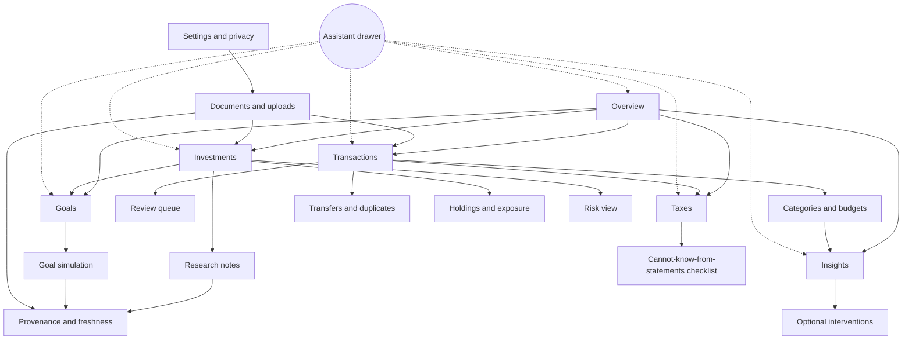
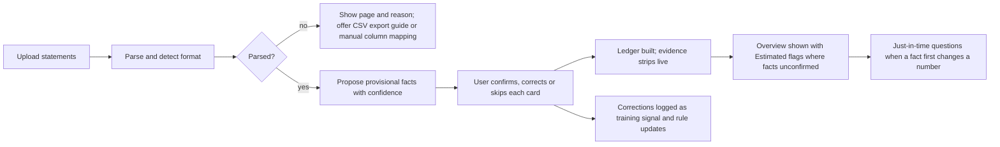

```
Document: 08 — User Experience and Product Design Blueprint
Department: Product and User-Experience  ·  Lead role(s): Chief Product Officer; UX researcher; UI designer; accessibility specialist; product-analytics specialist; human–computer-interaction (HCI) researcher
Version: 0.1 draft  ·  Date: 2026-11-02  ·  Status: for cross-department review
Reviewers required: Behavioural Finance (Doc 3); Ledger and Data (Doc 4); Investment and Quant Methods (Doc 5); Tax (Doc 6); Architecture and Data Engineering (Doc 7); Programme coordinator; licensed reviewers flagged in §4.4 Journey 7 and §7
```

# Document 8 — User Experience and Product Design Blueprint

## 1. Executive summary

**Conclusions.** "Remarkably easy to use" is achievable without hiding the sophistication, but only if four design commitments are made now and never traded away:

1. **Infer first, ask last.** First-run is an upload, not a questionnaire. The system proposes provisional facts (accounts, currencies, salary rhythm, recurring bills, own-account transfers, investment contributions) with a visible confidence and a one-tap confirm/correct. Only facts that cannot be inferred from records (tax residency, goals, risk-capacity facts) are asked, and each is asked at the moment it first changes a number on screen, not in a wizard.
2. **Every number wears an evidence strip.** Source, as-of time, currency/unit, validation status and (where relevant) confidence are rendered as one consistent component on every figure, including inside the AI assistant's answers. This is the direct product answer to the stale-constant and prompt-injected-number failures recorded in the Context Brief (§1).
3. **Two levels of disclosure, never three.** Each domain has a calm summary layer (five to seven figures) and one detail layer; everything deeper is reached by cross-links, not by burying. This follows the strongest usability evidence we found (F1).
4. **Uncertainty is shown as counted futures, not a single success percentage.** Goal and Monte Carlo results are displayed as quantile dotplots ("in 60 of 100 simulated futures…") with ranges and a "probability of needing to adjust" framing, with animated hypothetical-outcome plots available on demand. This is where the research evidence is clearest and where most finance products do worst (F4).

Behavioural insights are presented as observations with an evidence level and at least one alternative explanation, never as labels or scores; interventions are opt-in and described as experiments on oneself (F7, F9). We recommend a desktop-first personal MVP with a responsive, offline-tolerant web layer, and a separate Android-first, data-light track for any future Nigerian product (F10).

**Biggest uncertainty.** The whole "no questionnaire" promise depends on inference precision on real Nigerian and UAE statement formats, which no department has yet measured. If precision on transfer-matching and recurring-income detection is below roughly 90 percent, the review queue becomes the questionnaire we were avoiding. Second: evidence that *seeing* spending changes behaviour is genuinely mixed (F7); we must instrument rather than assume. Third: with one user, "ease" can be shown only as task-level success and sustained use, not as a population claim.

## 2. Scope and method

**Questions addressed.** (A) What research should govern how a sophisticated financial system is made easy to use and honest about uncertainty? (B) What is the context of use for the founder now and for a Nigerian product later? (C) What information architecture, onboarding, journeys, screens, components, accessibility, performance and localisation rules follow? (D) How would we know the product is "remarkably easy to use", and that its explanations are understood and trusted without over-trust?

**What we searched and which tools.** Web search and fetch for HCI and design research, standards (W3C WCAG 2.2, CLDR via ICU), design-system and style guidance (Nielsen Norman Group, GOV.UK, Monzo), regulatory material (FCA, FTC, Nigeria Data Protection Act, UAE PDPL), and current Nigerian and UAE market context (Statcounter, NCC-derived reporting, TechCabal, Techpoint, Businessday). Academic references were checked against bibliographic registries: the hosted reference-lookup tool (OpenAlex) verified three references by DOI before timing out; the non-hosted tool timed out on every call; direct OpenAlex queries were refused (shared-IP daily budget exhausted until midnight UTC). We therefore verified the remaining references by resolving each DOI against the Crossref registry (polite pool, scripted, results retained in the session scratchpad) and, for items without a DOI, by Crossref bibliographic search; arXiv's API verified the one preprint. Entries in §10 marked **[verified]** matched on title, first author and year (±1) in Crossref or OpenAlex; **[verified — page fetched]** means we read the primary page; **[unverified]** means neither succeeded. Synthetic worked-example figures were computed in Python 3 (seeded; code retained) so every number in §4 is reproducible.

**What we could not access or do.** The web-search budget shared across departments was exhausted after about twelve searches, so some context facts rest on one or two fetched pages rather than triangulation (flagged inline). Pages that refused automated access: TechCabal (two articles, HTTP 403), SSRN, arise.tv (KPMG/Orange smartphone study), KPMG Nigeria's NDPA page, and Apple's Human Interface Guidelines (page content not returned). We did not read the founder's Google Drive or email, wrote nothing under `src/`, and used synthetic data throughout. No usability testing has been run; everything in §4 is a design hypothesis until §9 is executed. Sibling documents 3–7 did not exist in the repository at the time of writing (`docs/portfolio-os/decisions`, `research`, `reviews` were empty), so dependencies in §6 are stated as requirements rather than as references to agreed interfaces.

## 3. Findings

Evidence grades follow the Context Brief (E1–E6). Source numbers refer to §10.

**F1 — Cognitive load is the binding constraint; two-level progressive disclosure is the best-supported remedy. (E2 for the load theory; E3 for the disclosure rule.)** Working-memory capacity is small (about four chunks for novel material [S2]) and extraneous load measurably degrades problem solving [S1]. Progressive disclosure (show the few most important options first, the rest on request) improves learnability, efficiency and error rate, and designs with more than two disclosure levels "typically have low usability" because users lose their place [S3]. Shneiderman's "overview first, zoom and filter, details on demand" is the same rule for data-rich screens [S4]. Implication: every domain gets exactly one summary layer and one detail layer; depth beyond that is reached by cross-links (§4.2), not by nesting.

**F2 — Nielsen's heuristics translate cleanly into finance-specific obligations. (E3 heuristics [S5–S7]; E4 mapping, HCI researcher and CPO.)**

| Heuristic | Portfolio OS obligation |
|---|---|
| Visibility of system status | Every figure shows as-of time and validation state; long jobs (statement parsing, simulations) show progress and partial results |
| Match to the real world | Use the user's own account names, bank descriptors and currencies; say "money you moved between your own accounts", not "intra-entity transfer" |
| User control and freedom | Every inferred fact is reversible; corrections are undoable; no auto-posting without a review path |
| Consistency and standards | One evidence strip, one number format per currency, one colour meaning everywhere |
| Error prevention | Duplicate and transfer detection before posting; confirmation only for destructive actions |
| Recognition rather than recall | Show the evidence (the transactions behind a pattern) rather than asking the user to remember it |
| Flexibility and efficiency | Keyboard-first ledger, bulk actions in the review queue, saved views |
| Aesthetic and minimalist design | Five to seven figures per summary layer; no decorative gauges |
| Recognise, diagnose, recover from errors | Parsing failures name the file, page and reason, and offer a manual path |
| Help and documentation | "How was this calculated?" on every derived figure, opening the inputs and method |

**F3 — Trust in automated systems should be calibrated, not maximised; explanations and confidence displays can increase over-reliance unless designed as checks. (E1 for the trust framework as a replicated literature review [S8, S9]; E2 for individual experiments.)** Lee and See define appropriate reliance as trust matched to actual capability [S8]. In controlled studies, showing confidence scores improved trust calibration but not accuracy [S10]; explanations increased acceptance of AI recommendations even when wrong, so team accuracy did not exceed the better of human or AI alone [S11]; cognitive forcing functions (for example, asking the user to decide before revealing the AI's answer, or delaying it) reduced over-reliance but were liked less [S12]; explanations reduced over-reliance only when the task was hard enough and the explanation made verification cheap [S13]. Transparency has an inverted-U effect: some explanation raised trust, too much lowered it [S14]. People abandon algorithms after seeing them err, but keep using them when allowed to adjust the output [S15, S16]. Implication: the assistant must show the data and calculation it used in a form that is cheap to verify (the "Working" panel, §4.2), label unvalidated inputs loudly, and never present a single unexplained confidence number as reassurance.

**F4 — Uncertainty should be shown as counted, discrete futures; single probabilities and error bars are misread; verbal hedges damage trust but numeric ranges do not. (E1–E2.)** Quantile dotplots (and CDFs) improved real decisions compared with text or density plots in repeated experiments [S25, S26]; hypothetical outcome plots (animated draws) outperformed error bars and violin plots for judging ordering and helped untrained observers judge trends [S27, S28]; discrete-outcome displays improved recall of uncertainty [S38]. Error bars and confidence intervals are systematically misread even by researchers [S31, S32]; hurricane "cones" are read as the storm growing rather than uncertainty widening, which is the same risk for fan charts of wealth [S33, S34]. A large experiment found that communicating uncertainty as a numeric range caused little or no loss of trust, whereas verbal uncertainty did [S22]. Spiegelhalter and colleagues' reviews converge on multiple formats, natural frequencies and avoiding false precision [S23, S24, S36]. Practitioner evidence in retirement planning shows "probability of success" framing frightens clients and conflates the chance of needing an adjustment with the size of that adjustment; "probability of adjustment" plus the size of the adjustment in currency is the recommended reframing [S40]. The Bank of England fan chart is the canonical institutional precedent for showing a central path inside graded bands [S39]. Implication: §4.6 uncertainty standard.

**F5 — Numeracy varies widely; frequencies and well-designed icon arrays help, "1 in X" formats and percentages are often confused; fees in currency beat fees in percent. (E1 for numeracy effects [S41, S42]; E2 for formats.)** Natural-frequency formats improve probabilistic reasoning [S44, S45]; people with lower numeracy are more swayed by format [S41, S42, S43]; "1 in X" formats performed worst among numeric formats tested [S46] and ratio bias makes "10 in 100" feel larger than "1 in 10" [S47]; icon arrays reduce errors when designed consistently [S48, S49, S50]. In Mexico, showing fund fees in pesos rather than percentages made investors far more fee-sensitive [S51]; US experiments show investors fail to minimise fees even for identical index funds [S52] and simplified disclosure helped little without fee salience [S53]; credit-card repayment maths is widely misunderstood [S54]. Implication: show probabilities as "N of 100 futures" with a fixed denominator; show costs, fees and FX spreads in currency first and percentage second.

**F6 — Framing and feedback frequency change decisions: frequent portfolio feedback increases loss aversion and lowers risk taking; money illusion and currency numerosity distort multi-currency judgement. (E1 for framing and prospect theory [S55–S57]; E2 for myopic loss aversion experiments [S58–S61]; E2 for ostrich effect [S62]; E2 for money illusion and numerosity [S63–S65].)** Investors who see returns more often take less risk and earn less [S59, S60], including professional traders in the field [S61]; people check portfolios less after market falls [S62]. Nominal framing produces money illusion [S63] and amounts in high-numerosity currencies (NGN 1,500,000 versus USD 1,000) feel larger or smaller than their value [S64, S65]. Implication: default portfolio views to long horizons with daily change available but not foregrounded; always show the base-currency value next to the native amount; separate FX-driven changes from real changes (§4.1, F12).

**F7 — Evidence that seeing spending changes behaviour is positive but modest, heterogeneous, and contradicted by some studies; goal-setting and reminders have the best field evidence; social comparison can backfire. (E2 overall; downgraded from E1 because results conflict.)** Mobile access to account aggregation reduced spending in one field study [S67] and app adoption changed fee and overdraft behaviour in another [S66]; aggregator data show consumption responds to liquidity rather than to information alone [S68]. Goal setting in a FinTech app increased saving and the effect persisted [S69]; SMS reminders increased saving modestly [S70]; a credit-card reminder reduced late fees but increased overdrafts elsewhere, a side effect visible only because it was measured [S71]. Peer spending information reduced over-spenders' spending in one app [S72], but peer information discouraged low savers in a large retirement experiment [S73], and energy-use social comparison effects were real but small [S74]. Financial-education meta-analyses find small-to-moderate effects that decay [S75–S77]. Defaults and commitment devices move behaviour more than information does [S78–S82]. One practitioner-reported study claims frequent budgeting-app checking is associated with overspending [S83, unverified]. Implication: we design spending feedback as neutral, user-paced and measurable, we build goals and optional commitment devices rather than streaks, we show no peer comparison in the MVP, and Doc 3 must specify evaluation designs before any intervention ships.

**F8 — Dark patterns are prevalent, effective and now regulated; gamified engagement practices increase trading and risk taking. (E2 for prevalence and experiments [S84–S86]; E2 for regulators' own research [S87, S88].)** A crawl of 11,000 shopping sites found 1,818 dark-pattern instances [S84]; a randomised experiment found mild dark patterns more than doubled acceptance of a dubious service [S86]; the FTC's 2022 report groups them into designs that induce false beliefs, hide or delay material information (including drip pricing), lead to unauthorised charges, or subvert privacy choices [S87]. The FCA's experiment with more than 9,000 consumers found push notifications and points/prize draws raised trade counts by 11 and 12 percent and the share of risky trades by 8 and 6 percent, with larger effects for low-literacy, female and 18–34 participants [S88]. Implication: §4.1 lists prohibited patterns; nothing in the product celebrates a trade, a login or a streak.

**F9 — Presenting behavioural insights ethically means boosting competence rather than steering, protecting autonomy, avoiding shame, and disclosing the nudge. (E2.)** Boosts (teaching a skill or showing a representation that improves judgement) preserve agency where nudges exploit biases [S89]; autonomy support predicts sustained motivation [S90]; financial shame drives avoidance and worsens hardship, in a longitudinal and experimental programme [S91]; disclosing a default or nudge does not remove its effect, so transparency costs nothing [S92, S93]; Sunstein's ethical criteria (welfare, autonomy, dignity, self-government) are the standard test [S94]; scarcity itself consumes cognitive bandwidth, so insights should reduce load, not add guilt [S95]. Mental-accounting research explains why users keep separate "pots" and why debt and savings are felt differently [S96, S97]. Implication: no labels ("over-spender"), no scores, alternative explanations shown by default, interventions opt-in and framed as self-experiments (§4.5 card spec).

**F10 — Context of use: Nigeria is Android-dominant, data-cost sensitive and intermittently connected; the UAE is also majority-Android on web traffic; open banking in Nigeria had not launched as of the latest reports we could read. (E2 for official-statistic-derived figures; E3 for press reporting; several items single-sourced.)** Statcounter mobile OS share, October 2026: Nigeria Android 86.6 percent, iOS 13.3 percent [S98]; UAE Android 80.7 percent, iOS 19.3 percent [S99] (web-traffic shares, not device ownership). The NCC approved a 50 percent tariff increase in January 2025; the 1 GB floor price rose from NGN 287.50 to NGN 431.25, and average use per subscriber was 9.86 GB/month in May 2025 [S100]; one outlet computed an average 2025 price of about NGN 575 per GB [S101, page not retrievable]. Broadband penetration crossed 50 percent only in late 2025 (secondary reporting of NCC data; not independently fetched). Formal financial inclusion was 64 percent of adults in the 2023 EFInA survey [S104, secondary]. The CBN's open-banking go-live set for 1 August 2025 did not happen; in October 2025 a CBN official said a standard API template was still being built and no date was set [S102, S103]; its status on 2026-11-02 is unknown — founder's team to confirm before relying on bank connections. Implication: the personal MVP can assume the founder's own devices (unknown — founder to confirm), but any Nigerian product must be Android-first, work offline, keep first-load payloads small (F14) and treat file upload, not API connection, as the primary ingestion path.

**F11 — Multi-currency mental models need a declared base currency and a strict separation of FX effects from real changes; accounting standards already define this. (E3 standard [S108]; E2 behavioural basis [S63–S65]; E4 design.)** IAS 21 distinguishes the functional currency (where cash is mainly earned and spent) from the presentation currency, translates transactions at transaction-date rates and reports exchange differences separately [S108]. For an individual with NGN income, AED expenses and USD investments there is no single functional currency, so the product must let the user choose a base (presentation) currency and must decompose every period change into "what you did" and "what the exchange rate did" (worked example §4.1). Without this, naira devaluation will appear as spending or investment loss and defeat every behavioural inference downstream.

**F12 — Number formatting: CLDR locales already encode the right conventions; the new dirham symbol exists but is not yet renderable. (E3; locally verified.)** ICU 78.3 (Unicode 17) formats `en-NG` as `₦1,234,567.89`, `en-AE` as `AED 1,234,567.89`, `ar-AE` with the Arabic abbreviation and right-to-left marks, and negative values with a leading minus [S107]. The Central Bank of the UAE unveiled a new dirham symbol on 27 March 2025; it was encoded as U+20C3 in Unicode 18.0 (September 2026) and is not yet in the ICU shipped with current runtimes, so devices will show a missing-glyph box [S106]. GOV.UK's style rules (numerals for 2+, commas over 999, no decimals unless minor units are present, "million" in words, "%" with numerals, dates as "2 November 2026") are a sound plain-language baseline [S109]. Implication: use ISO codes (`AED`, `NGN`, `USD`) as the primary symbol in tables, the naira sign only where glyph support is verified, and defer the dirham sign until font coverage is measured.

**F13 — Usability can be measured credibly at n=1 and at n=5–8 if the right instruments are used. (E2 instruments; E3 practice.)** Validated instruments: SUS [S120, S121], UMUX-Lite [S122], the Single Ease Question [S123], NASA-TLX and Paas's mental-effort scale for load [S124, S125], and Google's HEART framework for product-level metrics [S126]; Hornbæk documents the pitfalls of measuring usability without effectiveness, efficiency and satisfaction together [S127]. Five users find most problems in a homogeneous group [S128, S129], but the assumption is fragile for heterogeneous users and rare problems [S130]. Diary methods capture lived use over weeks [S131]; n-of-1 trial designs (alternating conditions within one person) are the appropriate logic for evaluating features on the founder alone [S132]. Implication: §4.9.

**F14 — Perception research and standards set hard constraints on financial tables and charts. (E1 for graphical perception [S114–S116]; E3 standards [S111–S113, S117–S119].)** Position along a common scale is read most accurately; angle and area are not, which rules out pie and gauge charts for comparisons [S114, S115, S116]. About 8 percent of men have a colour-vision deficiency and red–green encodings fail for them [S112, S113]; the Okabe–Ito palette is the standard safe set [S113]. WCAG 2.2 (W3C Recommendation, 5 October 2023) adds nine criteria including minimum target size 24×24 CSS px, focus not obscured, redundant entry and accessible authentication [S111]. Core Web Vitals "good" thresholds at the 75th percentile are LCP ≤ 2.5 s, INP ≤ 200 ms, CLS ≤ 0.1 [S118]; the 2026 performance-inequality baseline is a Galaxy A24-class device on 9 Mbps/100 ms, with a 3-second first-load budget of about 2.0 MiB total and 0.3 MiB JavaScript for a JavaScript-light page [S119]. The FT Visual Vocabulary gives a shared chart taxonomy (deviation, change over time, distribution, part-to-whole, flow) [S117].

**F15 — Data-protection law in both jurisdictions grants rights the interface must honour, and the UAE's banking-data regime sits outside the PDPL. (E2, official-law summaries via practitioner sources; licensed review required.)** Nigeria's Data Protection Act 2023 (signed June 2023; regulator NDPC) gives rights of access, rectification, erasure, portability, objection, withdrawal of consent as easily as it was given, and protection from solely automated decisions with significant effects; consent must be affirmative and cannot be a condition of service [S134]. The UAE's Federal Decree-Law 45 of 2021 lists similar rights but excludes banking and credit data (governed by the Central Bank framework, Federal Decree-Law 6 of 2025) and free zones (DIFC, ADGM regimes), and its executive regulations had not been issued as of March 2026 [S135]. Implication: privacy controls (§4.5.13) are rights-exercising surfaces, not preferences; local-first storage (Doc 7) is the simplest way to honour them for a single user.

**F16 — The AI assistant's value depends on explanation forms people actually ask for. (E2.)** Users want "why", "why not", "what if" and "how confident" questions answered, in that order of frequency [S18, S21]; explanations that are complete but not overwhelming build the most accurate mental models [S17]; guidelines for human–AI interaction stress making clear what the system can do, how well, and supporting efficient correction [S19]; explanation should be contrastive and selective rather than exhaustive [S20]. Implication: the assistant's entry points are phrased as those four questions, and every answer carries a Working panel (§4.2.4).

## 4. Proposed framework / specification for Portfolio OS

### 4.1 Design principles and the two universal components

**Ten binding principles** (each traceable to §3):

| # | Principle | Evidence | Testable consequence |
|---|---|---|---|
| P1 | Infer before asking; ask only at the moment a fact changes a number | F1, F16 | First-run contains zero free-text questions before the first upload is parsed |
| P2 | Every figure carries an evidence strip | Brief §1, F3 | No numeral is rendered without source, as-of, currency and status fields present in the data contract |
| P3 | Two disclosure levels per domain | F1 | Any datum is ≤ 2 taps from its domain summary or reached via a cross-link |
| P4 | Uncertainty as counted futures with ranges and the size of adjustment | F4, F5 | No single "probability of success" is shown without the dotplot and adjustment framing |
| P5 | Currency honesty: native amount, base-currency value, and FX effect separated | F6, F11 | Every period change has a "what you did / what FX did" decomposition |
| P6 | Horizon-appropriate feedback: long horizons by default, short on request | F6 | Portfolio summary defaults to 1-year and since-inception views; daily P&L is a detail-layer element |
| P7 | Observation, not judgement: no labels, scores, streaks or peer comparisons | F7–F9 | Copy lint rejects the banned vocabulary (§4.7) |
| P8 | Reversible by design: every inference and correction can be undone | F2 | Undo available for 30 days on all ledger edits |
| P9 | Explanations are verifiable and contrastive, with inputs shown | F3, F16 | Working panel present on 100 percent of assistant answers containing numbers |
| P10 | Accessible and light by default | F14 | WCAG 2.2 AA audit passes; initial route ≤ 300 KiB compressed JavaScript |

**Component A — the evidence strip.** Rendered beneath or beside any figure. Fields (data contract to be agreed with Doc 4 and Doc 7): `source` (institution or feed name, with licence class), `as_of` (timestamp, displayed relative and absolute: "as of 2 Nov, 17:40 WAT"), `unit_currency`, `validation` (Validated / Unvalidated / Stale / Conflict / Estimated), `confidence` (only for inferred facts: High ≥ 0.9, Medium 0.7–0.9, Low < 0.7 — thresholds are an E5 engineering assumption to be calibrated against correction rates), `method` (link to the calculation record). Visual states: Validated — normal numerals; Estimated — italic numerals plus "est."; Stale — grey numerals, "stale" chip, derived figures that depend on it inherit the chip; Conflict — amber chip, figure shown as a range of the conflicting values; Unvalidated — figure shown but never used in totals until confirmed. Text wireframe:

```
NGN 12,600,000.00   ·   Validated   ·   NG Bank statement p.3   ·   as of 31 Oct 2026   ·   How was this calculated? ›
```

**Component B — the Working panel.** Attached to every assistant answer and every derived figure. Shows (1) the inputs as a table with their own evidence strips, (2) the operation performed by a deterministic tool (name, version, parameters), (3) assumptions used, each flagged "default — change?", (4) what was *not* known, (5) a "Recompute" action. The model may paraphrase; it never produces the number (Doc 7 to enforce tool-only arithmetic).

**Prohibited patterns (design-review checklist, derived from F8).** Confirmshaming copy; pre-ticked consents; countdowns or scarcity cues; celebratory animation after any financial action; leaderboards or peer rankings; streaks and badges; drip-disclosed fees or FX spreads; interstitials that delay reaching one's own data; opt-out defaults for data sharing; nagging after a declined intervention (one decline silences that intervention for 90 days); any colour-only encoding of gain/loss.

**Worked example (synthetic) — the FX decomposition behind P5.** NGN current account: opening NGN 12,000,000, closing NGN 12,600,000; USD/NGN 1,530 at the start of the month and 1,480 at the end (synthetic rates). In USD base: opening USD 7,843, closing USD 8,514, total change +USD 670. Decomposition at closing rate: transactional ("what you did") +USD 405; revaluation of the opening balance ("what FX did") +USD 265. Shown as:

```
NG Bank · NGN current            Oct 2026
Balance   NGN 12,600,000  (USD 8,514 at 1,480 NGN/USD, as of 31 Oct)
Change    +USD 670  =  +USD 405 from your transactions  ·  +USD 265 from the naira strengthening
          Rates: CBN/NAFEM closing, as of 31 Oct 2026 · Why two numbers? ›
```

The AED account over the same period moves from AED 85,000 to AED 79,500 (USD 23,145 to 21,647; change −USD 1,498, FX effect nil under the peg). A net-worth view that did not separate these would attribute a naira move to behaviour.

### 4.2 Information architecture

**4.2.1 Domains.** Eight top-level areas: Overview, Transactions (ledger and review queue), Insights (behavioural), Investments (holdings, risk, research), Goals (Goal Reality Engine and planning scenarios), Taxes, Documents (uploads, parsing status, provenance), Settings (profile facts, currencies, privacy, data). The assistant is not a ninth area: it is a drawer available on every screen, pre-filled with the context of the current object.

**4.2.2 Navigation model.** Desktop: persistent left rail with the eight areas; content pane with summary layer on top and detail layer below (collapsed sections, not new pages); right-hand inspector for the selected object (its evidence strip, links, history). Mobile: bottom bar with five items (Overview, Transactions, Investments, Goals, More) and the assistant as a floating entry; same two layers vertically. Global: command palette (`/`) for keyboard users; search across transactions, securities, documents and settings.

**4.2.3 Cross-linking.** Every object exposes its relations so a user can traverse: transaction → category → budget line → spending pattern (insight) → tax relevance (for example interest income or a deductible item, per Doc 6), and back. Links are rendered as a breadcrumb trail of chips at the top of the detail layer ("Transaction › Category: Utilities › Budget: Housing (Lagos) › Pattern: bills cluster after salary › Tax: not relevant").



**4.2.4 "AI explain" entry points.** Four fixed verbs appear wherever a figure or insight is shown, matching the question types users actually ask (F16): **Why?** (what drove this number), **Why not?** (why a transaction was not matched, why a goal is not on track), **What if?** (opens the relevant scenario control pre-filled), **How sure?** (opens the evidence strip and the confidence rationale). Free-text questions are allowed but are routed through the same tools. The answer format is fixed: one-sentence answer with the number and its evidence strip; two to four bullet drivers; the Working panel; "What I could not know" line; optional next action. Example (synthetic):

> **Why did spending rise in October?** Spending was NGN 1,420,000, NGN 145,000 above your six-month average (NGN 1,275,000). Drivers: school fees NGN 180,000 (annual, last seen Oct 2025); fuel and generator NGN 62,000 above average. Excluding school fees, October was NGN 35,000 *below* average. *Working:* 212 transactions, NG Bank statement Oct 2026 (validated), categories as confirmed by you on 3 Nov. *Not known:* whether the fees are for one term or the year.

### 4.3 Onboarding by inference

**4.3.1 First-run flow.** The only required action is uploading at least one statement (PDF, CSV or XLSX; multiple files at once; password-protected PDFs prompt for the password locally and do not store it unless asked). Everything else is proposed.



**4.3.2 What is inferred, how it is shown, what it asks.** Confidence words follow the thresholds in §4.1 and are always accompanied by the evidence count ("seen 6 of 6 months").

| Proposed fact | Inference basis (Doc 4 to specify algorithms) | Card copy (synthetic) | If confidence Low |
|---|---|---|---|
| Accounts and currencies | Statement header, IBAN/NUBAN format, currency codes | "We found 3 accounts: NG Bank NGN current, UAE Bank AED current, US Broker USD. Correct?" | Ask user to name the account; never guess the institution |
| Salary or regular income | Same counterparty, similar amount, monthly cadence | "Income of about NGN 1,850,000 arrives around the 25th each month — seen 6 of 6 months. Treat as salary?" | Shown as "regular inflow" without the word salary |
| Recurring bills | Cadence, counterparty, amount variance | "12 recurring payments found (rent, DEWA, data, school fees…). Review list ›" | Listed under "possibly recurring" |
| Own-account transfers | Amount and date match across accounts, FX tolerance, descriptor cues | "NGN 3,000,000 out on 2 Oct and USD 1,960 in at US Broker on 3 Oct look like the same money (rate 1,531). Mark as transfer?" | Both legs stay in the review queue, excluded from spending totals until resolved |
| Investment contributions | Transfers to known brokers or CSCS/NGX descriptors | "USD 800 to US Broker on the 5th monthly looks like an investment contribution" | Classified as transfer, not spending |
| Duplicates | Hash of date, amount, descriptor across overlapping statements | "Two files cover 1–15 Oct; 41 duplicates removed. Show ›" | Kept, flagged |
| Base currency | Majority of income currency | "Show totals in NGN? (most income is NGN). You can change this any time." | Ask |

**4.3.3 How corrections teach the system.** Each correction is a typed event (`fact_id`, old, new, scope: this item / this counterparty / all similar) stored in the ledger's audit trail (Doc 4) and used to (a) create a user rule immediately, (b) adjust confidence calibration for that fact type, and (c) feed Doc 4's classifier evaluation. The user sees the consequence at once: "Applied to 11 similar transactions — undo". Correction rate per 100 proposals is a first-class product metric (§4.9).

**4.3.4 The minimum questions that cannot be inferred, and when to ask.**

| Question | Why statements cannot answer it | When asked | Default while unanswered |
|---|---|---|---|
| Tax residency and days present per jurisdiction (Doc 6 to define) | Residency is a legal status, not a cash flow | The first time a figure's tax treatment would change the display (for example interest income on an NGN savings account), or when opening Taxes | Taxes area shows "Not yet determined"; no tax amounts computed |
| Employment type and employer location | Needed for PAYE vs self-assessment logic | Same trigger as above | Income shown as "regular inflow" |
| Goals (amount, currency, date, purpose, flexibility) | Preferences | When opening Goals, or when the user asks "can I afford…" | No goal probabilities displayed |
| Risk-capacity facts (dependants, emergency reserve months, insurance, debts not on statements, expected income stability) | Partly inferable (reserve months) but legally and ethically must be confirmed | When the first investment or goal simulation is requested; shown with the inferred values pre-filled for confirmation | Simulation runs but is labelled "capacity facts unconfirmed" |
| Citizenship and visa status | Affects UAE/Nigeria obligations and account access | Only when Doc 6 logic needs it | Not asked |
| Consent choices (analytics, cloud processing of documents) | Legal requirement (F15) | At first upload, as separate unticked choices | Off |

Design rule: a question is asked once, in context, with "why we ask" and "what changes if you skip" sentences, and is never repeated in a wizard. The founder's profile facts live in Settings › Facts about you, each with its own evidence strip ("You told us on 3 Nov 2026").

### 4.4 End-to-end journeys (synthetic data; the user is "the founder", devices unknown — desktop assumed unless stated)

**Journey 1 — First upload and reconciliation (desktop, 25 minutes).** The founder drops five files: NG Bank NGN statements for May–October 2026 (two PDFs, password-protected), UAE Bank AED statement (PDF), US Broker activity CSV, and a Nigerian savings-app statement (PDF). *Screens:* Documents › Upload (progress per file, "page 3 of 14 parsed"); one PDF fails on a scanned page and the error names the page and offers "export CSV from your bank app" instructions. *Proposals:* 3 accounts (High), salary NGN 1,850,000 around the 25th (High, 6 of 6 months), 12 recurring bills (9 High, 3 Medium), 7 own-account transfers (5 High, 2 Low), 41 duplicates (High), base currency NGN (asked). The founder corrects one: "USD 1,960 in at US Broker" was a client payment, not a transfer; the system asks whether to treat future inflows from that counterparty as income (scope choice) and logs the correction. *Explanations:* each card shows "seen in" counts and the matched lines. *Overview* appears with two figures marked Estimated (AED balance, because the statement ends 15 Oct) and the stale chip on the AED/NGN rate (last fetched 31 Oct). *Success criteria:* ≥ 90 percent of proposals accepted without edit; time to first Overview ≤ 30 minutes; zero free-text questions before the first proposal; the founder can state, unprompted, which numbers are estimates (comprehension probe, §4.9).

**Journey 2 — Monthly financial review (mobile then desktop, 15 minutes).** On 3 November a quiet notification (opted in, monthly) says "October is ready to review — 14 items need you". *Mobile screens:* Overview summary (net worth in NGN with FX decomposition; income; spending vs six-month average; savings rate; goals status line; "14 to review"); Review queue in swipe-free list form (tap to resolve; no gamified clearing). *Desktop:* Budget and cash-flow view shows October spending NGN 1,420,000 against the NGN 1,275,000 average, with the school-fees annual item separated so the recurring baseline reads NGN 1,240,000. The assistant's "Why?" answer is the example in §4.2.4. The founder asks "What if school fees are for the whole year?" — the scenario control spreads NGN 180,000 over 12 months and the monthly surplus mean becomes NGN 551,667 ± 75,093 (six-month mean and standard deviation). *Success criteria:* review completed in one session; Single Ease Question ≥ 6/7; no figure displayed without an evidence strip; the founder correctly recounts the FX versus real decomposition of net worth change.

**Journey 3 — "Can I afford this, and what does it do to my goal?" (mobile, 5 minutes).** In Dubai, the founder considers a AED 14,000 purchase. From Goals, "Can I afford…?" takes amount, currency and date. *Data shown:* liquid balances by currency after committed bills for the next 30 days (AED 79,500 minus AED 23,400 committed = AED 56,100 free; NGN and USD shown separately, with the caution that moving NGN to AED would cost a quoted spread — shown in AED first, percentage second); effect on the emergency reserve (from 5.8 to 5.1 months of baseline spending); effect on the USD 100,000 goal: "In 60 of 100 simulated futures you reach USD 100,000 by Nov 2031 today; after this purchase, 57 of 100 — a small change, because the purchase is from AED cash, not from contributions." *Explanation:* the Working panel lists balances, committed items and the simulation version. *Success criteria:* answer in ≤ 3 taps; the founder can say which currency the money would come from and what the goal effect is; no "yes/no" verdict is given by the system — it shows consequences and the user decides.

**Journey 4 — A behavioural insight is surfaced (desktop, 4 minutes).** Insights shows one new card: "Pattern — observed over 6 months: 38 percent of discretionary spending happens in the 4 days after salary arrives (NGN 310,000 of NGN 815,000 per month on average)." Evidence level per Doc 3's scale (card shows "Statistically measurable pattern — 6 months, 212 transactions; not yet a stable trait"). Alternative explanations are listed by default: bills are also paid in those days and may be mis-categorised; salary timing coincides with month-start school and household purchases; the pattern may simply reflect when money is available. The card asks nothing. A collapsed "If you want to test something" section offers one opt-in self-experiment (for example, a standing transfer to savings on salary day for two months, with the measurement plan: compare post-salary discretionary spending before and after, with the confounders named). *Success criteria:* the founder rates the card as non-judgemental (Likert ≥ 4/5), can repeat the alternative explanations, and chooses freely; no card uses the words in the banned list (§4.7).

**Journey 5 — Investment research on an NGX or US stock (desktop, 20 minutes).** The founder opens Investments › Research and searches an NGX-listed bank (synthetic "NGX: BANKX") and a US name. *Research note view:* price and change with evidence strip (NGX closing price as of 3 Nov 2026 16:30 WAT, source and licence shown); fundamentals table with per-field as-of dates (half-year results, filing date, "Q3 not yet filed"); valuation ratios computed by tool with inputs listed; dividend history with ex-dates; macro context (the policy rate with its decision date and next MPC date, flagged "stale" if past). The US name shows an intraday price marked "delayed 15 min" and fundamentals from the latest 10-Q with the filing date. One field — analyst consensus — shows **Unvalidated: single unofficial source** and is excluded from any computed figure. A conflict state appears where two sources disagree on shares outstanding; the note shows both values and the range of the resulting market capitalisation. The assistant's note ends with "What I could not verify" and never with a buy/sell verdict. *Success criteria:* every figure in the note has a provenance badge; stale and conflict states are noticed by the founder in a seeded test (≥ 80 percent detection); no sentence states a return expectation as fact.

**Journey 6 — Goal Reality Engine for "USD 100,000 targeting X percent" (desktop, 15 minutes).** Inputs (pre-filled from the ledger, confirmed): current USD investments USD 35,000; contributions USD 800/month; horizon 60 months; three candidate structures from Doc 5's instrument list. Outputs (synthetic, 20,000 paths, seeded, assumptions visible — nominal expected return and volatility are placeholders for Doc 5's validated parameters): a 60/40 global portfolio at 7 percent nominal and 11 percent volatility reaches USD 100,000 in **60 of 100** futures (10th–90th percentile USD 83,000–134,000; median USD 105,000); an all-equity structure at 9 percent and 17 percent volatility reaches it in 63 of 100 futures but with a wider spread (USD 77,000–160,000); a USD money-market structure at 4 percent reaches it in 0 of 100 (ends near USD 95,000–97,000). The screen then answers the question actually being asked: the return required to hit the target exactly with these contributions is about 5.2 percent a year nominal, and raising contributions to USD 1,000 and USD 1,200 per month moves the count to 84 and 95 of 100 futures respectively — the contribution lever dominates the return lever at this horizon. The target "X percent" is shown against the distribution rather than promised; the "size of adjustment" line reads "if you are in the lower third of outcomes, you would need to add about USD 150–300 a month in the last two years or extend by 8–14 months." *Success criteria:* the founder can state the probability as a frequency, the range, and the lever that matters most; no screen shows a single success percentage alone; the assumptions registry is opened at least once in testing.

**Journey 7 — Tax-season preparation (desktop, 30 minutes; licensed review required).** Taxes shows two columns, Nigeria and UAE, each with "What we can compute from your records" and "What we cannot know from statements". Computable (per Doc 6's logic, with its effective dates displayed): interest income by account and currency, dividend receipts with withholding shown on the statement, capital transactions with dates and amounts, rent and other recurring items that may be relevant. The checklist of what statements cannot reveal: residency days, employment status and employer filings, allowances and reliefs claimed, assets held outside uploaded accounts, cash income, the tax treatment of specific instruments, and whether a figure is gross or net where the statement is silent. Each item has a status (Confirmed by you / Unknown / Practitioner to review). The workspace exports a filing-preparation pack with every figure carrying its evidence strip, and a prominent banner: "Prepared from your records; a licensed tax practitioner must review before filing." Nothing is filed from the product in the MVP. *Success criteria:* the founder can distinguish computed from unknown items; export contains zero figures without provenance; the practitioner banner is visible on every Taxes screen.

### 4.5 Screen and component specifications (text wireframes; states listed per screen)

Common states for every screen: *loading* (skeleton with the as-of of the last good data visible), *empty* (what to upload to populate it, one action), *stale* (grey numerals and chip; recompute offered), *error* (named cause, manual path), *offline* (last synced time; all read actions available; writes queued).

**4.5.1 Overview dashboard.**
```
┌ Overview ──────────────────────────────── base: NGN ▾  as of 3 Nov 2026 09:10 WAT ┐
│ Net worth  NGN 164.2M  (+NGN 2.1M in Oct: +1.3M yours · +0.8M FX)   [evidence strip] │
│ Income Oct NGN 1.85M · Spending NGN 1.42M (6-mo avg 1.28M) · Saved 23%             │
│ Goals: USD 100k by Nov 2031 — 60 of 100 futures  ·  Emergency reserve 5.8 months    │
│ To review: 14 items  ›      Insights: 1 new observation  ›    Taxes: residency not set│
├ Detail (collapsed sections) ─────────────────────────────────────────────────────────┤
│ ▸ Accounts by currency   ▸ Cash-flow last 6 months   ▸ Holdings   ▸ Upcoming bills   │
└──────────────────────────────────────────────────────────────────────────────────────┘
```
Rules: maximum seven figures in the summary; compact notation ("164.2M") allowed here only, full numerals in all tables; each figure deep-links to its domain detail.

**4.5.2 Transaction ledger with review queue.** Dense table (date, description as printed, counterparty as resolved, amount native, amount base, category, account, status chip, links). Review queue is a filtered view, grouped by reason (Unmatched transfer leg, Low-confidence category, Possible duplicate, New counterparty, Currency conversion unclear). Bulk actions: accept all High, assign category to counterparty, mark as transfer. Keyboard: `j/k` move, `a` accept, `c` categorise, `t` transfer, `u` undo. Row density toggle (comfortable/compact). State: "Queue empty — nothing needs you" with no celebration graphic.

**4.5.3 Transfer and duplicate resolution.**
```
┌ Possible transfer ──────────────────────────────────────────────────────┐
│ OUT  2 Oct  NG Bank     −NGN 3,000,000  "TRF TO US BROKER"               │
│ IN   3 Oct  US Broker   +USD 1,960      "WIRE IN"                        │
│ Implied rate 1,531 NGN/USD · market 1,528–1,534 that day · fee NGN 2,500?│
│ Confidence: Medium (amount within 0.3%, 1-day lag, descriptor match)    │
│ [ Same money — mark transfer ]  [ Different — keep both ]  [ Not sure ]  │
└──────────────────────────────────────────────────────────────────────────┘
```
Duplicates show both source documents side by side with the overlapping date range highlighted.

**4.5.4 Budget and cash-flow view.** Horizontal bars by category against a six-month baseline (not a user-set target unless one exists); annual or irregular items split out; "committed next 30 days" list; waterfall from income to surplus. Baseline bars use the neutral palette; over-baseline shows an outline, not red fill.

**4.5.5 Net worth across currencies.** Stacked bars by currency in base terms, with a toggle "show in native currencies" that renders three small multiples; change decomposition table (transactions / FX / market moves / unknown residual, with the residual shown rather than forced to zero); rate source and as-of for each currency pair.

**4.5.6 Behavioural insight card.**
```
┌ Observation ───────────────────────────────────────────────── evidence: Pattern ■■□ ┐
│ 38% of discretionary spending happens in the 4 days after salary arrives.             │
│ Basis: 6 months, 212 transactions, categories you confirmed. See the transactions ›   │
│ Other explanations we cannot rule out:                                                │
│  • Bills fall in those days too and some may be mis-categorised                       │
│  • Month-start school and household purchases coincide with salary                    │
│  • Spending follows availability of money, which is ordinary                          │
│ ▸ If you want to test something (optional)                                            │
│ [ Useful ] [ Not useful ] [ Hide this kind of observation ]                           │
└───────────────────────────────────────────────────────────────────────────────────────┘
```
Evidence-level indicator maps to the Brief's taxonomy: ■□□ Observed (a single fact), ■■□ Pattern (statistically measurable), ■■■ Supported explanation (Doc 3 grade E1–E2 with the specific study cited). Hypotheses are shown only inside the "test something" section, never as the headline. No card is shown with fewer than Doc 3's minimum data window.

**4.5.7 Portfolio exposure and risk view.** Summary: value in base, allocation by asset class, currency exposure (look-through, with the share of wealth exposed to NGN moves stated plainly), top-five concentration, 1-year volatility and maximum drawdown with as-of. Detail: correlation matrix (ordered, diverging palette, numbers printed in cells), drawdown chart, risk-adjusted measures with the window and benchmark named. Daily change is present but third in order and de-emphasised (P6).

**4.5.8 Research note view.** Header with security, exchange, currency, price and badge row (Validated / Delayed / Stale / Conflict / Unvalidated); sections: Business, Financial statements (per-field as-of), Valuation (computed, inputs listed), Dividends, Risks, Macro context, "What could not be verified", Sources. Each number has a hover/tap evidence strip; conflicting values are shown as a range. No rating, target price or recommendation component exists.

**4.5.9 Goal simulation view.**
```
┌ USD 100,000 by Nov 2031 ────────────────────── assumptions ▾  version sim-0.3  ┐
│ In 60 of 100 simulated futures you reach the goal.                              │
│  ●●●●●●●●●●●●●●●●●●●●  (20 dots = quantiles of final value, k USD)             │
│  74 81 85 89 91 94 96 99 |101 104 106 109 111 114 117 121 125 130 138 151        │
│ Middle half of outcomes: USD 93k–119k · Lower tenth below USD 83k               │
│ If you land low: add ~USD 150–300/month in the last 2 years, or wait 8–14 months │
│ Biggest lever: contributions (USD 1,000/mo → 84 of 100)  ▸ Try it               │
│ [ Show 20 possible paths (animated) ]  [ Compare structures ]  [ Why these odds? ]│
└──────────────────────────────────────────────────────────────────────────────────┘
```
Required return to hit the target with current contributions is shown as a plain number with "this is not a forecast" copy; the "X percent" the user named is placed on the distribution ("a 12 percent average return sits above 80 of 100 historical five-year windows for this structure — Doc 5 to supply the actual base rate").

**4.5.10 Tax workspace.** Two jurisdiction columns; per item: figure, evidence strip, status (Confirmed / Unknown / Practitioner to review); the "cannot know from statements" checklist pinned at top; rule effective dates visible ("rule in force from 1 Jan 2026 — checked 4 Nov 2026" to be populated by Doc 6); export pack; permanent practitioner banner.

**4.5.11 Data-provenance and freshness indicators.** The evidence strip (§4.1) plus a Documents › Sources page listing each feed and file, its licence class, last successful refresh, failure count, and the figures that depend on it; a global "freshness" indicator in the header shows the oldest input currently on screen.

**4.5.12 Empty, error and stale states.** Empty: one sentence on what to add and one button. Error: cause, where (file, page, field), what the system did (kept or discarded), manual path. Stale: numerals greyed, chip, "last good value as of…", recompute. Offline: banner with last sync; no features hidden that work on local data.

**4.5.13 Settings and privacy controls.** Facts about you (each with "you told us on…", edit, delete); Currencies and base; Notifications (all off by default except parsing results; cadence choices weekly/monthly; no daily spending alerts offered in the MVP, F6/F7); Data: export everything (CSV and JSON, machine-readable, per NDPA/PDPL portability), delete everything (two-step, no retention dark pattern), where data is processed (local / cloud, per document), analytics opt-in with the exact event list shown; Access: device passcode or OS biometrics, session timeout; Assistant: allow or forbid cloud model calls per data class.

### 4.6 Uncertainty display standard (applies to Monte Carlo, goal probabilities, forecasts, confidence of inferences)

| Rule | Specification | Basis |
|---|---|---|
| U1 Frequency first | "N of 100 futures" with a fixed denominator of 100; percent in secondary text | F5 [S44–S47] |
| U2 Distribution visible | Quantile dotplot of 20 dots (or 50 when space allows) as the default graphic; CDF available | F4 [S25, S26] |
| U3 Range before point | Middle half (25th–75th) and lower tenth stated before any median | F4 [S23, S24] |
| U4 Adjustment framing | Always pair the probability with the size of adjustment needed in low outcomes (currency and months) | F4 [S40] |
| U5 Animated paths on demand | Hypothetical outcome plots behind a button, with pause/stop controls, static fallback | F4 [S27, S28]; WCAG 2.2.2 |
| U6 No fan-chart-only displays | Fan charts allowed only with the dotplot beside them and a caption that widening means uncertainty, not growth | F4 [S33, S34] |
| U7 Assumptions registry | Every simulation shows its parameters, their source and as-of, and a version id; changing one re-runs and shows the delta | Brief §5.1; F3 |
| U8 Honest zero | When a structure cannot reach the target, say "0 of 100" and why (contribution arithmetic), not "unlikely" | F4 [S22] |
| U9 Inference confidence | High/Medium/Low words with the evidence count; numeric confidence available on hover; calibration reviewed quarterly against correction rates | F3 [S10] |
| U10 Never alone | No single probability, score or gauge appears without U2–U4 within the same view | F4, F8 |

### 4.7 Copy principles and tone

Principles: plain English at a reading level suitable for a general adult audience; expand terms on first use; active voice; lead with the effect on the reader; numbers per GOV.UK conventions (numerals, commas, no spurious decimals, "million" in words in prose, "%" with numerals, dates as "3 November 2026") [S109]; never patronise, never joke about money, own mistakes once and plainly [S110]; every assumption stated in the sentence that uses it ("using the CBN closing rate of 1,480 on 31 Oct"); every time-sensitive figure carries "as of".

Banned vocabulary (lint rule): over-spender, under-saver, bad habit, guilty, splurge, treat yourself, you should, on fire, streak, badge, level up, congratulations (for financial actions), guaranteed, expected return (without "assumed"), will grow to, on track (without the frequency), score.

Preferred patterns: "We noticed… " (observation), "One explanation… another… " (alternatives), "If you want to test…" (intervention), "We could not tell from your statements whether…" (unknowns), "This is an assumption you can change" (defaults).

Sample strings: error — "We could not read page 7 of NG-Bank-Oct-2026.pdf (it looks scanned). The other 13 pages were used. You can export a CSV from the bank app and upload it, or type the 6 missing lines."; stale — "Price as of Fri 31 Oct, 16:30 WAT. Markets have traded since; values that depend on it are marked stale."; consent — "Send document text to a cloud model for parsing? Off by default. If off, parsing runs on this device and may be slower."

### 4.8 Accessibility, performance, localisation and design system

**Accessibility (WCAG 2.2 AA as the floor [S111]).** Contrast ≥ 4.5:1 for text, ≥ 3:1 for chart marks and UI boundaries; targets ≥ 24×24 CSS px everywhere and ≥ 44 px for primary mobile actions (platform guidance commonly cited; Apple page not retrievable at access time); all chart information available as a table (toggle on every chart); colour never the sole channel — sign, arrow glyph and label accompany colour; focus visible and never obscured by sticky headers; no redundant entry in onboarding (3.3.7); authentication by device biometrics or passkey, no cognitive puzzles (3.3.8); animations respect reduced-motion and HOPs have pause controls; screen-reader announcements for review-queue actions and undo; text resizable to 200 percent with tables reflowing to card lists.

**Performance budgets.** Personal MVP (desktop web): LCP ≤ 2.0 s, INP ≤ 150 ms, CLS ≤ 0.05 on the founder's hardware; parsing of a 15-page statement ≤ 20 s with progress. Future Nigerian product (Android web/PWA first): tested on a Galaxy A24-class device over a throttled 9 Mbps/100 ms profile [S119]; initial route ≤ 300 KiB compressed JavaScript and ≤ 1.0 MiB total transfer; subsequent routes ≤ 100 KiB; Core Web Vitals at p75 within "good" [S118]; offline-first with local database, background sync, and a Data-saver mode (no automatic price refresh, SVG charts, no images or video); statement upload size shown before sending with an estimate of data cost at the user's tariff (E5 assumption: tariff entered by user or defaulted to the NCC floor [S100]).

**Localisation.** Default locale `en-NG` for Nigerian users, `en-AE` for UAE, `en-US` otherwise; number and currency formats from CLDR via ICU [S107]; ISO currency codes in tables, symbols only when the glyph is verified in the shipped font; the new dirham sign U+20C3 adopted only after font coverage is confirmed [S106]; dates and times stored in UTC with the statement's time zone recorded (WAT UTC+1, GST UTC+4) and displayed in the user's zone; right-to-left readiness (logical CSS properties) for a later Arabic release; which Nigerian languages (Hausa, Yoruba, Igbo, Nigerian Pidgin) to support is unknown — founder and Doc 9/commercial team to decide on evidence of demand.

**Design system approach.** Tokens: semantic colour roles (`positive`, `negative`, `neutral`, `estimated`, `stale`, `conflict`) mapped to an Okabe–Ito-derived palette (positive = blue #0072B2, negative = vermilion #D55E00, estimated = reddish purple #CC79A7, stale = neutral grey, conflict = orange #E69F00) [S113]; categorical chart series limited to six Okabe–Ito hues plus patterns; sequential and diverging scales perceptually uniform. Typography: a variable sans-serif with tabular lining figures enabled (`font-variant-numeric: tabular-nums`) for all numeric columns; right-aligned numbers with aligned decimal separators; minimum 14 px in tables on desktop, 16 px body on mobile; negative numbers with a true minus sign and parentheses optional via setting. Components: evidence strip, Working panel, confidence chip, state chips, dotplot, dense table, review card, insight card, jurisdiction column. Chart grammar: FT Visual Vocabulary categories as the selection rule [S117]; position-based encodings preferred, no pies or gauges [S114–S116].

### 4.9 Validation plan

**Phase 0 — heuristic and accessibility review (week 1 of any build).** Two reviewers apply the finance heuristics table (F2), the prohibited-pattern checklist and an automated WCAG 2.2 scan; defects logged by severity.

**Phase 1 — n = 1 task-based protocol with the founder (first 8 weeks).** Weekly 45-minute sessions; think-aloud on the seven journeys with real files of the founder's choosing (processed locally); per task: success (binary, with assists counted), time, Single Ease Question (7-point) [S123], Paas mental-effort rating [S125]; monthly SUS [S120] and UMUX-Lite [S122]; comprehension probes after each explanation ("In your own words, what does 60 of 100 mean? What range of outcomes is likely? What would you change first?") scored against a rubric; a diary study [S131] using a two-question daily prompt ("Did you open Portfolio OS? Did anything surprise or confuse you?") for eight weeks. Feature-level evaluation uses n-of-1 logic [S132]: alternate conditions (for example dotplot-only versus dotplot plus HOPs; monthly versus weekly review prompts) in two-week blocks and compare comprehension and self-reported effort. Thresholds (indicative, not population claims): task success ≥ 90 percent unassisted by week 4; SEQ median ≥ 6; SUS ≥ 80 by month 2; correction rate on inferred facts ≤ 10 per 100 proposals by the third statement batch.

**Phase 2 — 5–8 external users (before any multi-user release).** Recruit across the intended segments (Nigeria resident, diaspora, UAE resident; mixed numeracy using a short numeracy screen [S43]); five users per segment where segments differ materially [S129, S130]; same task protocol with synthetic statement packs; add a seeded-error block to measure appropriate reliance.

**Instrumentation (privacy-preserving, opt-in, aggregate-only).** Events carry no amounts, counterparties, descriptors or document text — only event type, screen, duration, outcome and coarse counts. Local-first event store with user-visible log; export only aggregates; differential-privacy noise on any counts leaving the device if a multi-user service exists [S133]. Event list: `upload_started/parsed/failed` (with file type and page count bucket), `proposal_shown/accepted/corrected/skipped` (fact type, confidence bucket), `queue_item_resolved` (reason, action, time), `explain_opened` (verb, object type), `working_panel_opened`, `assumption_changed`, `stale_seen` and `stale_recomputed`, `insight_shown/rated/hidden`, `intervention_offered/declined/started/stopped`, `goal_sim_run` (version), `export_run`, `settings_privacy_changed`.

**UX metrics that would show "remarkably easy" (HEART framing [S126]).** Happiness: SUS, UMUX-Lite, insight "useful" rate. Engagement: monthly review completed within 7 days of statement availability; median items in review queue after proposals. Adoption: share of accounts ingested; share of facts confirmed. Retention: months of consecutive reviews. Task success: unassisted success per journey; time to first Overview; corrections per 100 proposals; explanation comprehension score ≥ 80 percent; "what I could not know" recall.

**Testing explanations for understanding and calibrated trust.** (1) Comprehension rubric above. (2) Seeded-error protocol in a clearly labelled sandbox: insert known-wrong inputs (a stale price, a transposed amount, an unvalidated field) into otherwise correct answers and measure detection when the evidence strip signals the problem; target ≥ 80 percent detection with signals, and record detection without signals as the baseline [S11–S13]. (3) Calibration: after each assistant answer in test sessions, ask "How confident are you this is right?" and compare with actual correctness; over-trust is a gap where stated confidence exceeds accuracy for flagged items. (4) A decision-first variant (user estimates before seeing the system's figure) in alternating blocks to see whether it improves calibration enough to justify the added effort [S12].

**Limitations of this specification.** No behavioural claim in the cards is ours to make — Doc 3 owns the evidence levels and minimum windows; synthetic numbers in §4 are illustrations, not parameters; thresholds for confidence words and metric targets are E5 assumptions until calibrated; the device and connectivity context of the founder is unknown.

