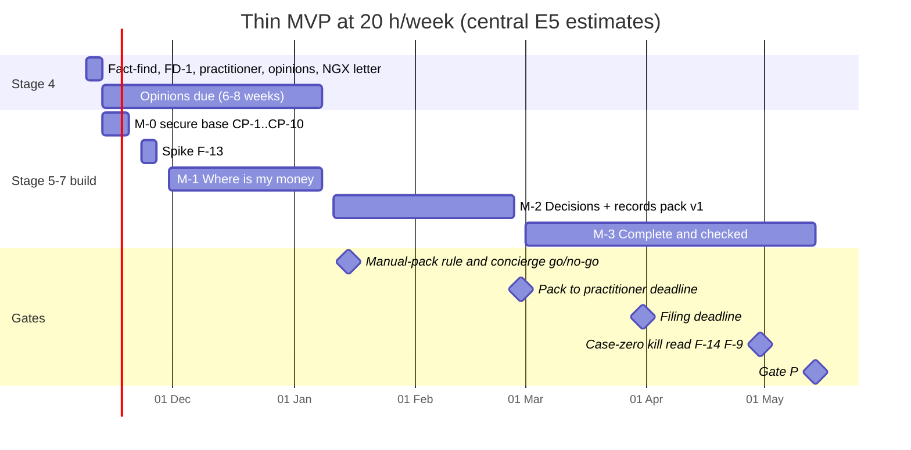
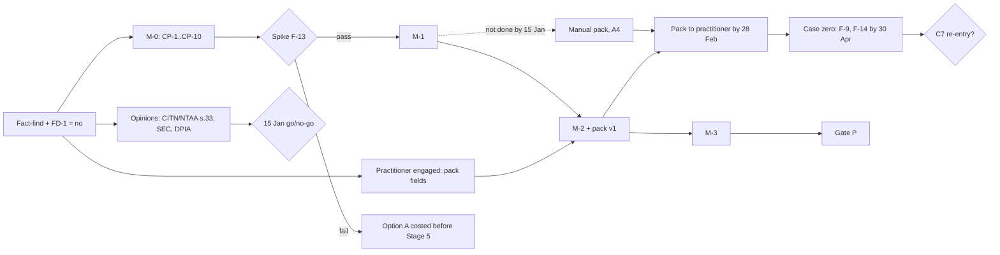

# Document 10 — Engineering and Product Development Roadmap

```
Document: 10 — Engineering and Product Development Roadmap
Department: Engineering and Product  ·  Lead role(s): Chief Technology Officer; Chief Product Officer; QA lead (all simulated, none licensed)
Version: 1.0  ·  Date: 2026-11-04  ·  Status: implements IC decisions, awaiting founder approval
Reviewers required: The founder (approval authority); Head of the Independent Red Team; contracts owner (C1, C3, C5, C8); a CITN-registered tax practitioner (records-pack fields, §3.5); an external security reviewer (CP-12, §5)
```

*This roadmap implements the Investment Committee (IC) memorandum v1.0 (decisions D1–D9). It does not reopen those decisions. Every number comes from the IC memo or from a cited document. Where we did our own arithmetic or made an engineering judgement, it is marked **E5** and states how it will be tested. The calendar arithmetic is in a scratch script (§11, item 12). The authors are simulated roles from the same model family as every other author (Doc 11 §2.3), so nothing here counts as independent review.*

---

## 1. Executive summary

**What is built first.** A reconciled NGN/AED/USD ledger on Beancount + Fava, in this order:
- **M-0**, a security milestone (conditions precedent CP-1 to CP-10);
- **spike F-13**, a 2–3-day falsification test;
- **M-1 "Where is my money?"**, ≈ 3 person-weeks (pw);
- **M-2 "Decisions for the next 90 days"**, +3.5 pw: five reports, a decision log, and **records pack v1 to a CITN-registered practitioner by 28 February 2027**;
- **M-3 "Complete and checked"**, +5.5 pw.

The IC sizes the MVP at ≈ 12 pw (8–18), or 480 hours (IC D1–D2). With the fact-find, M-0 and the spike, our estimate is ≈ 13.4 pw (9.1–19.8, **E5**).

**By when.** The founder's weekly hours are unknown, and this is the biggest uncertainty (IC §1). Every date is therefore given at 10, 20 and 40 hours a week. At **20 h/week**, central estimate (**E5**):

| Milestone | Date at 20 h/week |
|---|---|
| Fact-find | 13 Nov 2026 |
| M-0 | 20 Nov 2026 |
| Spike | 27 Nov 2026 |
| M-1 | 8 Jan 2027, one week before the 15 January manual-pack rule |
| M-2 | 26 Feb 2027, with almost no slack before 28 February |
| M-3 and Gate P | 14 May 2027 |

At 10 h/week the pack is prepared by hand and M-3 leaves the 2027 plan. At 40 h/week the MVP finishes around 10 February 2027.

**Not built yet:** the AI layer (FD-1 = no), the C7 tax engine, the C6 Monte Carlo, investment research and NGX data, risk and optimisation, the statistical matcher, OCR, the claims-ladder engine and a custom UI. Each keeps its contract and a measured re-entry trigger (§4).

**Schedule finding (E5).** At 20 h/week the pre-build work uses almost all of the IC's ≈ 60-hour margin to 28 February. The founder's 2027 filing is protected by the 15 January manual-pack rule (IC D2), not by slack.

---

## 2. Stage map

The IC's sequence fits inside the charter's Stages 4–8 (Doc 2 §8). Stages 5–7 overlap by milestone: each is built (5), validated (6) and used (7) before the next starts, because a single end-of-build gate tests the calendar, not the hypothesis (RT-C B1).

| Charter stage | IC elements | Entry condition | Exit criteria | Review (with independence label, C3.3a) |
|---|---|---|---|---|
| **4 MVP definition** | Fact-find (IC §11); FD-1 = no; practitioner engaged; opinions commissioned; NGX letter; this Doc 10; register (§9); F-1 to F-18 hashed | IC memo issued (2026-11-04) | Founder approves §10 DP-0; Doc 11 §9.1 items 1–9 met | Founder (approval authority). Contracts owner for CC-1 to CC-12 triage (simulated_agent) |
| **5 Engineering implementation** | M-0 → spike F-13 → M-1 → M-2 → M-3 | Stage 4 approval. Code is written only in the development account, against synthetic fixtures (IC D3 tooling rule) | Each milestone's acceptance criteria (§3) pass in CI on synthetic data and in the data account on real data | Founder (self) and coding agents (simulated_agent); nothing independent until CP-12 |
| **6 Testing and validation** | Per-milestone test procedures (§3); falsification tests (§6); the practitioner's recomputation (F-9); second-person checks (F-2, F-4, F-5, F-18) | The milestone is built | Tests pass, or are reported "not run" with the reason (IC D4) | Licensed (F-9, F-14); second_person (if named); CP-12 reviewer |
| **7 Personal deployment and iteration** | Real use from M-1; monthly close; operating-minute log; decision log; **Gate P** | M-1 passes on real data, with CP-1 to CP-10 in place | **Gate P** (IC D2), at 480 logged build hours on M-1 to M-3 or 4 November 2027, whichever is first: (1) every uploaded period reconciles or its gap is named; (2) no figure without source and as-of; (3) pack to the practitioner by 28 Feb 2027; (4) operating minutes measured, ≤ 60 min/month after month 3; (5) ≥ 1 logged decision a month used a report | Founder (self); Red Team head reads the result |
| **8 Commercial validation** | Case zero (F-9, F-14 on the founder's pack); the 15 Jan 2027 concierge go/no-go; S-a pre-orders held; re-dated kill criteria (IC D7) | Opinions received; the case-zero measures exist | Kill or continue under IC D7; earliest kill read 30 April 2027 | IC; counsel; practitioner |

**"480 build hours" (E5; founder to confirm, DP-0)** is counted from the start of M-1, because the fact-find, M-0 and the spike sit outside RT-C's 12 pw (IC D1 table).

---

## 3. Milestone plan

### 3.1 Effort

RT-C gives per-milestone central values only. We derive per-milestone ranges by scaling RT-C's total range of 8–18 against 12 (×0.67 to ×1.5) (**E5**). Measured velocity replaces these after M-1 (RT-C §3).

| Item | Central | Range | Source |
|---|---|---|---|
| Week 0–1 fact-find and engagements | 12.5 h | 10–15 founder hours | RT-C §4.1 |
| M-0 secure base | 24 h (0.6 pw) | 16–32 h | "Hours to days" (Doc 11 §7.1); hours **E5** |
| Spike F-13 | 20 h (0.5 pw) | 16–24 h (2–3 days at 8 h, **E5**) | IC D1 |
| M-1 | 3 pw (120 h) | 2.0–4.5 pw | RT-C §4.2; range **E5** |
| M-2 | 3.5 pw (140 h) | 2.3–5.3 pw | RT-C §4.2; range **E5** |
| M-3 | 5.5 pw (220 h) | 3.7–8.3 pw | RT-C §4.2; range **E5** |
| **Total founder build effort** | **≈ 13.4 pw (536.5 h)** | **9.1–19.8 pw** | IC 480 h + **E5** pre-build |
| External security review (CP-12) | ≈ 1 reviewer-week | — | Doc 7 MVB 10 |
| Second-person checks | ≈ 1 reviewer-week a year | — | IC §10 item 7; RT-B M6 |

### 3.2 Calendar at 10, 20 and 40 hours a week

From Monday 9 November 2026, hours spread evenly over working days, central estimates, with the 20 h/week range from the low and high columns. The founder is assumed to keep the same hours through the December holidays (**E5**; a two-week break moves every later date by two weeks).

| Milestone (cumulative h) | 10 h/week | 20 h/week (range) | 40 h/week |
|---|---|---|---|
| Fact-find (12.5) | 17 Nov 2026* | 12 Nov 2026 | 10 Nov 2026 |
| M-0 (36.5) | 3 Dec 2026 | 20 Nov 2026 (17–24 Nov) | 13 Nov 2026 |
| Spike F-13 (56.5) | 17 Dec 2026 | 27 Nov 2026 (23 Nov–2 Dec) | 18 Nov 2026 |
| M-1 (176.5) | 11 Mar 2027 → **manual pack** | **8 Jan 2027** (21 Dec–3 Feb) | 9 Dec 2026 |
| M-2 / pack v1 (316.5) | 17 Jun 2027; pack by hand by 28 Feb | **26 Feb 2027** (21 Jan–19 Apr) | 1 Jan 2027 |
| M-3 (536.5) | Dropped from the 2027 plan (IC §9, D2) | **14 May 2027** (15 Mar–11 Aug) | 10 Feb 2027 |
| Gate P | 4 Nov 2027 backstop, with M-1 and M-2 only | 14 May 2027 | ≈ 10 Feb 2027; CFO backstop (4 Aug 2027) adopted (IC §9) |

\*The fact-find is calendar-bound to 13 November (IC D2), whatever the hours.

At 20 h/week the high-effort case lands M-1 on 3 February, so the manual-pack rule fires. The founder's filing never depends on software being on time (IC D2).





### 3.3 M-0 — Secure base (Stage 5; before any real or redacted statement)

**Scope.**
- Module 13 (security and access control).
- The C8 retention and erasure model.
- The C3.5 entry check (part of module 14), built here so that CP-9 holds before any FX figure exists. This moves part of M-1's CBN-fetcher effort earlier and adds no hours (**E5**).
- Parser sandboxing (Doc 7 MVB 4, kept by RT-C cut 12).

**Contracts touched:** C8 (I1–I4); C3.5; C3.3a. **Deliverables:** the configuration and check scripts behind each criterion below, a CP-4 boundary note, and a signed CP evidence sheet (§5).

**Acceptance criteria (each is testable):**
- **AC0-1** A scripted inventory of the data account finds no code toolchain, Node or npm, AI coding agent or NEXUS checkout; the only Portfolio OS code is a release matching the lock-file hashes (CP-1).
- **AC0-2** Committing a file that matches the statement or ledger patterns is rejected in every code repository. `git remote -v` in the ledger repository prints nothing (CP-2; D9).
- **AC0-3** After a synthetic import the drop folder is empty and the shred logged; no PDF password exists outside the OS keychain (CP-3).
- **AC0-4** Only 127.0.0.1 sockets are listening. Full-disk encryption reports "on". The Portfolio OS browser profile has zero extensions (CP-5).
- **AC0-5** Every backup object carries exactly one class (C8-I1). A configuration test finds no compliance-mode lock (C8-I4). A read or delete with the host backup key fails. The key-store identity is escrowed with `age -p` or 2-of-3. The stated rotation window is ≤ 30 days. No retention date is displayed (C8-I2) (CP-6).
- **AC0-6** A restore from off-site, using only the escrowed identity, reproduces the synthetic ledger byte for byte within RTO < 4 h (Doc 7 MVB 8, **E5**). After a class is shredded, no generation older than the window yields a readable record of it (C8-I3) (CP-7).
- **AC0-7** An unauthenticated request to Fava, and a request with a foreign Host header, are both refused. A narration containing quotes, newlines, directive keywords and `plugin` text round-trips as data. Otherwise the founder signs acceptance of the residual risk, which is valid only with AC0-1 passed (CP-8).
- **AC0-8** The trap from `doc05c_revision_checks.py` is rejected: a policy rate of 27.50 entered on 2026-03-02 against the primary record. An NFEM value that differs from its snapshot, or a snapshot whose column header is not "NFEM Rate (₦/US$)", leaves the value at `candidate` (CP-9; C3.5; C5.1).
- **AC0-9** After a synthetic statement containing a third party's account number is ingested, a pattern search over the ledger finds only tokens (CP-10).
- **AC0-10** A parse job that tries an outbound connection fails (Doc 7 §4.7.7 item 5).

**Test procedures:** scripted configuration checks, committed to the code repository and run in the data account; the restore and erasure drill on synthetic data; the `doc05c_revision_checks.py` Example C trap as a golden test. These security checks are run by the founder, so they are `self`.

**Dependency:** the fact-find has answered rank 9 (a separate OS account or VM is possible). Without it, no real data is loaded (IC §11).

### 3.4 Spike F-13 — falsify Beancount + Fava (Stage 5)

**Scope:**
- three *redacted* real statements: a Nigerian bank, a UAE bank and a broker (RT-C §4.1);
- beangulp import;
- balance assertions;
- re-import;
- RT-B's proxy and injection checks.

This replaces Doc 7's 5-day ADR-10 spike. The weighted-average plugin criterion is dropped (RT-C M6; IC D1).

**Acceptance criteria:**
- **ACS-1** Every statement period's balance assertion passes, or the gap is named.
- **ACS-2** Re-importing each document, and a re-export with changed narrations, creates zero new postings (C1-I10).
- **ACS-3** No narration escapes into a directive (AC0-7 repeated on real narrations).
- **ACS-4** The proxy and Host-header checks pass on the real configuration.

**Decision rule (pre-registered, Doc 11 §8):** if any check fails, Doc 7's Option A (PostgreSQL C1, 37 pw, range 24–58) is re-costed for the thin scope before M-1 starts. That re-costing is the CTO's dissent made operational (IC D1). The result is recorded as decision D-008.

### 3.5 M-1 — "Where is my money?" (≈ 3 pw)

**Scope:**
- Modules 1 (ledger), 2 (one importer), 3 (validation) and 14 (thin: rate snapshots, user facts);
- Fava as module 12;
- net worth (module 4).

**Contracts:** C1 (D1–D4, I1, I3, I5, I6, I10–I12, C1.8); C3 (three values × independence chip; read-time freshness); C3.5; C5.1–C5.2; C8.

**Deliverables** (RT-C §4.2): the Beancount repository on the C1 account plan (`Equity:Conversion:<C>`, `Assets:InTransit:<id>`, categories as metadata); opening balances; one beangulp importer with the C1.8 line key and document SHA-256; monthly balance assertions for every other account; the CBN NFEM fetcher writing `price` entries with source URL, retrieval time and snapshot hash; net worth in NGN and USD; an operating-minutes log.

**Acceptance criteria:**
- **AC1-1** The invariant checker passes over the whole ledger: exact per-commodity balance (C1-I1); one commodity per asset, liability, conversion and in-transit account (C1-I3); two opposite conversion postings per exchange (C1-I5); at most one account per institution, identifier and commodity (C1-I11).
- **AC1-2** An identical document hash is rejected, and re-import creates no posting (C1-I10). A category change alters only metadata lines (C1-I12).
- **AC1-3** Every account has an opening balance linked to a statement, and a balance assertion at every month-end with a statement.
- **AC1-4** Each net-worth figure prints source, as-of, unit and status chip. A rate more than 2 source business days old shows as stale; more than 10 gives "rate missing" and an incomplete total (C5.2).
- **AC1-5** The outputs of `contracts_checks.py` `c1()` and Doc 7 §4.12(a) (an FX transfer as a C1 exchange) are reproduced as goldens. A real restore succeeds (RT-C §4.2).

**Test procedures:** unit tests of each importer on synthetic fixtures; property-based tests in which a Hypothesis generator writes random synthetic ledgers (exchanges, own transfers, fees, reversals) that the checker must accept, and mutants (an unbalanced leg, a second commodity in a leaf) it must reject; goldens from `contracts_checks.py`, `doc07_tech_checks.py` §4.12(a) and §4.12(e) (duplicate keys against the C1.8 line key) and the three-variant re-import test in `doc04_ledger_worked_example.py`; the SYN-HH-01 household (Doc 5 §8.1) as the shared fixture; and reconciliation of ledger balance to the printed closing balance for every uploaded period.

### 3.6 M-2 — "Decisions for the next 90 days" (+3.5 pw)

**Scope:**
- Module 2: two more importers;
- Module 4: deterministic matcher and five reports;
- Module 5: four L0b measures and the decision log;
- Module 10: records pack v1 and the presence-mode monitors.

**Contracts:** C1.5; C1-I6 and I13; C3.4 (table-level chips); C4 fixed rules (tax-weighted items always reviewed; unknown credits never defaulted to transfers); C7 monitor rules; Doc 3 L0a/L0b templates.

**Deliverables:**

*Matcher.* It proposes pairs by amount or known fee, date window and shared reference. Cross-currency pairs are always reviewed (RT-C M1).

*Five reports.* Each prints its definition, sources and as-of date:
1. conversion cost against the CBN reference;
2. liquidity in months of essential spend, by currency;
3. currency exposure with named devaluation scenarios;
4. fees, levies and recurring charges;
5. unexplained inflows.

*Decision log.* This is Doc 1 A8, and it feeds F-1.

*Records pack v1*, on the practitioner's field list: FX conversions with reference rates; foreign income; days-present evidence; residency facts as user-asserted facts; the US-situs total against USD 60,000; the W-8BEN date; broker documents. Its cover sheet labels each check as self, software, second-person or licensed (IC D4).

**Gap we are making explicit (E5).** Broker importers and FIFO lots arrive only in M-3, but RT-C M3 lists foreign-share lots at NGN cost as a pack item. Pack v1 therefore carries the broker's own statements and a lot schedule the founder prepares by hand, labelled "self-prepared". M-3 automates it for pack v2.

**Acceptance criteria:**
- **AC2-1** No conversion cost appears for an unconfirmed match, or for one whose residual test failed (C1-I13). A conversion outside its band stays in `Suspense:FXUnexplained:<C>`. The bands are in the register (§9).
- **AC2-2** An open in-transit balance older than 10 business days raises a review item. At period end it is reported as an asset (C1-I6).
- **AC2-3** The exposure report reproduces the 2023 unification scenario of −29% on day one and about −39% by 23 June. It is labelled as a historical event, not a forecast (V-016; `doc05b_revision_checks.py`).
- **AC2-4** Each L0b caption equals Doc 3's template text exactly (string equality). A lint rejects trait words and causal verbs from Doc 3's prohibited-output list. No L1 statement exists (IC D8).
- **AC2-5** The fees report includes overdraft and non-sufficient-funds fees, which are the construct 6a trigger (IC D8).
- **AC2-6** The monitors never show a threshold, an amount or "no action needed" while rules 21–22 are draft (C7 presence mode).
- **AC2-7** The pack reaches the practitioner by 28 February 2027, by software or by hand.
- **AC2-8** Matcher recall: F-3 is run on 100 lines drawn from all bank lines.

**Test procedures:** goldens from `doc04_ledger_worked_example.py` (C1.5 residual rule and bands, C4 routing, cash flow at transaction-date rates) and `doc08_journey_figures.py` (transfer-card conversion cost, Journey 3 reserve months); `synthetic_ledger.csv` as the fixture for the recurring-charges and fees reports; reconciliation for each new importer; the F-3 sample.

### 3.7 M-3 — "Complete and checked" (+5.5 pw)

**Scope:**
- Module 2: broker importers;
- Module 1: FIFO lots;
- Module 4: C5 decomposition and the cap audits;
- Module 9: deterministic calculator;
- Module 10: NGN pool-cost view;
- the provenance report, CI, and the close checklist.

**Contracts:** C1-I8 and C1.6; C5.3; C6 (the `required_return` subset only); C3.3a.

**Acceptance criteria:**
- **AC3-1** Lot relief conserves cost exactly (C1-I8). Commission is capitalised (C1.6). Realised profit and loss matches the broker statement within a tolerance held in the register (Doc 6 R5; the tolerance is unknown and set at DP-0).
- **AC3-2** The NGN currency-pool view reproduces the realised gain of NGN 2,544.64 from `contracts_checks.py`. It is labelled "method pending practitioner". It is hidden when the year's recorded residency is non-resident (Doc 11 A4; IC D1 modification 4).
- **AC3-3** The C5.3 identity holds exactly in Fraction arithmetic, and the sign check withholds any figure that fails. The C5.4 golden values from `contracts_checks.py` `c5()` and `doc08_journey_figures.py` agree.
- **AC3-4** The calculator gives the required return (nominal and real) and a contribution table. Every assumption is shown at low, central and high values. An NGN-depreciation input is accepted only from the register, with no default (IC D5). The golden test is `doc05a_worked_examples.py` Example 3.
- **AC3-5** For any figure in a sample, the provenance report gives a document hash and page.
- **AC3-6** The C1 invariants and golden tests run in CI on every change, with line coverage of at least 85% on modules 1–3 (Doc 7 §4.9, **E5** threshold).
- **AC3-7** The CAMF cap and stamp-duty scope audits from `doc04_ledger_worked_example.py` pass as golden tests. This is Doc 4 R5, scheduled here (**E5** placement).
- **AC3-8** The monthly close checklist records minutes and includes a check of the re-entry register (IC D1 preservation rule).

**Not in any MVP milestone: the C2 fresh adversarial round.** It belongs to CP-11 (§5) and runs only when a model is proposed for the figure path.

---

## 4. Module plan

The founder's 13 modules are Doc 7 §4.3 modules 1–13. Module 14 (registries and user-asserted facts) was added in Doc 7 v0.2 (R07 M7) and is included here because C3.5 lives in it. Docs 1–9 remain the frozen target specification. Each deferred item is listed in a re-entry register that is checked at every monthly close. No item leaves the vision without a founder decision in the log (IC D1).

| # | Module | MVP status | Milestone | Governing doc and contract | Interface in the MVP | Deferred part, with measured re-entry trigger |
|---|---|---|---|---|---|---|
| 1 | Financial ledger | **Built** (Beancount) | M-1, M-3 | Doc 4, Doc 6; C1 | `.beancount` files in the local ledger repository; an external C1 invariant checker | Bitemporal soft state and a PostgreSQL C1 build. Trigger: a second user or a hosted tier (RT-C cut 1), or F-13 fails |
| 2 | Data ingestion | **Thin** | M-1, M-2, M-3 | Doc 4 R1; C1.8 | beangulp importers (identify, account, extract; E3, not re-verified) in a no-network sandbox | OCR, Docling and local-model extraction: > 3 scanned statements a month. Bank APIs: open banking live plus a 60-day shadow test (Doc 4 R10) |
| 3 | Data validation | **Thin** | M-0, M-1 | Doc 7; C3, C3.5 | Balance assertions; document hash; line key; three status values × independence chip | C3 axes L, R, I and C at the first licensed feed (RT-C cut 10) |
| 4 | Financial analytics | **Built (thin)** | M-1 to M-3 | Doc 4 R6; C5, C1.5 | Report scripts over beanquery; each prints definition, source and as-of | Statistical matcher: > 50 own transfers a month. C4 calibration: when model suggestions are introduced. Budgets (Doc 4 R9, Later). Income-stream forecast (Doc 4 R7): re-enters with module 9 (**E5** trigger) |
| 5 | Behavioural intelligence | **Thin**: four L0b reports and the decision log | M-2 | Doc 3; Doc 3 templates; C8 class B | Fixed-caption reports; a decision-log file | Claims ladder and construct 6: shortfall cost > 0 and one confirmed income stream, after the F-6 placebo test. Construct 5: tokenisation plus consent machinery. Questionnaires: when module 8 re-enters (V-039) |
| 6 | Investment research | **Deferred**. Holdings are valued from broker or CSCS statements with as-of dates | — | Doc 5a, 5c; C2, C3, C3.5 | — | A pending investment decision above a founder-set share of liquid net worth, or NGX trading more than monthly (IC D1) |
| 7 | Portfolio optimisation | **Deferred**. No optimiser in Phase 1 (Doc 5 §1) | — | Doc 5b; C5 | — | Only after module 8 re-enters and Doc 5's stability gate passes (Doc 5 rec 10) |
| 8 | Risk management | **Thin**: exposure table, named devaluation scenarios, FIFO lots | M-2, M-3 | Doc 5b; C5 | Exposure report | Risk metrics: > 10 positions, or the founder asks (RT-C cut 3). Monte Carlo goes with C6 |
| 9 | Financial planning | **Thin**: deterministic calculator | M-3 | Doc 5b, Doc 4; C6 (`required_return`) | A calculator report reading the register | C6 Monte Carlo: all six IC D5 conditions (including F-7 and F-8). The planning module re-enters after the goal engine (System E) does |
| 10 | Tax calculations | **Thin**: records pack, presence-mode monitors, pool view | M-2, M-3 | Doc 6; C7, C1.6 | A pack export plus a cover sheet | C7 engine: F-14 shows a priced saving **and** F-9 passes (IC D1) |
| 11 | AI reasoning | **Deferred** (FD-1 = no) | — | Doc 7; C2 | — | F-15: at least 10 unanswerable questions a month for 2 months, **then** CP-11 and CP-12 |
| 12 | User interface | **Thin**: Fava plus five reports | M-1 | Doc 8 | Fava on 127.0.0.1 behind a proxy | React app, nine-area information architecture, 15 screens and WCAG 2.2 AA work on our own UI: second user (RT-C cut 14) |
| 13 | Security and access control | **Built** (M-0 baseline) | M-0 | Doc 7 §4.7; C8 | Data account; proxy; backups | Passkeys and CSP work, and the external review: first remote access, AI layer or second user (RT-C cut 12; CP-12) |
| 14 | Registries and user facts | **Thin**: CBN snapshots, peg fact, user-asserted residency facts, the assumption register | M-0 to M-3 | Docs 5c, 6, 8; C3.5 | A snapshot store with hashes; versioned fact files | Licence registry, security master and corporate-action records: first licensed feed or module 6 |

**How every Personal-MVP must-have from the departments is handled.**

| Doc | Scheduled | Deferred (trigger in the module table) |
|---|---|---|
| 3 | R2 L0b views (M-2); R6 standing order with disclaimer (M-2); R4 in part (C8 classes, tokenisation, M-0) | R1 claims ladder; R3 construct 6 (6a fees in M-2 are its trigger); R4 consents and sensitive-inference register; R5 questionnaires |
| 4 | R1 (M-1, M-2); R2 (M-1; pool view M-3); R4 (M-1, M-2); R5 fees (M-2), cap audits (M-3); R6 net worth, liquidity, Fava cash flow; R8 fact-find | R3 Fellegi–Sunter; R5 classifier and C4 calibration; R6 savings rate (**E5**: founder asks); R7 forecast |
| 5 | Rec 1 as C3 three values + C3.5 + freshness; Rec 3 as exposure and scenarios; Rec 4 NGX letter; Rec 9 fixture | Rec 1 C2 tokens; Rec 2 filter and C6; Rec 3 TWR/MWR, risk; Recs 5–8 |
| 6 | R1; R3 residency facts with review flags (pack); R4 practitioner (F-9); R5 lots (M-3); R6 monitors, presence mode (M-2); R7 pack, no submission (M-2) | R2 C7 engine (CEO dissent, §10) |
| 7 | R1 spike and ledger; R2 as CP-1 to CP-10; R3 sandboxed ingestion; R4 thin | R2 external review moved to CP-12 (CTO dissent, §10); R5 AI; R6 risk |
| 8 | R1 as report footers (source, as-of, chip); R4 C5 (M-3); R5 residency record; R7 retention classes (M-0) | R1 Working panel; R2 onboarding; R3 with C6; R6 IA; R8 WCAG on own UI; R9 L1 card |

---

## 5. Conditions precedent CP-1 to CP-12

**Owners.** "Founder" means the founder does the work and records the evidence. "CTO" means this department specifies the check script. Every founder verification is `self` (C3.3a). Only CP-12 is independent.

| # | Condition (IC D3) | Owner | Verification method | Gates |
|---|---|---|---|---|
| ☐ CP-1 | Dedicated OS account or VM: no development tools, no AI coding agents, no NEXUS checkout; installed from a hash-pinned release | Founder; CTO script | AC0-1 inventory script; hash comparison against the lock file | M-0 exit → any redacted statement (spike) |
| ☐ CP-2 | Data directory outside every repository and agent working directory; pre-commit block; ledger repository with no remote | Founder | AC0-2 rejected test commit; `git remote -v` is empty; path check | M-0 exit |
| ☐ CP-3 | Shredded drop folder; no statements left in Downloads or email; PDF passwords nowhere, or in the keychain | Founder | AC0-3 shred log; search of the data account | M-0 exit |
| ☐ CP-4 | The statement-receiving email account is inside the system boundary | Founder | Boundary note listing the account and its recovery routes (**E5**: the content of the note) | M-0 exit |
| ☐ CP-5 | Full-disk encryption; screen lock; services on 127.0.0.1; dedicated browser profile with no extensions | Founder | AC0-4 | M-0 exit |
| ☐ CP-6 | C8 live before the first backup: per-class recipients; no compliance lock; governance mode only with the bypass credential in escrow; write-only host key; escrow by `age -p` or 2-of-3; rule 34 gates nothing; window ≤ 30 days stated | Founder; contracts owner | AC0-5; C8-I1, I2, I4 tests | M-0 exit → first real backup |
| ☐ CP-7 | One tested restore and one erasure drill | Founder | AC0-6; C8-I3 | M-0 exit (synthetic); repeated at M-1 on real data |
| ☐ CP-8 | Fava behind an authenticating proxy with a Host-header check, and an injection test passing; or signed acceptance of the residual risk (with CP-1 in place) | Founder; CTO | AC0-7, then ACS-3 and ACS-4 | M-0 exit; confirmed at the spike |
| ☐ CP-9 | C3.5 entry check live on the CBN "NFEM Rate" field | CTO; founder | AC0-8 (the R0 trap, and header and value mismatch) | Before any FX-derived figure (M-1) |
| ☐ CP-10 | Counterparty identifiers tokenised at ingest | CTO | AC0-9 | M-0 exit |
| ☐ CP-11 | Before any model enters the figure path: a fresh C2 adversarial round with new strings, written by someone other than C2's author; RT-B tests (i)–(vi); a value-blind model | Red Team head (commissions); a third party writes the strings | Harness reports 0 PASS, with n and a 95% upper bound (0 of 200 gives ≈ 1.5%); T2-17 to T2-19 | AI layer re-entry; any hosted extraction |
| ☐ CP-12 | External security review, ≈ 1 reviewer-week | Founder (engages); reviewer | Findings report; critical findings closed (Doc 7 §4.7.7 item 2) | Network exposure, AI layer or a second user. **Not** M-1 (CTO dissent, §10) |

---

## 6. Testing and validation strategy (Stage 6)

**Principle.** A test nobody can run is reported as "not run", never as passed (IC D4). Doc 1 §9 criteria that are "not measurable for n = 1" (RT-C m2) are restated: transfer precision and recall become F-3; categorisation accuracy is measured only on income, transfers, fees and tax-weighted lines (RT-C m6); the 20-minute review becomes ≤ 60 min/month in total (IC D1).

| Area | What we test | How | Pass criterion | Who |
|---|---|---|---|---|
| **Accuracy** | Ledger integrity; reconciliation; conversion cost; pool and lots; decomposition | C1 property tests; goldens from `research/scripts/`; reconciliation per uploaded period; F-2 blind rebuild | 0 invariant failures; every period reconciles or its gap is named (F-16); F-2 ≤ 2% value-weighted disagreement and no tax-weighted error | Self; F-2 needs a second person |
| **Model reliability** | The surviving models only: residual bands, matcher rules, calculator, freshness thresholds, devaluation scenarios | Register entries with low/central/high values (§9); F-3; F-10 after 3 months | A low/high span that changes a decision is shown as such (U12); F-3 missed-value upper bound ≤ 5% | Self |
| **Behavioural-inference limits** | No L1 output; verbatim templates; no trait words or causal verbs; no behavioural sentence from any model | AC2-4 lint and string-equality tests; F-11 after 6 months | Zero non-template behavioural sentences | Self. F-6 is not run (construct 6 deferred). No within-person trial: power is 0.36 at twelve months (IC Q3) |
| **UX (n = 1)** | Task success; minutes; comprehension of reports and calculator | Doc 8 Phase 1 on Fava: task tests (success, time, SEQ); SUS at start and week 8 (descriptive); opt-in two-question diary for 8 weeks; minute log | Unassisted task success ≥ 90% by week 4 (indicative, Doc 8 §4.9); ≤ 60 min/month after month 3 | Independent facilitator if a second person exists; else "self, not independent" |
| **Security** | CP-1 to CP-10; weekly `pip-audit`; hash-pinned installs; sandbox has no network | Scripted checks at M-0 and at each release | All pass; CP-12 when triggered | Self; CP-12 is external |
| **Completeness** | Accounts covered; inflows explained; deferrals kept | Monthly assertion per account; unexplained-inflows report; re-entry register at each close | No account without an assertion; no deletion without a log entry (U16) | Self |
| **Badge density** | Detection at default density against reduced density | F-18 seeded errors in a labelled replica | Apply the materiality threshold if default density detects worse | Second person |

**Falsification tests.** These are pre-registered and hashed before their data exist (Doc 11 §8, §9.1 item 8). The SHA-256 of this table, of §9 and of the decision rules goes into the decision log at DP-0 (**E5** procedure).

| # | Starts | Fails if | Pre-registered decision rule | Who | MVP status |
|---|---|---|---|---|---|
| F-1 | M-2 (decision log) | < 3 decisions changed in 6 months, or value < hourly value × hours | Freeze new modules; keep only reports that changed a decision | Self | Run; needs the founder's hourly value (IC fact 13) |
| F-2 | Quarterly from M-2 | > 2% disagreement, or any tax-weighted error | No pack leaves until fixed. The IC majority lets pack v1 leave first, with disclosure (Red Team head dissent, §10) | 2P | "Not run" unless a person is named |
| F-3 | M-2 | Missed transfer value > 5% (upper 95% bound) | Matcher totals marked "incomplete" | Self | Run |
| F-4, F-5 | Quarterly from M-2 | Catch rate < 90%; > 1 seeded error approved a quarter | Feature freeze; control labelled ineffective | 2P | Labelled replica only (Doc 11 §7.1) |
| F-6 | — | Placebo interval overlaps payday | Demote to L0b | Self | Not applicable (deferred) |
| F-7, F-8 | — | Same decision in every case; any rise in the count | C6 stays Later; C6 refuses to display | Self | Gate for C6 re-entry only |
| F-9 | Pack v1 (Feb 2027) | Material difference outside `disputes[]` | Rules revert to `draft`; no C7 engine | L | Run by 30 Apr 2027 |
| F-10 | M-1 + 3 months | `fresh` error rate not below `ageing` | Re-set thresholds from data | Self | Run |
| F-11 | M-2 + 6 months | Below the founder's threshold | Remove from the monthly review | Self | Run |
| F-12 / F-17 | M-1 | > 60 min/week for 4 weeks, or backlog > 30 days; success ≤ 60 min/month | Cut the lowest-value control; a miss means no new module | Self | Run |
| F-13 | Spike | A period fails, re-import duplicates, or a narration escapes | Option A costed before Stage 5 | Self | Run |
| F-14 | Pack v1 | Saving < ≈ 2 practitioner hours a case | No C7 engine | L | Run |
| F-15 | M-1 | < 10 unanswerable questions a month for 2 months | AI stays deferred | Self | Run (a question log) |
| F-16 | Every close | Unnamed gap, or a figure without source and as-of | Stop the close until fixed | Self | Run |
| F-18 | After M-2 | Default density detects worse | Apply the materiality threshold | 2P | "Not run" without a person |

---

## 7. Resource plan

**Founder hours.** Unknown (IC fact 1). The plan needs build, operate and sell hours as three separate numbers.

The operating load is not settled. RT-B counts ≈ 130–150 h a year for the full package. Its MVP-relevant lines (weekly `pip-audit` ≈ 26 h; restore drills ≈ 12 h in year 1; review queue ≈ 5–15 h; snapshot and calibration chores up to ≈ 20 h) total ≈ 43–73 h a year (our arithmetic, **E5** selection). That already exceeds the ≤ 60 min/month target (12 h a year). We keep the disagreement open as Doc 11 §7.1 resolves it: one chore list, all logged, measured for four weeks after M-1, with F-12 deciding which control to cut. We do not reclassify chores to make the target pass.

**External roles.**

| Role | When | What | If unavailable |
|---|---|---|---|
| CITN-registered practitioner | Engaged by 13 Nov 2026 | Agrees pack fields; receives pack v1 by 28 Feb; recomputes Doc 6 Examples 1–3 and the real year (F-9); logs hours with and without the pack (F-14); answers C1.6; two quotes (IC D4) | The founder must still file; the pack is built anyway; F-9 and F-14 "not run"; C7 cannot re-enter |
| Nigerian counsel: CITN s.16/s.19 and NTAA s.33; SEC perimeter; light DPIA | Commissioned by 13 Nov; due in 6–8 weeks, so 25 Dec 2026 to 8 Jan 2027 | Opinions for D7 | A late opinion blocks; it does not kill. The concierge moves to the 2028 season (IC D7, U9) |
| UAE counsel | Only if UAE residents are to be approached | Decree-Law 33/2025 perimeter | No UAE residents are approached |
| External security reviewer | Before network exposure, an AI layer or a second user | ≈ 1 reviewer-week (CP-12) | The MVP stays local. The AI layer and second users stay blocked |
| Second person, or a paid reviewer under a confidentiality agreement | Quarterly from M-2 | F-2, F-4, F-5, F-18; Phase 1 facilitator; ≈ 1 reviewer-week a year | Tests reported "not run". After pack v1, the Red Team head's rule binds later packs (IC §9, D4) |
| Python contractor | Only if the founder lacks Python (IC fact 12) | The build | Cost unknown; without one D1 is reopened |

**Money (IC D6).** The recurring ceiling is ≤ USD 5 a month (Backblaze B2: first 10 GB free, 50 GB $0.28), with no NGX licence, US data or AI. Ceilings after a trigger each need their own approval: NGX at its written quote (reference points $26.33–$791.67, sensitivity to $1,416.67); AI at $141.64 a month with per-workspace limits; Tiingo at $30. One-off fees (practitioner, counsel, security review) are paid against quotes inside Doc 9's Stage 0 envelope of USD 10–20k. Development tooling is outside the ceiling. Without funding for the fees (IC fact 7), F-9, F-14 and CP-12 cannot happen, and the plan becomes a personal tool with "not run" labels (A3).

---

## 8. Risks to the schedule and their triggers

| # | Risk | Trigger (measured) | Response | Owner |
|---|---|---|---|---|
| S1 | Hours too few (U1) | M-1 not done by 15 Jan 2027 | Manual pack (A4); re-plan on the hours index | CEO, founder |
| S2 | Pre-build work or unworked holiday weeks consume the 20 h/week margin (**E5**) | Fact-find + M-0 + spike > 60 h logged, or < 50% of planned hours logged 21 Dec–1 Jan | Dates move by the hours lost; M-2 scope held; the 15 Jan rule unchanged | CTO, founder |
| S3 | Statements do not parse (U3) | F-13 fails, or > 3 scanned statements a month | Manual entry checked by balance assertions; Option A costed | CTO |
| S4 | Beancount + Fava insufficient (U4) | F-13 fails | Option A, 37 pw (24–58), re-costed for the thin scope before Stage 5 | CTO |
| S5 | Proxy costs more than planned | CP-8 work > 0.5 pw with CP-1 done | The founder may sign acceptance of the risk (IC §9, D3) | CTO |
| S6 | Practitioner not engaged in November | No engagement by 13 Nov | Pack fields drafted from Doc 6 R7 and confirmed later; F-9 and F-14 slip | CFO |
| S7 | Opinions late (U9) | Not in hand by 15 Jan | 2028 season for the concierge | CEO |
| S8 | Concierge competes for founder hours (CPO dissent) | Go/no-go passes on 15 Jan | The founder chooses against hours; M-3 moves after the season (**E5**) | CPO |
| S9 | Operating burden (U10) | > 60 min/week for 4 weeks | Cut the lowest-value control (F-12) | CPO |
| S10 | Ledger goes stale (U20) | Close skipped for 2 months | F-16 stop rule; minute log | CPO |
| S11 | Scope creep from the dissents | A C7 rule set, the C6 engine or an NGX feed is added without its trigger | Refused unless the founder logs a decision (§10) | Chair |
| S12 | Tax law moves (U18), or the research freeze is breached | Re-gazetting notice; a new research document with no consuming module | Freeze exception for re-gazetting only; otherwise stop (four IC exceptions apply) | CFO, chair |

---

## 9. Model and assumption register (V-036)

**Purpose and scope.** V-036 found ≈ 220 E4/E5 parameters with no owner or test. IC D5 overrules V-036's "before Stage 5" timing: a scoped register is required **before Stage 4 sign-off**, covering only the models that survive D1. Everything else is marked "deferred with module".

**Schema** (IC D5 fields plus identifiers): `id`; `model or module`; `parameter`; `value(s)` (low/central/high where relevant); `owner`; `source`; `as-of`; `evidence grade` (E1–E6); `sensitivity` (low/central/high effect on the output); `test`; `materiality tier` (tax and net worth tier 1, behaviour tier 3); `review date`; `status` (C3 value × independence chip); `deferred-with-module` flag. The register is a versioned file in the code repository, holds no personal data, and changes only by new version (**E5** form).

**Initial entries.** "Unknown" means a value the founder or a professional must supply. We do not invent one.

| id | Model / parameter | Value | Source | Grade | Test | Tier | Owner |
|---|---|---|---|---|---|---|---|
| A-01 | C1 conventions: per-commodity exact balance; conversion and in-transit accounts; categories as attributes | As specified | C1 D1–D4 | E4/E5 | C1-I1, I3, I5, I12 | 1 | Contracts owner |
| A-02 | C1.5 one-sided bands | NGN→USD or NGN→AED [−1.0%, +4.0%]; AED↔USD [0%, +1.5%]; USD or AED→NGN via a money transfer operator [−3.0%, +4.0%] | C1.5 | E5 | Recalibration only from ≥ 30 band-independent exchanges per pair | 1 | CTO |
| A-03 | C1.5 rule-1 tolerance | q × ½ minor unit of R + ½ minor unit of G | C1.5 | E5 | AC2-1 | 1 | CTO |
| A-04 | C5 rate hierarchy | CBN "NFEM Rate (₦/US$)", `nfem_vwap`; AED/USD peg 3.6725 as a registered fact; AED/NGN exact cross | C5.1 (CBN page fetched 2026-11-04) | E2 (field) | AC0-8 | 1 | Data quality |
| A-05 | FX freshness | Stale > 2 source business days; expired > 10; month-end = last fixing on or before the last calendar day | C5.2 | E5 | F-10 | 1 | Data quality |
| A-06 | In-transit age | Review at 10 business days | C1-I6 | E5 | AC2-2 | 1 | CTO |
| A-07 | Matcher rules | Amount or known fee; date window (**unknown**); shared reference; cross-currency always reviewed | RT-C M1 | E5 | F-3 | 1 | CTO |
| A-08 | Badge materiality threshold | **Unknown**, founder to set | IC D1; Doc 8 C4 Q1 | E5 | F-18 | 1 | CPO |
| A-09 | Essential spend | Trailing 6-month median of `is_essential` categories per currency; "essential" confirmed by the founder; target user-set, with 3–6 months labelled "convention" | Doc 4 §4.4.2; Doc 3 construct 3 | E3/E4 | Stability within ±0.2 months between consecutive months (Doc 4 R6) | 1 | CPO |
| A-10 | Devaluation scenarios | 2023 unification: −29% day one, ≈ −39% by 23 June. Others **unknown** | V-016; Doc 5b v0.2 | E2 (via Doc 5b) | AC2-3 | 1 | CIO |
| A-11 | Weighted-average currency pool | Method pending practitioner (C1.6 questions i–iv); residency-gated | C1.6; Doc 6 rule 28 | E4, pending L | AC3-2; F-9 | 1 | CFO |
| A-12 | FIFO lots, commission capitalised | Pending practitioner | C1.6 | E4, pending L | AC3-1 | 1 | CFO |
| A-13 | Broker realised-P&L tolerance | **Unknown** | Doc 6 R5 | — | AC3-1 | 1 | CFO |
| A-14 | Statement-valuation freshness for holdings | **Unknown** (no feed thresholds apply) | Doc 5c table not applicable | — | F-10 | 1 | Data quality |
| A-15 | C8 windows | Key rotation ≤ 30 days; class B 24 months; class A 12 months; escrow locations **unknown** (founder) | C8 | E5 | C8-I3, I5 | 1 | CTO |
| A-16 | Backup targets | RTO < 4 h; RPO < 24 h; drills monthly in Q1, then quarterly | Doc 7 MVB 8 | E5 | AC0-6 | 1 | CTO |
| A-17 | Operating-time targets | Success ≤ 60 min/month after month 3; kill > 60 min/week for 4 weeks, or backlog > 30 days | RT-C M2; RT-A F-12 | E5 | F-12 / F-17 | 3 | CPO |
| A-18 | Calculator assumptions | Return, inflation and NGN-depreciation inputs at low/central/high: **unknown**; registered and sourced; no default | IC D5 | — | AC3-4 | 1 | CIO |
| A-19 | L0b value threshold | ₦ value set by the founder after a 3-month baseline | Doc 3 Rec 2 | E5 | F-11 | 3 | CBSO |
| A-20 | Case-zero thresholds | F-14 ≈ 2 practitioner hours a case; pack price ≈ $100 (Doc 9 §4.4) | IC D7 | E5 | F-14 | — | CFO |
| A-21 | Founder's hourly value | **Unknown** | IC fact 13 | — | F-1 | — | Founder |
| A-22 | CI coverage threshold | ≥ 85% on modules 1–3 | Doc 7 §4.9 | E5 | AC3-6 | — | QA lead |
| A-23 | Recurring data ceiling | ≤ USD 5 a month | IC D6 | — | Monthly cost log | — | CFO |

---

## 10. Decision points and what the founder must approve

| DP | When | Founder approves |
|---|---|---|
| **DP-0 Stage 4 sign-off** | By 13 Nov 2026 | In the IC's order (IC §10): (1) D1 + D2: the modified thin MVP, the research freeze, Gate P and the manual-pack rule; (2) D3: CP-1 to CP-12 and FD-1 = no; (3) the practitioner and opinions; (4) D7: case zero and the go/no-go; (5) D6: USD 5 a month and the NGX letter; (6) D5: C6 deferred and the register; (7) D4: a named second person or a paid reviewer; (8) D8; (9) D9: the repository; (10) D-007 and D-008. Also: the fact-find answers; this roadmap; the §9 register with its "unknown" values filled or accepted as unknown; the hashed F-tests; our reading of the 480 hours (§2) |
| DP-1 M-0 exit | ≈ 20 Nov (20 h) | That redacted statements may be loaded. If CP-8 is not met, a signed acceptance of the residual risk |
| DP-2 Spike result | ≈ 27 Nov | D-008 confirmed, or Option A re-costed |
| DP-3 Opinions received | 25 Dec–8 Jan | Any change to the perimeter; the founder-only rule stays until counsel opines |
| DP-4 Go/no-go | 15 Jan 2027 | The concierge (only if all four IC D7 conditions hold) against hours; the manual pack if M-1 is late |
| DP-5 Pack v1 | By 28 Feb 2027 | The cover sheet's independence labels; sending pack v1 before F-2 has run |
| DP-6 Case-zero read | 30 Apr 2027 | C7 stays deferred, or re-enters (F-14 and F-9) |
| DP-7 Gate P | 480 M-1 to M-3 hours, or 4 Nov 2027 | Pass, redesign or re-plan (IC D2) |
| DP-8 Every monthly close | Monthly | Any re-entry trigger that fired; its module scope and spending ceiling |

**Dissents that the founder could adopt instead (preserved from the IC).**

| Dissent | Effect on this plan if adopted |
|---|---|
| CTO: "spike, then choose"; CP-12 before the first real statement | ≈ 1 reviewer-week before M-1; M-1 moves by the reviewer's lead time |
| CEO: a minimal C7 rule set in M-3 | Adds 4–8 pw (RT-C M3, **E5**), which breaks the 20 h/week dates |
| CIO: C6 in M-3; the NGX non-display line at $103.78 | Breaks F-8 today, and exceeds the USD 5 ceiling |
| CFO: Gate P backstop on 4 Aug 2027 | Binding at ≤ 10 h/week; adopted anyway at ≥ 40 h/week |
| Red Team head: no pack before F-2 | Pack v1 needs a named second person by February |
| YC operator: drop CP-8 and CP-10; concierge in 2027 | Saves M-0 hours; CP-10 protects third parties (majority) |
| CPO: no concierge in 2027; co-locate code in this repository | Removes S8. D9 becomes a directory here, under CP-1 and CP-2 |
| CBSO: pre-register construct 6; ask the 7 items | Allowed as a document only; no build hours |

---

## 11. Sources

All are internal documents under `/home/user/Terminal-/docs/portfolio-os/`, read on 2026-11-04. No web sources were fetched for this roadmap.

1. `00_CONTEXT_BRIEF.md` v0.2 §1, §5, §7.
2. `decisions/INVESTMENT_COMMITTEE_MEMO.md` v1.0, in full (D1–D9, U1–U20, §9–§11).
3. `reviews/RT_C_product_complexity_commercial.md`, in full.
4. `11_independent_red_team_review.md` §1, §4(d), §7–§10.
5. `CANONICAL_CONTRACTS.md` v0.2: C1.2–C1.8, C2.3, C3.2–C3.5, C4, C5.1–C5.3, C6, C7, C8.
6. `07_technology_and_open_source_report.md` v0.2 §1, §4.3, §4.7.1, §4.7.7, §4.8 (ADR-10), §4.9, §4.13, §8, §9.
7. Docs 3 §8; 4 F15, §4.4.2, §8; 5 §10; 6 §1, §8, §9; 8 §4.9, §8, §9.
8. Doc 1 §6.1, §9, §10; Doc 2 §8 (stage gates).
9. `reviews/RT_B_security_privacy_regulation.md` B2 tests (i)–(vi), B4, M2, M6, §6.
10. `reviews/REVISION_LOG.md` V-016, V-033–V-037, V-040, V-041, V-043; `decisions/DECISION_LOG.md` D-007–D-018.
11. `research/scripts/README.md` and the golden scripts named in §3 (read, not re-run, for this document).
12. Calendar arithmetic (**E5**): `doc10_calendar.py` in the session scratchpad, not committed. It spreads hours over Monday–Friday from 9 November 2026 using §3.1's values, and gives 160/320/640 hours to 26 February 2027 at 10/20/40 h/week, matching the IC D2 table.
